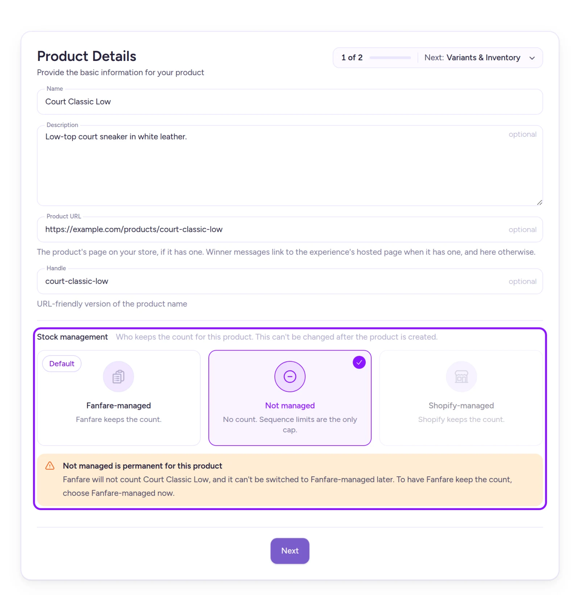

A product is anything an experience sells or gives access to. You add it to Fanfare once, with its variants, prices and images, and then attach it to as many experiences as you like. The one choice on this page that you cannot take back is **Stock management**, who keeps the count of how many units exist: read [Manage stock](/guide/create/stock) before you create the product.

{/* image: products-list */}

## Before you start

- Decide who should keep the stock count for this product. See [Manage stock](/guide/create/stock#choose-who-keeps-the-stock-count).
- If the product comes in sizes, colours or other options, [set those options up](#set-up-variant-options) under **Settings → Variant Options** first.
- Have your images ready as JPEG, PNG, GIF or WebP files of up to 50 MB each.

## Create a product

1. Open **Products** and select **Create Product**.
2. On **Product Details**, enter a **Name**. **Description**, **Product URL** and **Handle** are optional. The handle fills in from the name until you edit it.
3. Under **Stock management**, choose **Fanfare-managed** (the default) or **Not managed**. **Shopify-managed** is shown but cannot be picked: a product becomes Shopify-managed only when it comes in from Shopify. If your organisation takes payment outside Fanfare, the section offers no choice and every product you create is **Not managed**. See [Manage stock](/guide/create/stock) for what each option means.

<Warning>
  **Stock management** cannot be changed after the product is created. A product created as **Not managed** can never become **Fanfare-managed**, so Fanfare will never count it or stop a drop selling more units than you have. If you choose wrongly, the only way out is to create the product again with the right choice. Product names must be unique, so either [delete the old product](#delete-a-product) first or give the new one a different name.
</Warning>

4. Select **Next**. On **Media**, drag in your images or select them from your computer. This step is optional.
5. Select **Next**. On **Variants & Inventory**, choose **Simple product** for a product with one price and one SKU, or **Product with variants** for sizes, colours or other options.
6. Fill in the variant details. For a simple product, enter the **SKU**, the **Price**, and then **Opening stock** (Fanfare-managed) or **Quantity** and **Inventory policy** (Not managed). On a Not managed product, **Quantity** and **Inventory policy** do not cap sales; see [Manage stock](/guide/create/stock). For variants, see [Add variants](#add-variants).
7. Select **Create**.

Fanfare shows **Product created** and returns you to the Products list. Open the new product from there to add more.

<Frame caption="Choosing Not managed shows a reminder that the choice cannot be undone.">
  
</Frame>

<Note>
  The wizard keeps your progress in the browser tab while you work. Images you add on **Media** are lost if you refresh the page before you select **Create**, and the whole draft is lost if you close the tab.
</Note>

## Autofill from a store link

If the product already has a page on an online store, Fanfare can fill in the name, description, images and variants from it for you to check.

<Info>Available on Growth and above. On Starter you can type the link, but the **Autofill** button stays disabled and an upgrade prompt shows below it.</Info>

1. On **Product Details**, paste the full link, starting with `https://`, into **Product page link**.
2. Select **Autofill**. If you have already entered anything, Fanfare asks **Replace what you've entered?** first: Autofill replaces the details, images and variants in the form. Select **Replace and autofill** to go ahead.
3. Wait while Fanfare reads the page. This usually takes 15 to 40 seconds.
4. Read the **Needs your decision** list, if one appears, and act on each item.
5. Check every step of the wizard, choose **Stock management** yourself, and select **Create**. The product exists only once you select **Create**.

| Limit | Value |
| --- | --- |
| Autofills per organisation | 25 a day, and 3 a minute |
| Images copied | Up to 12 |
| Variants kept | Up to 100. Fanfare tells you how many it found and keeps the first 100. |
| Options worked out from the page text | Up to 3 |

**Needs your decision** lists what Autofill could not settle for you, for example:

- The store prices in a different currency from yours, so prices were left blank. Enter every price yourself.
- An option of yours is locked, so values it does not allow, and the variants that use them, were left out.
- A product with the same name already exists. Change the name before you create this one.
- The variants came from the page text, or could not be confirmed and the product was set up as a simple product. Check each variant and its price, or add variants on the last step.

<Note>
  Autofill adds any option it does not recognise, and any new value for an option that is not locked, to your organisation's variant options straight away. They stay under **Settings → Variant Options** even if you cancel the wizard.
</Note>

If Autofill fails, the message says why. It can say Autofill is not available at the moment, even on a plan that includes it. You can always fill in the form yourself.

## Add variants

A variant is one version of the product that a customer can buy, such as the medium in black, with its own SKU and price.

### Set up variant options

Options such as Size or Colour, and their values such as M or Black, are shared by every product in your organisation. Manage them under **Settings → Variant Options**.

1. Select **Add Option**, enter a **Name**, and select **Create**. Or select **Use Template**, choose a category such as Clothing or Footwear, choose the options you want, and select **Apply Options (N selected)**.
2. Add values to each option. You can edit, reorder and delete them. You cannot delete a value that any product's variants use, even though the confirmation says those variants will not be affected.
3. Drag options into the order you want.

You cannot delete an option while products use it.

If you follow the **Create option** link from the wizard's option picker to **Settings → Variant Options**, any images you added on **Media** are lost.

### Add variants to a product

On **Variants & Inventory** in the wizard, or in the **Variants** card on an existing product:

1. On an existing product that already has variants, select **Edit options** first. Under **Options**, pick the options this product uses, then pick or type values for each. **Add all** adds every value of an option. A value you type that does not exist yet is added to your organisation's options straight away. On an existing product, the values you pick are kept only until you leave the page: create the variants that use them before you go.
2. Check **SKU format** and its **Preview**. The format must include every option you picked, or Fanfare cannot generate distinct SKUs.
3. Select **Create all N** to make every combination at once, or **Create your first variant** to add them one at a time. Once the product has a variant, **Add Variant** adds another.
4. Give every variant a **Price** and an **SKU**. Each SKU must be different within the product, and SKUs are case-sensitive.

{/* image: products-create-variants */}

On an existing product, **Create N missing** makes the combinations you do not have yet. Fanfare asks you to confirm and then saves them straight away, each with the first variant's price (or 0.00 if there is none) and a stock of 0. Check prices and stock afterwards.

Options and values that a variant uses cannot be removed from the product.

### Prices

If your organisation takes payment through Fanfare checkout, every price must be something your currency can charge: no more than two decimal places (whole amounts for currencies such as JPY and HUF), and not below the smallest charge for your currency, for example 0.50 in USD or EUR and 0.30 in GBP. A price of 0 is always allowed. With an external checkout processor these limits do not apply.

## Add and arrange images

- In the wizard, add images on **Media**. Images found by Autofill already appear there.
- On an existing product, select the + tile under the gallery and choose files from your computer. Each upload saves straight away.
- Reorder by dragging thumbnails. The first image is the product's main image.
- Remove an image by pointing at the large preview and selecting the bin icon that appears in its corner.

<Note>
  Removing an image from an existing product deletes it immediately. There is no confirmation and no undo.
</Note>

## Edit a product

Open the product from **Products**. You can rename it directly in the page heading, which saves at once, or change **Name**, **Description**, **Product URL** and **Handle** in the form and save from the bar that appears. Saving the form takes you back to the Products list.

<Warning>
  Price and SKU changes reach experiences that offer the product, including live ones. While a pre-authorised drop that holds one amount for everything on offer includes the product, Fanfare refuses any price other than the drop's amount until the drop has ended and its payment windows have closed. Deleting the experience also lifts the refusal.
</Warning>

With Fanfare checkout, a customer pays the price in force when they first submit payment, so a customer in a payment window who has not yet submitted payment pays the new price. Auction winners pay their winning price.

## Field reference

| Setting | What it does | Default | Can you change it once it is live? |
| --- | --- | --- | --- |
| **Name** | The product's name. It must be different from the names of your other products. | None (required) | Yes |
| **Description** | Text describing the product. | Empty | Yes |
| **Product URL** | The product's page on your store. Winner messages link here when the experience has no [hosted page](/guide/create/hosted-page). | Empty | Yes |
| **Handle** | A web-address-friendly version of the name. | Made from the name | Yes |
| **Stock management** | Who keeps the stock count. See [Manage stock](/guide/create/stock). | **Fanfare-managed** (Fanfare checkout); **Not managed** (external checkout) | No. Fixed when the product is created. |
| **SKU** | The variant's identifier. Must be different for each variant of the product. | None (required) | Yes |
| **Price** | What a customer pays for the variant. | None (required) | Yes, and the change reaches live experiences, except where a pre-authorised drop holds the price. |
| **Opening stock** | Fanfare-managed only. The units you start with. See [Manage stock](/guide/create/stock). | 0 | No. See [Manage stock](/guide/create/stock). |
| **Quantity** | Not managed only. A number for your reference. See [Manage stock](/guide/create/stock). | 0 | Yes |
| **Inventory policy** | Not managed only: **Untracked (always available)**, **Deny when out of stock**, or **Continue selling (allow oversell)**. See [Manage stock](/guide/create/stock). | **Deny when out of stock** | Yes |

## Delete a product

Select **Delete** on the product page, or **Delete** (**Delete product** in card view) in a product's menu on the list.

Fanfare refuses while any experience that has not ended offers the product, draft experiences included, and lists those experiences. A sequence is one way in to an experience. Fanfare also refuses while a sequence that offers the product is still finishing, for example with customers still in line or in a payment window, and while a live sequence holds counted stock of the product. End the experiences, remove the product from them, or delete the ones you no longer need, then delete the product.

<Note>
  Deleting cannot be undone: the admin offers no way to restore a deleted product. Variants can be deleted one at a time only on **Not managed** products, and never the product's last variant.
</Note>

## On Shopify

In the Fanfare app in Shopify, products come from your Shopify catalogue:

- There is no **Create Product** button. Products come in through Shopify's product picker wherever Fanfare asks for a product, whole products only and up to 20 at a time.
- The name, description, product URL, handle and variants of a Shopify product are read-only in Fanfare. Change them in Shopify admin, then select **Sync from Shopify** on the product page.
- The product page has **Sync from Shopify** in place of **Delete**.
- The **Variants** card is not shown for Shopify products.

{/* image: products-shopify-product-detail */}

For picking, re-syncing, image copies, **Source missing** and refused syncs, see [Products from Shopify](/guide/shopify/products). To start from a product in Shopify admin, see [Fanfare inside Shopify admin](/guide/shopify/in-shopify-admin).

## Troubleshooting

<AccordionGroup>
  <Accordion title="The product won't delete">
    An experience that has not ended still offers it, or a sequence that offers it is still finishing. See [Delete a product](#delete-a-product).
  </Accordion>
  <Accordion title="Autofill left the prices blank">
    Either the store prices in a different currency from your organisation's, or the page did not give one price for each variant. Enter each variant's price before you select **Create**.
  </Accordion>
  <Accordion title="Create all N doesn't make my variants">
    The **SKU format** leaves out one of the options you picked. Add every option to the format under **Edit options**, then try again.
  </Accordion>
  <Accordion title="An option won't delete in Variant Options">
    The message names the products that use it. On each one, select **Edit options** and clear the option under **Options**. You cannot clear an option that the product's variants use; for such a product, the only way to free the option is to [delete the product](#delete-a-product).
  </Accordion>
</AccordionGroup>

## Related

<CardGroup>
  <Card title="Manage stock" href="/guide/create/stock">Choose who keeps the stock count, and record stock changes.</Card>
  <Card title="Create an experience" href="/guide/create/experiences">Attach your product to a drop.</Card>
  <Card title="Allocate stock to a drop" href="/guide/create/stock-allocation">Give an experience its units and split them across sequences.</Card>
  <Card title="Products from Shopify" href="/guide/shopify/products">How Shopify products reach the Fanfare app in Shopify.</Card>
</CardGroup>
