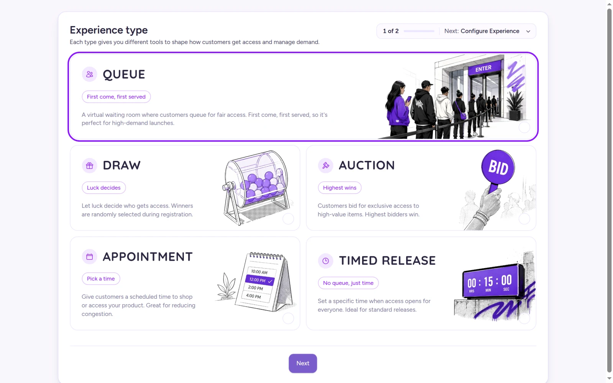
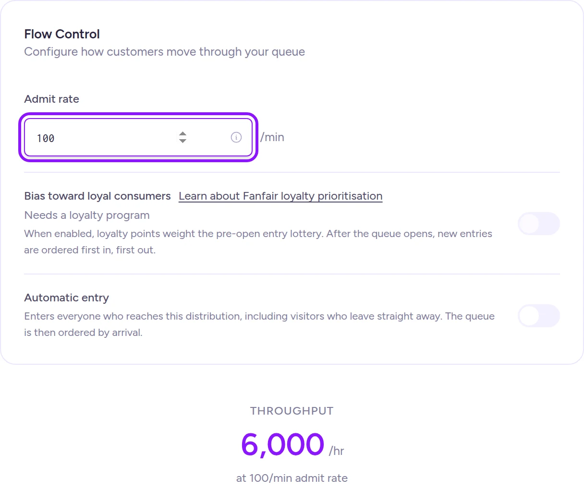
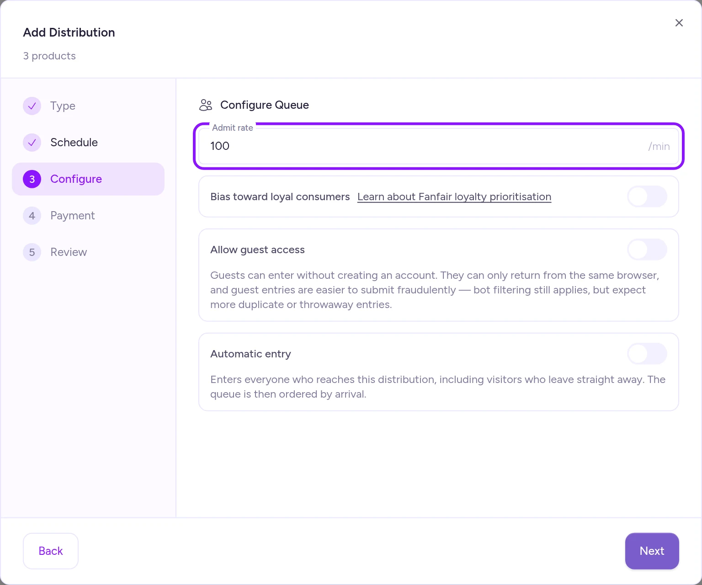

A queue admits shoppers in order at a steady pace you control, keeping high-demand drops from overwhelming your checkout. You can create a queue with a new experience or add one to a sequence in an existing experience.

Not sure if a queue is the right format for your drop? Read [Queue](/concepts/distributions/queue) first.

## Before you start

- Have at least one product ready in Fanfare. See [Add products](/guide/create/products).
- To use **Pre-authorise on joining**, you need **Fanfare checkout** and a connected Stripe account. See [Payments and fees](/guide/account/payments).
- To use **Bias toward loyal consumers**, turn on your loyalty program first (Pro and above). See [Run a loyalty program](/guide/learn/loyalty).

Queues are available on every plan, including Starter.

## Create a queue with a new experience

The experience wizard builds your experience, its first sequence, and the queue in one flow. Shared steps—products, naming, schedule defaults, **Stock**, and **Review & launch**—are covered in [Create an experience](/guide/create/experiences). Here's what's specific to a queue:

<Steps>
  <Step title="Choose Queue">
    Open **Experiences**, select **Create Experience**, and choose **Queue**.
  </Step>
  <Step title="Set your schedule and stock">
    Complete **Configure Experience** and **Stock**. **Opens At** defaults to the next minute—adjust it if you aren't ready to launch right away, because keeping it opens the queue immediately and locks **Payment collection** as soon as you finish.
  </Step>
  <Step title="Configure queue pacing">
    On **Queue Configuration**, under **Flow Control**, set your **Admit rate** (how many shoppers enter per minute). Check the **Throughput** estimate below it to see your hourly pace, then optionally turn on **Bias toward loyal consumers** or **Automatic entry**.
  </Step>
  <Step title="Choose how customers pay">
    On **Payment**, choose **Pay when admitted** or **Pre-authorise on joining** under **Payment collection**. Review [Payment collection](#payment-collection) before deciding.
  </Step>
  <Step title="Set guest access and launch">
    On **Access**, select **Anyone, as a guest** under **Open to everyone** if you want shoppers to join without signing in. Review your setup on **Review & launch**, then select **Create experience**.
  </Step>
</Steps>

<Frame caption="Select Queue to start a paced, first-in-line release.">
  
</Frame>

There's no separate publish or launch step—your queue opens automatically at the **Opens At** time you set.

<Frame caption="Set your admit rate and check the hourly throughput before continuing.">
  
</Frame>

## Add a queue to an existing sequence

Use this when you want to add another release window—like a second wave later in the day—to an experience you've already created.

1. Open your experience, then select the sequence you want to add to.
2. On the **Overview** tab, select **Add distribution** in the **Distributions** card (or **Create Distribution** at the top of the page).
3. Enter a **Name**, select **Queue**, and click **Next**.
4. Set **Opens**, **Closes**, and **Time zone** (defaults to the experience's time zone), then select **Next**.
5. On **Configure**, set **Admit rate** and toggle **Bias toward loyal consumers**, **Allow guest access**, or **Automatic entry** as needed, then select **Next**.
6. On **Payment**, choose your **Payment collection** option and select **Next**.
7. Review your settings and select **Create Distribution**.

You can also reuse an existing queue's setup by selecting **Duplicate** from its card—the copy keeps your settings with cleared dates. See [Add and gate sequences](/guide/create/sequences).

<Note>
  **Schedule rules:** Opening times can't be in the past, and distributions in the same sequence can't overlap—if they do, **Schedule conflict** flags the overlapping window before you can continue. Before **Opens**, shoppers see a countdown (or whichever earlier distribution is currently active). To run two distributions at the same time, place the second one in a new sequence—keeping in mind that sequence routing priority follows creation order and can't be reordered in the admin. See [Distributions](/concepts/distributions/overview) and [Sequences and routing](/concepts/sequences).
</Note>

<Frame caption="When adding a queue to an existing sequence, guest access appears as a toggle on the Configure step.">
  
</Frame>

## Queue settings

| Setting | What it does | Default | Editable once live? |
| --- | --- | --- | --- |
| **Admit rate** | Shoppers admitted per minute (up to 10,000). | 100 | Yes |
| **Bias toward loyal consumers** | Weights line order before opening so shoppers with more loyalty points have better odds of an earlier spot. Doesn't affect anyone who joins after **Opens**. | Off | Yes, but changing it after open won't reorder anyone—it only affects whether waiting shoppers see their exact spot in line. |
| **Allow guest access** (**Anyone, as a guest** in the wizard) | Lets shoppers join without signing in. | Off | Yes, unless the sequence is gated to an audience (audience sequences require sign-in). |
| **Automatic entry** | Automatically enters everyone who lands on the queue, including visitors who leave right away. | Off | Yes |
| **Payment collection** | Whether shoppers pay at checkout (**Pay when admitted**) or place a card hold up front (**Pre-authorise on joining**). | **Pay when admitted** | No—locks about 5.5 minutes before **Opens**. |
| **Authorization amount** | Card hold amount when using **Pre-authorise on joining**. | None | No—locks with **Payment collection**. |
| **Opens** | When the queue begins admitting shoppers. | Wizard: next minute; **Add distribution**: none | Until about 5.5 minutes before **Opens**; after that, only earlier. |
| **Closes** | When the queue stops admitting shoppers. | Wizard: 7 days after **Opens At**; **Add distribution**: none | Yes, until the queue closes. |
| **Name** | Internal name in the admin. | Wizard: experience name; **Add distribution**: none | Yes, until the queue closes. |
| **Time zone** (**Time Zone** in Edit) | Zone used to display and enter times. Changing it doesn't shift the actual open or close moment. | Experience's time zone | Yes, until the queue closes. |

A few details worth knowing as you configure your queue:

- **Admit rate floor:** The wizard requires an admit rate of at least `1`. **Add distribution** and **Edit** accept `0`, but an admit rate of `0` lets nobody in—use **Pause queue** if you need to pause admissions during a live drop.
- **Loyalty bias:** Requires your loyalty program to be active—otherwise the toggle stays disabled. See [Loyalty and Fanfair](/concepts/loyalty) for how points affect queue order.
- **Guest access trade-offs:** Guests can only return to their spot from the same browser, and open guest access tends to attract more duplicate or throwaway entries than email sign-in. See [Customers and identity](/concepts/customers) and [Sequences and routing](/concepts/sequences).
- **Payment window and line size:** Every admitted shopper gets a fixed **30-minute payment window** (not configurable for queues), and the admin has no setting to cap queue length. See [Admission and the payment window](/concepts/admission-and-payment).

### Payment collection

- **Pay when admitted:** Shoppers complete checkout within their 30-minute payment window after being admitted.
- **Pre-authorise on joining:** Fanfare places a hold for the **Authorization amount** (in your organization's currency) when a shopper joins. The hold is captured automatically if they're admitted and released if they aren't. The authorization amount must exactly match the product's price, and because card holds expire after about 7 days, keep your queue window well under a week. See [Admission and the payment window](/concepts/admission-and-payment).

Pre-authorization requires **Fanfare checkout** and a connected Stripe account. If you use external checkout, shoppers pay in your own store and Fanfare skips payment collection entirely. See [Checkout options](/concepts/checkout-options).

<Note>
  **Pre-authorise on joining** isn't available when shoppers in the sequence still have to choose between multiple products or variants. To pre-authorize a multi-option drop, run it as a [draw](/guide/create/draw) or limit the sequence to a single product and variant.
</Note>

<Warning>
  **Payment collection** and **Authorization amount** lock about **5.5 minutes before Opens**—not at the open time itself. Moving **Opens** earlier never unlocks them. To change how payment is collected after they lock, you'll need to **Deactivate** the queue (which can't be undone) and create a new one. Double-check both settings before launch.
</Warning>

## Edit a queue

To update a scheduled or live queue, open the sequence's **Overview** tab, select **Edit** on the queue card, adjust **Schedule**, **Configuration**, or **Payment**, and select **Save**.

- **Live edits apply immediately:** While a queue is live, **Save** takes effect right away with no confirmation prompt. See [Change things mid-drop](/guide/drop/live-controls).
- **Opening-time lock:** Starting about 5.5 minutes before **Opens**, the open time can only move earlier—you can still adjust **Closes** until the queue ends.
- **Closed or deactivated queues:** Once a queue closes, it can't be edited (including its **Name**)—create a new queue instead. Deactivated queues become read-only (**View** replaces **Edit**). See [Stop a drop](/guide/drop/deactivate).

<Frame caption="Payment collection locks shortly before the queue opens and can't be changed afterward.">
  
</Frame>

Need to temporarily halt admissions during a live drop? Use **Pause queue**—see [Change things mid-drop](/guide/drop/live-controls).

## What customers see

For how line order works under the hood, see [Queue](/concepts/distributions/queue). For a walkthrough of every screen shoppers see from countdown to checkout, see [What your customers see](/guide/drop/what-customers-see).

## On Shopify

Queues work the same way in the Shopify app, with one difference: shoppers pay in Shopify's checkout, so **Pre-authorise on joining** isn't available.

Make sure checkout protection is enabled and the Fanfare product widget is published on your theme before doors open—otherwise shoppers can bypass the queue. See [Storefront setup](/guide/shopify/storefront-setup).

## Troubleshooting

<AccordionGroup>
  <Accordion title="I can't continue past the Schedule step">
    Your queue overlaps another distribution in the same sequence, flagged under **Schedule conflict**. Adjust the dates so the queue starts after the other distribution ends (back-to-back windows are fine), or add the queue to a separate sequence.
  </Accordion>
  <Accordion title="Bias toward loyal consumers is grayed out">
    Your loyalty program is turned off. Enable it under **Loyalty** (available on Pro and above), then return to your queue settings.
  </Accordion>
  <Accordion title="I can't change Payment collection">
    **Payment collection** locks about 5.5 minutes before the queue opens. Deactivate the queue and create a new one with the payment method you want.
  </Accordion>
</AccordionGroup>

## Related

<CardGroup>
  <Card title="Queue" href="/concepts/distributions/queue">
    How queues work and when to choose one.
  </Card>
  <Card title="Allocate stock to a drop" href="/guide/create/stock-allocation">
    Control how many units a queue can sell.
  </Card>
  <Card title="Change things mid-drop" href="/guide/drop/live-controls">
    Pause a queue or adjust pacing while it's live.
  </Card>
  <Card title="What your customers see" href="/guide/drop/what-customers-see">
    Every stage of the queue from the shopper's side.
  </Card>
  <Card title="Watch a live drop" href="/guide/drop/watch-live">
    What each metric on the live queue card means.
  </Card>
  <Card title="Stop a drop" href="/guide/drop/deactivate">
    Deactivate or delete a queue.
  </Card>
</CardGroup>
