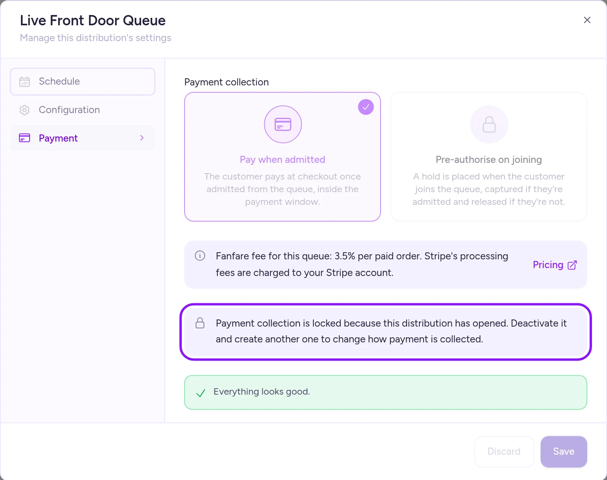

A queue lets customers in, in order, at a steady rate. You set how many people it lets in each minute, so a limited release does not flood your checkout. A sequence is one way in to an experience, and a queue always belongs to one sequence. To decide whether a queue is the right distribution for your drop, read [Queue](/concepts/distributions/queue) first.

## Before you start

- You have at least one product to sell. See [Add products](/guide/create/products).
- **Pre-authorise on joining** needs a connected payment provider and Fanfare checkout. See [Payments and fees](/guide/account/payments).
- **Bias toward loyal consumers** needs your loyalty programme turned on. Loyalty is available on Pro and above. See [Run a loyalty programme](/guide/learn/loyalty).

Queues are available on every plan, including Starter.

## Create a queue with a new experience

The experience wizard creates the experience, its first sequence and the queue in one go. The steps every experience shares, including products, name, time zone, **Opens At**, **Closes At**, **Stock** and **Review & launch**, are in [Create an experience](/guide/create/experiences). These are the steps that are specific to a queue.

1. Open **Experiences** and select **Create Experience**.
2. On **Experience type**, select the **Queue** card. The wizard moves to the next step on its own.
3. Complete **Configure Experience** and **Stock**. **Opens At** starts at the next minute. If you keep it, the queue takes customers straight away and **Payment collection** locks as soon as you create it: see [Create an experience](/guide/create/experiences).
4. On **Queue Configuration**, under **Flow Control**, set **Admit rate**, and turn on **Bias toward loyal consumers** or **Automatic entry** if you want them. The **Throughput** figure shows how many people the queue lets in per hour at that rate.
5. On **Payment**, choose how customers pay under **Payment collection**. Read [Payment collection](#payment-collection) before you choose.
6. On **Access**, under **Open to everyone**, select **Anyone, as a guest** to let customers join without signing in. This is where the wizard sets guest access for a queue.
7. On **Review & launch**, check each row and select **Create experience**.

<Frame caption="Selecting the Queue card moves the wizard to the next step.">
  
</Frame>

The experience gets one sequence named after the experience, holding your queue. There is no separate launch step: once you select **Create experience**, the queue is scheduled to open at the time you set.

<Frame>
  
</Frame>

## Add a queue to an existing sequence

Use this to add a queue to an experience you have already created, for example a second window later in the day.

1. Open the experience, then open the sequence.
2. On the **Overview** tab, in the **Distributions** card, select **Add distribution**. **Create Distribution** at the top of the page does the same.
3. Enter a **Name**, choose **Queue**, and select **Next**.
4. Set **Opens**, **Closes** and **Time zone**, then select **Next**. The time zone starts as the experience's time zone.
5. On the **Configure** step, set **Admit rate**, and turn on **Bias toward loyal consumers**, **Allow guest access** or **Automatic entry** if you want them. Select **Next**.
6. Under **Payment**, choose the **Payment collection** option. Select **Next**.
7. Check the review and select **Create Distribution**.

The queue appears in the **Distributions** card. To copy an existing queue instead, use **Duplicate**; the copy's dates are cleared. See [Add and gate sequences](/guide/create/sequences).

You cannot choose an opening time that has already passed: earlier times are greyed out, and a time that has passed by the time you continue is refused with "This time has passed. Choose a time from now on."

Distributions in one sequence cannot overlap in time: if they do, the panel under the dates shows **Schedule conflict**, naming the distribution in the way, and you cannot continue. See [Distributions](/concepts/distributions/overview). Until **Opens**, customers see a countdown to the queue, or the earlier distribution in the sequence while that one is still open. To run a queue at the same time as another distribution, put it in a second sequence. A new sequence ranks after the ones created before it, because priority follows creation order and cannot be changed in the admin. See [Sequences and routing](/concepts/sequences) and [Add and gate sequences](/guide/create/sequences).

<Frame caption="When you add a queue to a sequence, guest access is a switch on the Configure step.">
  
</Frame>

## Queue settings

| Setting | What it does | Default | Can you change it once it is live? |
| --- | --- | --- | --- |
| **Admit rate** | How many people the queue lets in each minute, up to 10,000. | 100 | Yes. |
| **Bias toward loyal consumers** | Gives customers with more loyalty points a better chance of an early place among those who joined before the queue opened. It has no effect on anyone who joins after it opens. | Off | Yes, but it only affects the order of people who join before **Opens**. Changing it after the queue opens reorders no one, though it changes whether waiting customers see their exact place in line. |
| **Allow guest access** (in the wizard: **Anyone, as a guest**) | Lets customers join without an account. | Off | Yes, unless the sequence has an audience. A sequence with an audience requires sign-in, so it cannot be turned on there. |
| **Automatic entry** | Puts everyone who reaches the queue into it, including visitors who leave straight away. | Off | Yes. |
| **Payment collection** | When the customer pays: **Pay when admitted** or **Pre-authorise on joining**. | **Pay when admitted** | No. It locks about five and a half minutes before **Opens**. |
| **Authorization amount** | The amount held on the customer's card with **Pre-authorise on joining**. Required with that option. | None | No. It locks with **Payment collection**. |
| **Opens** | When the queue starts letting people in. | In the wizard, the next minute; in **Add distribution**, none | Yes until about five and a half minutes before **Opens**. After that, only earlier. |
| **Closes** | When the queue closes. | In the wizard, seven days after **Opens At**; in **Add distribution**, none | Yes, until it closes. |
| **Name** | The queue's name in the admin. | In the wizard, the experience's name; in **Add distribution**, none | Yes, until the queue closes. |
| **Time zone** (in the settings dialogue: **Time Zone**) | The zone the times are shown and entered in. Changing it does not move **Opens** or **Closes**. | The experience's time zone | Yes, until the queue closes. |

**Admit rate** in the wizard must be at least 1. When you add or edit a queue, it accepts 0, and a queue at 0 lets no one in.

**Bias toward loyal consumers** cannot be turned on while your loyalty programme is off: the switch shows "Needs a loyalty program". How points weight the order is in [Loyalty and Fanfair](/concepts/loyalty).

Guests can join without an account, but they can only come back from the same browser, and guest access brings more duplicate or throwaway entries than sign-in. See [Customers and identity](/concepts/customers). How guest entry works across a sequence is in [Sequences and routing](/concepts/sequences).

Each customer who is let in has 30 minutes to pay, and you cannot change this payment window for a queue. See [Admission and the payment window](/concepts/admission-and-payment).

The admin has no setting for how many people can wait in a queue.

### Payment collection

- **Pay when admitted**: "The customer pays at checkout once admitted from the queue, inside the payment window."
- **Pre-authorise on joining**: "A hold is placed when the customer joins the queue, captured if they're admitted and released if they're not." Set the **Authorization amount** too, in your organisation's currency. It must equal the product's price, and card holds last about a week, which limits how long the queue can stay open: see [Admission and the payment window](/concepts/admission-and-payment).

Without a connected payment provider, **Pre-authorise on joining** cannot be selected. If your customers pay in your own checkout, there is no choice to make: the step reads "Customers pay in your own checkout, so Fanfare collects no payment for this queue." See [Checkout options](/concepts/checkout-options).

<Note>
  **Pre-authorise on joining** is refused while customers in the sequence still choose between products or variants: "A queue can't pre-authorize a card when consumers still have a product to choose. Run this as a draw, or leave the sequence with a single product and variant."
</Note>

<Warning>
  **Payment collection** and **Authorization amount** lock about five and a half minutes before **Opens**, not at **Opens** itself. After that the admin shows "Payment collection is locked because this distribution has opened. Deactivate it and create another one to change how payment is collected." Deactivating cannot be undone, so check these two settings before the queue opens.
</Warning>

## Edit a queue

On the sequence's **Overview** tab, select **Edit** on the queue's card. The settings are in three sections: **Schedule**, **Configuration** and **Payment**. Make your change and select **Save**.

While the queue is live, **Save** applies the change with no confirmation step: see [Change things mid-drop](/guide/drop/live-controls).

From about five and a half minutes before **Opens**, **Opens** shows **Locked** and can only move earlier: "This Queue has opened, so its open time can only move earlier. You can still change when it closes." Rescheduling **Opens** never unlocks **Payment collection** again. Once the queue has closed, you cannot save any change to it, even to its **Name**: **Save** is refused with "This queue has closed. Create a new queue." A deactivated queue is read only, and its card shows **View** instead of **Edit**. See [Stop a drop](/guide/drop/deactivate).

<Frame caption="Payment collection locks shortly before the queue opens and cannot change after that.">
  
</Frame>

To stop admissions for a while during a live drop, use **Pause queue**: see [Change things mid-drop](/guide/drop/live-controls).

## What customers see

How a queue orders customers is in [Queue](/concepts/distributions/queue). For each stage of their journey, from the countdown to checkout, see [What your customers see](/guide/drop/what-customers-see).

## On Shopify

You set up a queue the same way in the Fanfare app in Shopify, with one difference: customers pay in Shopify's checkout, so the **Payment** step shows the own-checkout message from [Payment collection](#payment-collection) and you cannot choose **Pre-authorise on joining**.

The queue does not protect your product until checkout protection is on and the product widget is on your theme. See [Storefront setup](/guide/shopify/storefront-setup).

## Troubleshooting

<AccordionGroup>
  <Accordion title="I can't select Next on the Schedule step">
    The window overlaps another distribution in the same sequence, and the panel under the dates names it: "This window overlaps ...". Choose a window that starts after the other one ends, or add the queue to another sequence.
  </Accordion>
  <Accordion title="Bias toward loyal consumers is greyed out">
    Your loyalty programme is off. Turn it on in **Loyalty**, which is available on Pro and above, then come back to the queue.
  </Accordion>
  <Accordion title="I can't change Payment collection">
    It locked about five and a half minutes before the queue opened. Deactivate the queue and create a new one with the payment collection you want.
  </Accordion>
</AccordionGroup>

## Related

<CardGroup>
  <Card title="Queue" href="/concepts/distributions/queue">What a queue is and when to choose one.</Card>
  <Card title="Allocate stock to a drop" href="/guide/create/stock-allocation">How many units the queue can sell.</Card>
  <Card title="Change things mid-drop" href="/guide/drop/live-controls">Pause a queue and change settings while it runs.</Card>
  <Card title="What your customers see" href="/guide/drop/what-customers-see">Each stage of the queue from the customer's side.</Card>
  <Card title="Watch a live drop" href="/guide/drop/watch-live">What each number on the live queue card means.</Card>
  <Card title="Stop a drop" href="/guide/drop/deactivate">Deactivate and Delete.</Card>
</CardGroup>
