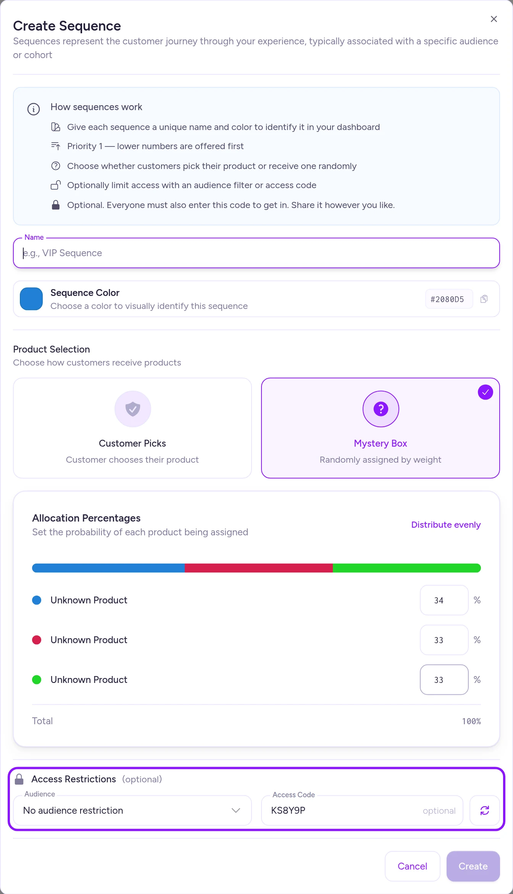
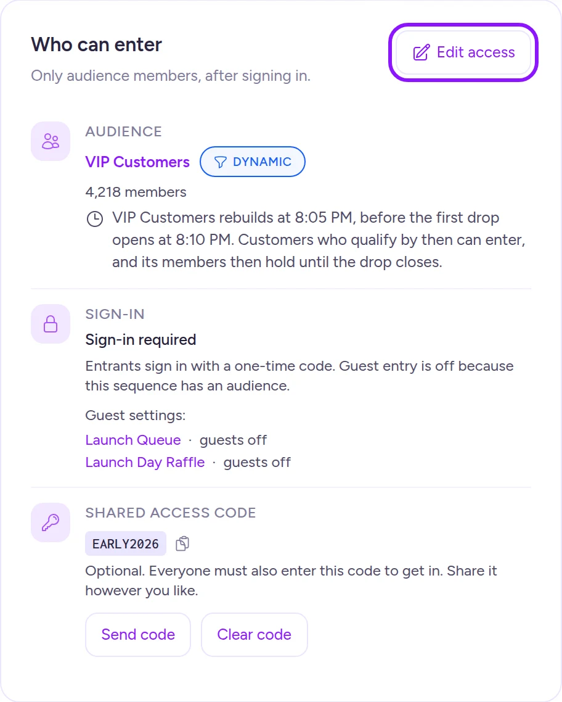
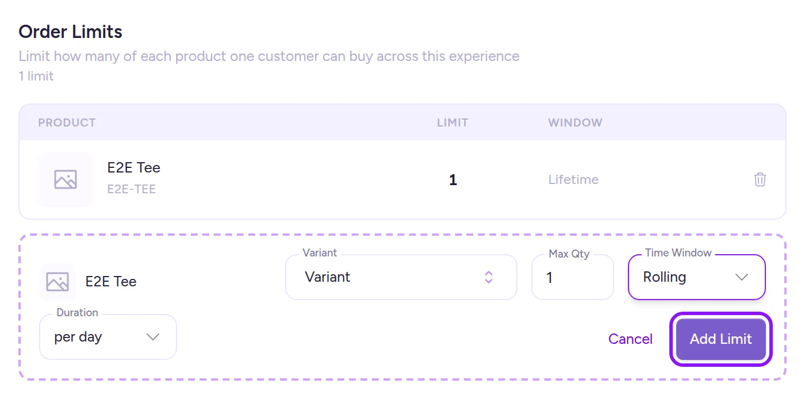

A sequence is one way in to an experience. The experience wizard already made the first one. Add another when a group of customers should get in on different terms, for example your best customers first, or anyone holding a code you handed out. For when you need more than one sequence and how Fanfare picks one for each customer, see [Sequences and routing](/concepts/sequences).

## Before you start

- The experience exists and has not been fully deactivated. Once every distribution in an experience is deactivated, **Add sequence** is hidden: create a new experience instead.
- To gate a sequence by audience, the audience must already exist. Building audiences needs Growth or above: see [Build audiences](/guide/create/audiences). Sequences, access codes and order limits are on every plan, and so is choosing an audience you already have for a sequence.

## Create a sequence

1. Open the experience. On **Overview**, find the **Sequences** card and select **Add sequence**.
2. Enter a **Name** and pick a **Sequence Color**. A colour is filled in for you.
3. If the experience has two or more products, choose a **Product Selection**:
   - **Customer Picks** (the default): the customer chooses their product.
   - **Mystery Box**: Fanfare assigns a product at random by weight. Set the **Allocation Percentages**, or select **Distribute evenly**. The last product's percentage is worked out for you. Give every product a share above 0%.
4. Optionally, under **Access Restrictions (optional)**, pick an **Audience**, enter an **Access Code** of up to 32 characters, or select the generate button beside the code box (its tooltip reads **Generate access code**) to create one. An audience chosen here keeps guest entry off on every queue, draw and timed release you add, and sets up an invite email when you add the first distribution. This dialogue warns you about neither: see [Choose who can enter](#choose-who-can-enter).
5. Select **Create**.

<Warning>
  Create sequences in the order customers should be offered them. Each new sequence gets the next priority number, and priority cannot be changed in the admin. See [Sequences and routing](/concepts/sequences).
</Warning>

The new sequence appears on the **Sequences** card as Draft, with the next priority chip (for example **P2**) and its own waitlist.

If you leave a product at 0%, the sequence is still created but none of its Mystery Box weights are saved, and you see "Sequence created, but product weights could not be saved. Edit the sequence to set weights." Set them as described in [Product selection and Mystery Box](#product-selection-and-mystery-box).

<Frame caption="Mystery Box and its percentages appear only when the experience has two or more products.">
  
</Frame>

## Add a distribution to the sequence

A sequence needs at least one distribution (a queue, draw, auction, timed release or appointment) before customers can get in.

1. Open the **Add Distribution** dialogue from any of these:
   - **Add distribution** on the sequence's row in the **Sequences** card, while the sequence is still Draft;
   - **Create Distribution** at the top of the sequence page, or in the row's menu on the **Sequences** card;
   - the dashed **Add distribution** row in the sequence page's **Distributions** panel;
   - **Duplicate** in an existing distribution's menu, which copies it.
2. Work through the steps: **Type**, **Schedule**, **Configure**, **Payment** (queues and draws only), then **Review**.
3. Select **Create Distribution**.

The sequence leaves Draft. The fields in **Configure** and **Payment** differ by type: see [Set up a queue](/guide/create/queue), [Set up a draw](/guide/create/draw), [Set up an auction](/guide/create/auction), [Set up a timed release](/guide/create/timed-release) and [Set up appointments](/guide/create/appointment). A type your plan does not include shows an upgrade prompt; Appointment needs Growth or above. Auction also needs a checkout that charges the winning bid.

Windows in one sequence cannot overlap. If the window you pick overlaps another distribution in the same sequence, **Schedule** shows **Schedule conflict** and you cannot continue until you choose another window. Back-to-back windows are allowed. To run two distributions at the same time, put them in two sequences.

**Duplicate** keeps the type and settings but clears the schedule, so pick a new window.

Once every distribution in a sequence has been deactivated, every way to add a distribution disappears, **Duplicate** included, and the sequence takes nothing new. To run it again, add a new sequence.

## Choose who can enter

Open the sequence and select the **Access** tab. The **Who can enter** card shows:

- **Audience**: the audience that gates the sequence, or "No audience".
- **Sign-in**: whether customers must sign in or can enter as guests, with a link to each queue, draw and timed release marked "guests on" or "guests off". Guest entry is set in each distribution's settings, not here.
- **Shared access code**: the code, with a copy button, or "No code".

To change any of it:

1. Select **Edit access**.
2. To gate by audience, select **Choose audience** and pick one. Use **Change** to pick a different one, or **Remove** to take it off.

<Warning>
  Choosing an audience turns off guest entry on every queue, draw and timed release in the sequence. The dialogue says so before you save: "Saving turns off guest entry on … distributions, because an audience needs to know who is entering." Removing the audience later does not turn guest entry back on: turn it on again in each distribution's settings.

  Giving a sequence its first audience also sets up an invite email to the audience's members. If the sequence already has a distribution, the dialogue says so: "Saving sets up an invite email to this audience's members." If it has none, the invite is set up without a notice when you add the first distribution. Removing the audience stops the invite. It will not send until you set a postal address in **Settings → Email sender**. For its schedule and how to change or stop it, see [Invites, waitlist and access-code sends](/guide/create/invites-and-waitlist).
</Warning>

3. To require a code, turn on the switch beside **Shared access code**. If the code box is empty, a code is generated for you. Type your own (up to 32 characters) or select **Generate** for a new one. A blank code is refused while the switch is on.
4. Select **Save**.

Access codes are not case-sensitive. With both an audience and a code set, a customer needs both. Changing a code does not lock out a customer who already got past the gate with the old one, and clearing it removes the code gate. All three rules are explained in [Sequences and routing](/concepts/sequences). What a customer sees at each gate is in [What your customers see](/guide/drop/what-customers-see).

To remove the code, select **Clear code** on the **Shared access code** row, then **Clear code** again to confirm.

To email the code to the waitlist, or to manage the invite and the waitlist, see [Invites, waitlist and access-code sends](/guide/create/invites-and-waitlist).

<Frame caption="The Who can enter card sums up the audience, sign-in and code for the sequence.">
  
</Frame>

<Frame caption="Read the notice before you save.">
  
</Frame>

## Product selection and Mystery Box

Product selection applies only when the experience has two or more products and the sequence runs something other than appointments.

1. On the sequence page, select **Edit**. The **Settings** section opens.
2. Under **Product Selection**, choose **Customer Picks** or **Mystery Box**.
3. For Mystery Box, use **Mystery Box Products**:
   - **Add Products** to add products to the box;
   - a weight from 1 to 1,000 in the number box on each product's row. A higher weight means a higher chance of being assigned. The badge beside it shows the resulting percentage;
   - **Save Weights** to save your weight changes.
4. Select **Save** at the foot of the dialogue to save the mode itself.

Mystery Box products and weights save straight away when you add, remove or save them, separately from the dialogue's **Save**. **Discard** does not undo them. Add only products that are in the experience: the picker lists your whole catalogue, and a product the experience doesn't offer can't be assigned. The create dialogue uses percentages; settings uses weights from 1 to 1,000. When an experience is created with a draw and two or more products, the wizard's **Product assignment** step sets the same thing.

<Warning>
  Product selection and Mystery Box products can't be changed while a distribution in the sequence is open, has entrants or is still holding checkouts, or while its stock is being counted, which starts about 10 minutes before it opens. The selector stays clickable, but saving fails with an error. Once every distribution has closed and finished, you can change them again. To change them sooner, run a new drop.
</Warning>

Things to know about Mystery Box:

- Odds shift as products sell out. A product with no stock left is dropped from the draw, and its share goes to the products that remain.
- It assigns a product, not a size. A product with several sizes has its size settled afterwards.
- It cannot be combined with a timed release: "Timed release can't be combined with Mystery Box products".

Weights decide which product a customer receives. They do not change who wins a draw. How many units each sequence can sell is set separately: see [Allocate stock to a drop](/guide/create/stock-allocation).

## Order limits

1. On the sequence page, select **Edit**, then **Order limits**.
2. Select **Add First Limit**, or **Add Limit** if the sequence already has one.
3. Fill in:
   - **Product** (a choice appears only when the experience has two or more products);
   - **Variant**, optional, to limit one size or option only;
   - **Max Qty**, the most one customer can buy;
   - **Time Window**: **Lifetime**, **Rolling** or **Calendar**;
   - **Duration**, for Rolling and Calendar: **per day**, **per week** or **per month**.
4. Select **Add Limit**.

A limit saves as soon as you add it and reaches a live drop straight away. To change a limit, delete it with the trash button on its row, confirm "Delete this order limit?", and add it again: limits cannot be edited.

- A limit is set on the sequence, but it counts the customer's orders across the whole experience.
- **Rolling** counts orders in the last day, week or 30 days. **Calendar** resets at midnight in your organisation's time zone; weeks start on Sunday and months on the 1st.
- If you take payment in your own checkout rather than Fanfare's or Shopify's, Fanfare cannot enforce limits: your store has to.

<Frame>
  
</Frame>

## Rename or recolour a sequence

Select the sequence's name at the top of its page and edit it in place. Or select **Edit**, change **Name** or **Sequence Color** in **Settings**, and select **Save**.

To deactivate or delete a sequence, see [Stop a drop](/guide/drop/deactivate). To pause a live queue, see [Change things mid-drop](/guide/drop/live-controls).

## Settings at a glance

| Setting | What it does | Default | Can you change it once it is live? |
| --- | --- | --- | --- |
| **Name** | Identifies the sequence in the admin. | None; required | Yes |
| **Sequence Color** | Identifies the sequence on cards and timelines. | A colour picked from its priority number | Yes |
| Priority (**P1**, **P2**…) | The order sequences are offered in. | The next number after existing sequences | No. It cannot be changed in the admin at all. |
| **Product Selection** | **Customer Picks** or **Mystery Box**. Two or more products only, and not for appointment-only sequences. | **Customer Picks** | Not while a distribution is open, has entrants or holds checkouts, or its stock is being counted |
| Mystery Box weights / **Allocation Percentages** | The chance each product is assigned. Every product needs a share above 0%. | Split evenly across the products when you create the sequence | Not while a distribution is open, has entrants or holds checkouts, or its stock is being counted |
| **Audience** | Only signed-in members can enter. Turns guest entry off. | No audience | Yes, takes effect immediately |
| **Shared access code** | Everyone must also enter the code. Up to 32 characters. | No code | Yes, takes effect immediately |
| Order limits | Most of a product one customer can buy across the experience. | None | Add or delete, takes effect immediately; no editing |

## On Shopify

In the Fanfare app in Shopify, the **Add Distribution** type list does not offer **Appointment**. Everything else on this page is the same.

## Troubleshooting

<AccordionGroup>
  <Accordion title="Create is greyed out">
    The sequence needs a **Name** and a **Sequence Color**.
  </Accordion>
  <Accordion title="Schedule conflict">
    The window overlaps another distribution in the same sequence. Choose a window that ends before the other starts, or starts when it ends or later, or put the new distribution in its own sequence.
  </Accordion>
  <Accordion title="I can't change product selection">
    A distribution in the sequence is open, has entrants or is still holding checkouts. Wait until every distribution has closed and finished, or run a new drop.
  </Accordion>
  <Accordion title="The invite email isn't sending">
    The invite needs a postal address. Set it in **Settings → Email sender**: see [Sender identity and sending domain](/guide/create/email-sender).
  </Accordion>
</AccordionGroup>

## Related

<CardGroup>
  <Card title="Sequences and routing" href="/concepts/sequences">
    How Fanfare picks a sequence for each customer, and how gates combine.
  </Card>
  <Card title="Invites, waitlist and access-code sends" href="/guide/create/invites-and-waitlist">
    The invite email, the waitlist, and emailing an access code.
  </Card>
  <Card title="Allocate stock to a drop" href="/guide/create/stock-allocation">
    Each sequence's units per size, and moving units between sequences.
  </Card>
  <Card title="Build audiences" href="/guide/create/audiences">
    Create the audiences you gate sequences with.
  </Card>
</CardGroup>
