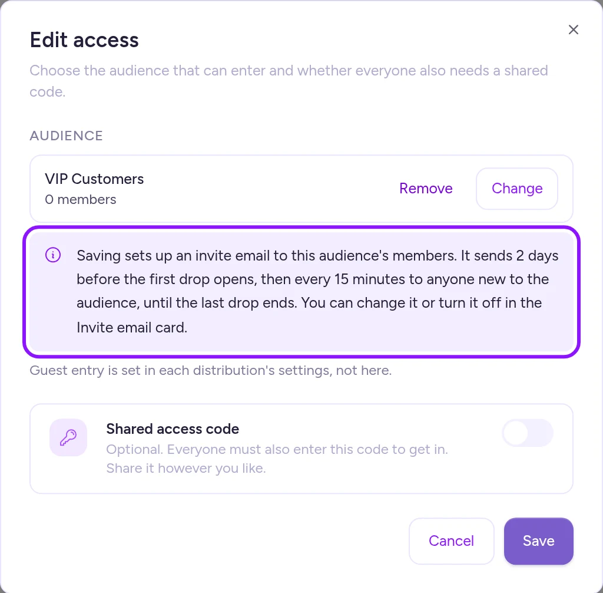

A sequence is one way into an experience. The Create Experience wizard builds your first sequence automatically. Add more sequences when you want different groups to enter on different terms—such as VIP early access before a public release, or a private access-code drop.

For how Fanfare decides which sequence each shopper sees, see [Sequences and routing](/concepts/sequences).

## Before you start

- Your experience must still be active. Once every distribution in an experience is deactivated, **Add sequence** is hidden—create a new experience instead.
- Creating audiences requires Growth or above (see [Build audiences](/guide/create/audiences)). Sequences, access codes, order limits, and attaching an existing audience are included on every plan.

## Create a sequence

1. Open your experience, find the **Sequences** card on **Overview**, and select **Add sequence**.
2. Enter a **Name** and choose a **Sequence Color** (one is preselected for you).
3. If your experience has two or more products, choose a **Product Selection** mode:
   - **Customer Picks** (default): Shoppers choose which product to buy.
   - **Mystery Box:** Fanfare randomly assigns a product using your **Allocation Percentages** (or select **Distribute evenly**). Give every product more than `0%`—leaving any product at `0%` still creates the sequence, but skips saving the Mystery Box weights until you set them in [Product selection and Mystery Box](#product-selection-and-mystery-box).
4. Optionally, under **Access Restrictions (optional)**, pick an **Audience** and/or enter an **Access Code** (up to 32 characters, or select the generate icon). Selecting an audience here keeps guest entry off for distributions you add and schedules an invite email once you add the first distribution—see [Choose who can enter](#choose-who-can-enter).
5. Select **Create**.

<Warning>
  Create sequences in the exact priority order you want shoppers to be routed. Each new sequence gets the next priority number (**P1**, **P2**, **P3**…), and priority can't be reordered in the admin. See [Sequences and routing](/concepts/sequences).
</Warning>

Your new sequence appears in the **Sequences** card as **Draft**, with its priority chip and its own waitlist.

<Frame caption="Mystery Box and its allocation percentages appear only when an experience has two or more products.">
  
</Frame>

## Add a distribution to the sequence

A sequence needs at least one distribution—a queue, draw, auction, timed release, or appointment—before customers can enter.

1. Open **Add Distribution** from any of these spots:
   - **Add distribution** on the Draft sequence row in the **Sequences** card
   - **Create Distribution** at the top of the sequence page (or in the row menu on **Sequences**)
   - The dashed **Add distribution** row in the sequence's **Distributions** panel
   - **Duplicate** in an existing distribution's menu (copies type and settings with a blank schedule)
2. Complete **Type**, **Schedule**, **Configure**, **Payment** (queues and draws only), and **Review**.
3. Select **Create Distribution**.

The sequence moves out of **Draft** as soon as its first distribution is created. For format-specific settings, see [Set up a queue](/guide/create/queue), [Set up a draw](/guide/create/draw), [Set up an auction](/guide/create/auction), [Set up a timed release](/guide/create/timed-release), or [Set up appointments](/guide/create/appointment). Plan and checkout rules apply here too: **Appointment** requires Growth or above, and **Auction** requires a checkout that can charge the winning bid.

<Note>
  Distributions within the same sequence can't overlap—back-to-back windows are fine, and Fanfare flags any **Schedule conflict** before you can continue. To run two distributions at the same time, put them in separate sequences.
</Note>

Once every distribution in a sequence has been deactivated, you can't add or duplicate distributions into it—create a new sequence instead.

## Choose who can enter

Open the sequence and go to the **Access** tab. The **Who can enter** card summarizes your **Audience**, **Sign-in** status (with quick links to each queue, draw, and timed release where guest entry is configured), and **Shared access code**.

To update access gates:

1. Select **Edit access**.
2. To gate by audience, select **Choose audience** and pick one—or use **Change** or **Remove** to update an existing selection.
3. To require a code, switch on **Shared access code**. Fanfare auto-generates a code if the box is empty, or you can enter your own (up to 32 characters) or select **Generate**.
4. Select **Save**.

<Warning>
  Adding an audience gate triggers two automatic changes:

  - **Guest entry turns off:** Fanfare disables guest entry on every queue, draw, and timed release in the sequence because it needs to identify who's entering. Removing the audience later doesn't turn guest entry back on—re-enable it on each distribution if needed.
  - **An invite email is scheduled:** Adding a sequence's first audience automatically sets up an invite email to its members (immediately if the sequence already has a distribution, or when you add the first distribution). Removing the audience cancels the invite. Invites won't send until you save a business postal address under **Settings → Email Sender**. See [Invites, waitlist and access-code sends](/guide/create/invites-and-waitlist).
</Warning>

Keep these gate rules in mind:

- Access codes aren't case-sensitive.
- If you set both an audience and an access code, shoppers must satisfy both.
- Changing an access code doesn't remove shoppers who already passed the gate with the old code.
- To remove a code completely, select **Clear code** on the **Shared access code** row and confirm.

See [Sequences and routing](/concepts/sequences) for gate behavior, [What your customers see](/guide/drop/what-customers-see) for the shopper view, and [Invites, waitlist and access-code sends](/guide/create/invites-and-waitlist) to email an access code to your waitlist.

<Frame caption="The Who can enter card summarizes the audience, sign-in requirement, and shared access code for a sequence.">
  
</Frame>

<Frame caption="Review the invite email notice before saving an audience gate.">
  
</Frame>

## Product selection and Mystery Box

Product selection applies when an experience has two or more products and the sequence isn't appointment-only. (For multi-product draws created in the experience wizard, the **Product assignment** step configures this same setting.)

1. On the sequence page, select **Edit** to open **Settings**.
2. Under **Product Selection**, choose **Customer Picks** or **Mystery Box**.
3. For **Mystery Box**, configure **Mystery Box Products**:
   - Select **Add Products** to choose products for the pool.
   - Enter a weight from `1` to `1,000` on each row (higher weights mean higher odds, shown live as a percentage badge).
   - Select **Save Weights**.
4. Select **Save** at the bottom of the dialog to save the selection mode.

<Note>
  Adding or removing Mystery Box products—and selecting **Save Weights**—saves immediately, independently of the dialog's **Save** or **Discard** buttons. Make sure you pick only products included in this experience; the picker displays your full catalog, and products outside the experience can't be assigned.
</Note>

<Warning>
  Product selection and Mystery Box products lock while any distribution in the sequence is live, has entrants, has open payment windows, or is counting stock (starting about 10 minutes before doors open). They unlock once every distribution has closed and finished—otherwise, run a new drop.
</Warning>

How Mystery Box behaves during a drop:

- **Automatic rebalancing:** When a product sells out, it's dropped from the pool and its share redistributes across remaining products.
- **Product-level assignment:** Mystery Box assigns the product, not the size—size selection happens afterward for multi-size products.
- **Not supported with timed releases:** You can't combine Mystery Box with a timed release.
- **Odds vs. draw winners:** Weights decide which product a shopper receives, not who wins a draw. Sequence stock limits are configured separately—see [Allocate stock to a drop](/guide/create/stock-allocation).

## Order limits

Cap how many units one customer can purchase:

1. On the sequence page, select **Edit → Order limits**.
2. Select **Add First Limit** (or **Add Limit**).
3. Configure the rule:
   - **Product** (shown when the experience has 2+ products)
   - **Variant** (optional, to limit a single size or option)
   - **Max Qty** (maximum units per customer)
   - **Time Window:** **Lifetime**, **Rolling**, or **Calendar**
   - **Duration** (for Rolling and Calendar): **per day**, **per week**, or **per month**
4. Select **Add Limit**.

Order limits take effect immediately, including on live drops. Limits can't be edited in place—delete the existing limit and add a new one to change it.

- **Experience-wide counting:** Even though you set a limit on a sequence, it counts a customer's purchases across the entire experience.
- **Window behavior:** **Rolling** looks back 24 hours, 7 days, or 30 days. **Calendar** resets at midnight in your organization's time zone (weeks start on Sunday; months start on the 1st).
- **External checkout:** If customers pay in your own store checkout rather than Fanfare's or Shopify's, Fanfare can't enforce order limits—enforce them in your store instead.

<Frame>
  
</Frame>

## Rename or recolor a sequence

Click the sequence's name at the top of its page to rename it inline, or open **Edit → Settings** to change **Name** or **Sequence Color** and select **Save**.

To deactivate or delete a sequence, see [Stop a drop](/guide/drop/deactivate). To pause a live queue, see [Change things mid-drop](/guide/drop/live-controls).

## Settings at a glance

| Setting | What it does | Default | Editable while live? |
| --- | --- | --- | --- |
| **Name** | Identifies the sequence in the admin. | Required | Yes |
| **Sequence Color** | Visual color tag on cards and timelines. | Auto-picked by priority | Yes |
| **Priority** (`P1`, `P2`…) | Order in which Fanfare routes shoppers to sequences. | Next number in creation order | No—cannot be changed in the admin |
| **Product Selection** | **Customer Picks** or **Mystery Box** (2+ products, non-appointment). | **Customer Picks** | No while a distribution is open, counting stock, has entrants, or has open checkouts |
| **Mystery Box weights / Allocation Percentages** | Relative odds for each product (must be > 0%). | Even split at creation | No while a distribution is open, counting stock, has entrants, or has open checkouts |
| **Audience** | Restricts entry to signed-in audience members and turns off guest entry. | None | Yes—takes effect immediately |
| **Shared access code** | Requires a code (up to 32 characters) to enter. | None | Yes—takes effect immediately |
| **Order limits** | Caps units per customer across the experience. | None | Add or delete anytime (takes effect immediately) |

## On Shopify

In the Shopify app, **Appointment** isn't available under **Add Distribution**. Everything else on this page works the same.

## Troubleshooting

<AccordionGroup>
  <Accordion title="Create is disabled when adding a sequence">
    Make sure you've entered a **Name** and selected a **Sequence Color**.
  </Accordion>
  <Accordion title="I see a Schedule conflict error">
    Your chosen window overlaps another distribution in the same sequence. Adjust the times so the windows don't overlap (back-to-back windows are fine), or add the new distribution to a separate sequence.
  </Accordion>
  <Accordion title="I can't change Product Selection or Mystery Box settings">
    A distribution in the sequence is already counting stock, open, has entrants, or still has active checkouts. Wait until all distributions finish, or launch a new drop.
  </Accordion>
  <Accordion title="The audience invite email isn't sending">
    Fanfare requires a business postal address before sending emails. Add yours under **Settings → Email Sender**—see [Sender identity and sending domain](/guide/create/email-sender).
  </Accordion>
</AccordionGroup>

## Related

<CardGroup>
  <Card title="Sequences and routing" href="/concepts/sequences">
    How Fanfare chooses a sequence for each customer and how access gates combine.
  </Card>
  <Card title="Invites, waitlist and access-code sends" href="/guide/create/invites-and-waitlist">
    Manage audience invite emails, waitlists, and access-code blasts.
  </Card>
  <Card title="Allocate stock to a drop" href="/guide/create/stock-allocation">
    Set sequence inventory per size and move units between sequences.
  </Card>
  <Card title="Build audiences" href="/guide/create/audiences">
    Create the customer audiences you use to gate sequences.
  </Card>
</CardGroup>
