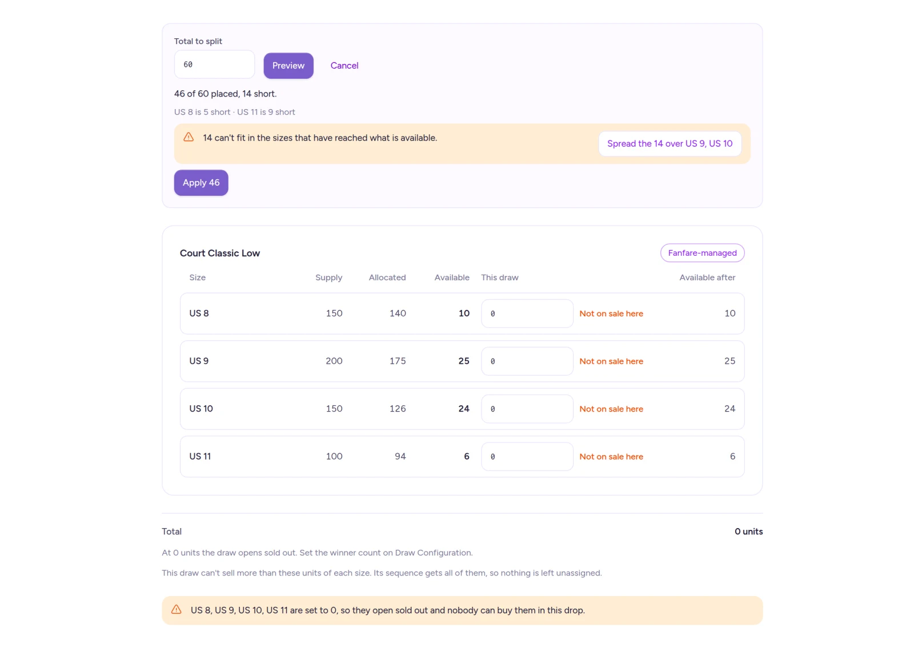
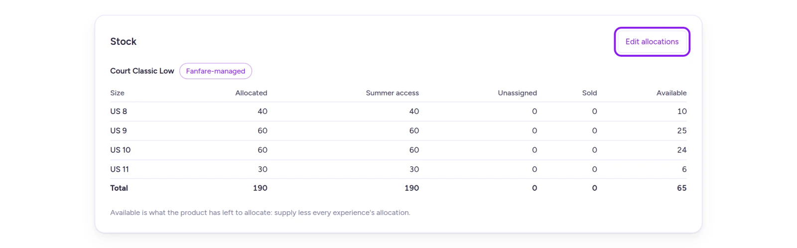
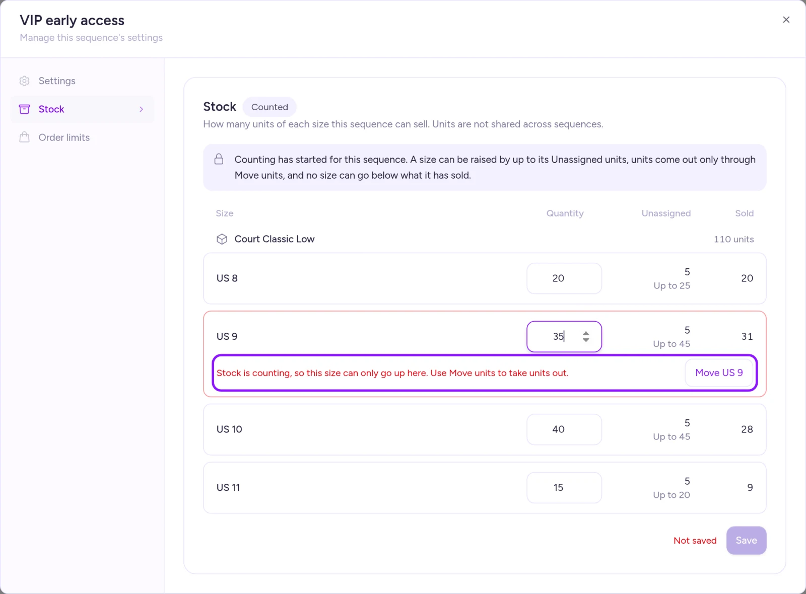
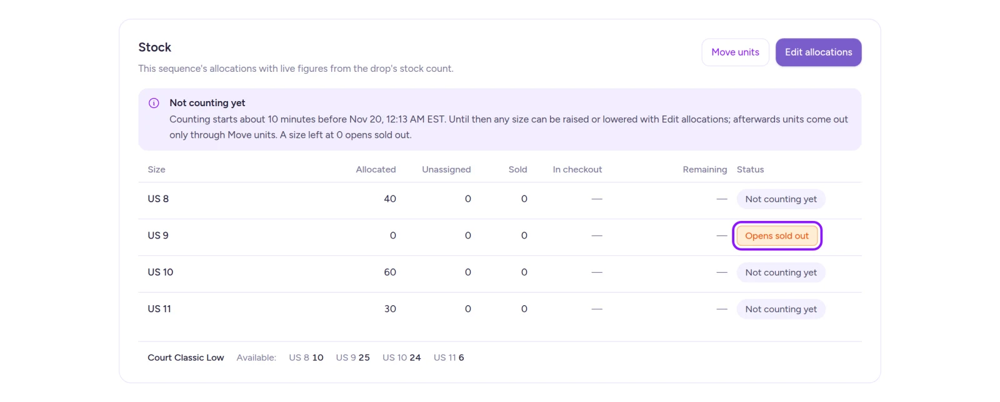

Before a drop opens you decide two things: how many units of each size the experience can sell, and how those units are shared between its sequences. A sequence is one way in to an experience, and each sequence sells only its own units. You set the numbers when you create the experience, and can raise, lower and split them until counting starts, about 10 minutes before a sequence opens. After that, a sequence's sizes only go up.

## Before you start

- **Two levels hold the numbers.** For a Fanfare-managed product, the experience reserves units of each size from the product's **Available** stock. Each sequence then takes its own share of those units, and what the experience holds that no sequence has yet is **Unassigned**. The model is explained in [Stock](/concepts/stock).
- **Other products have no experience-level count.** For a Not managed product, the number you set on a sequence is the only limit (see the last point for your own checkout). Shopify-managed products are covered in [On Shopify](#on-shopify). What each stock mode means is in [Manage stock](/guide/create/stock).
- **An experience cannot mix Fanfare-managed and Shopify-managed products.** Not managed products can sit beside either.
- **A sequence gets its sizes when its first distribution is added.** Until then its **Stock** section has nothing to count.
- If your organisation uses its own checkout rather than Fanfare's or Shopify's, the wizard's **Stock** step shows **Sales aren't counted**: your checkout doesn't report sales to Fanfare, so the numbers limit how many customers hold a pass at once, not how many units sell. Such an organisation has no Fanfare-managed products.

## Set units when you create the experience

The **Stock** step of **Experiences → Create experience** appears when you have picked at least one product and the distribution is not an appointment.

1. For each size, type the units in the units column. A Fanfare-managed size shows its **Supply**, **Allocated**, **Available** and **Available after** beside the input.
2. To fill the numbered sizes at once, select **Split a total across sizes** (it appears when there is more than one size), enter the **Total to split**, select **Preview**, then select **Apply**. A Fanfare-managed size never takes more than it has available. Any shortfall is shown, with an offer to spread it over the sizes that still have room.
3. For a product whose stock Fanfare does not manage, you can select **No limit** instead of a number. A Fanfare-managed size always needs a number.
4. Check the **Total** at the bottom, then select **Next**.

<Frame caption="A Fanfare-managed size shows what is available, and the split helper never places more than that.">
  
</Frame>

If a Fanfare-managed size asks for more than is available, its row shows **Over by** and the shortfall, and a breakdown reads, for example, "M is over by 5: only 40 available". The breakdown shows what each experience holds and offers ways out: set the size to what is available, reduce an experience that has not opened yet, or record a receipt on the product. **Next** stays blocked until every size fits.

A size at 0 shows **Not on sale here**, and the step warns, for example, "M is set to 0, so it opens sold out and nobody can buy it in this drop."

What the numbers mean depends on the distribution:

| Distribution | What the units do |
| --- | --- |
| Queue | "This queue can't sell more than these units of each size." How fast customers are let in is set by **Admit rate** on **Queue Configuration**. The admin has no setting for how many people can wait. |
| Draw | "This draw can't sell more than these units of each size. Its sequence gets all of them, so nothing is left unassigned." The winner count follows the total. |
| Timed release | While any size has a number, automatic entry is not offered: customers tap Enter to join. With every size at **No limit**, automatic entry stays open. |
| Dutch auction | Every size needs a number. The auction sells the sum of the sizes. |
| English auction | Offers one unit of each size, but the auction has one winner, who takes one. There is nothing to enter. |

If you have not chosen Dutch or English yet, the column reads **Units (if Dutch)**. A draw's winner count follows the total, unless a size has no limit: see [Set up a draw](/guide/create/draw). The two auction types are compared in [Set up an auction](/guide/create/auction).

The wizard creates the experience with one sequence and gives it every unit you entered, so nothing is left **Unassigned**.

## Change the experience's units later

1. Open the experience's **Overview**. For a Fanfare-managed product, its **Stock** card lists each size's **Allocated**, each sequence's share, **Unassigned** and **Sold**, plus **Available** before the drop opens or **In checkout** once it has. For other products it lists each size's **Limit**.
2. Select **Edit allocations**. The experience's settings window opens on its **Stock** section.
3. Type a new number for each Fanfare-managed size. The field shows "Up to" the most it can take: what the experience holds now plus what the product has available.
4. Select **Save** at the bottom of the window.

For a size whose stock Fanfare does not manage, this section sets one limit for every sequence that holds the size. If the sequences hold different limits, saving sets all of them to this one.

If you lower a Fanfare-managed size, Fanfare takes the units from **Unassigned** first, then from the sequences, newest sequence first. It shows an estimate before you save. A lowering that needs units from a sequence that has started counting is refused.

<Frame caption="Edit allocations is offered until the drop goes live.">
  
</Frame>

<Warning>
  Once any sequence of the experience is live, the experience's totals are fixed and the card shows **Fixed while live**. Units you left **Unassigned** are the only reserve you can hand to a sequence during the drop, through **Move units**. After the drop ends, the section reads "This drop has ended, so its allocations can't be changed."
</Warning>

A product that still holds units cannot be removed from the experience. Removing it on **Products** shows that it "can't be removed", and **Save** stays blocked. Select **Keep** with the product's name to put it back, open **Stock**, set its sizes to 0 and select **Save**. Then remove the product on **Products** and save again.

## Split units across sequences

Each sequence has its own **Stock** card on its **Overview** tab.

1. Open the sequence from the experience's **Overview**.
2. On the **Stock** card, select **Edit allocations**. Or select **Edit**, then **Stock**.
3. Type a **Quantity** for each size, from 0 to 1,000,000. For a size whose stock Fanfare does not manage you can select **No limit** instead.
4. Select **Save**. The message "Stock saved" confirms it.

The grid's columns:

- **Quantity**: the units this sequence can sell.
- **Unassigned**: for a Fanfare-managed size, what the experience holds that no sequence has. Below it, "Up to" shows the most this size can be raised to here.
- **Sold**: units this sequence has already sold.
- **Manual planning inventory**: shown only for Not managed goods. It warns when this sequence and the others together go over the number you keep on the product. It never blocks a save.

**No limit** is not offered for a Fanfare-managed size, or on a sequence that has a Dutch auction.

A row with a problem blocks **Save** and says why:

| Message | What to do |
| --- | --- |
| "Can't go below 3: 3 already sold" | A size can never go below what it has sold. |
| "Stock is counting, so this size can only go up here. Use Move units to take units out." | Counting has started. Use the **Move** button that carries the size's name (for example **Move M**) beside the row. |
| "At most 40: the experience has no more unassigned units of this size" | Before any sequence of the experience is live, raise the experience's units, recording a receipt first if the product has none available. Once one is live, the experience's totals are fixed: move units in from another sequence with **Move units**. |

If someone else changed the stock while you were editing, the save is refused with **Stock changed while you were editing**. The grid reloads, keeping your edits only for the sizes nobody else changed. Review them and save again.

A Fanfare-managed size, and most other sizes, start at 0 and open sold out. A Shopify-managed size starts at Shopify's count, and other sizes in a timed release or under your own checkout start at **No limit**.

<Warning>
  Counting starts about 10 minutes before the sequence opens. From then on a size can only go up here, and units leave the sequence only through **Move units**. A size left at 0 opens sold out. Set every size before that point.
</Warning>

<Frame caption="Once counting starts, a lower number is refused and the row offers Move units instead.">
  
</Frame>

## Once counting starts

The sequence's **Stock** card shows one status per size:

| Status | What it means |
| --- | --- |
| Not counting yet | This drop is not counting yet. Before the sequence's first drop counts, any size can be raised or lowered; after that, sizes only go up. |
| Ready | Stock is set up for the next drop, and live figures appear when it opens. |
| Opens sold out | The size has nothing left (it is at 0, or has sold everything allocated), so customers see it sold out from the moment the drop opens. |
| Preparing | Counting is about to start. Figures appear within a minute. |
| Selling | The drop is open and the size is on sale. |
| Sold out right now | Everything allocated has sold and none is in checkout. |
| Held: stock | Another size is over-allocated, so the whole sequence will not start selling. The over-allocated size itself reads **Over-allocated by** and the missing units. |
| Released | The sequence ended and its stock went back to the experience. |

<Frame caption="A size left at 0 opens sold out.">
  
</Frame>

A size that sold out comes back when you raise its **Quantity** (a Fanfare-managed size by at most its **Unassigned** units) or move units in. You find **Move units** on the sequence's **Stock** card, and as the **Move** button with the size's name beside a refused row in the grid. The steps, including the effect on a draw's winner count, are in [Change things mid-drop](/guide/drop/live-controls). What customers see when a size is sold out is in [What your customers see](/guide/drop/what-customers-see).

## Over-allocated and held sizes

If a Fanfare-managed size's allocations add up to more than its supply before the drop opens, the experience's **Stock** card shows "Over-allocated by 2 on M. Phantom Stitch Anorak Drop will not start selling until this is resolved", with **Resolve** and **Record a receipt of at least** the missing units. [Manage stock](/guide/create/stock) explains both.

## After the drop

For Fanfare-managed products, once all of a sequence's distributions have finished, its allocation is cut to what it sold and the rest returns to the experience as **Unassigned**. Once at least one sequence is released and no other still holds Fanfare-managed units, the experience's own allocation is released the same way. Release is final: the grid reads "Each allocation was reduced to what it sold, so the grid can't change." See [Stock](/concepts/stock).

A sequence that holds no Fanfare-managed units is never released. After the drop its grid stays open, but sizes still only go up, as they did once counting started.

## Field reference

| Setting | What it does | Default | Can you change it once it is live? |
| --- | --- | --- | --- |
| Units (wizard **Stock** step) | The units of each size the experience and its first sequence can sell. | 0 for a Fanfare-managed size. Other sizes start at 0 (always 0 in a Dutch auction), at **No limit** (timed release, your own checkout, or more than 256 size combinations), or at Shopify's count. | Set at creation only. Change it later on the experience's **Stock** card. |
| Experience units (settings window, **Stock** section) | How many units of each Fanfare-managed size the experience holds, or one limit for every sequence for other goods. | What the wizard set. | No. Totals are fixed while the drop is live. |
| **Quantity** (sequence grid) | The units this sequence can sell. | 0 for a Fanfare-managed size, which opens sold out. Other sizes start at 0 (always 0 in a Dutch auction), at **No limit** (timed release, your own checkout, or more than 256 size combinations), or at Shopify's count. | Only up, once counting starts. Units leave only through [Move units](/guide/drop/live-controls). |
| **No limit** (sequence grid) | Fanfare never stops sales of the size. | Off, except in the cases above. | Yes. Once counting starts, a size at no limit cannot be given a number. |

## Things to know before you go live

- **No limit** means Fanfare never stops sales of that size and never shows it sold out. Once counting starts, it cannot be given a number.
- A sequence that offers more than 256 size combinations refuses new customers while it is counted: "More than 256 size combinations: new shoppers are refused". Remove products or sizes until it offers 256 or fewer. Mystery Box sequences are covered in [Add and gate sequences](/guide/create/sequences).
- The sequence's **Stock** section has its own **Save**, separate from **Settings** and **Order limits**. If you close the window with unsaved grid edits, you are asked to discard them.

## On Shopify

- Products brought in from Shopify while your checkout processor is **External** are Shopify-managed. For them, the allocation from the product's **Available**, **Unassigned**, the "Up to" ceiling, held sizes and release do not appear, and each sequence's **Quantity** is the cap. Imports after a switch to Fanfare checkout are Fanfare-managed: see [Manage stock](/guide/create/stock#on-shopify).
- For a Shopify-managed size in a queue or draw, the wizard's **Stock** step shows a **Shopify count** column and starts each size at Shopify's count, marked **Shopify's count at creation**. The size keeps following Shopify's count until counting starts or you type a number of your own. For a draw, the winner count follows that total and is set when the draw is created.
- If Shopify reports a size sold out, the size stops selling in that sequence. Raising its **Quantity** reopens it, except while more than one drop of the sequence is still running: "Shopify reported this size sold out, and it can't reopen while more than one drop of this sequence is still running. Try again once the earlier drop has ended." Units cannot be moved into or out of that size until it reopens.
- During a drop the sequence's **Stock** card can warn "Shopify shows 4, below what this drop has left" or "Shopify may be short by 2 while these are in checkout".

How products come in from Shopify is in [Products from Shopify](/guide/shopify/products).

## Troubleshooting

<AccordionGroup>
  <Accordion title="I can't lower a size">
    Counting has started for that sequence. Use **Move units** to take units out: see [Change things mid-drop](/guide/drop/live-controls).
  </Accordion>
  <Accordion title="Save is blocked: at most a number">
    The experience has no more **Unassigned** units of that size. Before the drop is live, raise the experience's units with **Edit allocations** on its **Stock** card, recording a receipt first if the product has none available (see [Manage stock](/guide/create/stock)). Once it is live, totals are fixed: move units in from another sequence with **Move units**.
  </Accordion>
  <Accordion title="A size shows Opens sold out">
    The size has nothing left: it is at 0, or has sold everything allocated. Raise its **Quantity** in the sequence's grid, or move units in.
  </Accordion>
</AccordionGroup>

## Related

<CardGroup>
  <Card title="Stock" href="/concepts/stock">
    How stock flows from supply to the experience, its sequences, and sales.
  </Card>
  <Card title="Manage stock" href="/guide/create/stock">
    Stock modes, Adjust stock, and resolving over-allocated sizes.
  </Card>
  <Card title="Change things mid-drop" href="/guide/drop/live-controls">
    Move units between sequences during a drop.
  </Card>
  <Card title="Add and gate sequences" href="/guide/create/sequences">
    Create sequences, and choose Customer Picks or Mystery Box.
  </Card>
</CardGroup>
