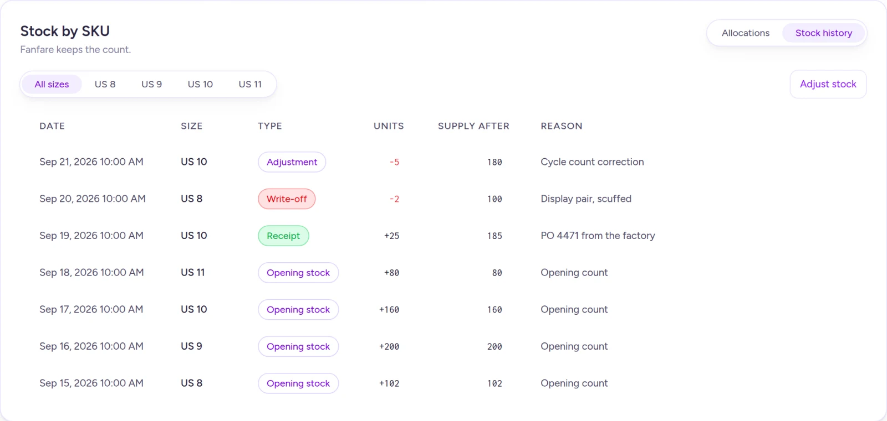

Before you create a product, decide who keeps its stock count. When Fanfare manages stock, every unit that arrives, gets damaged, or gets recounted is logged on the product page, and Fanfare uses that ledger to control how many units your drops can sell.

To assign units to an experience and split them across sequences, see [Allocate stock to a drop](/guide/create/stock-allocation). For the underlying inventory model, see [Stock](/concepts/stock).

## Before you start

- Recording stock changes requires a **Fanfare-managed** product—choose this when creating the product. See [Choose who keeps the stock count](#choose-who-keeps-the-stock-count).
- Fanfare-managed stock is available only when your organization uses **Fanfare checkout**.

## Choose who keeps the stock count

You choose **Stock management** in the Create Product wizard, and the choice is permanent. See [Add products](/guide/create/products).

| Option | How it works for your drops |
| --- | --- |
| **Fanfare-managed** | Fanfare tracks the count (default). You log receipts, adjustments, and write-offs, and Fanfare enforces how many units each experience can sell. |
| **Not managed** | Fanfare doesn't track product inventory. Sequence limits are the only cap—and with your own external checkout, those cap concurrent passes rather than units sold. |
| **Shopify-managed** | Shopify keeps the count. Assigned automatically to products imported from Shopify (not selectable in the Fanfare admin). See [On Shopify](#on-shopify). |

Your organization's checkout processor determines which options are available:

- **Fanfare checkout:** Choose **Fanfare-managed** or **Not managed**.
- **External checkout:** Every product you create is automatically **Not managed**, because Fanfare can't count sales completed outside its checkout.

You can't switch your checkout processor from **Fanfare** to **External** while any Fanfare-managed product exists—you'd need to delete those products first. See [Organization settings](/guide/account/organization).

<Warning>
  On a **Not managed** product, **Quantity** and **Inventory policy** (including **Deny when out of stock**) don't cap sales. The only cap is the limit you set on each sequence—and with external checkout, that limits active passes held at once, not units sold. See [Allocate stock to a drop](/guide/create/stock-allocation). If you need Fanfare to stop selling at your exact unit count, choose **Fanfare-managed** when creating the product.
</Warning>

An experience can't combine **Fanfare-managed** and **Shopify-managed** products, though **Not managed** products can appear alongside either.

## Read the stock figures

For **Fanfare-managed** products, Fanfare displays six stock figures per variant (labeled **size** on stock screens):

| Figure | What it means |
| --- | --- |
| **Supply** | Total units recorded: opening stock, receipts, adjustments, write-offs, and restocked returns. |
| **Sold** | Units with captured payment. Refunds don't automatically reduce this count. |
| **On hand** | **Supply** minus **Sold**. |
| **Allocated** | Units reserved across your experiences. |
| **Available** | **Supply** minus **Allocated**—units you can still allocate to an experience. Below zero means the size is over-allocated. |
| **At risk** | Units in active checkouts that stock no longer covers while a size is over-allocated. Otherwise `0` (shown as `—` in **Stock by SKU**). |

You'll see these numbers in three places on the product page:

- **Summary cards at the top:** **Supply** (with Sold and On hand), **Available** (with Allocated and any over-allocated sizes), and **At risk**.
- **Variants card:** **On hand** and **Available** per size. **On hand** is read-only—sales decrease it and stock changes adjust it through **Supply**.
- **Stock by SKU:** The full breakdown table, one row per size. Expand any size to see every experience holding it, its status, units currently in checkout, **Unassigned** units, and units sold and allocated. Toggle between **Allocations** and **Stock history** at the top of the card.

<Frame caption="Available shows how many units you can still allocate to an experience.">
  
</Frame>

Refunding an order doesn't automatically reduce **Sold** or add units back to **Supply**—you choose whether to restock them from the order page. See [Orders and refunds](/guide/learn/orders). Orders awaiting that decision appear under **Refunded, not returned to stock:** below the table.

## Record a stock change

On a Fanfare-managed product, inventory changes only when you log an entry. Every entry stays in **Stock history** with your reason.

You can open **Adjust stock** from:

- A size's menu in the **Variants** card
- The **Adjust stock** button in the variant editor
- **Stock history**, next to the size filter
- Any **Record a receipt of at least …** button on an over-allocation banner, the Resolve dialog, or a confirmation screen (pre-set as a receipt for that size)

To log a change:

1. Select the **Size** (if the product has more than one).
2. Choose the **Type**:
   - **Receipt:** New inventory arriving.
   - **Adjustment:** A count correction (**Add** or **Remove**).
   - **Write-off:** Units that are lost, damaged, or unsellable.
3. Enter the number of **Units**.
4. Enter a **Reason** (required), or pick a quick shortcut like **Purchase order received** or **Damaged**.
5. Review the before-and-after preview and any warnings underneath.
6. Select the record button (for example, **Record receipt of 20**), review the summary, and select **Done**.

<Warning>
  Fanfare never blocks a **Write-off** or downward **Adjustment**, even if it drops **Supply** below what your experiences have allocated. The preview warns you first—and once you confirm:

  - Unclaimed units are automatically reclaimed from live experiences (newest first, including ended drops that still have active checkouts; see [Stock](/concepts/stock)).
  - Units already in a shopper's checkout stay with that shopper and can still be purchased.
  - Any remaining shortfall—even a single unit—places a hold on every distribution of that size that hasn't started selling yet, including later distributions in an already-running sequence. See [Fix an over-allocated size](#fix-an-over-allocated-size).

  Orders completed from at-risk checkouts will need either a refund or a new receipt to cover them. Recorded entries can't be deleted from history—if you make a mistake, record a correcting adjustment.
</Warning>

<Frame caption="Before you confirm, the preview warns you if a write-off or downward adjustment will pull stock from active experiences.">
  
</Frame>

<Note>
  If a connection issue prevents confirmation, click the record button again without editing any fields—Fanfare treats it as the same request so it won't double-count. If you edit a field or close the dialog first, check **Stock history** before submitting again.
</Note>

## Fix an over-allocated size

A size becomes over-allocated when your experiences hold more units than its **Supply**. **Stock by SKU** pins that size to the top and displays an alert banner with three ways to fix it:

- **Resolve:** Opens the Resolve dialog to compare options.
- **Reduce [experience] [size] to [count]:** One-click reduction for each eligible held experience.
- **Record a receipt of at least [count] × [size]:** Opens **Adjust stock** pre-filled as a receipt.

In the **Resolve** dialog, pick an experience reduction and select **Apply** (enabled when that single reduction closes the gap), or record a receipt directly from the dialog. Some experiences can't be reduced here:

- **Released experiences:** Their allocation already matches what they sold.
- **Closed experiences awaiting release:** Their allocation remains attached until release finishes.
- **Live experiences:** Units already sold or in checkout can't be reduced.

Once **Available** is back to `0` or higher, held experiences automatically start selling on Fanfare's next stock check (about once a minute).

<Warning>
  Over-allocating a size by even 1 unit holds every upcoming experience that offers it (**Held: stock** badge) as well as any later distributions in an already-running sequence. Held distributions won't open on schedule—they wait until **Available** returns to `0` or higher. Once a held experience's opening time passes, you can't lower its own allocation; you'll need to reduce another upcoming experience or record a receipt. Always check for over-allocation banners before doors open. See [What your customers see](/guide/drop/what-customers-see).
</Warning>

<Frame caption="A held experience won't start selling until the over-allocated size fits supply again.">
  
</Frame>

## Stock history

Switch to **Stock history** in **Stock by SKU** (or select a size's **History** link to filter directly to that size). Filter by **All sizes** or an individual size to view each entry's **Date**, **Size**, **Type** (**Opening stock**, **Receipt**, **Adjustment**, **Write-off**, or **Return**), signed **Units**, **Supply after**, and **Reason**. Removed sizes appear as **Removed size**. Select **Show older changes** to load earlier entries.

<Frame>
  
</Frame>

## Field reference

### Adjust stock

| Setting | What it does | Default |
| --- | --- | --- |
| **Size** | Which variant the change applies to (shown on multi-variant products unless pre-locked from a receipt shortcut). | The size you opened it from (or first size from **All sizes**) |
| **Type** | **Receipt** adds units, **Write-off** removes units, **Adjustment** lets you **Add** or **Remove**. | **Receipt** |
| **Units** | Number of units to add or remove (`1` to `1,000,000`). | `0` |
| **Reason** | Required note saved to **Stock history**. Shortcuts pre-fill editable text. | Empty |

### Product stock settings

| Setting | What it does | Default | Editable while live? |
| --- | --- | --- | --- |
| **Stock management** | Who tracks the product's inventory. | **Fanfare-managed** (Fanfare checkout); **Not managed** (external checkout) | No—locked at creation |
| **Opening stock** | Starting **Supply** for a **Fanfare-managed** size when creating a product or adding a variant. | `0` | No—use **Adjust stock** once the size exists |

## Things to know before you go live

- Experience allocations lock once a drop goes live. See [Allocate stock to a drop](/guide/create/stock-allocation).
- You can't delete **Fanfare-managed** variants from the admin. See [Add products](/guide/create/products).

## On Shopify

Organizations installed through the Shopify app start on **External** checkout, so every product imported from Shopify is **Shopify-managed**—Shopify tracks inventory and **Fanfare-managed** isn't offered:

- Adjust stock, **Stock by SKU**, and **Stock history** don't appear on Shopify-managed products; update stock in Shopify admin instead.
- The **Products** list shows `—` in the **Stock** column.

If an organization admin switches checkout to **Fanfare** in [Organization settings](/guide/account/organization), products imported from Shopify afterward become **Fanfare-managed**, and newly created products offer the standard stock management choice. Existing products keep their original stock mode.

<Note>
  Fanfare-managed products imported from Shopify don't sync stock counts back to Shopify. Enter only the units you've set aside for Fanfare drops and take those units off sale in Shopify so the same inventory can't sell twice.
</Note>

See [Products from Shopify](/guide/shopify/products) for full sync details.

## Troubleshooting

<AccordionGroup>
  <Accordion title="I can't choose Fanfare-managed">
    Your organization's checkout processor is set to **External**, so all new products are **Not managed**. Fanfare-managed stock requires Fanfare checkout. Existing products stay **Not managed** even if you switch processors later. See [Organization settings](/guide/account/organization).
  </Accordion>
  <Accordion title="Adjust stock isn't available">
    The product is **Not managed** or **Shopify-managed**—only **Fanfare-managed** products track an editable stock ledger. Check the stock mode in the **Variants** card header. This setting can't be changed after product creation.
  </Accordion>
  <Accordion title="Stock figures didn't load">
    Select **Try again** (or **Reload** if stale figures are shown) to refresh the stock ledger.
  </Accordion>
  <Accordion title="An experience shows Held: stock">
    One of its sizes is over-allocated, blocking its sequences from starting. Open the product, locate the alert banner in **Stock by SKU**, and either record a receipt or reduce an upcoming experience's allocation. See [Fix an over-allocated size](#fix-an-over-allocated-size).
  </Accordion>
</AccordionGroup>

## Related

<CardGroup>
  <Card title="Allocate stock to a drop" href="/guide/create/stock-allocation">
    Reserve units for an experience, split them across sequences, and move stock mid-drop.
  </Card>
  <Card title="Stock" href="/concepts/stock">
    How supply, allocations, and sales fit together.
  </Card>
  <Card title="Add products" href="/guide/create/products">
    Create products and choose their stock management mode.
  </Card>
  <Card title="Orders and refunds" href="/guide/learn/orders">
    Return refunded units back to stock.
  </Card>
</CardGroup>
