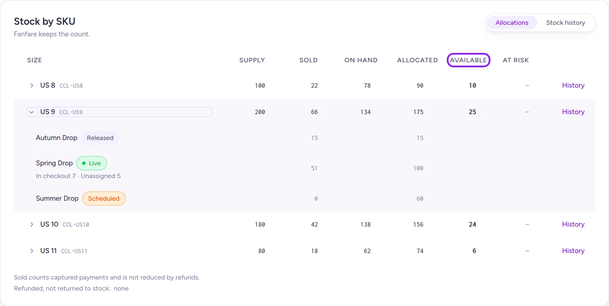
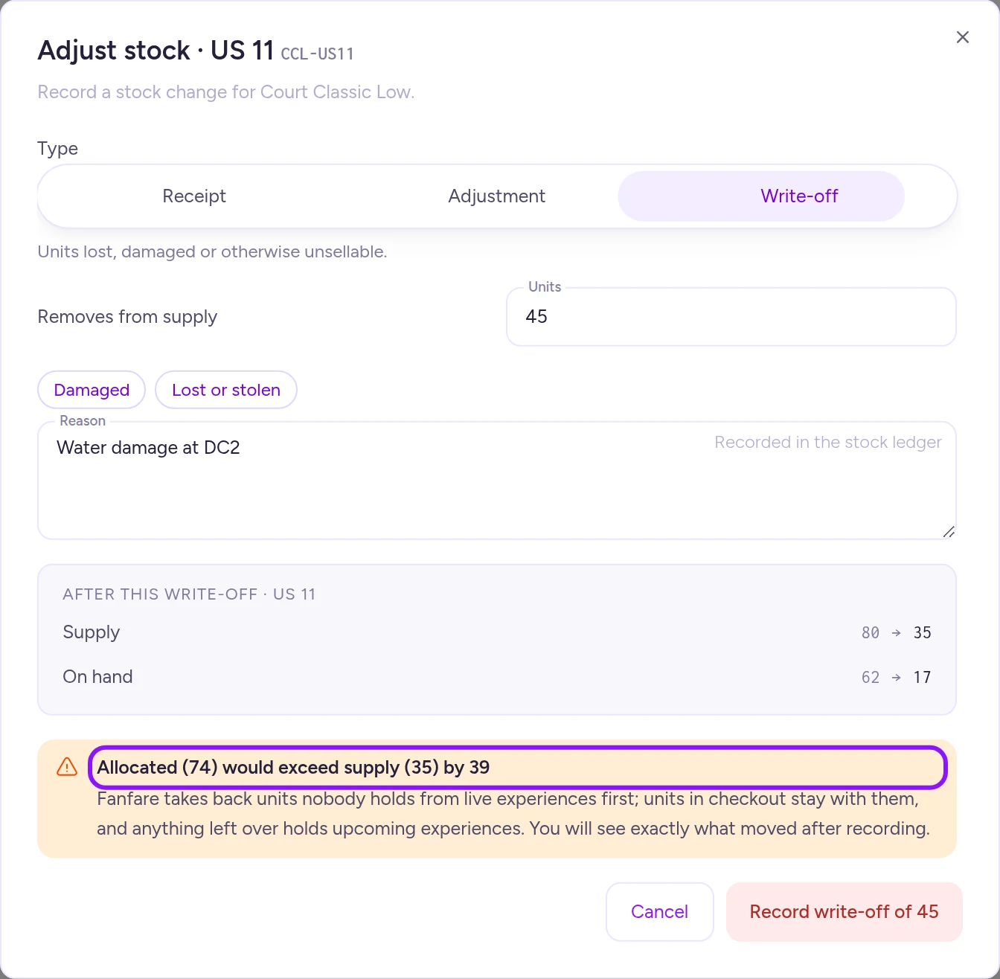
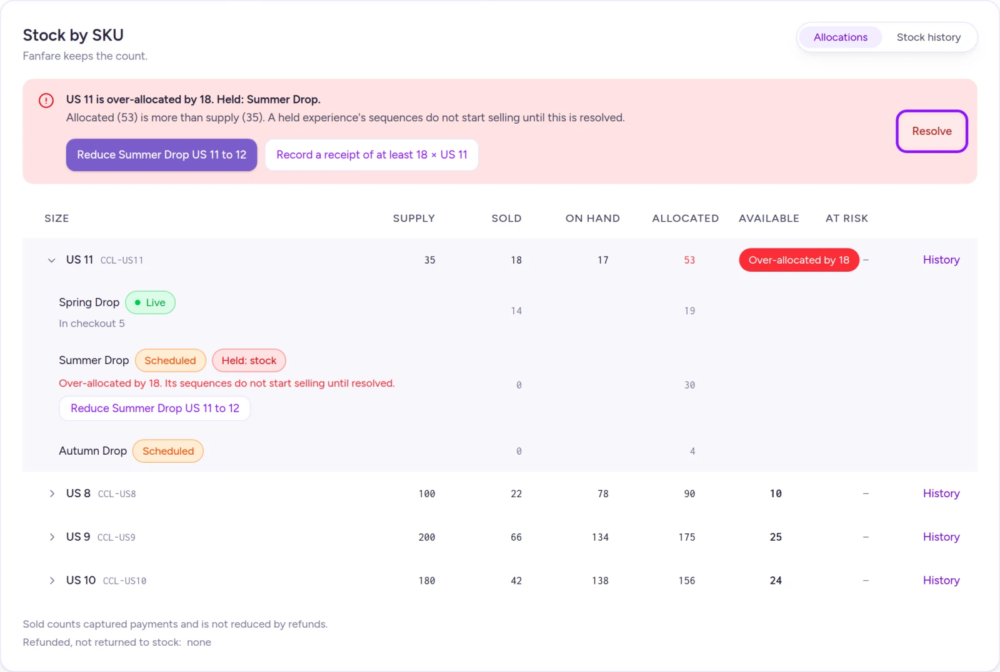

Before you create a product, decide who keeps its stock count. If Fanfare keeps it, every unit that arrives, goes missing or is counted again is recorded on the product page, and Fanfare uses that count to decide how many units your experiences can sell.
Giving an experience its units and splitting them across sequences is covered in [Allocate stock to a drop](/guide/create/stock-allocation). Why stock works this way is in [Stock](/concepts/stock).

## Before you start

- To record stock changes, the product must be **Fanfare-managed**. Read [Choose who keeps the stock count](#choose-who-keeps-the-stock-count) before you create it.
- Fanfare-managed stock needs your organisation to take payment through Fanfare checkout.

## Choose who keeps the stock count

**Stock management** decides who counts the units of a product. You choose it in the Create Product wizard, and it is permanent: see [Add products](/guide/create/products).

| Option | What it means for your drops |
| --- | --- |
| **Fanfare-managed** | Fanfare keeps the count. You record every change in stock, and Fanfare uses the count to decide how many units each experience can sell. This is the default. |
| **Not managed** | No count. Sequence limits are the only cap; under your own checkout they limit passes held at once, not units sold. (A sequence is one way in to an experience.) |
| **Shopify-managed** | Shopify keeps the count. You cannot choose this in the Fanfare admin: a product only becomes Shopify-managed when it is brought in from Shopify. See [On Shopify](#on-shopify). |

Which options you get depends on your organisation's checkout processor:

- **Fanfare** (Fanfare checkout): you choose **Fanfare-managed** or **Not managed**.
- **External**: there is no choice. Fanfare cannot count sales it does not take payment for, so every product you create is **Not managed**.

While any Fanfare-managed product exists, your organisation cannot switch its checkout processor to **External**: you would have to delete those products first. See [Organisation settings](/guide/account/organization).

<Warning>
  On a **Not managed** product, the **Quantity** and **Inventory policy** fields do not stop sales. Even **Deny when out of stock** does not cap what an experience sells: the only cap is the stock limit you set on each sequence, and if customers pay in your own checkout rather than Fanfare's or Shopify's, that limit caps passes held at once, not units sold. See [Allocate stock to a drop](/guide/create/stock-allocation). If you need Fanfare to stop at the units you have, choose **Fanfare-managed** when you create the product.
</Warning>

An experience cannot offer Fanfare-managed and Shopify-managed products together. Not managed products can sit alongside either.

## Read the stock figures

For a Fanfare-managed product, the product page shows these figures for each size. (The stock screens call each variant a size.)

| Figure | Meaning |
| --- | --- |
| **Supply** | Every unit you have recorded: opening stock, receipts, adjustments, write-offs and returns. |
| **Sold** | Units with a captured payment. Refunds do not reduce it. |
| **On hand** | Supply minus Sold. |
| **Allocated** | Units your experiences have reserved. |
| **Available** | Supply minus Allocated: what can still go into an experience. Below zero, the size is over-allocated. |
| **At risk** | While the size is over-allocated, units in live checkouts that stock no longer covers. Otherwise 0 (shown as — in **Stock by SKU**). |

You find them in three places:

- **The header cards**: **Supply** (with Sold and On hand), **Available** (with Allocated, and a line for each over-allocated size) and **At risk**.
- **The Variants card**: **On hand** and **Available** for each size. In the variant editor, **On hand** is read-only: sales lower it, and every change to **Supply** moves it.
- **Stock by SKU**: the full table, one row per size. Select a size to expand it into the experiences that hold it, each with its status, units in checkout on a live experience ("In checkout [count]"), units not yet given to a sequence ("Unassigned [count]"), and units sold and allocated. Use the **Allocations** and **Stock history** toggle to switch between this table and the history.

<Frame caption="Available is what can still go into an experience.">
  
</Frame>

**Sold** is not reduced by refunds, and refunded units return to stock only when you return them from the order. See [Orders and refunds](/guide/learn/orders). Under the table, **Refunded, not returned to stock:** lists the orders still waiting on that decision.

## Record a stock change

For a Fanfare-managed product, the count changes only when you record a change. Every change is kept in the product's stock history with your reason.

You can open **Adjust stock** from:

- a size's menu in the **Variants** card;
- the **Adjust stock** button in the variant editor;
- **Stock history**, beside the size filter;
- the **Record a receipt of at least …** button on the over-allocation banner, in the Resolve dialogue, or on the result screen after a change, which opens a receipt for that size with the type fixed.

To record a change:

1. Choose the **Size**, if the product has more than one.
2. Choose the **Type**: **Receipt** when new units arrive, **Adjustment** for a count correction (choose **Add** or **Remove**), or **Write-off** for units lost, damaged or otherwise unsellable.
3. Enter the **Units**.
4. Enter a **Reason**, or select a shortcut such as **Purchase order received** or **Damaged**. The reason is required and is kept in the stock history.
5. Read the preview of the figures after the change, and any notice under it.
6. Select the record button. It names the change, for example **Record receipt of 20**. It becomes available once the dialogue has read the current stock; if that read fails, close the dialogue and open it again.

The result screen shows the figures before and after, and which experiences gave units back or are now held. Select **Done** to close it. You cannot close the dialogue while it is recording.

<Warning>
  A **Write-off** or a downward **Adjustment** that leaves less supply than your experiences have allocated is always recorded: Fanfare does not block it. The preview warns you first with "Allocated … would exceed supply" (or, if no experience holds the size, "Supply would go to …"). Once you record:

  - Units nobody holds are taken back from live experiences, newest first, including one that shows **Ended** while customers are still checking out: see [Stock](/concepts/stock). If some are still being taken back when the result shows, it says so and Fanfare finishes on its own.
  - Units already in a customer's checkout stay with that customer and can still be bought.
  - Any shortfall left over, however small, holds in full every distribution of the size that has not started selling yet, including a later one in a sequence that is already selling: see [Fix an over-allocated size](#fix-an-over-allocated-size).

  Orders completed from at-risk checkouts then need a refund, or a receipt of new units to cover them. A recorded change cannot be removed from the history; to correct one, record another change.
</Warning>

<Frame caption="The preview tells you before you record whether the change will take units from your experiences.">
  
</Frame>

<Note>
  If Fanfare does not confirm a change, the dialogue says it may already be recorded. Select the record button again without changing anything: Fanfare treats it as the same change, so it cannot be counted twice. If you edit any field first, the dialogue may lock and ask you to check **Stock history** instead. If you close the dialogue instead, check **Stock history** before you record the change again, or you may count it twice.
</Note>

## Fix an over-allocated size

A size is over-allocated when your experiences hold more units than its supply. **Stock by SKU** puts that size first, shows **Over-allocated by** in its **Available** column, and shows a banner headed "[size] is over-allocated by [count]". The banner offers:

- **Resolve**, which opens the Resolve dialogue;
- **Reduce [experience] [size] to [count]**, for each held experience whose allocation can be lowered;
- **Record a receipt of at least [count] × [size]**, which opens **Adjust stock** as a receipt.

In the Resolve dialogue, choose an option of the form "Set [experience] [size] to [count]" and select **Apply**. **Apply** is available only when that change alone makes the size fit supply; if it does not, the dialogue tells you how many units to receive instead, and you can record that receipt from the dialogue. Some experiences cannot be lowered here, and the dialogue says why:

- A released experience: its allocation already equals what it sold.
- A closed experience whose stock has not been released yet: its allocation stays with it.
- A live experience: units sold and in checkout stay with it, so it cannot go lower.

When the size fits supply again, the panel shows "[size] now fits supply. Held experiences start selling once Fanfare's next stock check seeds them."

<Warning>
  An over-allocated size, even by one unit, holds every experience that offers it and whose sequences have not started selling: these show a **Held: stock** badge. It also holds a later distribution in a sequence that is already selling. Nothing held starts selling at its open time. Held sequences start selling only once **Available** is back to 0 or more, at Fanfare's next stock check after that. Fanfare checks stock about once a minute. Once its open time has passed, its own allocation can no longer be lowered: lower another experience that has not opened yet, or record a receipt. Check the banner before an experience opens. For what customers see at each stage, see [What your customers see](/guide/drop/what-customers-see).
</Warning>

<Frame caption="A held experience does not start selling until the size fits supply.">
  
</Frame>

## Stock history

Select **Stock history** in **Stock by SKU**, or a size's **History** link to open it filtered to that size. Filter with **All sizes** or a single size. Each entry shows the **Date**, the **Size** (when not filtered), the **Type**, the **Units** (signed, so removals are negative), **Supply after**, and the **Reason**. The types are **Opening stock**, **Receipt**, **Adjustment**, **Write-off** and **Return** (units returned to stock from a refunded order). A size that has been removed shows as **Removed size**. Select **Show older changes** to load earlier entries.

<Frame>
  
</Frame>

## Field reference

**Adjust stock**

| Setting | What it does | Default |
| --- | --- | --- |
| **Size** | The size the change applies to. Shown when the product has more than one, except for a receipt opened from a **Record a receipt of at least …** button. | The size you opened it from; from **Stock history** with **All sizes**, the first size |
| **Type** | **Receipt** adds units, **Write-off** removes them, **Adjustment** goes either way with **Add** or **Remove**. | **Receipt** |
| **Units** | How many units the change adds or removes: 1 to 1,000,000. You cannot record until it is above 0. | 0 |
| **Reason** | Why the stock changed. Required, and kept in the stock history. Shortcuts fill it in and stay editable. | Empty |

**Product settings that decide stock**

| Setting | What it does | Default | Can you change it once it is live? |
| --- | --- | --- | --- |
| **Stock management** | Who keeps the stock count. | **Fanfare-managed** (Fanfare checkout); **Not managed** (external checkout) | No. Fixed when the product is created. |
| **Opening stock** | Fanfare-managed only. The units a size starts with, entered when you create the product or add a new size; it becomes that size's starting **Supply**. | 0 | No. Once the size exists, use **Adjust stock**. |

## Things to know before you go live

- Allocations are fixed while an experience is live. See [Allocate stock to a drop](/guide/create/stock-allocation).
- Fanfare-managed variants cannot be deleted from the admin. See [Add products](/guide/create/products).

## On Shopify

An organisation created through the Fanfare app in Shopify starts with an **External** checkout processor. While it stays External, every product you bring in from Shopify is **Shopify-managed**: Shopify keeps the count, and **Fanfare-managed** is not offered. For a Shopify-managed product:

- The product page says "Stock changes for Shopify-managed products are made in your Shopify admin. Adjust stock is not offered here." It has no **Stock by SKU** and no stock history.
- The Products list shows "—" in the **Stock** column, with the hover text "Shopify keeps the count."

If an organisation admin switches the checkout processor to **Fanfare** in [Organisation settings](/guide/account/organization), products you bring in from Shopify after that are Fanfare-managed, and when you create a product you get the same choice as in the Fanfare admin. Products that already exist keep their stock management.

<Note>
  For a Fanfare-managed product you bring in from Shopify, Fanfare's count and Shopify's count do not sync. Enter only the units you are setting aside for Fanfare drops, and take the same units off sale in Shopify. If you do not, the same units can sell twice: once in Shopify and once in an experience.
</Note>

See [Products from Shopify](/guide/shopify/products).

## Troubleshooting

<AccordionGroup>
  <Accordion title="I can't choose Fanfare-managed">
    Your organisation's checkout processor is **External**, so every product you create is **Not managed**. Fanfare-managed stock needs payments to go through Fanfare checkout. Products already created stay **Not managed** even if the processor changes. To change the processor, see [Organisation settings](/guide/account/organization).
  </Accordion>
  <Accordion title="Adjust stock isn't offered">
    The product is **Not managed** or **Shopify-managed**. Only Fanfare-managed products have a stock count to change. The **Variants** card header shows which one a product is, for example "Stock management: Not managed". This cannot be changed on an existing product.
  </Accordion>
  <Accordion title="Couldn't load stock figures">
    Fanfare could not read the product's stock. Select **Try again**. If figures were already showing, the panel says "These figures may be out of date." instead: select **Reload**.
  </Accordion>
  <Accordion title="An experience shows Held: stock">
    A size it holds is over-allocated, so its sequences do not start selling. Open the product, find the banner in **Stock by SKU**, and record a receipt or lower the allocation of an experience that has not opened. See [Fix an over-allocated size](#fix-an-over-allocated-size).
  </Accordion>
</AccordionGroup>

## Related

<CardGroup>
  <Card title="Allocate stock to a drop" href="/guide/create/stock-allocation">Give an experience its units, split them across sequences, and move units.</Card>
  <Card title="Stock" href="/concepts/stock">How supply, allocations and sales fit together.</Card>
  <Card title="Add products" href="/guide/create/products">Create products and choose their stock management.</Card>
  <Card title="Orders and refunds" href="/guide/learn/orders">Return refunded units to stock.</Card>
</CardGroup>
