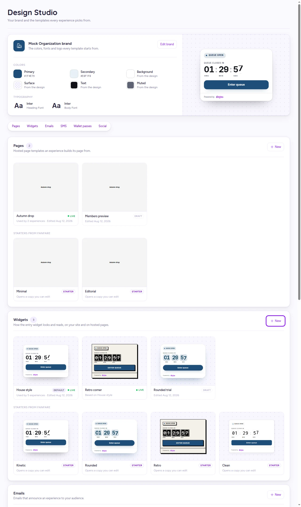
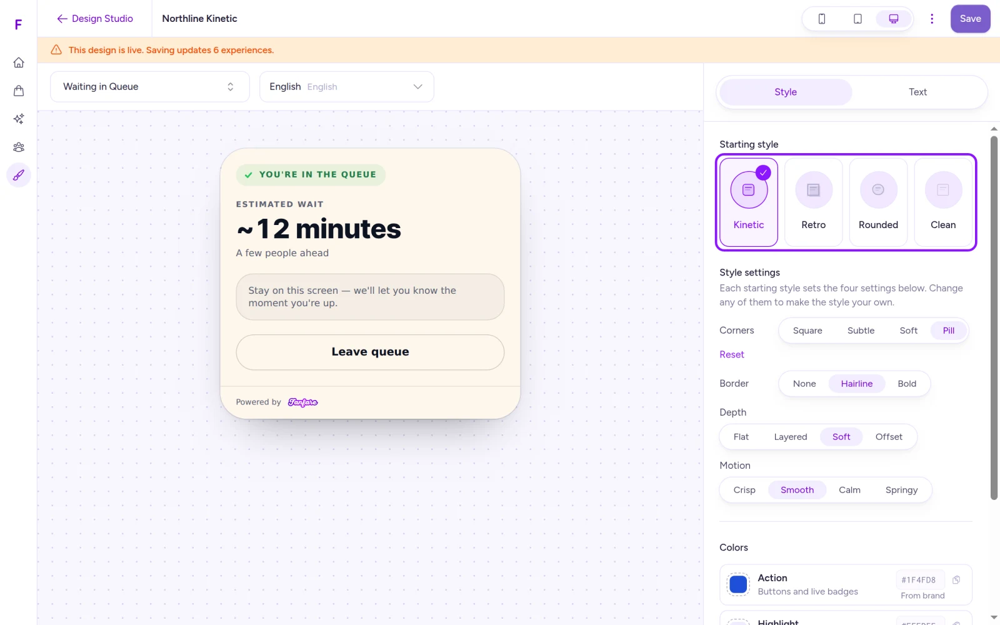
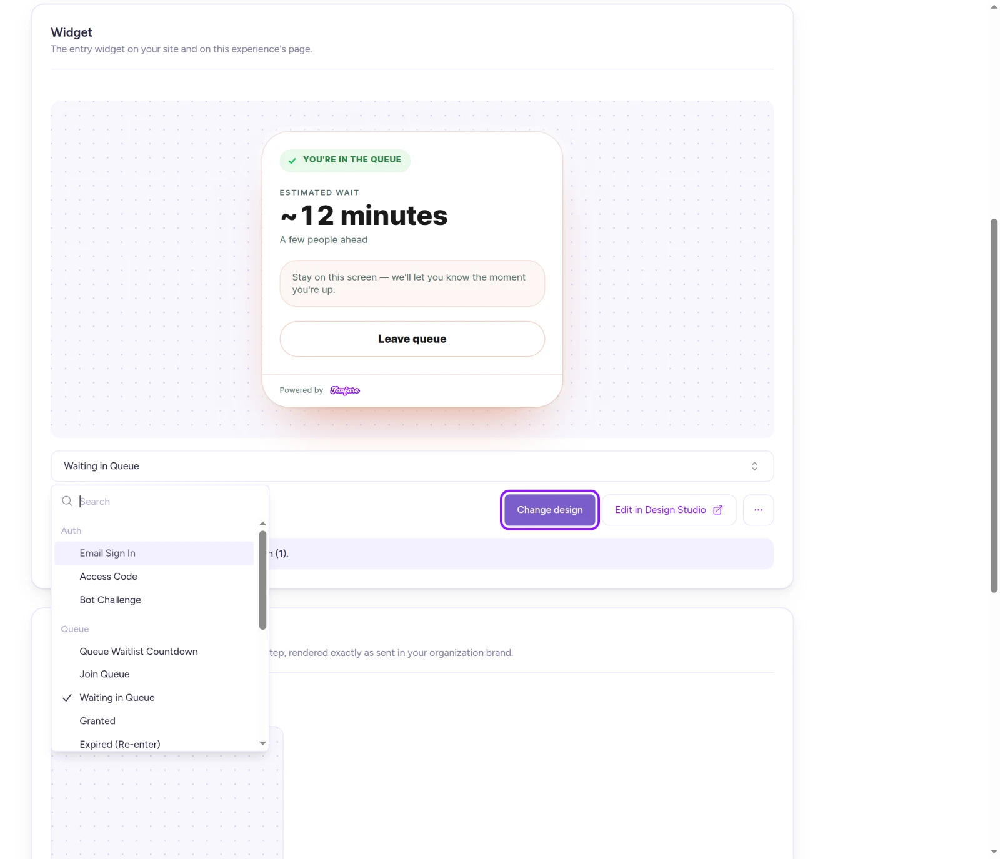

Design Studio is your library of reusable looks across every drop. Build a page template, widget design, social kit, or wallet pass design once, publish it, and apply it across experiences so every launch feels unmistakably yours.

<Info>
  Available on Growth and above. Wallet pass designs require Pro. See [Plans and what they unlock](/guide/start/plans).
</Info>

On Starter, selecting **Design Studio** opens the Brand editor directly. If you downgrade from Growth to Starter, existing designs keep serving your drops, and you can still use **Reset to org default** on an experience's **Widget** card—however, creating, editing, unpublishing, deleting, or clearing defaults locks until you upgrade again.

## Before you start

- Configure your brand first—every template and widget design inherits your logo, colors, and fonts. See [Set your brand](/guide/create/brand).

## Browse your library

Open **Design Studio** to see your brand card followed by six sections: **Pages**, **Widgets**, **Emails**, **SMS**, **Wallet passes**, and **Social**. Your saved designs appear as cards alongside **Starters from Fanfare** (or **Kits from Fanfare** under Social; Wallet passes starts from a default template).

Each design card displays:

- **Live** or **Draft** status (only **Live** designs can be selected on experiences).
- **Default** when set as your organization's default for that section.
- Usage count on active page templates and widget designs (for example, *"Used by 3 experiences"*).
- Last edited time, or *"Based on [name]"* for cloned designs.

Select any card to open its editor.

<Frame caption="Your Design Studio library organizes reusable designs by where customers see them.">
  
</Frame>

## Create a design

### Page template

1. Under **Pages**, select **New → Experience page** and pick a starter—or select any card in **Starters from Fanfare**.
2. Your copy opens in the editor as a **Draft** named after the starter.

All page templates start from one of Fanfare's starters so layout regions and responsive blocks are ready to go.

### Widget design

1. Under **Widgets**, select **New** to open **New widget design**.
2. Pick a starting style: **Kinetic**, **Rounded**, **Retro**, or **Clean**.
3. Select **Start from starter** to open your new **Draft** in the editor.

<Frame>
  
</Frame>

### Social kit

Under **Social**, select **Customize** on any kit under **Kits from Fanfare**. Your copy opens as a **Draft** where you can configure the **Card color** (solid colors only), **Phase label**, **Title typeface**, message, and hashtags.

Edits to a live social kit apply only to posts created afterward. Select your kit when scheduling posts in [Announcements](/guide/create/announcements).

## Customize a widget design

Use the canvas's state picker to preview every stage of a drop, and switch the language menu to preview localized copy.

<Frame caption="Start from a preset style, then fine-tune corners, borders, depth, motion, and colors with a live preview.">
  
</Frame>

### Style tab

| Setting | What it controls | Default | Updates live drops? |
| --- | --- | --- | --- |
| **Starting style** | Preset foundation (**Kinetic**, **Rounded**, **Retro**, or **Clean**). Switching resets the four style settings below, with an **Undo** option if you've customized them. | Chosen at creation | Yes—saving restyles every experience using this design. |
| **Corners** | **Square**, **Subtle**, **Soft**, or **Pill**. | Set by starting style (**Soft** for Kinetic) | Yes |
| **Border** | **None**, **Hairline**, or **Bold**. | Set by starting style (**Hairline** for Kinetic) | Yes |
| **Depth** | **Flat**, **Layered**, **Soft**, or **Offset**. | Set by starting style (**Soft** for Kinetic) | Yes |
| **Motion** | **Crisp**, **Smooth**, **Calm**, or **Springy**. | Set by starting style (**Smooth** for Kinetic) | Yes |
| **Action** | Buttons and live badges. | **From brand** if set, otherwise **From [style]** | Yes |
| **Highlight** | Thumbnails and hover accents. | Same as **Action** | Yes |
| **Card** | Widget background surface. | Same as **Action** | Yes |
| **Text** | Headlines and body text. | Same as **Action** | Yes |

Select **Reset** beside any customized style setting to return it to the starting style. Fonts and your logo always come from your brand, and any color overridden on an experience's **Design** tab takes precedence over widget design colors.

### Text tab

Customize the widget's wording in any supported language: English, Spanish, French, German, Italian, Portuguese, Japanese, or Chinese.

- Use **Search all text** to find a label and edit it (up to 500 characters per string).
- Select **Reset to default** to restore Fanfare's wording.
- Each language is edited independently, so update every language your customers use.
- Marketing SMS consent copy is fixed for compliance and can't be edited.
- Remove any unsupported placeholder variables before saving.

## Customize a page template

Page templates use the same editor as individual hosted pages—see [Build and publish the hosted page](/guide/create/hosted-page) for tabs, fields, blocks, and **Save as organization template**. The preview reflects your last saved version. You can save a template with required fields left blank; individual drop pages must fill them in before publishing.

## Save and publish a design

Select **Save** (or press `Cmd+S` / `Ctrl+S`). Drafts save right away; saving a **Live** design asks you to confirm first.

<Warning>
  Saving edits to a **Live** widget design restyles every experience using it—including drops running right now. The confirmation dialog (**Save changes to a published design?**) shows how many experiences will update and how many are inside a publish freeze. Editing a **Live** page template only affects pages created from it afterward. See [Brand, templates, and designs](/concepts/design).
</Warning>

Only **Live** designs appear in experience pickers (up to 50 per type, plus your default and any design already assigned to the experience). To publish a **Draft**:

1. Save any pending edits.
2. Select **Publish** in the editor toolbar to review what's going live.
3. Confirm with **Publish**.

## Set an organization default

Your default page template is copied whenever you select **Create Page** on an experience. Your default widget design applies automatically to every experience unless you assign another. Social kits don't use a default.

1. Open a **Live** design.
2. Select **More actions → Make default**.
3. For a widget design, confirm **Make this the default widget design?**—the dialog shows how many experiences follow the default and how many are in a publish freeze.

Setting a new default widget design updates every experience following the default immediately; a new default page template applies only to pages created afterward.

To remove a default, select **More actions → Clear default**. Before clearing a default widget design, check [Things to know before you go live](#things-to-know-before-you-go-live).

## Assign a widget design to one experience

1. Go to **Experiences**, open the experience, and select **Design**.
2. On the **Widget** card, select **Change design**.
3. In **Choose a widget design**, select a published design and click **Use template**.

The card updates to show *"Chosen for this experience: [name]"* (or *"Org default: [name]"* when following the default). You can preview every state that experience's distributions can reach directly on the card. Select **Edit in Design Studio** to modify the shared design (remembering it updates every experience using it), or open **More widget actions (`…`) → Reset to org default** to follow your organization default again.

<Frame caption="Experiences follow your organization default widget design until you assign a specific design.">
  
</Frame>

<Warning>
  Assigning a widget design or selecting **Reset to org default** updates the widget immediately on both your hosted page and your own website. If the experience is inside its [publish freeze](/concepts/design), Fanfare asks **Change this experience during its drop?** before applying the change.
</Warning>

To embed the widget on your own website, see [Run it on your own site](/guide/create/your-own-site).

## Rename, clone, unpublish, and delete

Open **More actions** inside any design editor to manage its lifecycle:

- **Clone:** Creates a **Draft** copy with the same name and opens it—rename it right away so it's easy to distinguish in your library.
- **Unpublish:** Returns a **Live** design to **Draft** and hides it from experience pickers. Existing hosted pages created from a page template aren't affected; unpublishing a wallet pass design rebuilds passes that used it.
- **Delete:** Permanently removes the design from Design Studio and pickers. Existing pages or experiences using it keep their current styling.

Keep these rules in mind before retiring a design:

- **Clear the default first:** You must select **Clear default** before unpublishing or deleting a default design.
- **Detach widget designs:** Reassign any experience using a widget design before unpublishing or deleting it.
- **Detach wallet pass designs:** Reassign any loyalty audience using a wallet pass design in your loyalty settings before unpublishing or deleting it. See [Run a loyalty program](/guide/learn/loyalty).

## Emails and SMS templates

Announcements sent from an experience's **Marketing Hub** use Fanfare's built-in announcement layouts rather than Email or SMS templates created in Design Studio. See [Announcements](/guide/create/announcements).

## Wallet pass designs

Design how your loyalty pass looks in Apple Wallet and Google Wallet (available on **Pro** and above). For setting up the loyalty program itself and enabling passes, see [Run a loyalty program](/guide/learn/loyalty).

<Steps>
  <Step title="Create a pass design">
    Under **Wallet passes**, select **New → Wallet pass**. A **Draft** opens prefilled with Fanfare's default layout.
  </Step>
  <Step title="Customize Apple and Google passes">
    Select any area directly on the side-by-side Apple Wallet and Google Wallet previews, or pick a section from the **Regions** list:
    - **Shared:** **Program name**, **Points & tier fields**, and the barcode (select the barcode on either pass to edit).
    - **Apple Wallet only:** **Colors**, **Logo text**, and **Strip image**.
    - **Google Wallet only:** **Background color**, **Circle logo**, and **Hero image**.
  </Step>
  <Step title="Save and publish">
    Select **Save**, then **Publish**.
  </Step>
</Steps>

### Wallet pass field limits

| Field | Limit or rule |
| --- | --- |
| **Program name** | Required, up to 40 characters (Google Wallet wraps onto two lines after ~20 characters). |
| Points and lifetime points labels | Up to 9 characters each. |
| Tier label | Up to 20 characters. |
| **Logo text** (Apple) | Up to 30 characters. Falls back to **Program name** when empty. |
| Images | JPG, PNG, or WebP (GIF isn't supported). Images aren't auto-cropped—mismatched dimensions trigger a warning. |
| Colors | Low-contrast color combinations trigger a readability warning. |

Saving edits to a **Live** pass design prompts **Save changes to a published design?**—confirm with **Save & rebuild [count] passes**.

<Warning>
  Editing a **Live** wallet pass design rebuilds every member pass carrying it. Setting or clearing your default wallet pass also rebuilds passes falling back to the default—and clearing the default leaves members without an audience-specific pass design without a design until you set a new default.
</Warning>

If you move from Pro to Growth, existing wallet pass designs stay visible so you can **Unpublish**, **Delete**, or **Clear default**, while creating, editing, and publishing require Pro.

## Things to know before you go live

- Clearing your organization's default widget design immediately switches every experience following the default back to Fanfare's built-in **Kinetic** style—including live drops.

## On Shopify

Everything in Design Studio works the same in the Fanfare app on Shopify, with one note for test emails: sending a test email from a Design Studio editor delivers to your Shopify staff account's email address, which must be verified in Shopify first.

## Troubleshooting

<AccordionGroup>
  <Accordion title="Make default is disabled">
    Only **Live** designs can be set as your organization default—select **Publish** first. Setting a default wallet pass design also requires the Pro plan.
  </Accordion>
  <Accordion title="I can't unpublish or delete a design">
    If the button is disabled, the design is currently your default—select **Clear default** first. If Fanfare blocks the action, an experience or loyalty audience still references it. Check your experiences' **Widget** cards (or loyalty pass settings for wallet passes), reassign them, and try again. See [Rename, clone, unpublish, and delete](#rename-clone-unpublish-and-delete).
  </Accordion>
  <Accordion title="Publish is disabled">
    Save your pending edits first with **Save**, then select **Publish**. For social kits, hover over **Publish** to check for any validation issues that need to be resolved.
  </Accordion>
  <Accordion title="My design doesn't appear in an experience's picker">
    Pickers only list **Live** designs (up to 50 per type). Open the design in Design Studio and publish it so it appears.
  </Accordion>
  <Accordion title="The page template preview is blank">
    Page template previews render using sample data from an existing experience. Create at least one experience to see the live preview—you can still edit and save the template in the meantime.
  </Accordion>
</AccordionGroup>

## Related

<CardGroup>
  <Card title="Brand, templates, and designs" href="/concepts/design">
    How linked and copied design layers work during a drop.
  </Card>
  <Card title="Set your brand" href="/guide/create/brand">
    Configure your logo, colors, and fonts across all templates.
  </Card>
  <Card title="Build and publish the hosted page" href="/guide/create/hosted-page">
    Create and publish a drop's hosted page from a template.
  </Card>
  <Card title="Run it on your own site" href="/guide/create/your-own-site">
    Embed your styled entry widget on your own website.
  </Card>
  <Card title="Announcements" href="/guide/create/announcements">
    Schedule email, SMS, and social announcements using your kits.
  </Card>
  <Card title="Run a loyalty program" href="/guide/learn/loyalty">
    Configure loyalty tiers and assign wallet pass designs.
  </Card>
</CardGroup>
