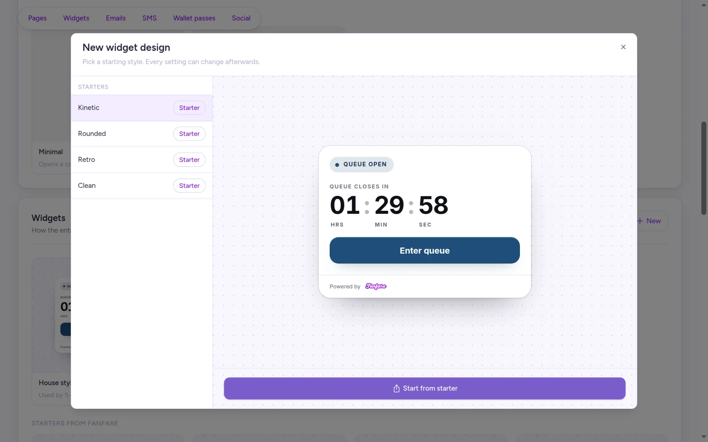

Design Studio holds the looks your team reuses on every drop. Build each one once and publish it: experiences pick page templates for the hosted page and widget designs for the entry widget, social posts pick a kit for their artwork, and your loyalty programme uses a wallet pass design.

<Info>Available on Growth and above.</Info>

On Starter, **Design Studio** in the sidebar opens the brand editor with no message, and a link to a template opens the plans page. Designs made before a downgrade to Starter keep working, but you cannot unpublish, delete or clear the default of one. On an experience's **Widget** card, an upgrade prompt replaces **Change design** and **Edit in Design Studio**; **Reset to org default** still works. Wallet pass designs need Pro. See [Plans and what they unlock](/guide/start/plans).

## Before you start

- Set your brand first: logo, colours and fonts come from it, and every template starts from it. See [Set your brand](/guide/create/brand).

## The library

**Design Studio** opens on a card for your brand, then six sections: **Pages**, **Widgets**, **Emails**, **SMS**, **Wallet passes** and **Social**. Each section has a **New** button and your own designs as cards. Pages, Widgets, Emails and SMS also show a **Starters from Fanfare** row of starting points; Social shows **Kits from Fanfare** instead, and Wallet passes has no starters.

Each card shows:

- A **Live** badge, or a dashed **Draft** badge for a design that is not published yet.
- A **Default** badge when it is your organisation's default for that section.
- On a page template or widget design that is in use, how many experiences use it, such as "Used by 3 experiences".
- "Based on [name]" for a clone, otherwise when it was last edited.

There is no search, sort or card menu: select a card to open its editor.

<Frame caption="Every design in your library, grouped by where it is used.">
  
</Frame>

## Create a design

### A page template

1. In **Pages**, select **New** → **Experience page** and choose a starter, or select a starter card in **Starters from Fanfare**.
2. The copy opens in the editor as a **Draft**, named after the starter.

There is no blank page template.

### A widget design

1. In **Widgets**, select **New**. The **New widget design** dialogue opens.
2. Choose a starting style: **Kinetic**, **Rounded**, **Retro** or **Clean**.
3. Select **Start from starter**. The design opens in the editor as a **Draft**.

<Frame>
  
</Frame>

### A social kit

In **Social**, **New** is always greyed out. Under **Kits from Fanfare**, select **Customise** on a kit; your copy opens as a **Draft**, where you set the **Card colour** (solid colours only), **Phase label**, **Title typeface**, message and hashtags. Saved changes to a live kit apply only to posts created afterwards. You choose the kit when you write a social post: see [Announcements](/guide/create/announcements).

## Edit a widget design

The canvas's state picker shows each moment of a drop, and its language menu each language.

<Frame caption="Each starting style sets the four style settings; change any of them to make it your own.">
  
</Frame>

The **Style** tab holds the look:

| Setting | What it does | Default | Can you change it once it is live? |
| --- | --- | --- | --- |
| **Starting style** | Picks one of four presets: **Kinetic**, **Rounded**, **Retro**, **Clean**. Switching it resets all four style settings to the new preset. If you had changed any of them, a message says so and offers **Undo**. | The one you chose when you created the design | Yes. Saving restyles every experience that uses the design. |
| **Corners** | **Square**, **Subtle**, **Soft** or **Pill**. | Set by the starting style. Kinetic: **Soft**. | Yes, as above. |
| **Border** | **None**, **Hairline** or **Bold**. | Set by the starting style. Kinetic: **Hairline**. | Yes, as above. |
| **Depth** | **Flat**, **Layered**, **Soft** or **Offset**. | Set by the starting style. Kinetic: **Soft**. | Yes, as above. |
| **Motion** | **Crisp**, **Smooth**, **Calm** or **Springy**. | Set by the starting style. Kinetic: **Smooth**. | Yes, as above. |
| **Action** | Colour of buttons and live badges. | "From brand" when your brand sets this colour, otherwise "From [style]", the starting style's own colour | Yes, as above. |
| **Highlight** | Colour of thumbnails and hover. | As for **Action** | Yes, as above. |
| **Card** | The widget surface. | As for **Action** | Yes, as above. |
| **Text** | Headlines and body text. | As for **Action** | Yes, as above. |

A changed style setting shows **Reset**, which returns it to the starting style. Fonts and the logo always come from your brand. An experience that sets its own colour on its **Design** tab keeps that colour; a design colour change does not reach it.

The **Text** tab lists the widget's text in the canvas's language: English, Spanish, French, German, Italian, Portuguese, Japanese or Chinese. The marketing text-message consent wording is fixed and not listed. Find a string with **Search all text** and type over it; **Reset to default** puts back Fanfare's wording. Each string can be at most 500 characters. Editing one language does not change the others, so translate each language you use. If a string refers to a value the widget cannot fill in, you cannot save until you remove it.

## Edit a page template

This is the editor an experience's own page uses: its tabs, fields and blocks, applying a template and **Save as organization template** are on [Build and publish the hosted page](/guide/create/hosted-page). The preview shows your last save. A template can be saved with required fields empty; a page made from it must fill them before it publishes.

## Save

Select **Save**, or press Cmd+S (Ctrl+S on Windows). A **Draft** saves straight away. If you try to leave the editor with unsaved edits, Fanfare asks "Discard unsaved changes?".

Saving a **Live** design asks you to confirm first.

<Warning>
  Saving a Live widget design restyles every experience that uses it, including drops that are live right now. The dialogue "Save changes to a published design?" says how many experiences will change and how many of them are in a freeze window. A Live page template is different: "Save changes to a live page template?" changes only pages created from it afterwards. See [Brand, templates and designs](/concepts/design).
</Warning>

## Publish

Only Live designs appear when an experience chooses a page template or widget design. Its pickers list at most 50 of each, plus the default, and for widgets the design the experience already uses.

1. Save your changes. **Publish** shows only on a **Draft**.
2. Select **Publish** in the editor bar. **Review & publish** summarises what goes live.
3. Select **Publish**.

## Make a design the default

The default page template is what **Create Page** copies on an experience. The default widget design is what every experience shows unless it chooses another.

1. Open a **Live** design.
2. Select **More actions** → **Make default**.
3. For a widget design, confirm "Make this the default widget design?". The dialogue says how many experiences follow the default and how many are in a freeze window.

For a widget design, confirming restyles every experience that follows the default at once. A new default page template affects only pages created afterwards. Social kits have no default.

To stop using a default, select **More actions** → **Clear default**. For a widget design, read [Things to know before you go live](#things-to-know-before-you-go-live) first.

## Choose the widget design for one experience

1. Go to **Experiences**, open the experience, and open **Design**.
2. On the **Widget** card, select **Change design**.
3. In **Choose a widget design**, pick one of your published designs, then select **Use template**.

The card then says "Chosen for this experience: [name]", or "Org default: [name]" while it follows the default. The preview-state selector shows the states this experience's distributions can reach. **Edit in Design Studio** opens the shared design, and the card warns "Changes every experience using this design ([count])." To go back to the default, open the … menu (**More widget actions**) and select **Reset to org default**.

<Frame caption="An experience follows the org default until you choose a design for it.">
  
</Frame>

<Warning>
  Choosing a design or selecting **Reset to org default** changes the widget at once on your own site and on the hosted page. Neither asks you to confirm, except while this experience is inside its [publish freeze](/concepts/design): then Fanfare asks "Change this experience during its drop?", and the change goes live as soon as you select **Save anyway**.
</Warning>

To put the widget on your own site, see [Run it on your own site](/guide/create/your-own-site).

## Rename, clone, unpublish and delete

All of these are under **More actions** in the editor.

- **Clone** makes a **Draft** copy with exactly the same name, then opens it. Rename it straight away; the gallery tells the two apart only by "Based on [name]".
- **Unpublish** returns a design to **Draft** and hides it from experience pickers. Pages already made from a page template are unchanged. Unpublishing a wallet pass design rebuilds the members' passes that carry it.
- **Delete** removes the design from Design Studio and every picker. It cannot be undone from the admin. Anything already using the design keeps it.

Three rules decide the order you do things in:

- Clear a default before you unpublish or delete it. Both are greyed out on the default, with "Clear the default before retiring this template".
- A widget design that any experience has chosen cannot be unpublished or deleted. Point those experiences at another design first.
- A wallet pass design that a loyalty audience uses cannot be unpublished or deleted. Choose another design for that audience in your loyalty pass settings first; see [Run a loyalty programme](/guide/learn/loyalty).

## Emails and SMS

Announcements are written from Fanfare's built-in layouts in the Marketing Hub. Email and SMS templates you make in Design Studio are not used by announcements. See [Announcements](/guide/create/announcements).

## Wallet pass designs

A wallet pass design sets how your loyalty pass looks in Apple Wallet and Google Wallet. The programme behind the pass, and turning passes on, are on [Run a loyalty programme](/guide/learn/loyalty).

1. In **Wallet passes**, select **New** → **Wallet pass**. A **Draft** opens with Fanfare's default content.
2. The editor shows the Apple Wallet and Google Wallet passes side by side. Select any part of a pass, or a region in the **Regions** list, to edit it.
3. Select **Save**, then **Publish**.

The **Regions** list has three groups. **Program name** and **Points & tier fields** apply to both passes; **Colors**, **Logo text** and **Strip image** are Apple only; **Background color**, **Circle logo** and **Hero image** are Google only. To change the barcode, which both passes share, select it on either pass.

| Item | Limit |
| --- | --- |
| **Program name** | Required, up to 40 characters. Google wraps it onto two lines after about 20. |
| Points and lifetime points labels | Up to 9 characters each. |
| Tier label | Up to 20 characters. |
| **Logo text** (Apple) | Up to 30 characters. Uses the programme name when empty. |
| Images | JPG, PNG or WebP; GIF is refused. Images are not cropped: one with the wrong shape only gets a warning. |
| Colours | A colour combination with low contrast gets a warning. |

Saving a **Live** pass design asks "Save changes to a published design?"; confirm with **Save & rebuild [count] passes**.

<Warning>
  Editing a Live pass design rebuilds the members' passes that carry it. Making or clearing the default wallet pass rebuilds the passes that fall back to the default. Clearing it ("Clear the default wallet pass?") leaves members without an audience-specific design with no pass design until you set a new default.
</Warning>

On Growth, the **Wallet passes** section shows an upgrade prompt. An existing pass design still opens, but only **Unpublish**, **Delete** and **Clear default** work: **Save** is disabled, **Publish** is hidden, and the other actions are greyed out with no reason shown.

## Things to know before you go live

- Clearing the default widget design puts every experience that follows the default back on Fanfare's built-in Kinetic style at once, live drops included. The dialogue says "They will show Kinetic."

## On Shopify

Everything on this page works the same in the Fanfare app in Shopify, except that a test email sent from a Design Studio editor goes to your Shopify staff account's email address, and only when Shopify has verified that address. Without a verified address, the **Send a test email** dialogue says "Your account has no email address to send a test to." and **Send** stays greyed out.

## Troubleshooting

<AccordionGroup>
  <Accordion title="Make default is greyed out">
    The design is a **Draft** ("Publish this template before making it the default"): publish it first. Wallet pass designs also need Pro.
  </Accordion>
  <Accordion title="Unpublish or Delete is greyed out, or refused">
    Greyed out: the design is your default; select **Clear default** first. Refused: experiences or a loyalty audience still use it, and the message does not say which experiences. Check each experience's **Widget** card, then follow the rules in [Rename, clone, unpublish and delete](#rename-clone-unpublish-and-delete).
  </Accordion>
  <Accordion title="Publish is greyed out">
    You have unsaved edits: select **Save**, then **Publish**. For a social kit, **Publish** also stays greyed out while the kit has issues; hover over **Publish** to see how many, and fix them.
  </Accordion>
  <Accordion title="A design does not appear in an experience's picker">
    Pickers show only Live designs, at most 50 of each kind: publish it.
  </Accordion>
  <Accordion title="The page template preview is empty">
    There is no experience to render the template against yet. Create one; you can still edit and save the template in the meantime.
  </Accordion>
</AccordionGroup>

## Related

<CardGroup>
  <Card title="Brand, templates and designs" href="/concepts/design"></Card>
  <Card title="Set your brand" href="/guide/create/brand"></Card>
  <Card title="Build and publish the hosted page" href="/guide/create/hosted-page"></Card>
  <Card title="Run it on your own site" href="/guide/create/your-own-site"></Card>
  <Card title="Announcements" href="/guide/create/announcements"></Card>
  <Card title="Run a loyalty programme" href="/guide/learn/loyalty"></Card>
</CardGroup>
