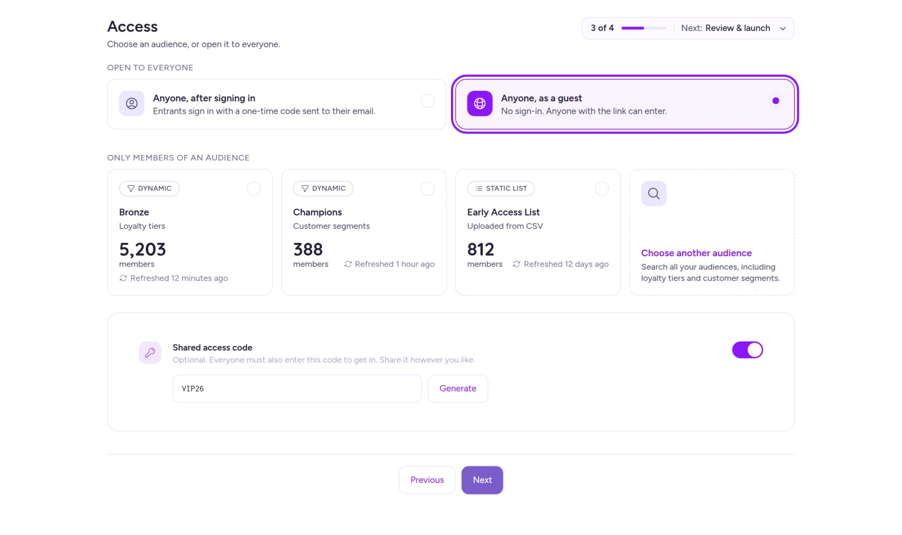
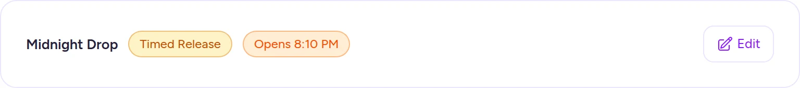

A timed release opens your product for purchase on a schedule, first come, first served—no waiting room, no raffle, and no bidding. If you want to pace traffic into checkout at a controlled rate instead, use a [queue](/guide/create/queue).

Timed releases are available on every plan and carry Fanfare's lower timed-release per-order fee. See [Timed release](/concepts/distributions/timed-release) for how a timed release behaves once live, and [Plans and what they unlock](/guide/start/plans) for rates.

## Before you start

- Have your products ready in Fanfare. See [Add products](/guide/create/products).
- Decide your opening time, closing time, and time zone.
- If you're adding to an existing experience, know which sequence the timed release belongs to.

## Create an experience with a timed release

Shared wizard steps and schedule defaults are covered in [Create an experience](/guide/create/experiences). A timed release skips configuration and payment steps—it flows straight through **Experience type** → **Configure Experience** → **Stock** → **Access** → **Review & launch**.

<Steps>
  <Step title="Choose Timed Release">
    Open **Experiences**, select **Create Experience**, and pick **Timed Release**.
  </Step>
  <Step title="Set products, dates, and stock">
    On **Configure Experience**, pick your products, name the experience, and set your time zone, opening time, and closing time. Then set your units on **Stock** (see [Allocate stock to a drop](/guide/create/stock-allocation)).
  </Step>
  <Step title="Choose who can enter">
    On **Access**, choose one of three options:
    - **Anyone, after signing in** (default): Shoppers sign in with a one-time email code.
    - **Anyone, as a guest**: No sign-in required—anyone with the link can enter.
    - **Only members of an audience**: Pick an audience card (or select **Choose another audience**). Shoppers sign in and Fanfare verifies their membership.
  </Step>
  <Step title="Review and create">
    Check each row on **Review & launch** (select **Edit** to adjust any step), then select **Create experience**.
  </Step>
</Steps>

<Frame caption="In the wizard, guest access for a timed release is set on the Access step.">
  
</Frame>

Choosing **Anyone, as a guest** enables **Allow guest access** on your timed release (the other two options leave it off). Keep in mind that guests can only return from the same browser, and guest access tends to attract more duplicate or throwaway entries than sign-in. See [Sequences and routing](/concepts/sequences).

The wizard leaves **Automatic entry** off by default. To turn it on, edit the timed release after creating it (see [Edit a timed release](#edit-a-timed-release)).

## Add a timed release to a sequence

Use this to add another drop window to an existing experience—for example, a public release following an early-access window in the same sequence.

1. Open your experience, then open the sequence you want to add to.
2. On the **Distributions** card, select **Add distribution**.
3. Enter a **Name**, select **Timed Release**, and click **Next**.
4. On **Schedule**, set **Opens**, **Closes**, and **Time zone**. Fanfare checks for overlaps against other distributions in the same sequence.
5. On **Configure**, turn on **Allow guest access** or **Automatic entry** if needed (both default to off).
6. Check **Review** and select **Create Distribution**.

There's no **Payment** step—shoppers always pay at checkout.

<Frame caption="Scheduled timed releases appear on the sequence's Distributions card with their opening time.">
  
</Frame>

Distribution windows in the same sequence can't overlap. To run a timed release alongside another distribution at the same time, place it in its own sequence—see [Distributions](/concepts/distributions/overview).

## Settings

| Setting | What it does | Default | Editable once live? |
| --- | --- | --- | --- |
| **Opens** | When the timed release opens for entry. | Set by you | Only earlier |
| **Closes** | When the timed release closes (must be after **Opens**). | Set by you | Yes, until it closes |
| **Time zone** | Zone used to display and enter times. Changing it keeps the exact same open/close moments in the new zone—re-pick the clock times if you meant to shift the schedule. | Experience's time zone | Yes |
| **Allow guest access** | Lets shoppers enter without signing in. | Off | Yes (unless gated to an audience) |
| **Automatic entry** | Automatically enters everyone who reaches the release, even visitors who leave immediately. When off, shoppers click to enter themselves. | Off | Yes |

<Note>
  **Automatic entry** is skipped for shoppers while a sequence tracks a size that can sell out, or while shoppers must pick a product or size on entry—they'll click to enter themselves instead, though Fanfare preserves your toggle setting.
</Note>

A few operational rules to keep in mind:

- **Locking:** Times save to the whole minute. Aside from **Opens** (which can only move earlier once live), nothing locks when a timed release opens. Once it closes, **Opens** and **Closes** lock permanently—create a new timed release for another window.
- **Audience gating:** Audience-gated sequences require sign-in, so adding an audience to a sequence later automatically turns **Allow guest access** off. See [Sequences and routing](/concepts/sequences).
- **No Mystery Box:** Timed releases can't share a sequence whose **Product Selection** is set to **Mystery Box**—Fanfare blocks combining them in either order.

## Edit a timed release

Select **Edit** on the timed release in your sequence's **Distributions** card to update **Schedule** (name, **Opens**, **Closes**, **Time Zone**) or **Configuration** (**Allow guest access**, **Automatic entry**). See [Change things mid-drop](/guide/drop/live-controls) for how live updates reach shoppers.

To end a timed release early, use **Deactivate**. Deactivation can't be undone, and the timed release's original schedule still blocks overlapping distributions in that sequence until you delete it. See [Stop a drop](/guide/drop/deactivate).

## Common patterns

| Pattern | How to set it up |
| --- | --- |
| **Flash sale** | Set a short window between **Opens** and **Closes**, and turn on **Allow guest access** if you want frictionless entry without sign-in. |
| **Members first, then everyone** | Create two sequences—an audience-gated sequence for members, then an open sequence for everyone—each with its own timed release. Sequence routing follows creation order and can't be reordered in the admin, so always create the members' sequence first. See [Add and gate sequences](/guide/create/sequences) and [Sequences and routing](/concepts/sequences). |
| **Countdown launch** | Schedule **Opens** in the future to build anticipation. See [What your customers see](/guide/drop/what-customers-see) for the pre-open countdown experience. |

## On Shopify

Before you've created your first experience, the **Experiences** page in the Shopify app offers **Create Timed Release** as a quick start (the standalone Fanfare admin shows **Create Appointment** instead).

Make sure checkout protection is enabled on your store so shoppers can't buy protected products outside your timed release. See [Storefront setup](/guide/shopify/storefront-setup).

## Troubleshooting

<AccordionGroup>
  <Accordion title="Schedule conflict">
    Your window overlaps another distribution in the same sequence. Adjust **Opens** or **Closes** so they don't overlap (back-to-back windows are fine), or add the timed release to a separate sequence to run them concurrently.
  </Accordion>
  <Accordion title="This time has passed. Choose a time from now on.">
    The opening time is too far in the past. When creating a timed release, Fanfare allows an opening time up to 5 minutes ago—pick a current or future time instead.
  </Accordion>
</AccordionGroup>

## Related

<CardGroup>
  <Card title="Timed release" href="/concepts/distributions/timed-release">
    How a timed release behaves and what shoppers see.
  </Card>
  <Card title="Create an experience" href="/guide/create/experiences">
    Walk through the experience wizard, shared settings, and time zones.
  </Card>
  <Card title="Add and gate sequences" href="/guide/create/sequences">
    Configure audiences, access codes, and order limits on a sequence.
  </Card>
  <Card title="Stop a drop" href="/guide/drop/deactivate">
    Deactivate a timed release, sequence, or experience.
  </Card>
</CardGroup>
