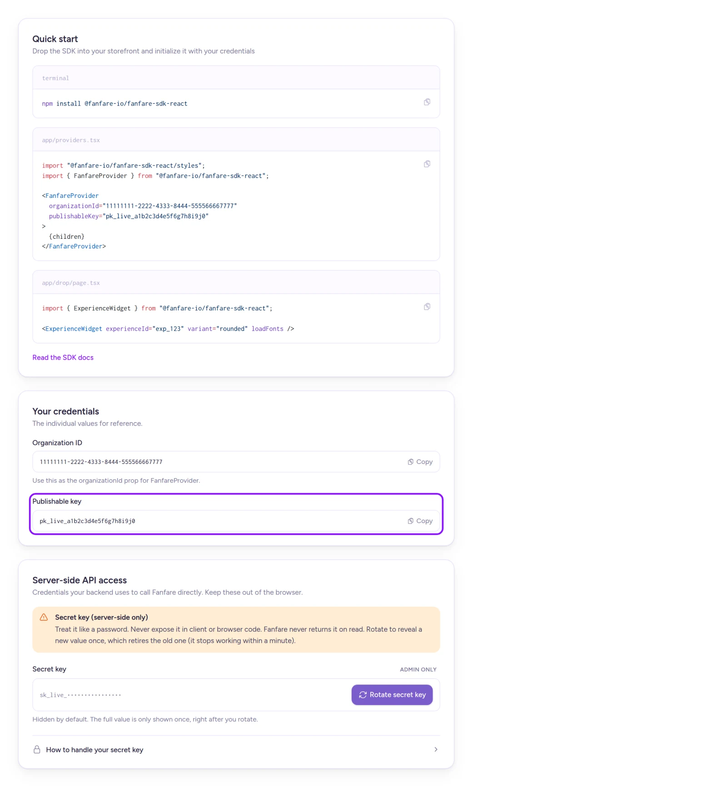

Run drops right on your own product or campaign pages by embedding the Fanfare widget—either alongside a Fanfare-hosted page (Growth and above) or completely on its own. It's the same interactive widget used on hosted pages and supports every drop type: queues, draws, auctions, timed releases, and appointments.

By default, visitors on your site see a **Get started** button before entering unless your developer configures the widget to launch automatically. If you'd like a standalone hosted page too, see [Build and publish the hosted page](/guide/create/hosted-page).

## Before you start

- Your experience is created in Fanfare.
- You have a developer who can add the widget to your website.

## Share credentials with your developer

<Steps>
  <Step title="Open API Keys">
    In the Fanfare admin, go to **Settings → API Keys**. Any team member can view these credentials.
  </Step>
  <Step title="Copy your Organization ID and Publishable key">
    Under **Your credentials**, copy your **Organization ID** and **Publishable key** and share both with your developer.
  </Step>
  <Step title="Share the Quick start snippet and SDK docs">
    Point your developer to the **Quick start** card on the same page (pre-filled with your organization's credentials) and select **Read the SDK docs** for full setup details—also available in the [SDK docs](https://docs.fanfare.io/sdk/components/react).
  </Step>
  <Step title="Send the experience ID">
    Open the experience you want to embed and copy its ID from the browser URL (the segment right after `/app/experiences/`). Your developer will replace the placeholder experience ID in the **Quick start** snippet with this value.
  </Step>
</Steps>

<Frame caption="Share your Organization ID, Publishable key, and the experience ID with your developer.">
  
</Frame>

<Warning>
  For a draw, timed release, or auction sequence set to **Customer Picks**, your website must run **Fanfare SDK 0.20.0 or later** so shoppers can pick their product on entry. Older SDK versions can't display the picker and will block entry on your site (hosted pages aren't affected). Check your SDK version with your developer before launching—see [Add and gate sequences](/guide/create/sequences).
</Warning>

<Warning>
  Never put your secret key in frontend or website code—it's strictly for your backend server. See [API keys and embedding](/guide/account/developer).
</Warning>

## How styling works on your site

- **Your brand:** Applies automatically once a customer enters the experience. To style pre-entry screens (such as **Get started** and sign-in), ask your developer to pass your brand config to the widget. See [Set your brand](/guide/create/brand).
- **Widget design:** Your experience's widget design applies on your site unless your developer overrides the starting style in code. Note that the **Quick start** snippet includes the **Rounded** starting style—ask your developer to remove it if you want your Design Studio style to control the look. Assigning a custom widget design beyond your default requires Growth or above; see [Templates and widget designs](/guide/create/templates).
- **Experience colors:** Any overrides set on the experience's **Design** tab under **Experience colors** apply automatically on your site. See [Brand, templates, and designs](/concepts/design).
- **Custom site styling:** Theme styling passed directly by your developer in code overrides your brand, widget design, and experience colors.
- **Brand fonts:** Display when loaded by your website or when widget font loading is enabled (included in the **Quick start** snippet). See [Set your brand](/guide/create/brand).

{/* image: guide-create-your-own-site-widget */}

## What changes without a published hosted page

If you run a drop exclusively on your own website—or if your organization's drop-page address isn't active—messages and posts that normally link to a Fanfare-hosted page behave differently:

- **Audience invites won't send:** Because invites require a hosted page URL, the invite displays **Needs an experience page link** (and **Needs link** on the sequence card). See [Invites, waitlist and access-code sends](/guide/create/invites-and-waitlist).
- **Access-code emails omit the button:** Codes still send, without the button linking to a hosted page. See [Invites, waitlist and access-code sends](/guide/create/invites-and-waitlist).
- **Social posts and SMS omit the link:** Scheduled posts and texts go out without a hosted page link, and Discord server events are skipped. See [Announcements](/guide/create/announcements).
- **Purchase notifications use your Product URL:** Win notices, queue admission messages, payment reminders, and outbid alerts link to each product's **Product URL** instead (or send without a link if no **Product URL** is set). See [Add products](/guide/create/products).

## Embed a hosted page in an iframe

If you publish a hosted page and want to display it inside an iframe on your own website, an organization admin must add your site's origin under **Settings → Embedding**. In the standalone Fanfare admin, this setting controls iframe framing only—it doesn't restrict the embedded SDK widget. See [API keys and embedding](/guide/account/developer).

## Preview before launch

- Preview every widget state on the experience's **Design** tab under **Widget** ([Templates and widget designs](/guide/create/templates)).
- Review every screen and notification shoppers experience in [What your customers see](/guide/drop/what-customers-see).

## On Shopify

On Shopify, you don't need custom SDK code—add the Fanfare widget directly to your product pages as a theme app block from **Settings → Storefront setup**, and turn on Fanfare's checkout rule to protect your inventory. See [Storefront setup](/guide/shopify/storefront-setup) and [Checkout protection](/guide/shopify/checkout-protection).

Two admin settings behave differently in the Shopify app:

- **Embedding:** Once you add a site under **Settings → Embedding**, only those listed sites and your store's own domains can access Fanfare from the browser.
- **API Keys:** Any staff member using the Fanfare app can rotate the secret key. See [API keys and embedding](/guide/account/developer).

## Related

<CardGroup cols={2}>
  <Card title="Build and publish the hosted page" href="/guide/create/hosted-page">
    Launch your drop on a dedicated Fanfare-hosted page.
  </Card>
  <Card title="Templates and widget designs" href="/guide/create/templates">
    Customize and preview your entry widget design.
  </Card>
  <Card title="API keys and embedding" href="/guide/account/developer">
    Manage API keys, secret keys, and iframe embedding allowlists.
  </Card>
  <Card title="What your customers see" href="/guide/drop/what-customers-see">
    Walk through the customer journey at every drop stage.
  </Card>
</CardGroup>
