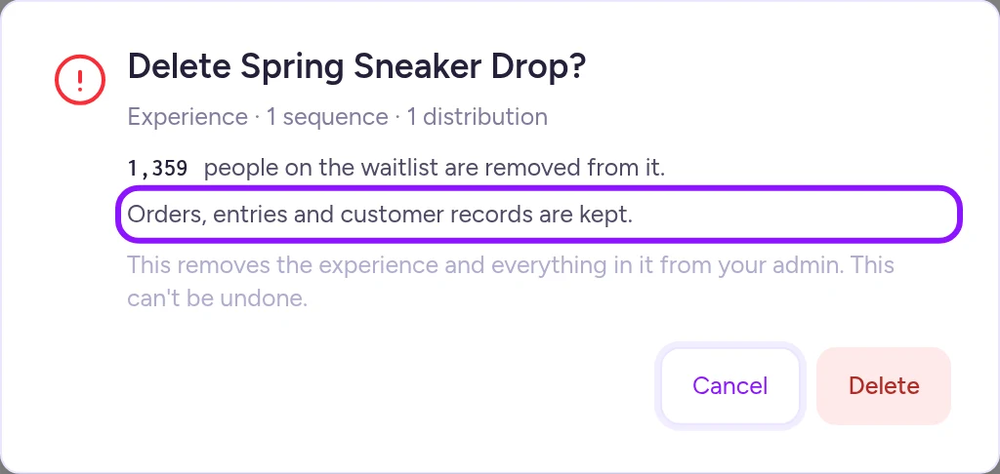

Fanfare gives you two ways to shut down and clean up a drop:

- **Deactivate** stops a distribution, sequence, or entire experience immediately and permanently. It's not a pause—if you just want to slow down a queue or adjust timing, use [Change things mid-drop](/guide/drop/live-controls) or **Pause queue** ([Set up a queue](/guide/create/queue)). Only **organization admins** can deactivate.
- **Delete** removes an already-ended distribution, sequence, or experience from your admin while keeping orders, entries, and customer records intact. Any team member can delete once an item is eligible.

## Deactivate

Before deactivating, choose the smallest scope that solves your issue: deactivating a **distribution** stops only that distribution, deactivating a **sequence** stops every distribution inside it, and deactivating an **experience** stops every sequence and distribution inside it.

### Where to find Deactivate

| Scope | Where to select it | Available when |
| --- | --- | --- |
| **Distribution** | Card menu on the sequence's **Distributions** card → **Deactivate** (also **Deactivate auction** or **Deactivate distribution** on the auction/appointment panel) | The distribution hasn't been deactivated yet |
| **Sequence** | **Deactivate Sequence** in the sequence header, or **Deactivate** in the sequence menu on the experience **Overview** | At least one distribution in the sequence hasn't been deactivated |
| **Experience** | **Deactivate Experience** in the experience header, or **Deactivate** in the row menu on **Experiences** | At least one distribution in the experience hasn't been deactivated |

<Note>
  On an appointment panel, **Deactivate distribution** is disabled before the appointment opens—use **Deactivate** from its card menu to cancel a scheduled appointment.
</Note>

<Frame caption="Delete stays unavailable until everything in the experience has been deactivated.">
  
</Frame>

### How to deactivate

<Steps>
  <Step title="Open the Deactivate dialog">
    Select **Deactivate** at the distribution, sequence, or experience level from the table above.
  </Step>
  <Step title="Review the customer impact">
    Check **Who this affects right now** to see how many waiting customers, unpaid winners, bidders, or bookings will be removed immediately.
  </Step>
  <Step title="Type deactivate to confirm">
    Enter `deactivate` in the confirmation box and select **Deactivate** (the button stays disabled until the impact counts finish loading and you type the confirmation word). If counts fail to load, Fanfare shows a notice and you can still deactivate.
  </Step>
</Steps>

<Warning>
  **Deactivate can't be undone.** Paid orders are always kept, but you can't reopen a deactivated drop. Once every distribution in a sequence or experience is deactivated, you can't add new distributions or sequences to it—you'll need to add a new sequence (if the experience still has active ones) or create a new experience to launch again.
</Warning>

<Warning>
  **Deactivating any single distribution or sequence marks your entire hosted page as ended**—even when other sequences or distributions in the same experience are still live or scheduled. There's no way to deactivate one sequence while keeping the shared public page open for others. The dialog only warns about this when other sequences are still running, not about other distributions in the same sequence.
</Warning>

<Frame caption="When your hosted page is live and other sequences are still running, the dialog warns that the entire public page will show as ended.">
  
</Frame>

### What happens to customers

Deactivation takes effect within seconds. Customers **already inside checkout** can still finish paying within their active payment window, and any unused card pre-authorization holds are released instead of charged. Everyone else loses access immediately:

| Distribution | What happens to active customers |
| --- | --- |
| **Queue** | People waiting in line won't be admitted. Customers who were admitted but haven't started checkout lose their spot. |
| **Draw** | Entries won't be drawn. Winners who haven't started paying lose their win. |
| **Auction** | All bids are voided and no winner is selected—even if the leading bid met the reserve. Winning bidders who haven't started paying lose the win. |
| **Appointment** | All upcoming bookings are canceled automatically and customers are notified. |
| **Timed release** | Entry ends immediately, and admitted customers who haven't started paying lose their spot (the dialog doesn't include these customers in its count). |
| **Any sequence's waitlist** | The distribution won't open for them, and any pending "opens soon" emails won't send. |

Anyone who visits the drop page afterward sees that it has ended. See [What your customers see](/guide/drop/what-customers-see).

<Frame caption="Review who is affected right now, then type deactivate to confirm.">
  
</Frame>

### Special rules for English auctions

Unlike Dutch auctions, an **English auction** can block deactivation most commonly in two situations:

- **A winner is actively checking out:** Wait until they complete payment or their payment window expires, then deactivate again.
- **The auction closed without settling:** If you're trying to deactivate its parent sequence or experience, deactivate that English auction individually first (from its card menu or **Deactivate auction**), then deactivate the sequence or experience. Deactivating an unsettled English auction withdraws it so no further winner is chosen, while letting any winner already in checkout keep their unit.

### After you deactivate

- **Status updates:** Deactivated distributions switch to **Ended early** (or **Ended** if already past their close time) and become read-only (**View** instead of **Edit**). Sequences and experiences update once nothing inside them is live or scheduled. See [Experiences](/concepts/experiences) and [Read your results](/guide/learn/performance).
- **Closed distributions included:** Deactivating a sequence or experience also deactivates distributions inside it that already closed on their own, ending anything still settling and relabeling the page as ended.
- **Appointment cancellations:** On the appointment panel, Fanfare displays a live progress counter as it cancels upcoming bookings.
- **Partial propagation:** If Fanfare warns that the change hasn't reached every live page yet, run **Deactivate** a second time to finish propagating it.

<Frame caption="Deactivated sequences display the Ended early chip along with the deactivation date.">
  
</Frame>

## Delete

**Delete** permanently removes a finished distribution, sequence, or experience from your admin. It never deletes **orders, entries, or customer records**—your historical orders remain in **Orders** ([Orders and refunds](/guide/learn/orders)).

### When Delete is available

You can't delete anything while it's live, scheduled, or still releasing active payment windows:

- **Live or scheduled items:** Deactivate first. **Delete** stays disabled in experience and sequence headers until everything inside is deactivated—except while an auction is running, when header **Delete** on the experience, the sequence, or the auction itself looks enabled (selecting it opens the **Delete** confirmation first, and confirming opens the **Deactivate** dialog). Selecting **Delete** on any other live or upcoming distribution opens the **Deactivate** dialog directly.
- **Wind-down wait period:** Even after a drop ends or is deactivated, **Delete** waits until all payment windows have finished winding down (about **payment window + 1 hour**) and is refused during this period even though the button looks available:
  - **After Deactivate:** About 90 minutes with the default payment window, or about 2 hours for a draw.
  - **After natural close (queue and timed release):** Payment window + ~1 hour from close (about 90 minutes for a timed release).
  - **After natural close (draw):** Payment window + ~2 hours (about an hour longer than a queue or timed release), measured from the final selection if it keeps drawing until every unit is claimed.
  - **After natural close (auction):** About 90 minutes from close or settlement, whichever is later. An English auction that closed without settling stays on hold for about 30 days unless you deactivate it, which drops the wait to about 90 minutes.
- **Appointments:** No wind-down wait, but you can't delete an appointment while any upcoming or in-progress booking stands. After deactivating, wait for all booking cancellations to complete, then delete. Past bookings don't block deletion.

See [Admission and the payment window](/concepts/admission-and-payment) for how payment windows wind down.

### How to delete

<Steps>
  <Step title="Select Delete">
    Choose **Delete** from the experience or sequence header, the **Experiences** row menu, or a distribution's card menu.
  </Step>
  <Step title="Review what's removed">
    Confirm the scope. Deleting an experience or sequence also removes any remaining waitlist sign-ups and stops pending "opens soon" emails, while keeping all orders, entries, and customer records.
  </Step>
  <Step title="Confirm deletion">
    Select **Delete**. There's no undo or restore. Old links show that the experience was deleted and when; its orders stay in **Orders**.
  </Step>
</Steps>

<Frame caption="Deleting removes the experience from your admin while keeping orders, entries, and customer records.">
  
</Frame>

## On Shopify

- **Checkout protection stays active after Deactivate:** Deactivating an experience does *not* release Shopify checkout protection on its products, so shoppers still won't be able to buy them normally. **Delete** the experience (or remove the products from it) to release protection. If removing protection fails for any product during deletion, the delete still completes and lists the affected products—see [Checkout protection](/guide/shopify/checkout-protection) to clean them up.
- **Admin permissions:** Every Shopify staff member who can open the Fanfare app counts as an organization admin and can deactivate drops.
- **No appointments:** Appointments aren't offered in the Shopify app.

## Troubleshooting

<AccordionGroup>
  <Accordion title="Delete is refused after I deactivated">
    Active admissions are still winding down. Wait about 90 minutes with the default payment window (or about 2 hours for a draw) and try again. See [When Delete is available](#when-delete-is-available).
  </Accordion>
  <Accordion title="I can't add a sequence or distribution anymore">
    Every distribution in the experience or sequence has been deactivated, so it's permanently closed to new additions. Add a new sequence (if the experience still has active sequences) or create a new experience.
  </Accordion>
</AccordionGroup>

## Related

<CardGroup>
  <Card title="Experiences" href="/concepts/experiences">
    Understand status chips and the full experience lifecycle.
  </Card>
  <Card title="What locks, and when" href="/concepts/what-locks-when">
    See what stays editable before, during, and after a drop.
  </Card>
  <Card title="Change things mid-drop" href="/guide/drop/live-controls">
    Pause a queue, pull close times earlier, or move units without deactivating.
  </Card>
  <Card title="What your customers see" href="/guide/drop/what-customers-see">
    Preview the screens customers see after a drop ends or is canceled.
  </Card>
  <Card title="Orders and refunds" href="/guide/learn/orders">
    View and manage paid orders—all orders survive Deactivate and Delete.
  </Card>
</CardGroup>
