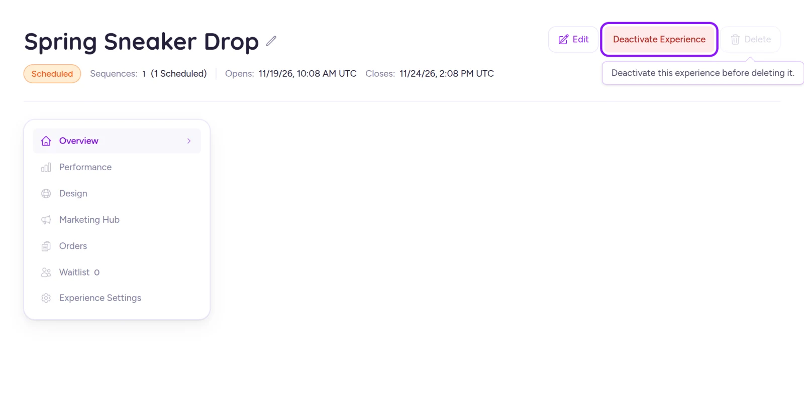
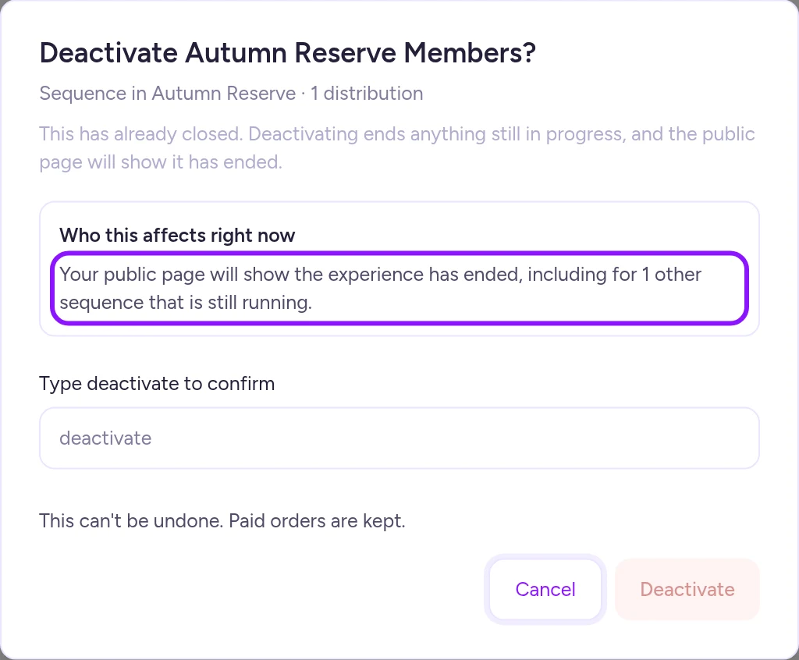
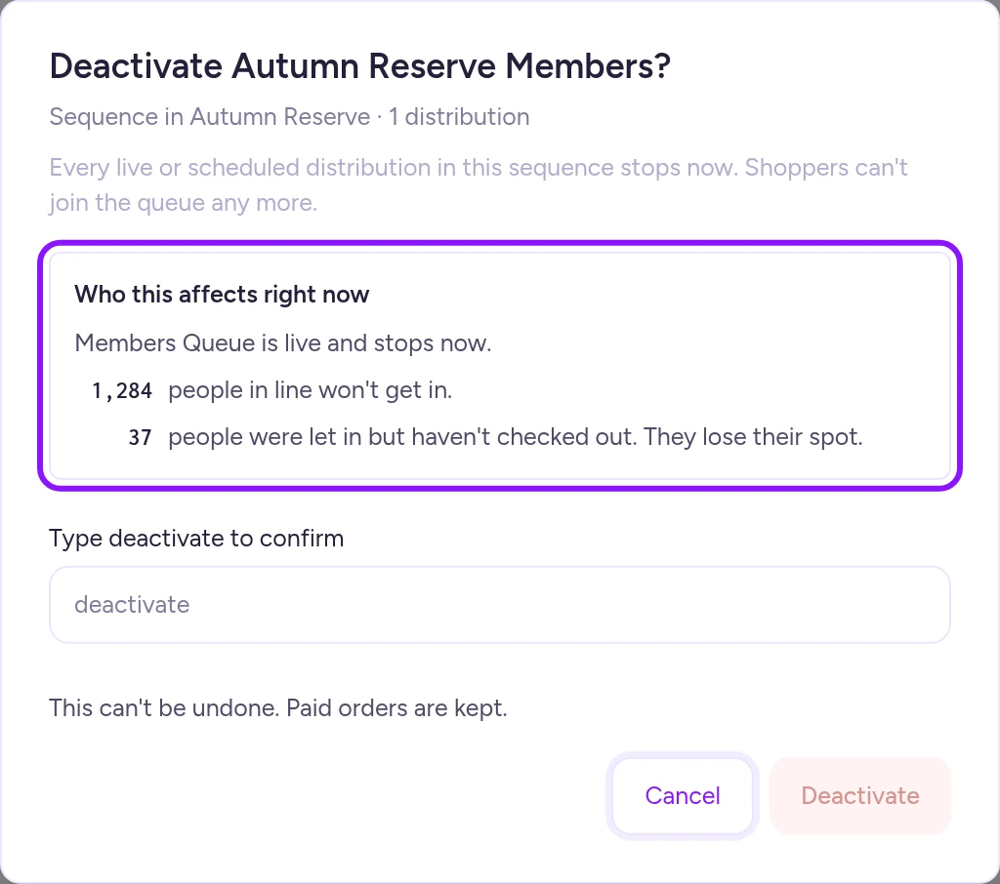
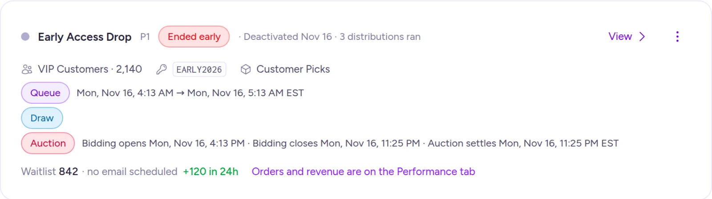

Two actions end a drop. **Deactivate** ends a distribution, a sequence or a whole experience straight away, for good. It is not a pause: to change settings mid-drop see [Change things mid-drop](/guide/drop/live-controls), and to hold a queue for a while see [Set up a queue](/guide/create/queue). **Delete** removes something that has already finished from your admin. Deactivate needs an organisation admin: anyone else sees the option but is refused with "Only an organization admin can deactivate this. Ask an admin to do it." Delete is open to every team member, so a member can delete an ended experience that they could not deactivate.

## Before you start

- To deactivate, you are an organisation admin.
- You know which scope you want. A sequence is one way in to an experience. Deactivating a distribution ends that one distribution; a sequence ends every distribution in it; an experience ends every distribution in every sequence.

## Deactivate

### Where the action is

| Scope | Where | Offered while |
| --- | --- | --- |
| A distribution | The card menu on the sequence's **Distributions** card → **Deactivate**. Also **Deactivate distribution** on the appointment view and **Deactivate auction** on the auction view, both on the sequence's **Overview**. | The distribution has not been deactivated |
| A sequence | **Deactivate Sequence** in the sequence header, or **Deactivate** in the sequence's menu on the experience **Overview** | Any distribution in the sequence has not been deactivated |
| An experience | **Deactivate Experience** in the experience header, or **Deactivate** in the row menu on the **Experiences** list | Any distribution in the experience has not been deactivated |

**Deactivate distribution** on the appointment view is greyed out while the appointment has not opened yet. To deactivate a scheduled appointment, use **Deactivate** in its card menu.

<Frame caption="Delete stays unavailable until everything in the experience has been deactivated.">
  
</Frame>

### Steps

1. Open the action for the scope you want, from the table above.
2. Read the dialogue. Its title is "Deactivate [name]?", with a line under it saying what you are deactivating, such as "Experience · 2 sequences · 3 distributions" or "Queue in Public Draw".
3. Read the description. It depends on what is running:
   - A live distribution: "It stops now. Shoppers can't join the queue any more." (the verb matches the type: join the queue, enter the draw, bid, book a time, buy from the release).
   - A scheduled distribution: "It won't open, so shoppers won't be able to enter the draw."
   - A sequence or experience: "Every live or scheduled distribution in this sequence stops now." (or "in this experience"), followed by what customers can no longer do.
   - Anything with nothing live or scheduled left: "This has already closed. Deactivating ends anything still in progress, and the public page will show it has ended."
4. Read **Who this affects right now**. It counts the customers this reaches at this moment (see the table below). If the count fails, the dialogue says "We couldn't count who this affects. You can still deactivate."
5. Type `deactivate` in the confirmation field. **Deactivate** stays greyed out until you do, and while the counts are still loading.
6. Select **Deactivate**.

Escape and clicking outside do not close the dialogue; use **Cancel**.

<Warning>
  Deactivate cannot be undone. The dialogue says "This can't be undone. Paid orders are kept." Once every distribution in a sequence or experience is deactivated, it takes nothing new: to run the drop again, add a new sequence, or create a new experience if the whole experience was deactivated.
</Warning>

<Warning>
  Deactivate reaches customers within seconds. Everyone counted under **Who this affects right now** loses their place, entry, bid or booking, as listed in the table below, except customers already paying, who can finish within their payment window.
</Warning>

<Warning>
  Deactivating any one distribution or sequence makes your public page show the whole experience as ended, including for anything still running. The dialogue warns you only when the page is published and other sequences are live or scheduled: "Your public page will show the experience has ended, including for N other sequences that are still running." It says nothing about other distributions in the same sequence. There is no way to end one sequence and keep the page open for the others.
</Warning>

<Frame caption="This line appears only when the page is published and other sequences are still live or scheduled.">
  
</Frame>

### What happens to customers

| Distribution | What the dialogue says happens |
| --- | --- |
| Queue | People in line "won't get in". People who "were let in but haven't checked out" "lose their spot". |
| Draw | Entries get no draw: "No winners will be drawn." Winners who "haven't paid yet" "lose their win". |
| Auction | "All bids are voided" and no winner is chosen, even if the leading bid met the reserve. Winning bidders who "haven't paid yet" "lose the win". |
| Appointment | "upcoming bookings are cancelled." |
| Timed release | It ends. Customers who were let in but haven't started paying lose their place, although the dialogue does not count them. |
| Any sequence's waitlist | "It won't open for them." Where an opens-soon email was due, it "won't be sent". |

A customer who had already started paying when you deactivate can still finish their purchase within their payment window. Where entry pre-authorised a card, a card that has not been charged yet is released instead of charged.

When no one is affected, the list reads "No one is in line, holding a spot or booked right now." Customers who open the page afterwards see that it has ended: [What your customers see](/guide/drop/what-customers-see) shows each screen.

<Frame caption="Type deactivate to confirm. The impact list counts who this reaches right now.">
  
</Frame>

### Auctions

An English auction can refuse Deactivate. The two cases you are most likely to meet:

- A winner is still checking out: "A winner of this auction still holds an admission to check out, so it can't be deactivated yet." Wait for them to pay or for their payment window to run out, then try again.
- An English auction ended without settling, and you are deactivating its sequence or experience: "The English auction '[auction name]' ended without settling, so it can't be deactivated as part of a sequence or experience. Deactivate '[auction name]' on its own first." Deactivate that auction from its card menu or with **Deactivate auction**, then deactivate the sequence or experience.

A Dutch auction does not refuse. Outside the two cases above, a winning bidder who has not started paying loses the win, and one who has already started paying can finish.

When you deactivate an English auction that ended without settling with **Deactivate auction**, the dialogue adds: "Deactivating withdraws this auction, and no further winner is chosen. A winner already in checkout keeps their unit."

## After you deactivate

- When you deactivate from a distribution's card menu, the appointment view or the **Experiences** list, a message confirms it, such as "Experience '[name]' was deactivated. It can be deleted once nothing in it is still on hold." The header buttons, the sequence menu on the **Overview** and **Deactivate auction** close the dialogue without a message; the status chip shows the change.
- The deactivated distribution's chip changes to **Ended early**, or to **Ended** if its window had already closed, and its card shows "Deactivated" with its date. A sequence or experience chip changes once nothing in it is still live or scheduled, and its header then shows a "Deactivated:" date. Chips are explained in [Experiences](/concepts/experiences).
- A deactivated distribution's card shows **View** instead of **Edit**, and its settings open read only: "This distribution was deactivated and can't be edited."
- For an appointment, the appointment view shows "Cancelling bookings · [cancelled] of [total]" until it reads "Cancelled [total] bookings".
- Once every distribution in a sequence is deactivated, **Create Distribution**, **Add distribution** and **Duplicate** disappear from it. Once every distribution in the experience is deactivated, **Add sequence** disappears too. The admin refuses new ones with "This experience was deactivated. Create a new experience to run it again." or "This sequence was deactivated. Add a new sequence to run it again."
- On the **Performance** tab a deactivated distribution reads "Ended", with a date once its scheduled close has passed. See [Read your results](/guide/learn/performance).

If you see "Deactivated, but the change has not reached every live page yet. Deactivate again to finish it.", deactivate again.

<Frame>
  
</Frame>

## Delete

### When Delete is available

- While anything is live or scheduled, Delete is unavailable. In the experience and sequence headers it is greyed out with "Deactivate this experience before deleting it." or "Deactivate this sequence before deleting it." In the **Experiences** list row menu the same reason shows under **Delete**. A distribution's **Delete** opens the Deactivate dialogue instead, with the line "This distribution can't be deleted while it is active or upcoming. Deactivate it first. It can be deleted once its admissions have finished winding down." above its description.
- After it ends, Delete waits for admissions to wind down, and is refused meanwhile even though the button looks available. The wait is:
  - After Deactivate: the payment window plus about an hour. With the default payment window that is about 90 minutes, or about 2 hours for a draw.
  - After a queue, draw or timed release closes on its own: its payment window plus about an hour from its close (about 90 minutes for a timed release). A draw waits about an hour longer, measured from its final selection if it keeps drawing until every unit is claimed.
  - After an auction closes on its own: about 90 minutes from its close or settlement, whichever is later. An English auction that closed without settling is held for about 30 days, unless you deactivate it, which brings it down to about 90 minutes.

  The refusal arrives as a message: "A distribution here may still be releasing its admissions. It can be deleted once that has finished." or "An ended auction here is still on hold. It can be deleted once that hold ends." See [Admission and the payment window](/concepts/admission-and-payment).
- An appointment has no wait, but it cannot be deleted while any booking for a time that has not ended yet still stands: **Delete** fails with "Appointment could not be deleted". After Deactivate, wait until the appointment view shows the bookings cancelled, then try again. Bookings whose time has passed do not block Delete.

<Note>
  Delete looks available on a sequence, experience or auction while an auction is still running. Selecting it opens the Delete confirmation; after you confirm, the Deactivate dialogue opens instead.
</Note>

### Steps

1. Select **Delete** in the experience or sequence header, in the **Experiences** list row menu, or in a distribution's card menu.
2. Read the dialogue, titled "Delete [name]?":
   - Experience: "This removes the experience and everything in it from your admin. This can't be undone."
   - Sequence: "This removes the sequence and its distributions from the experience. This can't be undone."
   - Distribution: "This removes it from its sequence. This can't be undone."
3. Read the details. For an experience or sequence with a waitlist, people on the waitlist "are removed from it", and where an opens-soon email was due, it "won't be sent". Every Delete dialogue says "Orders, entries and customer records are kept."
4. Select **Delete**.

<Frame caption="Deleting keeps orders, entries and customer records.">
  
</Frame>
There is no restore. An old link to a deleted experience shows "[name] was deleted" and "It was deleted on [date]. Its orders are still in Orders." An old link to a deleted sequence shows "It was deleted from [experience] on [date]." Orders stay in **Orders**: see [Orders and refunds](/guide/learn/orders).

## Things to know before you go live

- Deactivating a sequence or an experience also deactivates distributions in it that already closed on their own, and the action stays offered after the drop has closed. The page is relabelled as ended, and anything still in progress ends with it.

## On Shopify

- Shopify does not distinguish admins from members: every staff member who can open the Fanfare app in Shopify counts as an admin, so the admin-only refusal does not apply there.
- Deactivate leaves the protection on the Shopify products an experience covers in place. Deleting the experience removes it. If that fails, the delete still succeeds and a message names the products. [Checkout protection](/guide/shopify/checkout-protection) explains how to fix it.
- Appointments are not offered in the Fanfare app in Shopify, so **Deactivate distribution** on the appointment view does not apply.

## Troubleshooting

<AccordionGroup>
  <Accordion title="Delete is refused after I deactivated">
    Admissions are still winding down. Wait about 90 minutes with the default payment window, or about 2 hours for a draw, and try again. See [When Delete is available](#when-delete-is-available).
  </Accordion>
  <Accordion title="I can't add a sequence or distribution any more">
    Everything in the experience or sequence has been deactivated, and it takes nothing new. Create a new experience, or add a new sequence if the experience still has one running.
  </Accordion>
</AccordionGroup>

## Related

<CardGroup>
  <Card title="Experiences" href="/concepts/experiences">
    Status chips and the experience lifecycle.
  </Card>
  <Card title="What locks, and when" href="/concepts/what-locks-when">
    What you can change before, during and after a drop.
  </Card>
  <Card title="Change things mid-drop" href="/guide/drop/live-controls">
    Pause a queue, move units and other changes short of Deactivate.
  </Card>
  <Card title="What your customers see" href="/guide/drop/what-customers-see">
    The screens customers see once a drop has ended.
  </Card>
  <Card title="Orders and refunds" href="/guide/learn/orders">
    Orders survive Deactivate and Delete.
  </Card>
</CardGroup>
