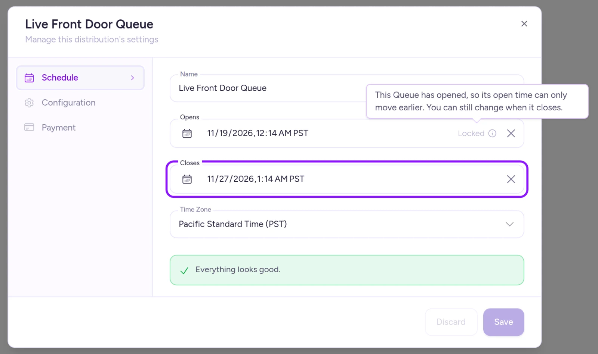
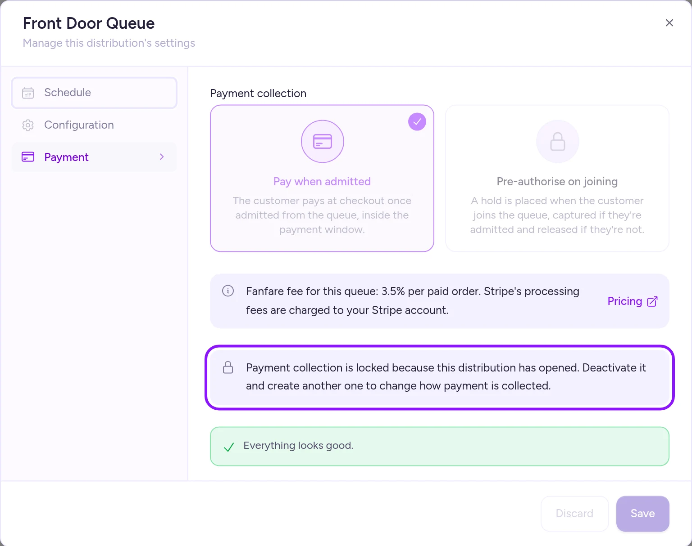

Something needs to change while the drop is running: the pace of a queue, the closing time, the stock in one size, a booking. Most distribution settings stay editable while customers are in, and a few lock at a set moment. This page shows where to make each change and what happens when you save. A sequence is one way in to an experience, and every distribution belongs to one sequence.

## Before you start

- The experience has a sequence with a live or upcoming distribution.
- You know which sequence the change belongs to. Live settings, stock moves and bookings are all on the sequence's **Overview** tab.
- To read the live numbers before you act, see [Watch a live drop](/guide/drop/watch-live).

## Edit a live distribution

1. Open the experience, then the sequence.
2. On the **Overview** tab, in the **Distributions** card, select **Edit** on the distribution's card.
3. Change what you need in **Schedule**, **Configuration** or **Payment**. Queues and draws have a **Payment** section; the other types do not.
4. Select **Save**.

Your plan limits which distribution types you can create, not edits. A distribution stays editable, and **Pause queue** and **Resume queue** keep working, even if your plan no longer includes its type.

On the live screen of a queue or draw, the pills under **Change a setting** on **Run** open these same settings, with no field selected. See [Watch a live drop](/guide/drop/watch-live).

<Warning>
  **Save** applies the change straight away. There is no confirmation step. Lowering **Admit rate**, moving **Closes** earlier, or switching **Allow guest access** or **Automatic entry** on a queue or draw changes who gets in. Check the value before you save.
</Warning>

<Frame caption="Once a distribution has opened, you can still change when it closes.">
  
</Frame>

## Change when a distribution closes

**Closes** stays editable while the distribution is live. You can end entry earlier or let it run later. Distributions in one sequence cannot overlap, so a later close cannot run into the next distribution's window: **Save** stays disabled until the window is clear. On a draw, the **Draw date** must stay inside the window, so move it too if you close earlier than it. An appointment's times cannot move at all while any booking stands.

Once the distribution has opened, **Opens** shows **Locked** and can only move earlier. Hovering **Locked** shows "This [type] has opened, so its open time can only move earlier. You can still change when it closes." Moving it back into the future does not unlock anything that locked when it opened. A queue counts as opened about five and a half minutes before **Opens**, just before customers can start joining five minutes before it. The lead time for each type is on its setup page.

Once the distribution has closed, its schedule can no longer move. A change to its times is refused with a message that names the type, such as "This draw has closed. Create a new one." A closed queue refuses every save, with "This queue has closed. Create a new queue."

Moving **Closes** earlier is not the same as **Deactivate**. **Deactivate** stops the distribution at once and ends everything in progress, and it cannot be undone. See [Stop a drop](/guide/drop/deactivate).

When **Closes** passes on a queue, no one new can join, and customers still waiting in line are turned away. Customers it has already let in keep their admission.

## What you can change while it is live

Why each setting locks when it does is in [What locks, and when](/concepts/what-locks-when). Defaults and exact field rules for each type are on [Set up a queue](/guide/create/queue), [Set up a draw](/guide/create/draw), [Set up an auction](/guide/create/auction), [Set up a timed release](/guide/create/timed-release) and [Set up appointments](/guide/create/appointment).

| Setting | Can you change it now? |
| --- | --- |
| **Closes** (every type) | Yes, until it closes. For an appointment, not while any booking stands. |
| **Opens** (every type; **First bookable slot** on an appointment) | Only earlier, once it has opened. On an appointment, not at all while any booking stands. |
| Queue **Admit rate** | Yes. It sets how many people are let in each minute from now on. |
| **Allow guest access** and **Automatic entry** (queue, draw, timed release) | Yes. Guest access cannot be turned on while the sequence has an audience, and a timed release on counted stock does not offer automatic entry to customers, whatever this is set to. |
| **Bias toward loyal consumers** (queue, draw) | Yes, but on a queue it only orders people who joined before **Opens**. See [Set up a queue](/guide/create/queue). |
| Draw **Winner count** | Yes, until entry closes: never below the winners already chosen, never below 1 once it has opened, and never above what the sequence's stock can cover. |
| Draw **Admission expiration** | Yes. See [Set up a draw](/guide/create/draw). |
| English auction **Auto Extend Seconds** | Yes. |
| Timed release settings | Yes. Nothing locks beyond the schedule rules above. |
| **Payment collection** and **Authorization amount** (queue, draw) | No. The only way out is to deactivate it and create another distribution. Deactivating shows your whole public page as ended, and if every other distribution in the sequence is already deactivated, the replacement needs a new sequence, or a new experience if nothing in the experience is left. See [Stop a drop](/guide/drop/deactivate). |
| Draw **Continue selecting until completed** | No, once the draw has opened. The switch still moves, but **Save** is refused. |
| Auction prices and quantity | No, once the auction has opened. **Auction Type** is fixed when you create it. |
| Appointment **Slot duration**, **Buffer**, **Max capacity per slot**, location, window and time zone | No, while any booking stands. See [Cancel a booking](#cancel-a-booking). |
| The sequence's product selection and **Mystery Box Products** | No, while a distribution in the sequence is open, settling or has entrants. See [Add and gate sequences](/guide/create/sequences). |
| The experience's products | No, while any sequence is live or has entrants. See [Create an experience](/guide/create/experiences). |
| The experience's stock allocations | No, while the drop is live. Units move only through [Move units](#move-units-during-a-drop). |

A queue's payment window is always 30 minutes and has no field, even though **Run** offers an **Admission window** pill for a queue. See [Admission and the payment window](/concepts/admission-and-payment).

A deactivated distribution is read only. Its card shows **View** instead of **Edit**, and its settings read "This distribution was deactivated and can't be edited."

<Frame caption="Payment collection cannot change once the distribution has opened.">
  
</Frame>

## Pause and resume a queue

To stop a live queue letting anyone new in, and later resume it at the rate it had, use **Pause queue** and **Resume queue** in the menu on the queue's card. Setting **Admit rate** to 0 is not a pause. See [Set up a queue](/guide/create/queue).

Customers already in line keep their place while the queue is paused, and new customers can still join the line.

What customers see at each stage, including a queue that sells out while they wait, is in [What your customers see](/guide/drop/what-customers-see).

## Move units during a drop

Fanfare starts counting a sequence's stock about 10 minutes before it opens. From then on, a sequence's quantities can only go up in **Edit allocations**, and units leave a sequence only through **Move units**. Allocating stock before counting starts is in [Allocate stock to a drop](/guide/create/stock-allocation).

1. On the sequence's **Overview** tab, in the **Stock** card, select **Move units**. When a size sells out, the card's sold-out notice also offers **Move units in** and, when only one size is sold out and the experience has unassigned units of it, "Move [units] × [size] from Unassigned". In **Edit allocations**, if you try to lower a size that can only go up, "Move [size]" appears beside the message under it.
2. Choose **From** and **To**: another sequence of the same experience, or "Unassigned ([experience])".
3. Choose the size.
4. Enter **Units to move**. The line under the field shows the most you can move ("up to [max]"). If you enter more, the field says "At most [max]".
5. Select "Move [units]".

The result reads "Moved [moved] of [requested]", with each sequence's figures before and after.

<Warning>
  A size that sells out comes back only when units are added to it: move them in with **Move units**, from Unassigned or another sequence, or raise the size in **Edit allocations** by up to the experience's unassigned units. Until then, customers see it as sold out.
</Warning>

<Note>
  A move can be partial. Units that customers have in checkout stay with the source sequence, and the result says how many stayed. If those checkouts lapse, the units go back to the source's **Remaining**: move them again then.
</Note>

<Warning>
  Moving units changes a draw's winner count. While a draw is still selecting winners, moving units into its sequence raises its winner count by the units moved, and moving units out lowers it, never below the winners already selected and never to zero once the draw has opened. Once it has finished selecting winners, moves into it are refused. For a move into a draw, the dialogue shows the new winner count before you move. For a move out of a draw, it says the count will go down, and the result shows the new count.
</Warning>

Fanfare refuses a move when the source does not have that many units, when it would take a sequence below what it has sold, or when the target cannot take units: a draw that has finished selecting winners, a Dutch auction that has ended, or an English auction whose winner is decided. Nothing is moved, and the dialogue says why.

<Frame caption="Units leave a sequence only through Move units once stock counting has started.">
  
</Frame>

## Cancel a booking

You can cancel one person's appointment booking before or during the appointment, as long as its slot has not ended.

1. On the sequence's **Overview** tab, find the appointment's card, headed with its name, below the **Distributions** card.
2. Pick the day and the slot.
3. In **Slot Attendees**, select **Cancel booking** beside the person.
4. Read "Are you sure you want to cancel the appointment for [name]? This action cannot be undone and the person will be notified." and select **Cancel booking**.

The admin shows "Booking cancelled". You cannot cancel a booking once the appointment has been deactivated.

A standing booking keeps the appointment's slot settings, window and location locked. They unlock when every booking has ended or been cancelled.

<Frame>
  
</Frame>

## Other changes during a drop

- **Access code:** changing or clearing a sequence's code takes effect at once: from then on, customers need the new code, or no code at all. The sequence's audience and sign-in still apply. See [Add and gate sequences](/guide/create/sequences).
- **Order limits:** adding or deleting one applies to a live drop as soon as it saves. See [Add and gate sequences](/guide/create/sequences).
- **Brand and pages:** during a publish freeze, a brand save restyles live pages, widgets and emails within about a minute, and page publishing is frozen from 15 minutes before a distribution opens. See [Set your brand](/guide/create/brand) and [Build and publish the hosted page](/guide/create/hosted-page).
- **After Deactivate:** nothing new can be added under a sequence or experience whose distributions are all deactivated. See [Stop a drop](/guide/drop/deactivate).

## On Shopify

The Fanfare app in Shopify does not offer appointments, so [Cancel a booking](#cancel-a-booking) does not apply there. For products whose stock Shopify manages, the **Stock** card can also show "Shopify shows [count], below what this drop has left" or "Shopify may be short by [units] while these are in checkout". What these mean is in [Products from Shopify](/guide/shopify/products).

## Troubleshooting

<AccordionGroup>
  <Accordion title="Save is greyed out">
    **Save** stays greyed out until you change something, and while any field fails its check. Common causes: the new window overlaps another distribution in the same sequence; on a draw, **Closes** is now earlier than the **Draw date** (move the draw date into the window too); **Opens** was moved later after opening; or the distribution has been deactivated and is read only.
  </Accordion>
  <Accordion title="Save says the distribution has closed">
    "This draw has closed. Create a new one.", or the same message for another type, means its schedule can no longer change. A queue says "This queue has closed. Create a new queue." Add a new distribution to the sequence instead.
  </Accordion>
  <Accordion title="I can't lower a size in Edit allocations">
    Stock counting has started: "Stock is counting, so this size can only go up here. Use Move units to take units out." Use [Move units](#move-units-during-a-drop).
  </Accordion>
  <Accordion title="A move into a draw is refused">
    The draw has finished selecting winners, so it takes no more units. Move them to another sequence, or leave them where they are.
  </Accordion>
  <Accordion title="Winner count is greyed out">
    Entry to the draw has ended, and the count is final. Hover the info icon beside the field to see "Winner count can't change after entry has closed."
  </Accordion>
  <Accordion title="Appointment settings will not change">
    Bookings stand on the appointment: "[count] bookings stand on this appointment; slot configuration, window and location cannot change until they end or are cancelled." Wait for them to end, or cancel them.
  </Accordion>
</AccordionGroup>

## Related

<CardGroup>
  <Card title="What locks, and when" href="/concepts/what-locks-when">
    Why each setting locks at the moment it does.
  </Card>
  <Card title="Watch a live drop" href="/guide/drop/watch-live">
    The live numbers, and the Run screen.
  </Card>
  <Card title="What your customers see" href="/guide/drop/what-customers-see">
    Each stage from the customer's side, including a paused or sold-out queue.
  </Card>
  <Card title="Stop a drop" href="/guide/drop/deactivate">
    Deactivate and Delete a distribution, sequence or experience.
  </Card>
  <Card title="Allocate stock to a drop" href="/guide/create/stock-allocation">
    Set each sequence's units before counting starts.
  </Card>
</CardGroup>
