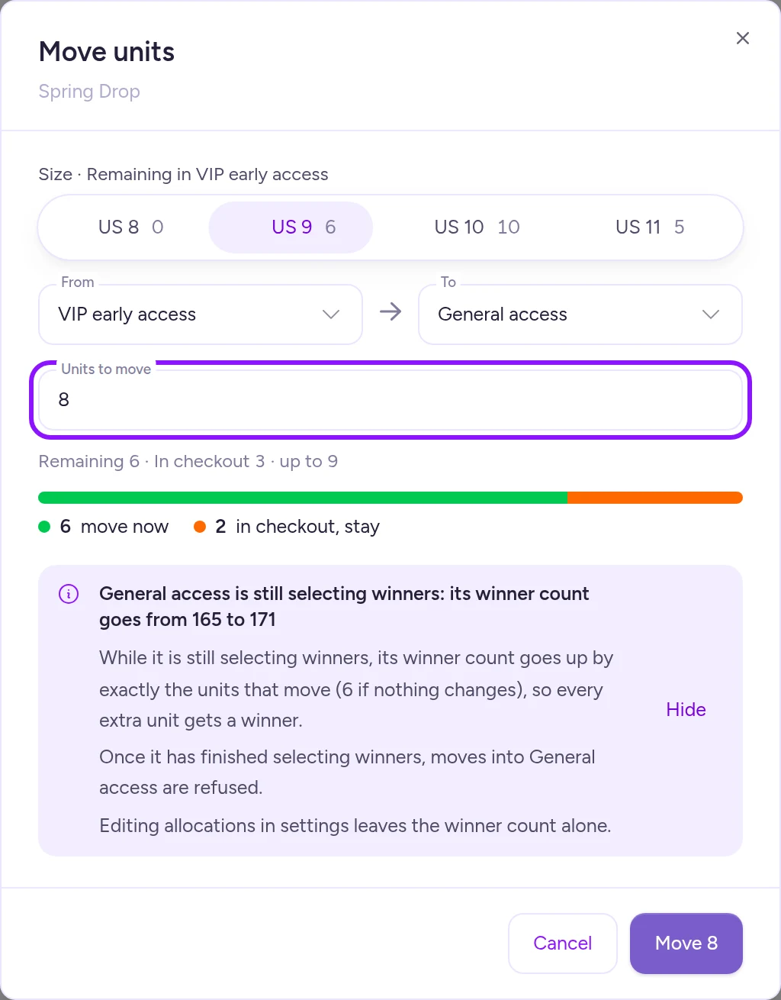
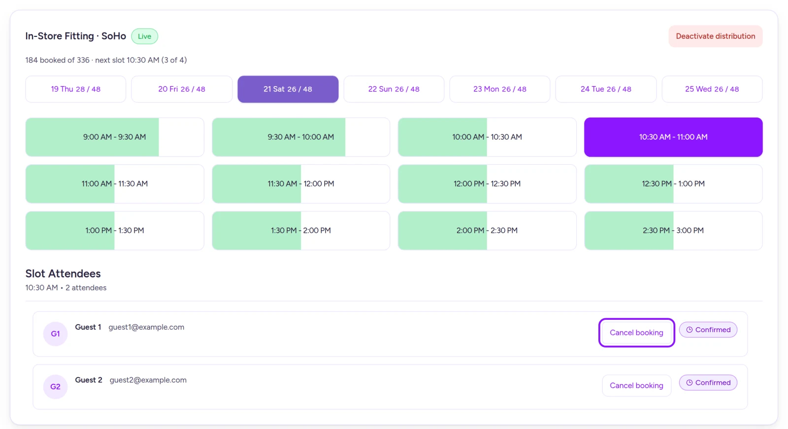

Need to slow down a queue, extend a close time, restock a sold-out size, or cancel an appointment while customers are live? Most operational controls stay editable during a drop, while pricing and payment rules lock before opening.

All live controls—settings, stock transfers, and booking cancellations—live on the sequence's **Overview** tab. To monitor real-time traffic before making a change, see [Watch a live drop](/guide/drop/watch-live).

## Edit a live distribution

<Steps>
  <Step title="Open the sequence">
    Open your experience, then select the sequence you want to update.
  </Step>
  <Step title="Open distribution settings">
    On the **Overview** tab, find the **Distributions** card and select **Edit** on the distribution you want to change.
  </Step>
  <Step title="Adjust and save">
    Update fields under **Schedule**, **Configuration**, or **Payment** (queues and draws only), then select **Save**.
  </Step>
</Steps>

On a live queue or draw's Performance screen, the shortcuts under **Change a setting** in **Run** mode jump directly to this same editor. See [Watch a live drop](/guide/drop/watch-live).

<Warning>
  **Changes go live immediately when you select Save**—there's no confirmation dialog. Double-check values like **Admit rate**, **Closes**, **Allow guest access**, or **Automatic entry** before saving.
</Warning>

<Note>
  Existing distributions stay editable—and **Pause queue** / **Resume queue** keep working—even if your organization moves to a plan that doesn't allow creating that distribution type.
</Note>

<Frame caption="Once a distribution opens, Opens locks to earlier times only, while Closes stays editable.">
  
</Frame>

## Change when a distribution closes

**Closes** stays editable throughout a live drop, so you can wrap up early or extend the window:

- **Avoid overlaps:** Distributions in the same sequence can't overlap—**Save** stays disabled if an extended close time runs into the next distribution's window.
- **Draws:** Keep the **Draw date** inside the open window. If you pull **Closes** earlier than the draw date, move the draw date too.
- **Appointments:** Appointment schedules can't change while any booking exists.
- **Once opened:** **Opens** shows **Locked** and can only move earlier (moving it doesn't unlock settings that locked at open). Queues count as opened about 5 minutes 30 seconds before **Opens**, right before their 5-minute waiting room opens.
- **Once closed:** Schedules can't be changed after a distribution closes, and closed queues refuse all edits.

When **Closes** passes on a queue, new customers can't join and anyone still waiting in line is turned away, but customers who were already admitted keep their checkout window.

<Tip>
  Pulling **Closes** earlier is much gentler than **Deactivate**. Closing lets admitted customers finish checking out and leaves the rest of your experience intact, whereas **Deactivate** ends everything immediately and can't be undone. See [Stop a drop](/guide/drop/deactivate).
</Tip>

## What you can change while live

For the full lock timeline, see [What locks, and when](/concepts/what-locks-when). For type-specific rules and defaults, see [Set up a queue](/guide/create/queue), [Set up a draw](/guide/create/draw), [Set up an auction](/guide/create/auction), [Set up a timed release](/guide/create/timed-release), and [Set up appointments](/guide/create/appointment).

| Setting | Editable while live? |
| --- | --- |
| **Closes** (all types) | **Yes**, until it closes. On appointments, locked while any booking exists. |
| **Opens** (all types; **First bookable slot** on appointments) | **Earlier only**, once opened. On appointments, locked while any booking exists. |
| Queue **Admit rate** | **Yes.** Sets how many customers are admitted per minute going forward. |
| **Allow guest access** and **Automatic entry** (queue, draw, timed release) | **Yes.** Guest access can't be enabled on a sequence with an audience, and timed releases on counted stock don't offer automatic entry regardless of this toggle. |
| **Bias toward loyal consumers** (queue, draw) | **Yes**, though on a queue it only orders people who joined before **Opens**. See [Set up a queue](/guide/create/queue). |
| Draw **Winner count** | **Yes**, until entry closes—never below winners already chosen, never below `1` once open, and never above available sequence stock. |
| Draw **Admission expiration** | **Yes.** See [Set up a draw](/guide/create/draw). |
| English auction **Auto Extend Seconds** | **Yes.** |
| Timed release settings | **Yes.** Only the schedule rules above lock. |
| **Payment collection** and **Authorization amount** (queue, draw) | **No.** You must deactivate and recreate the distribution. Note that deactivating marks your entire public page as ended, and if every distribution in the sequence or experience is deactivated, you'll need a new sequence or experience. See [Stop a drop](/guide/drop/deactivate). |
| Draw **Continue selecting until completed** | **No**, once the draw has opened. |
| Auction prices and quantity | **No**, once the auction has opened. (**Auction Type** locks at creation.) |
| Appointment **Slot duration**, **Buffer**, **Max capacity per slot**, location, window, and time zone | **No**, while any booking stands. See [Cancel a booking](#cancel-a-booking). |
| Sequence product selection and **Mystery Box Products** | **No**, while a distribution in the sequence is open, settling, or has entrants. See [Add and gate sequences](/guide/create/sequences). |
| Experience products | **No**, while any sequence is live or has entrants. See [Create an experience](/guide/create/experiences). |
| Experience stock allocations | **No**, while live. Shift inventory with [Move units](#move-units-during-a-drop) instead. |

<Note>
  A queue's payment window is always 30 minutes and doesn't have an editable field (even though **Run** mode displays an **Admission window** link). See [Admission and the payment window](/concepts/admission-and-payment).
</Note>

Deactivated distributions are read-only—their cards show **View** instead of **Edit**.

<Frame caption="Payment collection locks as soon as a queue or draw counts as opened.">
  
</Frame>

## Pause and resume a queue

To temporarily stop admitting people from a live queue without losing your pace settings:

- Open the menu on the queue's card and select **Pause queue**.
- When you're ready to restart at your previous rate, open the same menu and select **Resume queue**.

While paused, customers already waiting keep their place in line and new customers can still join. Don't set **Admit rate** to `0` as a pause—that overwrites your admit rate instead of pausing, so **Resume queue** won't appear. See [Set up a queue](/guide/create/queue) and [What your customers see](/guide/drop/what-customers-see).

## Move units during a drop

Stock counting starts about 10 minutes before a sequence opens. Once counting begins, quantities in **Edit allocations** can only increase—to take units out of a sequence or rebalance sizes mid-drop, use **Move units**. (For pre-drop setup, see [Allocate stock to a drop](/guide/create/stock-allocation).)

<Steps>
  <Step title="Open Move units">
    On the sequence's **Overview** tab, select **Move units** in the **Stock** card. (If a size sells out, the sold-out banner also shows **Move units in**, or a one-click shortcut to pull units from **Unassigned**.)
  </Step>
  <Step title="Pick source and destination">
    Select **From** and **To**—either another sequence in the same experience or **Unassigned**.
  </Step>
  <Step title="Choose size and quantity">
    Pick the size and enter **Units to move** (up to the maximum shown below the field).
  </Step>
  <Step title="Confirm the move">
    Select **Move [units]**. Fanfare shows how many units moved along with before-and-after totals for each sequence.
  </Step>
</Steps>

<Warning>
  **Sold-out sizes stay sold out until you add inventory.** Move units in from **Unassigned** or another sequence with **Move units**, or raise the size in **Edit allocations** using unassigned stock.
</Warning>

<Note>
  **Moves can be partial.** Units currently held in active customer checkouts stay with the source sequence, and the confirmation shows how many remained behind. If those checkouts expire without completing, the units return to the source's **Remaining** count and you can move them then.
</Note>

<Warning>
  **Moving units changes a draw's winner count.** While a draw is still selecting winners, moving units *into* its sequence raises **Winner count** by the same amount, and moving units *out* lowers it (never below winners already chosen and never to `0` once open). Once winner selection finishes, moves into that draw are refused.
</Warning>

Fanfare also refuses a move if the source doesn't have enough available units, if the move would drop a sequence below its sold count, or if the destination can't accept stock (a finished draw, an ended Dutch auction, or a decided English auction).

<Frame caption="Once stock counting starts, move inventory between sequences or Unassigned with Move units.">
  
</Frame>

## Cancel a booking

You can cancel a customer's appointment booking before or during the appointment, as long as its time slot hasn't ended.

<Steps>
  <Step title="Find the appointment panel">
    On the sequence's **Overview** tab, scroll below the **Distributions** card to the appointment card.
  </Step>
  <Step title="Select the day and slot">
    Pick the appointment day and time slot to load **Slot Attendees**.
  </Step>
  <Step title="Cancel and confirm">
    Select **Cancel booking** beside the customer's name, review the confirmation prompt, and select **Cancel booking** again. The customer is notified automatically.
  </Step>
</Steps>

<Note>
  Canceling a booking can't be undone, and individual bookings can't be canceled after the appointment has been deactivated. Any active booking keeps the appointment's slot settings, window, and location locked until all bookings end or are canceled.
</Note>

<Frame caption="Select a day and slot to view attendees and cancel individual bookings.">
  
</Frame>

## Other live changes

- **Access code:** Updating or clearing a sequence's **Shared access code** takes effect immediately for anyone who hasn't entered yet. Audience and sign-in gates still apply. See [Add and gate sequences](/guide/create/sequences).
- **Order limits:** Adding or deleting an order limit applies to the live drop as soon as you save. See [Add and gate sequences](/guide/create/sequences).
- **Brand and hosted pages:** Saving brand changes restyles live pages, widgets, and emails within about a minute—even during a hosted page publish freeze (which begins 15 minutes before a distribution opens). See [Set your brand](/guide/create/brand) and [Build and publish the hosted page](/guide/create/hosted-page).
- **After Deactivate:** Once every distribution in a sequence or experience is deactivated, you can't add new ones to it. See [Stop a drop](/guide/drop/deactivate).

## On Shopify

Appointments aren't offered in the Fanfare app in Shopify, so [Cancel a booking](#cancel-a-booking) doesn't apply.

For Shopify-managed products, the **Stock** card can also warn you if Shopify's inventory count falls below what your drop has left or in checkout. See [Products from Shopify](/guide/shopify/products) for how to resolve stock mismatches.

## Troubleshooting

<AccordionGroup>
  <Accordion title="Save is grayed out">
    **Save** stays disabled until you make a change and all fields pass validation. Common causes: the new schedule overlaps another distribution in the sequence; a draw's **Closes** time is earlier than its **Draw date**; **Opens** was pushed later after opening; or the distribution was deactivated and is now read-only.
  </Accordion>
  <Accordion title="Save says the distribution has closed">
    Once a distribution's window closes, its schedule can't be changed (and closed queues reject all edits). Add a new distribution to the sequence instead.
  </Accordion>
  <Accordion title="I can't lower a size in Edit allocations">
    Stock counting has already started, so **Edit allocations** only allows increases. Use [Move units](#move-units-during-a-drop) to transfer units out.
  </Accordion>
  <Accordion title="A move into a draw is refused">
    The draw has already finished selecting winners and can't accept additional units. Move the units to another sequence or keep them where they are.
  </Accordion>
  <Accordion title="Winner count is grayed out">
    Draw entry has already closed, so **Winner count** is final.
  </Accordion>
  <Accordion title="Appointment settings won't change">
    One or more bookings still stand on the appointment. Wait for those slots to finish—or cancel them—to unlock slot duration, buffer, capacity, window, and location.
  </Accordion>
</AccordionGroup>

## Related

<CardGroup>
  <Card title="What locks, and when" href="/concepts/what-locks-when">
    See exactly when each setting locks before, during, and after a drop.
  </Card>
  <Card title="Watch a live drop" href="/guide/drop/watch-live">
    Follow live metrics and jump to settings from Run mode.
  </Card>
  <Card title="What your customers see" href="/guide/drop/what-customers-see">
    See what customers experience during a pause, sellout, or close.
  </Card>
  <Card title="Stop a drop" href="/guide/drop/deactivate">
    Deactivate or delete a distribution, sequence, or experience.
  </Card>
  <Card title="Allocate stock to a drop" href="/guide/create/stock-allocation">
    Configure per-sequence stock allocations before counting begins.
  </Card>
</CardGroup>
