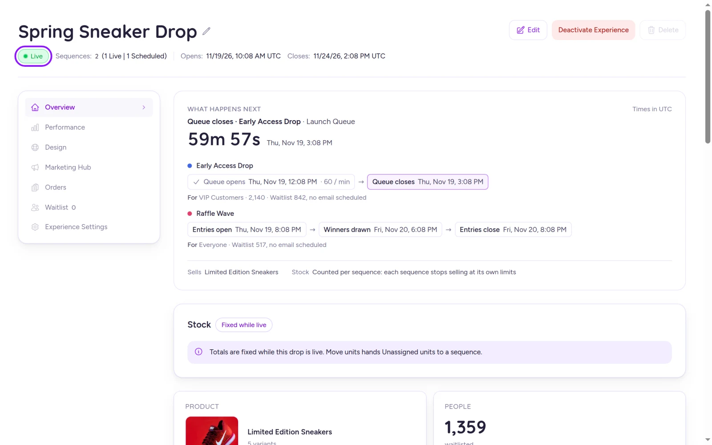
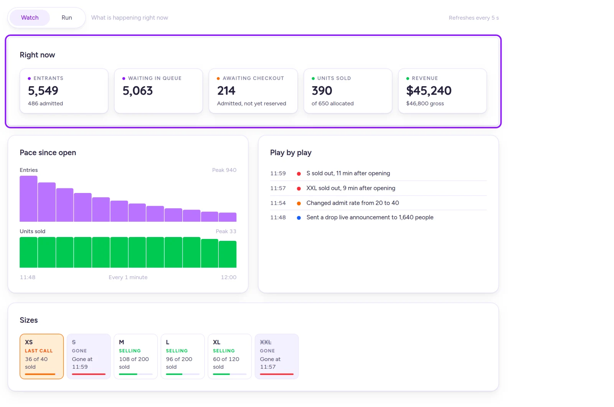

Your experience is open and customers are arriving. This page shows where to look and what each number counts, from the experience header down to the per-sequence live screen. The Performance screens are read-only. The cards and views on the **Overview** are not: they carry actions such as **Pause queue**, **Deactivate**, **Move units** and cancelling a booking, which [Change things mid-drop](/guide/drop/live-controls) covers. To see the same moment from the customer's side, see [What your customers see](/guide/drop/what-customers-see).

Everyone in your organisation sees the same figures, revenue included.

## Before you start

- The experience has at least one sequence with a distribution that is open now. A sequence is one way in to an experience.
- Keep the browser tab in front. The live screens stop refreshing while the tab is hidden.

## Read the experience at a glance

Open the experience from **Experiences**. The header tells you where things stand:

- The status chip: Draft, Scheduled, Live, Ended or Ended early. [Experiences](/concepts/experiences) explains what each one means.
- **Sequences**: the number of sequences, with a count per status, for example "2 (1 Live | 1 Scheduled)".
- **Opens** and **Closes**, in the experience's time zone.

The **What happens next** card at the top of the **Overview** counts down to the next scheduled moment, such as a queue opening or winners being drawn. It has one lane per sequence (the first five, then **Show all [count] sequences**). Times are in the experience's zone, labelled "Times in [zone]". When your browser is in a different zone, a **Show in my time** switch appears.

<Frame caption="The header and What happens next show the experience's state without opening Performance.">
  
</Frame>

## Watch the Sequences card

Further down the **Overview**, the **Sequences** card has one card per sequence. While the sequence and the experience are both live, each sequence card shows live tiles for the distribution that is running:

| Distribution | Tiles |
| --- | --- |
| Queue | in queue, awaiting checkout, pop rate (customers let in per minute), drain time (estimated minutes to clear the line), and a bar for how far through its window it is |
| Draw | entries, winners, odds, and a bar for how far through its window it is. While winners pay: entered, the number of winner places (with the odds beside it), claimed, the number of places lost unpaid (labelled with how many are still pending), and a **Claims** progress bar |
| Appointment | booked, fill, next slot, cancelled |
| Auction | a price ladder with the leading price and the time it settles |

A **Paused** badge appears when a live queue is paused. Under the tiles, a line shows the waitlist size, scheduled announcements and the next distribution to open.

## Watch the sequence page

Open a sequence with **View**. On its **Overview**:

- The **Distributions** card shows the live distribution first, as a larger card with the same tiles as the sequence card. Every other distribution shows a compact row with its status and schedule.
- The **Stock** card shows each size's **Allocated**, **Sold**, **In checkout**, **Remaining** and **Status**, and **Unassigned** when the experience has unassigned units to show. The figures update about every 5 seconds. [Stock](/concepts/stock) explains each status.
- An auction or appointment adds its own view below the **Distributions** card. See [Monitor a live auction](#monitor-a-live-auction) and [Monitor live appointments](#monitor-live-appointments).

The **Performance** card above every tab of the sequence page counts activity over the period chosen on Home. It does not refresh on its own: reload the page to update it.

## Open the Performance view

You can open the **Performance** view from any of these places:

- In the experience's side navigation, select **Performance**.
- On a sequence page, select **Performance** in its navigation, or **View performance** on the **Performance** card.
- On a sequence card, open the menu and select **View performance**.
- On a live card in the experience overview, select **Open performance**.

What the experience's **Performance** item shows depends on how many sequences the experience has. With one, it shows that sequence's Performance screen directly. With two or more, it shows the experience overview.

<Note>
  Adding a second sequence switches the experience's **Performance** item to the overview, even if the new sequence is an empty draft.
</Note>

## The experience overview while something is live

With two or more sequences, the overview calls each sequence a "drop" ("By drop", "Next drop").

The **Launch so far** card adds a **Live now** tile while any distribution is live. Below it, up to four live cards show what is running: live distributions first, then settling ones. When more are running, a line reads "[count] more live or settling, in By drop below". Each card shows "As of" the time its figures were taken and how often it refreshes.

| Live card | Tiles |
| --- | --- |
| Live queue | **In line** (people waiting now), **Sold**, **Revenue** (net), **Pace** (units sold per minute over about the last 10 minutes), and bars of units sold since open |
| Every other type, and a settling queue | **Entrants**, **Paid orders**, **Revenue** (net), **Sold** |

<Warning>
  **Live now** adds two different things. A live queue contributes the people in line right now. Every other live type contributes everyone who has entered so far. With a queue and a draw live at once, the total mixes current queue length with cumulative draw entries. Read the live cards to see each part.
</Warning>

The rest of the overview, including **By drop** and the insight cards, is explained in [Read your results](/guide/learn/performance).

<Frame caption="Live now sums people in line for queues and entrants for every other type.">
  
</Frame>

## The sequence Performance screen while live

When a sequence has two or more distributions, a switcher across the top lets you pick one, or **Whole sequence** for totals. It opens on the most recently opened live distribution. Your choice is kept in the page link, so you can share it. With one distribution there is no switcher.

A live distribution's screen has a **Watch** / **Run** toggle, with "Refreshes every … s" beside it. **Watch** is selected when the screen opens. The toggle is not kept in the link and goes back to **Watch** when you reload.

<Warning>
  Only queues have a live screen of their own. A draw, auction, timed release or appointment shows the queue's screen, so **Waiting in queue** and Run's **In queue** always read 0 for them. For appointments, **Awaiting checkout** and the "admitted" count also always read 0. For these types, read **Entrants**, **Units sold** with its paid-orders line, and **Revenue**, and use the auction or appointment view on the sequence's **Overview** for anything specific to the type.
</Warning>

### Watch

**Right now** counts the distribution since it opened:

| Cell | What it counts |
| --- | --- |
| **Entrants** | Different customers who have entered. The line below gives how many of them were let in ("N admitted"). |
| **Waiting in queue** | People in the queue's line at this moment. |
| **Awaiting checkout** | Customers let in who have not yet started checking out ("Admitted, not yet reserved"). |
| **Units sold** | Units on paid orders. The line below reads "of N allocated", or the number of paid orders when allocation cannot be shown. |
| **Revenue** | Net revenue, with gross below. Hidden until there are sales, and whenever sales are in more than one currency. |

**Pace since open** shows entries and units sold in each interval since the distribution opened.

**Play by play** lists notable moments, newest first: a size selling out, a setting set or changed, and an announcement sent. Settings appear as plain lowercase words, for example "admission expiration seconds", and their values are not converted, so a payment window reads in seconds. The list shown after close uses friendlier names.

**Sizes** shows a tile per size, grouped by product when there are several. Each tile moves from **Selling** to **Last call** at 80% of its allocation sold, then to **Gone**.

<Note>
  The allocation figures on this screen ("of N allocated" and the size meters), **Last call**, **Gone** and the size sold-out moments in **Play by play** need a sequence with exactly one distribution. With two or more, sizes show units sold only.
</Note>

<Frame caption="Watch shows what is happening right now.">
  
</Frame>

### Run

**Flow through the drop** shows where customers are between joining and paying: **In queue** (with entrants so far), **Awaiting checkout** (with admitted so far) and **Paid orders** (with units sold).

**Change a setting** shows links for a live queue (**Admit rate**, **Admission window**) or a live draw (**Admission window**, **Capacity**). Other types have none. Every link opens the same distribution settings editor on the sequence's **Overview**, not a particular field, and changes nothing by itself. What you can change mid-drop, and how, is in [Change things mid-drop](/guide/drop/live-controls).

<Frame caption="The Run links open the distribution's settings editor.">
  
</Frame>

## How fresh the numbers are

- The live screens and the overview refresh about every 5 seconds while the browser tab is visible, and pause while it is hidden.
- A figure can occasionally be up to two minutes old while it is being recalculated.
- The **Entrants** tile in **Launch so far** can lag by up to a minute. The live cards' figures follow the 5-second refresh.
- The sequence page's **Performance** card does not refresh on its own.

## When Live starts and stops

A queue's line opens five minutes before its **Opens** time: customers can join, but nobody is let in before **Opens**. During those five minutes its Performance screen already reads Live, while its card on the sequence page still shows when it opens.

The experience and sequence status chips still read Scheduled during those five minutes, unless something else in the experience or sequence is already live.

A queue stays Live past its close time while people are still in line, although nobody still waiting is let in after close. While it does, it shows no end time: the distribution switcher reads "Live now", and the overview's live card shows no close time.

After entry ends, a distribution reads **Settling** while customers who were let in can still pay: a draw before its results are settled, an auction before its payment window closes, or any distribution with customers still inside their payment window. The screen shows "Admitted consumers can still pay, so these figures may change." It refreshes every 30 seconds, or every 5 seconds while another distribution in the sequence is still live. Final results are explained in [Read your results](/guide/learn/performance).

## Monitor a live auction

On the sequence's **Overview**, each auction has its own view below the **Distributions** card, titled **English auction** or **Dutch auction**, with a phase badge: Upcoming, Bidding, Settling, Settled, Ended or Ended early.

A sentence at the top says where the auction stands, for example "Bidding is open — [name] leads at [amount] across [count] bids."

| Auction | Cards |
| --- | --- |
| English | **Highest bid** (with **Bids** and **Bidders**), **Reserve** (with whether it is met), **Settles** (a countdown while bidding, with the scheduled time and any **Extension**), **Winner** (with **Payment**: Awaiting payment, Checking out, Paid or Unpaid) |
| Dutch | **Current price** (with **Start** and **Floor**), **Units left** (with **Sold**), **Next drop** (when the price next falls, and by how much), **Winners** (with **Paid**, **Awaiting** and **Unpaid**) |

Below them, an event stream lists bids and moments such as "Anti-snipe extension +[minutes]m", "Reserve met" and "Price drop".

<Frame>
  
</Frame>

## Monitor live appointments

When the sequence's distribution is an appointment, its own view sits below the **Distributions** card, headed with the appointment's name and location. It shows a strip of days with bookings against capacity, then the slots for the selected day. Days outside the window read "not in window", and days the location is closed read "closed". Select a slot to see **Slot Attendees**, each with a status: Confirmed, Checked In, Cancelled or Completed. Times are in the appointment's time zone. The view does not name the zone. To cancel a booking, see [Change things mid-drop](/guide/drop/live-controls).

## On Shopify

The **Performance** view and the live screens are the same in the Fanfare app in Shopify. Appointments are not offered there, so there is no appointment view.

## Related

<CardGroup>
  <Card title="Change things mid-drop" href="/guide/drop/live-controls">
    Pause a queue, change a setting, move units or cancel a booking.
  </Card>
  <Card title="Read your results" href="/guide/learn/performance">
    Home metrics, By drop, insights and final results after close.
  </Card>
  <Card title="Before doors open" href="/guide/drop/preflight">
    The countdown and expected entrants before a distribution opens.
  </Card>
  <Card title="Stop a drop" href="/guide/drop/deactivate">
    Deactivate a distribution, sequence or experience.
  </Card>
  <Card title="Troubleshooting a live drop" href="/guide/drop/troubleshooting">
    What to check when something looks wrong.
  </Card>
</CardGroup>
