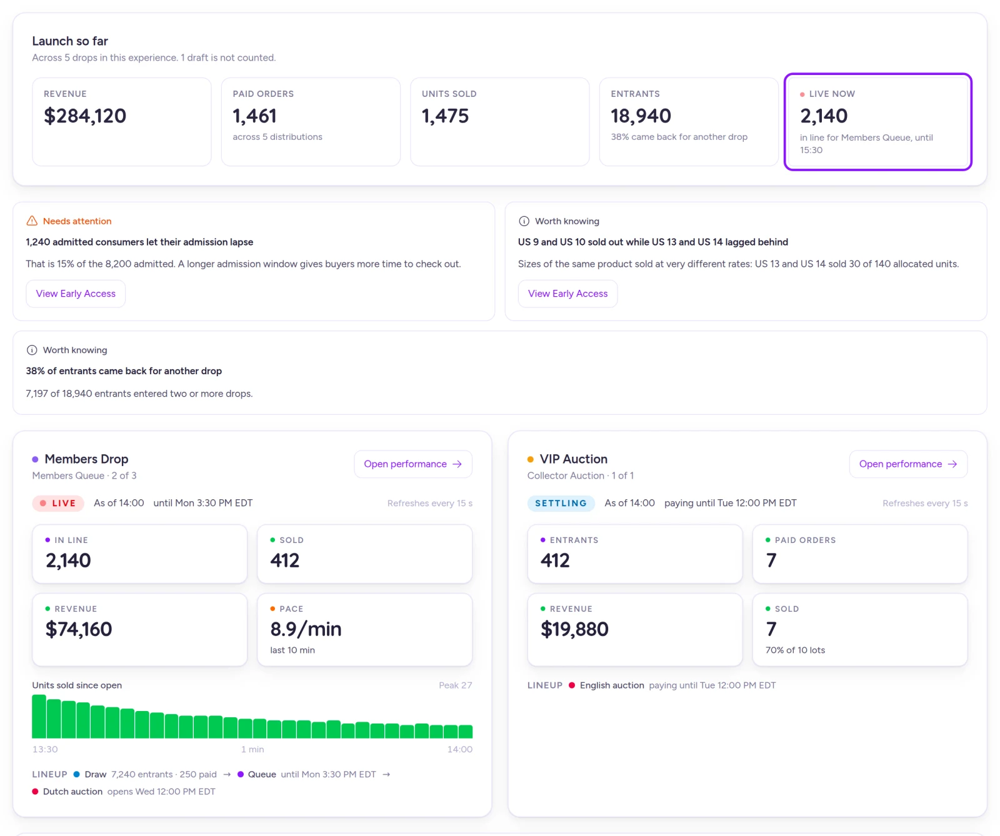
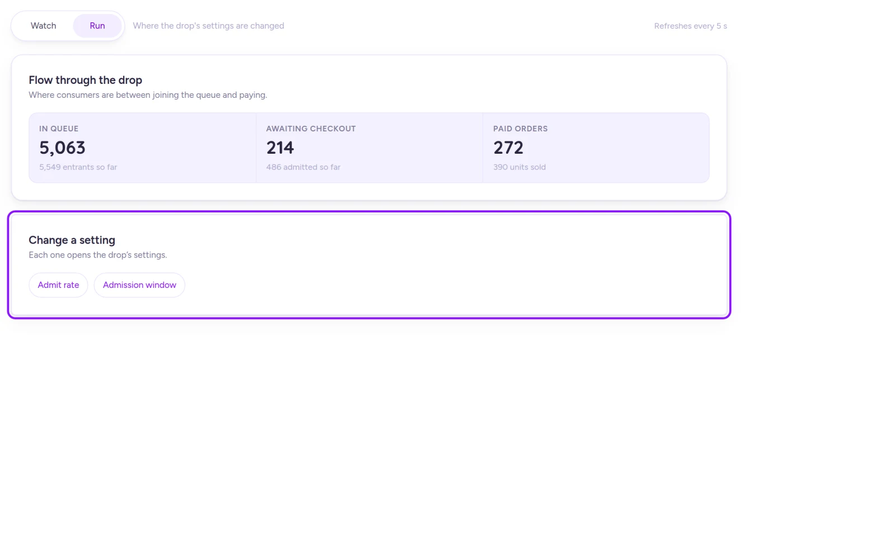
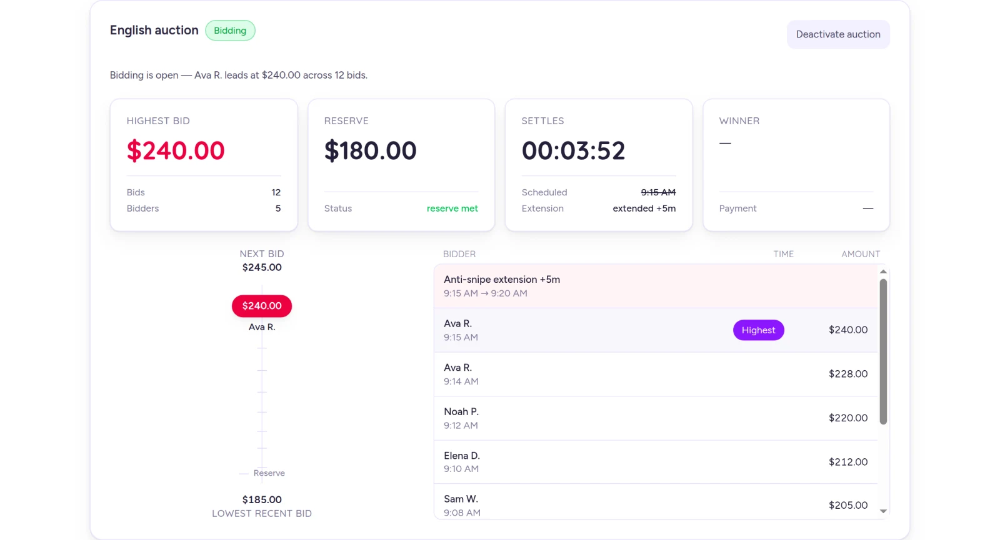

Once doors open, Fanfare gives you live views from the experience level all the way down to individual sizes, bids, and bookings.

The **Performance** views are read-only monitoring dashboards. Live actions—like **Pause queue**, **Move units**, canceling a booking, or **Deactivate**—live on the **Overview** tabs (see [Change things mid-drop](/guide/drop/live-controls)). To see what customers experience at the same moment, see [What your customers see](/guide/drop/what-customers-see).

<Note>
  Keep the browser tab visible while monitoring—live screens pause automatic refreshes when the tab is in the background. Everyone in your organization sees the same figures, including revenue.
</Note>

## Check experience status at a glance

Open your experience from **Experiences** to see its live status right in the header:

- **Status chip:** **Draft**, **Scheduled**, **Live**, **Ended**, or **Ended early**. See [Experiences](/concepts/experiences).
- **Sequences:** Total count broken down by status (for example, `2 (1 Live | 1 Scheduled)`).
- **Opens** and **Closes:** Shown in the experience's time zone.

Just below the header, the **What happens next** card counts down to the next scheduled milestone for each sequence (such as a queue opening or winners being drawn). Times appear in the experience's time zone; if your browser is in a different time zone, use **Show in my time** to convert them.

<Frame caption="The experience header and What happens next card give you an instant status check without opening Performance.">
  
</Frame>

## Monitor sequences and stock on Overview

### The Sequences card

Further down the experience **Overview**, the **Sequences** card displays live status tiles for every active sequence:

| Distribution type | Live tiles shown |
| --- | --- |
| **Queue** | People in queue, awaiting checkout, pop rate (admissions per minute), estimated drain time, and window progress bar. A **Paused** badge appears if the queue is paused. |
| **Draw** | During entry: entries, winners, odds, and window progress bar. While winners pay: entrants, winner places (with odds), claimed, unpaid places lost, and a **Claims** progress bar. |
| **Appointment** | Booked, fill rate, next slot, and canceled. |
| **Auction** | Price ladder with the leading price and settlement time. |

Underneath the tiles, each card summarizes waitlist size, scheduled announcements, and the next distribution to open.

### The sequence Overview

Select **View** on any sequence to drill into its **Overview**:

- **Distributions card:** Highlights the live distribution at the top with its live tiles, followed by compact rows for upcoming or ended distributions.
- **Stock card:** Tracks **Allocated**, **Sold**, **In checkout**, **Remaining**, and **Status** for every size (plus **Unassigned** units when available), updating about every 5 seconds. See [Stock](/concepts/stock).
- **Auction and appointment views:** Live auctions and appointments render dedicated control panels below the **Distributions** card. See [Monitor a live auction](#monitor-a-live-auction) and [Monitor live appointments](#monitor-live-appointments).

<Note>
  The summary **Performance** card pinned above the tabs on a sequence page reflects the date range selected on **Home** and doesn't auto-refresh—reload the page to update it.
</Note>

## Open the Performance view

Open **Performance** from any of these spots:

- **Performance** in the experience's left navigation.
- **Performance** in a sequence's navigation, or **View performance** on its summary card.
- **View performance** from a sequence card's menu, or **Open performance** on a live card in the experience overview.

If your experience has **one sequence**, the experience's **Performance** view opens that sequence's live screen directly. If it has **two or more sequences**—even if the second is still a draft—it opens the multi-sequence experience overview.

## The experience overview (multi-sequence drops)

When an experience has multiple sequences, the overview labels each sequence as a "drop" (**By drop**, **Next drop**).

While any distribution is active, **Launch so far** adds a **Live now** tile, and up to four live cards appear below it (active distributions first, followed by settling ones). Each card shows when its data was last updated and its refresh interval.

| Live card | Metrics shown |
| --- | --- |
| **Live queue** | **In line** (waiting right now), **Sold**, **Revenue** (net), **Pace** (units sold per minute over roughly the last 10 minutes), and a bar chart of units sold since open. |
| **All other types (and settling queues)** | **Entrants**, **Paid orders**, **Revenue** (net), and **Sold**. |

<Warning>
  **Live now combines two different counts.** Live queues contribute the number of people waiting in line *right now*, while every other live distribution type contributes *all cumulative entrants* so far. If a queue and a draw are live at the same time, read the individual live cards to separate current queue depth from total draw entries.
</Warning>

For **By drop** tables, insight cards, and post-drop metrics, see [Read your results](/guide/learn/performance).

<Frame caption="Live now sums current people in line for queues with cumulative entrants for every other distribution type.">
  
</Frame>

## The sequence live screen

When a sequence has multiple distributions, a switcher at the top lets you choose a specific distribution or **Whole sequence** for combined totals (it opens on the most recently opened live distribution, and the selection stays in the URL so you can share the link).

Use the **Watch** / **Run** toggle at the top to switch between live monitoring and quick access to settings (the toggle isn't kept in the URL and resets to **Watch** on reload).

<Warning>
  Only queues have a dedicated live layout. Draws, auctions, timed releases, and appointments share the queue layout, so **Waiting in queue** (in **Watch**) and **In queue** (in **Run**) always read `0` for them—and for appointments, **Awaiting checkout** and admitted counts also read `0`. For those types, focus on **Entrants**, **Units sold**, and **Revenue**, and use the dedicated auction or appointment panels on the sequence's **Overview**.
</Warning>

### Watch mode

**Watch** is the default monitoring screen for a live distribution. At the top, **Right now** tracks live headline counts since opening:

| Metric | What it counts |
| --- | --- |
| **Entrants** | Unique customers who have entered, with total admissions (`N admitted`) underneath. |
| **Waiting in queue** | Customers waiting in the queue line right now. |
| **Awaiting checkout** | Admitted customers who haven't started checkout yet. |
| **Units sold** | Units on paid orders, shown against allocation (`of N allocated`) or paired with paid order count. |
| **Revenue** | Net revenue, with gross revenue underneath. Hidden until sales occur or when orders span multiple currencies. |

Below **Right now**, three live panels track momentum and inventory:

- **Pace since open:** Interval charts plotting entries and units sold since doors opened.
- **Play by play:** A newest-first feed of notable drop events—sizes selling out, setting changes, and announcements sent.
- **Sizes:** A tile per size (grouped by product when selling multiple items) that progresses from **Selling** to **Last call** (at 80% sold) to **Gone**.

<Note>
  Allocation progress (`of N allocated`), size meters, **Last call** / **Gone** badges, and size sold-out events in **Play by play** only appear when a sequence has a single distribution. In multi-distribution sequences, **Sizes** shows units sold only.
</Note>

<Frame caption="Watch mode tracks live queue depth, sales pace, notable events, and size sell-through.">
  
</Frame>

### Run mode

Switch to **Run** for a funnel view and quick links to live controls:

- **Flow through the drop:** Shows how customers are moving from **In queue** (with total entrants) to **Awaiting checkout** (with total admitted) to **Paid orders** (with units sold).
- **Change a setting:** Shortcut links for live queues (**Admit rate**, **Admission window**) and live draws (**Admission window**, **Capacity**). Selecting any link opens the distribution's settings editor on the sequence's **Overview** without changing anything until you save. See [Change things mid-drop](/guide/drop/live-controls).

<Frame caption="Run mode shows funnel flow and shortcuts straight to the distribution's settings editor.">
  
</Frame>

## How fresh the numbers are

- Live screens and the experience overview refresh roughly every **5 seconds** while the browser tab is active, and pause when the tab is hidden.
- Individual figures can occasionally lag by up to **2 minutes** during recalculations.
- **Entrants** inside **Launch so far** can lag by up to **1 minute** (use the individual live cards for 5-second updates).
- The summary **Performance** card on a sequence page doesn't auto-refresh.

## When Live starts and stops

- **Queue waiting room (5 minutes before open):** Customers can join a queue's waiting room 5 minutes before **Opens**, though no one is admitted until **Opens**. During those 5 minutes, the queue's Performance screen already shows **Live**, while the experience and sequence chips stay **Scheduled** (unless another distribution is already live).
- **Queue clearing after close:** A queue stays **Live** past its **Closes** time while people are still waiting in line, though no one waiting is admitted after close. While clearing, the close time is hidden and the switcher reads **Live now**.
- **Settling:** After entry closes, a distribution moves to **Settling** while admitted customers or winners still have time to pay (or while a draw settles results). Figures can continue changing during this window and refresh every **30 seconds** (or every **5 seconds** if another distribution in the sequence is still live). For final post-drop reporting, see [Read your results](/guide/learn/performance).

## Monitor a live auction

On the sequence's **Overview**, each auction gets a dedicated **English auction** or **Dutch auction** panel below the **Distributions** card, complete with a phase badge (**Upcoming**, **Bidding**, **Settling**, **Settled**, **Ended**, or **Ended early**) and a live status headline (for example, `"Bidding is open — [name] leads at [amount] across [count] bids."`).

| Auction type | Live cards shown |
| --- | --- |
| **English** | **Highest bid** (with **Bids** and **Bidders**), **Reserve** (whether it's met), **Settles** (countdown, scheduled time, and any **Extension**), and **Winner** (with **Payment** status: Awaiting payment, Checking out, Paid, or Unpaid). |
| **Dutch** | **Current price** (with **Start** and **Floor**), **Units left** (with **Sold**), **Next drop** (countdown and drop amount), and **Winners** (with **Paid**, **Awaiting**, and **Unpaid**). |

Below the cards, an event stream logs live bids and milestones such as anti-snipe extensions, reserve met, and price drops.

<Frame caption="The live English auction view tracks the leading bid, reserve status, settlement countdown, and bid stream.">
  
</Frame>

## Monitor live appointments

When a sequence runs an appointment distribution, a dedicated panel appears below the **Distributions** card showing the appointment name, location, a day strip with booking counts against capacity, and the time slots for the selected day (days outside the window read `not in window`; closed days read `closed`).

Select any time slot to inspect **Slot Attendees** and their status (**Confirmed**, **Checked In**, **Cancelled**, or **Completed**). All slot times appear in the appointment's time zone, though the view doesn't name the time zone. To cancel a booking, see [Change things mid-drop](/guide/drop/live-controls#cancel-a-booking).

## On Shopify

The **Performance** views and live screens work the same way inside the Fanfare app in Shopify, except appointments aren't offered so there's no appointment view.

## Related

<CardGroup>
  <Card title="Change things mid-drop" href="/guide/drop/live-controls">
    Pause a queue, adjust settings, move units, or cancel a booking.
  </Card>
  <Card title="Read your results" href="/guide/learn/performance">
    Understand Home metrics, By drop breakdowns, and final post-drop results.
  </Card>
  <Card title="Before doors open" href="/guide/drop/preflight">
    Pre-launch checklist, automatic locks, and demand forecasts.
  </Card>
  <Card title="Stop a drop" href="/guide/drop/deactivate">
    Deactivate or delete a distribution, sequence, or experience.
  </Card>
  <Card title="Troubleshooting a live drop" href="/guide/drop/troubleshooting">
    Quick fixes when something looks wrong mid-drop.
  </Card>
</CardGroup>
