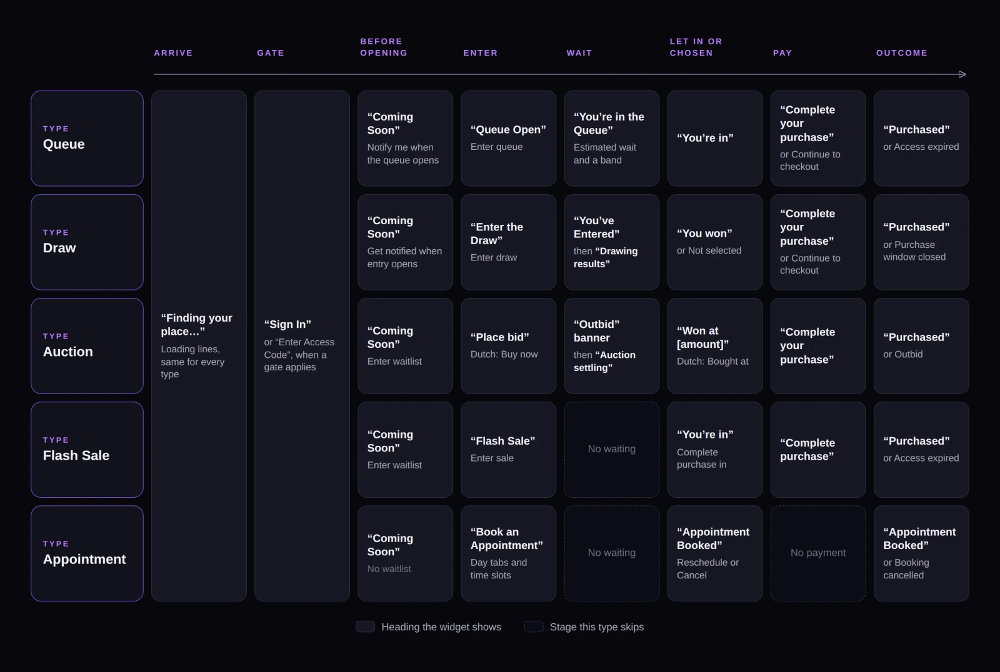

Your customers interact with Fanfare through a single widget—whether on your hosted page, your Shopify storefront, or your own site. Fanfare places each visitor into one sequence (see [Sequences and routing](/concepts/sequences)), and what they see depends on three things: any entry gates on that sequence, the drop's current stage, and the distribution type.

<Frame caption="Every customer moves through the same stages, with each distribution type skipping the ones it doesn't need.">
  
</Frame>

## Arriving

On hosted pages and Shopify, the widget starts automatically. On custom embeds, customers see a **Welcome** screen with **Get started** unless your developer initializes the widget automatically.

The widget updates in real time without page refreshes. If a customer's connection drops, a status bar shows `"Live updates paused — reconnecting…"` until the connection returns.

When **Automatic entry** is enabled on a distribution, the widget enters the customer automatically—unless they first need to authorize a card hold, pick a product/size, or enter a Flash Sale with counted stock.

## Gates

Before Fanfare places a customer into a drop, they may pass through one or more gates (see [Sequences and routing](/concepts/sequences)):

- **Sign-in:** Prompts for an email address or phone number and sends a 6-digit verification code (valid for 5 minutes, with a **Resend code** option). If your organization runs SMS marketing, phone sign-ins ask whether they want drop texts before sending the code—declining doesn't block entry.
- **Guest entry:** **Continue as guest** appears on the sign-in screen only when the sequence has no audience and every open or upcoming distribution has **Allow guest access** turned on. Guests see a reminder to keep the page open because they won't receive emails or texts.
- **Access code:** Prompts for the sequence's shared code (case-insensitive).
- **Verification:** Some customers may be asked to complete a **Verification Required** check before continuing.

### When a customer can't get in

- **Access unavailable:** Shown when an audience excludes the signed-in customer (`"This experience is for members of a specific group."`) or when no sequence accepts them (`"This experience isn't available to you."`).
- **No current access window:** Shown when their assigned sequence has no open or upcoming distribution.
- **After close (signed out):** Visitors who aren't signed in see `"Entered? Sign in to see your result."`

## Before doors open

Before a drop opens, customers see **Coming Soon** with a live countdown in their own local time zone, plus a waitlist button (**Notify me when the queue opens**, **Get notified when entry opens**, or **Enter waitlist**). Joining a waitlist requires sign-in, so signed-out visitors and guests see **Sign in to get notified** instead. Appointments don't have waitlists.

For queues, the waiting room opens **5 minutes before** the scheduled open time so customers can line up early. Wait estimates appear once the queue actually opens.

<Frame caption="Customers arriving before launch see a local-time countdown and a waitlist sign-up button.">
  
</Frame>

## Stage by stage

Note that customers see timed releases labeled as **Flash Sale**.

| Type | Entering | Waiting | Admitted or selected | Checkout |
| --- | --- | --- | --- | --- |
| **Queue** | **Queue Open** with countdown and **Enter queue** | **You're in the Queue** with **Estimated wait**, a progress band (`Up next`, `Almost there`, `Near the front`, `A few people ahead`, or `In the line`), and **Leave queue** | **You're in** | Fanfare payment form, or **Continue to checkout** for external checkout |
| **Draw** | **Enter the Draw** with countdown and **Enter draw** | **You've Entered** with countdown and **Withdraw entry**; switches to **Drawing results** at draw time | **You won** or **Not selected** | Fanfare payment form, or **Continue to checkout** for external checkout |
| **Auction** | English: live bid ledger (highest bid, minimum next bid, reserve, time left) and **Place bid**. Dutch: falling price and **Buy now — [amount]**. | Outbid banner (`Outbid — the highest bid is now [amount]`) when outbid; **Auction settling** after bidding closes | **Won at [amount]** (English) or **Bought at [amount]** (Dutch) | Payment |
| **Flash Sale** | **Flash Sale** with countdown and **Enter sale** | — | **You're in** with a **Complete purchase in** countdown and **Exit sale** | **Complete purchase** |
| **Appointment** | **Book an Appointment** with day tabs and time slots | — | **Appointment Booked** with **Reschedule** and **Cancel** | — |

When a sequence uses **Customer Picks**, customers see **Choose your item** either on entry or once admitted. With **Mystery Box**, admitted customers see `"You got [product name]!"`

<Frame caption="Queued shoppers see an estimated wait and a relative band rather than a raw position number.">
  
</Frame>

## Paying

Every admitted customer or winner gets a limited **payment window** to complete their purchase (see [Admission and the payment window](/concepts/admission-and-payment)):

- **Fanfare checkout:** Shows **Complete your purchase** with a **Your checkout time** countdown. If the customer's bank requires confirmation (such as 3DS), the countdown pauses while they verify. Completed purchases display a **Purchased** receipt.
- **Pre-authorization:** On queues with **Pre-authorize on joining** or draws with **Pre-authorize on entry**, customers authorize a card hold before entering (`"Only charged if you get a spot"`).
- **External checkout:** The widget keeps the **Your checkout time** countdown visible and hands customers off via **Continue to checkout**. If time runs out before payment finishes, the widget shows the expired screen below.

## How it ends

| Outcome | Screen title | What customers see | Can they re-enter? |
| --- | --- | --- | --- |
| **Payment window expired (Queue)** | Access expired | Their access expired and they can rejoin the line. | **Yes** (**Rejoin queue**) while open; pre-authorized queues require a new card hold. |
| **Payment window expired (Flash Sale)** | Access expired | Their access has expired. | **No** |
| **Payment window expired (Draw)** | Purchase window closed | Their window ended; each person can win once per draw. | **No** |
| **Payment window expired (Auction)** | Payment window closed | Their winning bid wasn't paid in time and the admission was released. | **No** |
| **Not selected in a draw** | Not selected | They weren't selected this time. | **No** |
| **Sold out** | Sold out | All items are claimed or no longer available. | **No** |
| **Sold out, more may free up** (Pay-when-admitted queue or Pay-after-win draw) | Sold out right now | Everything is claimed for now; check back soon. | **Yes** (**Try again**) while open. |
| **Outbid at close** | Outbid | They were outbid. | **No** |
| **Dutch auction reached floor** | Unsold | Floor price reached before all units were claimed. | **No** |
| **Reserve not met** | Ended | Standard ended screen (customers aren't told the reserve wasn't met). | **No** |
| **Purchased** | Purchased / Purchase complete | Order receipt or purchase confirmation. | **No** |
| **Canceled** | Canceled | The event was canceled. | **No** |
| **Left voluntarily** | You've left | They're no longer participating. | **Yes** (**Rejoin queue** / **Re-enter draw**) only on pay-later queues and draws while open. |

Customers who cancel their own appointment see **Booking canceled** and can pick a new slot if rebooking is enabled.

<Warning>
  **Heads up on expired-window notifications:** The automated email and text sent when a payment window expires tells customers they can enter again while the experience is open—even for draws, auctions, and Flash Sales that don't allow re-entry. The widget always shows the true state, so keep this in mind if customers reach out to support.
</Warning>

## When you change things mid-drop

See [Change things mid-drop](/guide/drop/live-controls) and [Stop a drop](/guide/drop/deactivate) for the admin side of these states:

- **Paused queue:** Shoppers keep their place in line (with no wait estimate until you resume), and new shoppers can still join. Note that `"Entry is paused. Your place in line is saved."` means the queue is waiting on held stock—not that you manually paused it (see [Troubleshooting a live drop](/guide/drop/troubleshooting)).
- **Queue sells out while people wait:** Shows `"Everything claimed"` (`"Right now · you keep your place"`). If stock frees up or you move units in, the line resumes automatically.
- **Deactivated drop:** Trying to interact with a deactivated distribution shows `"This has been ended early and is no longer available."` Deactivating anything in an experience marks the entire hosted page as canceled (before close) or ended (after close). Shoppers still waiting in a deactivated queue or pre-draw on a custom embed are removed and see **Not selected**; booked appointment customers see **Canceled**.
- **Deleted experience:** Custom embeds show **Ended**, and hosted pages display the ended page.

## Other prompts customers may see

- **Access code upgrade:** Customers placed in an open sequence see `"Have an access code?"` if a higher-priority open sequence is gated by a code. Entering an invalid code keeps them in their current sequence.
- **Loyalty fairness badge:** `"Fairness provided by Fanfair"` appears whenever **Bias toward loyal consumers** is enabled and entry is open. (In queues, loyalty weighting only orders people who joined before **Opens**; see [Loyalty and Fanfair](/concepts/loyalty).)

## Automated messages Fanfare sends

Each notification sends over one channel—your organization's default (email or SMS), falling back to the other if the customer lacks that contact method or opted out of texts. **Only signed-in customers receive messages.**

| Message | Trigger | Recipients |
| --- | --- | --- |
| **Login code** | Customer requests a sign-in code | Anyone signing in, via the channel they entered (SMS comes from Fanfare; email names your organization) |
| **Draw win** (`"You won [product name]"` or `"You won: choose your item"`) | Draw selects them | Draw winners |
| **Draw result** (`"Draw results for [product name]"`) | Draw finishes without selecting them | Unselected draw entrants |
| **Auction updates** (outbid, won, lost) | Outbid or auction settles | Auction bidders |
| **Admitted** (`"You're through: complete your purchase"`) | Customer is admitted | Queue and Flash Sale customers (draw and auction winners get win messages instead) |
| **Window expired** (`"Your window for [experience name] has closed"`) | Payment window lapses | All distribution types |
| **Flash Sale pick reserved** (`"Your pick is reserved: [product name]"`) | Item is reserved in a Flash Sale | Signed-in Flash Sale customers |
| **Opens soon** (`"[distribution name] opens soon"`) | 5 minutes before each distribution opens (unless edited or removed) | Sequence waitlist (not appointments) |
| **Access code** | You trigger **Send code** | Sequence waitlist |
| **Appointment updates** | Booking confirmed, canceled, or rescheduled | Appointment customers (Fanfare doesn't send appointment reminders) |
| **SMS opt-in confirmation** | Customer opts in to marketing texts | That customer, once |
| **Waitlist added** (`"You're on the waitlist for [experience name]"`) | You add someone to a waitlist in the admin | Admin-added waitlist members only |

The `"opens soon"` alert uses your distribution name verbatim—give distributions clean, customer-facing names ([Invites, waitlist and access-code sends](/guide/create/invites-and-waitlist)).

<Warning>
  **Guests receive no emails or texts**—no admission alerts, no win notifications, and no expiration notices. A guest only sees that they're in if they keep the page open. Leave **Allow guest access** off unless you expect customers to stay on the page.
</Warning>

<Note>
  Customers who join a waitlist themselves don't receive a confirmation email or text—only customers you add manually in the admin do.
</Note>

## Example: three shoppers at the same drop

Suppose Northbound Supply Co. runs **Phantom Stitch Anorak Drop** with two sequences:
1. **Inner Circle Early Access** (live queue, gated to the *Inner Circle* audience)
2. **Public Draw** (scheduled draw, open to everyone, guest access off)

Here's what three different visitors experience:

| Visitor | What they see in the widget | Messages they receive |
| --- | --- | --- |
| **Signed-in Inner Circle member** | **Queue Open**, then **You're in the Queue** with an estimated wait | `"You're through: complete your purchase"` when admitted, and `"Your window… has closed"` if they miss checkout |
| **Signed-in non-member** | **Coming Soon** for Public Draw with **Get notified when entry opens**, then **You're on the waitlist** after joining | No sign-up confirmation; receives any scheduled waitlist announcements, `"Public Draw opens soon"` 5 minutes before open, then win/loss results if they enter |
| **Signed-out visitor** | **Sign In** (no **Continue as guest**) because the live members-only sequence takes priority | Nothing until they sign in—then routed to the queue if they're a member, or the Public Draw countdown if not |

## On Shopify

On Shopify, customers interact with the exact same widget directly on your product page ([Storefront setup](/guide/shopify/storefront-setup)), while [checkout protection](/guide/shopify/checkout-protection) blocks anyone from buying protected products outside the drop.

Once admitted, the widget adds the item to the customer's cart and sends them to Shopify checkout. Shopify checkout doesn't display Fanfare's countdown timer—if a customer's payment window expires before they pay, checkout protection blocks the purchase. Appointments aren't offered on Shopify.

## Related

<CardGroup>
  <Card title="Sequences and routing" href="/concepts/sequences">
    See how Fanfare routes customers across sequences and applies gates.
  </Card>
  <Card title="Admission and the payment window" href="/concepts/admission-and-payment">
    Understand checkout timers and payment collection modes.
  </Card>
  <Card title="Customers and identity" href="/concepts/customers">
    Compare signed-in customers and guest entry.
  </Card>
  <Card title="Brand, templates and designs" href="/concepts/design">
    Customize how your hosted pages and widgets look.
  </Card>
</CardGroup>
