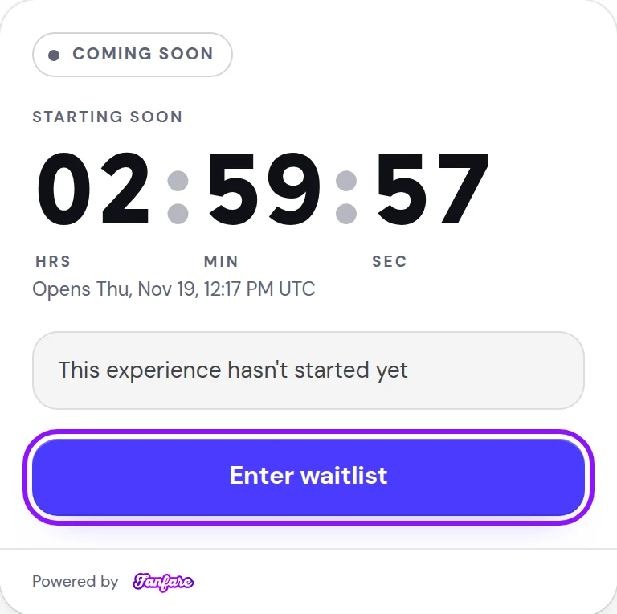
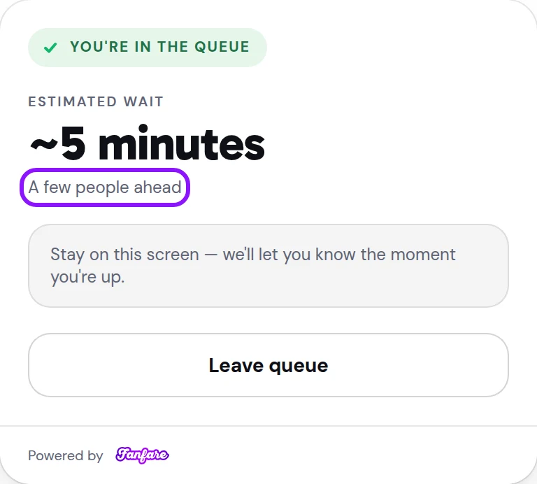

Your customers meet Fanfare through one widget, on your hosted page or on your own site. A sequence is one way in to an experience, and Fanfare places each customer in exactly one (see [Sequences and routing](/concepts/sequences) for how it picks). What the widget shows then depends on three things: whether the customer is stopped at a gate, the stage the sequence they were placed in has reached, and the distribution type.

<Frame caption="Every customer passes the same stages, and each distribution type skips some of them.">
  
</Frame>

## Arriving

On your hosted page and on Shopify the widget starts by itself. On your own site, if your developer does not start it automatically, the customer first sees "Welcome" with a "Get started" button. Then the widget shows short loading lines such as "Finding your place…" and "Validating access…". When the distribution uses **Automatic entry**, the customer sees "Joining…" and is entered without pressing a button, unless they must first confirm a card hold or choose an item, or the Flash Sale limits how many units of a size can sell.

Updates arrive without a refresh. If the connection drops, a strip reads "Live updates paused — reconnecting…" until it comes back.

## Gates

A gate is something the customer must do before Fanfare can place them; [Sequences and routing](/concepts/sequences) explains which applies when.

- **Sign-in.** "Sign In" asks for an email or phone number. Fanfare sends a 6-digit code, which the customer types on "Enter your code". The code expires in 5 minutes; "Resend code" sends a new one.
- **Guest entry.** "Continue as guest" appears on the sign-in screen only when every open or upcoming distribution in the sequence has **Allow guest access** on and the sequence has no audience. A guest sees "Keep this page open. As a guest you won't get emails or texts."
- **Access code.** "Enter Access Code" with a "Submit" button. A wrong code shows "Invalid access code". Access codes are not case-sensitive.
- **Verification.** Some customers may be asked to complete a check headed "Verification Required" before they continue.

If your organisation runs a marketing text programme, a customer who signs in with a phone number is asked "Get texts about [merchant name] drops?" with "Yes, text me" and "No thanks" before the code is sent. Saying no does not stop the customer buying.

## When there is no way in

- "Access unavailable", with "This experience is for members of a specific group." when an audience keeps the customer out, or "This experience isn't available to you." otherwise.
- "No current access window" when the sequence they were placed in has no open or upcoming window.
- After everything has ended, a customer who is not signed in sees "Entered? Sign in to see your result."

## Before it opens

The customer sees "Coming Soon" and a countdown. The opening time is shown in the customer's own time zone.

Below it is a waitlist button, worded by type: "Notify me when the queue opens" for a queue, "Get notified when entry opens" for a draw, and "Enter waitlist" for the others. Joining needs sign-in, so guests and visitors who have not signed in see "Sign in to get notified" instead. Once joined, the customer sees "You're on the waitlist" and can select "Leave waitlist". Appointments have no waitlist.

A queue lets people in to wait from 5 minutes before its open time. Until the open time passes, people already waiting see no wait estimate.

<Frame caption="A customer placed in a scheduled sequence sees its countdown and a waitlist button.">
  
</Frame>

## Stage by stage

Customers see a timed release as "Flash Sale".

| Type | Entering | Waiting | Let in or chosen | Checkout |
| --- | --- | --- | --- | --- |
| Queue | "Queue Open" with a "Queue closes in" countdown and "Enter queue" | "You're in the Queue" with "Estimated wait" and a band: "Up next", "Almost there", "Near the front", "A few people ahead" or "In the line". "Leave queue". | "You're in" | Payment, or "Continue to checkout" with your own checkout |
| Draw | "Enter the Draw" with a "Drawing in" countdown and "Enter draw" | "You've Entered" with the "Drawing in" countdown and "Withdraw entry". After the draw time: "Drawing results". | "You won", or "Not selected" | Payment, or "Continue to checkout" with your own checkout |
| Auction | English: the bid ledger (highest bid, minimum next bid, reserve, time left) and "Place bid". Dutch: the falling price and "Buy now — [amount]". | An "Outbid — the highest bid is now [amount]" banner when someone bids higher. After bidding closes: "Auction settling". | "Won at [amount]" (English) or "Bought at [amount]" (Dutch) | Payment |
| Flash Sale | "Flash Sale" with a "Window closes in" countdown and "Enter sale" | Not applicable | "You're in" with a "Complete purchase in" countdown, and "Exit sale" | "Complete purchase" |
| Appointment | "Book an Appointment": day tabs and time slots | Not applicable | "Appointment Booked", with "Reschedule" and "Cancel" | None |

Where the sequence lets customers pick (**Customer Picks**), they see "Choose your item", either on entry or once they are in. With **Mystery Box**, a customer who is let in sees the reveal "You got [product name]!".

<Frame caption="Customers in a queue see an estimated wait and a band, not a position number.">
  
</Frame>

## Paying

Every customer who is let in or wins has a limited time to buy, the payment window; [Admission and the payment window](/concepts/admission-and-payment) covers its length.

When Fanfare takes the payment, the customer sees "Complete your purchase", a "Your checkout time" countdown, and "Pay before the timer runs out to keep your item." If their bank asks them to confirm, the widget shows "Your bank needs to confirm this payment" and pauses the countdown while they do. A finished purchase shows a receipt headed "Purchased".

If a queue uses **Pre-authorise on joining**, or a draw uses **Pre-authorise on entry**, the customer confirms a card hold before they are entered, with the line "Only charged if you get a spot".

When you use your own checkout, the widget on your own site keeps the "Your checkout time" countdown on screen, and "Continue to checkout" hands the customer off to it. If the countdown runs out first, the widget shows the lapsed outcome below.

## How it ends

| Outcome | Title | What it says | Re-entry |
| --- | --- | --- | --- |
| Payment window lapsed (queue) | "Access expired" | "Your access has expired. You can rejoin to get back in line." | Yes: "Rejoin queue" while the queue is open. With pre-authorisation, a new card hold instead. |
| Payment window lapsed (Flash Sale) | "Access expired" | "Your access has expired." | No |
| Payment window lapsed (draw) | "Purchase window closed" | "Your purchase window ended. Each person can win once in this draw." | No |
| Payment window lapsed (auction) | "Payment window closed" | "Your winning bid was not paid in time, so the admission was released." | No |
| Lost a draw | "Not selected" | "You weren't selected this time." | No |
| Sold out | "Sold out" | "This release is fully claimed. Thanks for your interest.", or "This drop sold out. The items you were waiting on are no longer available." when they were turned away for stock | No |
| Sold out, more may come back (queue on **Pay when admitted**, draw on **Pay after the win**) | "Sold out right now" | "Everything has been claimed for now. Check back soon. If more become available, you can try again." | Yes: "Try again" while it is open. Other types show "Sold out". |
| Outbid at the close | "Outbid" | "You were outbid." | No |
| Dutch auction hit its floor | "Unsold" | "The auction reached its floor price before all items were claimed." | No |
| Reserve not met | "Ended" | The generic ended text. Customers are not told the reserve was not met. | No |
| Bought | A "Purchased" receipt when Fanfare took the payment; otherwise "Purchase complete" | "Thank you for your purchase" | No |
| Cancelled | "Cancelled" | "This event was cancelled." | No |
| Left | "You've left" | "You're no longer participating." | Only for a queue on **Pay when admitted** or a draw on **Pay after the win**, while it is still open: "Rejoin queue" or "Re-enter draw" |

A customer who cancels their own appointment sees "Booking cancelled" and can pick another time when rebooking is offered.

<Warning>
  The message sent when a payment window closes promises the customer can enter again ("You can enter again while the experience is open." by email, "You can enter again while it's open." by text) for every type. But a draw never takes back a winner whose window lapsed, a lapsed auction win is released, and a Flash Sale offers no way back in. The widget shows the true state, so the message can contradict the screen.
</Warning>

## When you change things mid-drop

The admin side is in [Change things mid-drop](/guide/drop/live-controls) and [Stop a drop](/guide/drop/deactivate).

- Paused queue: people waiting keep their place, and see no wait estimate until you resume. New customers can still join the line. "Entry is paused. Your place in line is saved." means the queue is waiting on stock, not that you paused it: see [Troubleshooting a live drop](/guide/drop/troubleshooting).
- Queue sells out while people wait: "Everything claimed" with "Right now · you keep your place". If more stock comes back, the line moves again.
- Deactivated distribution: a customer who tries to act on it sees "This has been ended early and is no longer available." Deactivating anything in an experience ends your whole hosted page: before its close time the page says "[experience name] was cancelled" and "This drop won't go ahead. Thanks for your interest."; after it, "[experience name] has ended".
- Customers still waiting in a deactivated queue, or entered in a deactivated draw that had not yet run, are removed from it, and the widget on your own site tells them "Not selected" ("You weren't selected this time.").
- Deactivated appointment: booked customers see "Cancelled" with "This event was cancelled."
- Deleted experience: the widget on your own site shows "Ended"; your hosted page shows its ended page.
## Other lines customers can meet

- **Upgrade offer.** A customer in an open sequence may see "Have an access code?" when a higher-priority open sequence needs a code. A wrong code shows "That code wasn’t recognized. You’re still in your current sequence."
- **Fairness note.** "Fairness provided by Fanfair" appears whenever **Bias toward loyal consumers** is on and entry is possible. In a queue, the bias only orders people who joined before the open time; see [Loyalty and Fanfair](/concepts/loyalty).

## Messages Fanfare sends

Each message goes by one channel: your organisation's default (email or text), or the other one when the customer has no address for the default or has opted out of texts. Only signed-in customers receive messages.

| Message | When it sends | Who gets it |
| --- | --- | --- |
| Login code | The customer asks for a sign-in code | Everyone signing in, by the channel they typed. The text says "Fanfare"; the email names your organisation. |
| "You won [product name]" (or "You won: choose your item" when they still have to pick) | A draw picks them | Draw winners |
| "Draw results for [product name]" | A draw does not pick them | Draw entrants not selected |
| Outbid, won, lost | Someone outbids them; the auction settles | Auction bidders |
| "You're through: complete your purchase" | They are let in | Queue and Flash Sale customers. Draw and auction winners get their win message instead. |
| "Your window for [experience name] has closed" | Their payment window lapses | Any type |
| "Your pick is reserved: [product name]" | Their item is settled in a Flash Sale, whether they chose it or Fanfare assigned it | Signed-in Flash Sale customers only |
| "[distribution name] opens soon" | 5 minutes before each distribution opens (for a queue, when customers can start joining its line), unless you change or remove this default announcement | The sequence's waitlist (not for appointments) |
| Your access code | You use **Send code** | The sequence's waitlist |
| Appointment confirmed, cancelled, rescheduled | The booking changes | Appointment customers |
| Marketing-text confirmation | They say yes to marketing texts | That customer, once |
| "You're on the waitlist for [experience name]" | You add them to a waitlist in the admin | Only people you add |

Fanfare sends no appointment reminder.

The "opens soon" message uses the distribution's name as you typed it in the admin, so name distributions for customers; see [Invites, waitlist and access-code sends](/guide/create/invites-and-waitlist).

<Warning>
  Guests get no messages at all: no win, no "you're through", no expiry notice. A guest who is let in or drawn finds out only if they have the page open. Leave **Allow guest access** off where customers may not watch the page.
</Warning>

<Note>
  Customers who join a waitlist themselves get no confirmation message. Only people you add in the admin do.
</Note>

## Worked example

Northbound Supply Co. is running "Phantom Stitch Anorak Drop". "Inner Circle Early Access" is open, running a queue for members of the "Inner Circle" audience. "Public Draw" is scheduled, with no audience and no guest access. Three people arrive.

| Customer | What they see | What they receive later |
| --- | --- | --- |
| Signed-in Inner Circle member | "Queue Open", then "You're in the Queue" with an estimated wait | "You're through: complete your purchase" when let in, and "Your window … has closed" if they do not pay in time |
| Signed-in non-member | "Coming Soon" for the Public Draw, with "Get notified when entry opens". They join and see "You're on the waitlist". | No confirmation. Any announcement you send the waitlist (here, "The public draw opens tomorrow"), then "Public Draw opens soon" 5 minutes before the draw opens, then "You won …" or "Draw results for …" if they enter. |
| Visitor not signed in | "Sign In", with no "Continue as guest" | Nothing until they sign in. A member is then placed in the queue; anyone else sees the Public Draw countdown. |

The visitor is asked to sign in because the open members' sequence comes before the scheduled public one; see [Sequences and routing](/concepts/sequences).

## On Shopify

On Shopify, customers meet Fanfare through the product widget on your product page ([Storefront setup](/guide/shopify/storefront-setup)), and [checkout protection](/guide/shopify/checkout-protection) stops anyone buying a protected product without going through the experience. It is the same widget described on this page, so customers meet the same gates, screens and messages. When a customer is let in, the widget puts the item in their cart and takes them to Shopify checkout to pay. Shopify checkout shows no Fanfare countdown; after the customer's time runs out, checkout protection stops the purchase. Appointments are not offered.

## Related

<CardGroup>
  <Card title="Sequences and routing" href="/concepts/sequences">
    How Fanfare places a customer, and which gates apply when.
  </Card>
  <Card title="Admission and the payment window" href="/concepts/admission-and-payment">
    How long customers have to buy, and how payment is collected.
  </Card>
  <Card title="Customers and identity" href="/concepts/customers">
    Guests and signed-in customers.
  </Card>
  <Card title="Brand, templates and designs" href="/concepts/design">
    How the hosted page and widget look.
  </Card>
</CardGroup>
