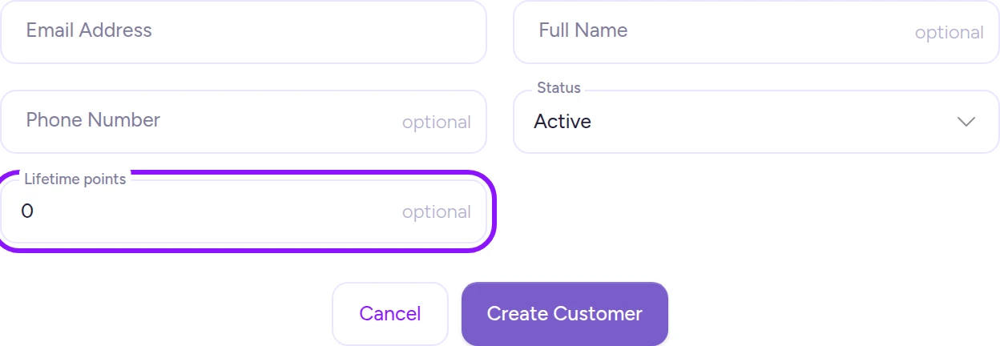

**Customers** in the Fanfare admin lists the people who have signed in to enter one of your drops, the people you add by hand, and the people synced from a Klaviyo or Mailchimp list. Each customer has a profile showing what they have spent, how they engage, which audiences they are in, and the queues, draws, auctions, waitlists and appointments they took part in. Use it to answer a support question, to check why someone did or did not get in, or to add a customer before a drop.

Customers who entered as guests and archived customers are not listed. A guest who placed an order has only a bare profile, which you can reach from the customer's name on their order. See [Customers and identity](/concepts/customers) for the difference between guests and signed-in customers.

## Before you start

- Customers is on every plan, and any team member can add and archive customers.
- The **Loyalty** column appears on every plan, but customers earn points, and you can adjust them, only with the loyalty programme, which is on Pro and above. See [Run a loyalty programme](/guide/learn/loyalty).

## The Customers list

Open **Customers** in the sidebar.

{/* image: guide-learn-customers-list */}

| Column | What it shows |
| --- | --- |
| **Customer** | The customer's name, or their email, or their phone number, or "Unnamed Customer". Their email and phone sit underneath, with a tick when verified. |
| **Value** | Lifetime value in your currency, with "N orders @ average/avg" underneath, or "0 orders". |
| **Engagement** | **High**, **Medium** or **Low**, comparing this customer's activity with your other customers': the top third is High, the middle third Medium, the bottom third Low. "No activity" when they have had none. The number of interactions sits underneath. A customer whose activity has not yet been scored shows only the number of interactions. |
| **Loyalty** | The customer's points balance, with lifetime points underneath, or "—" when they have no points at all. |
| **Activity** | How long ago they last ordered, or "No orders yet", with a recency label underneath: **Fresh** (under 7 days), **Active** (under 30 days), **At risk** (up to 60 days) or **Dormant** (over 60 days). |

### Find a customer

1. Type at least two characters in the search box. Search matches whole words in a customer's name, or any part of their email address. Phone numbers are not searched.
2. Select a row or the customer's name to open their profile.

With fewer than two characters the search is ignored and you see the whole list, with no message.

To sort, select the **Value** or **Activity** column heading, then choose **Asc** or **Desc**. No other column sorts, and the list has no filters. It shows 10 customers a page: use the arrow buttons below the list to move between pages. There is no total count.

## Add a customer

1. In **Customers**, select **Add Customer**.
2. Fill in the form. Only **Email Address** is required.
3. Select **Create Customer**.

The new customer's profile opens. Rule-based audiences re-check the new customer, so they join any audience whose rules they match.

<Frame>
  
</Frame>

| Setting | What it does | Default | Can you change it later? |
| --- | --- | --- | --- |
| **Email Address** | The customer's email. Each email belongs to one customer in your organisation. | None (required) | No |
| **Full Name** | The name shown on the list and the profile. | Blank | No |
| **Phone Number** | The customer's phone. A number without a country code is read using your organisation's country. Each phone number belongs to one customer. | Blank | No |
| **Status** | Sets the **Active** or **Inactive** badge on the profile. It does not stop the customer signing in or entering drops. | **Active** | No |
| **Lifetime points** | Sets the customer's lifetime points total. | 0 | Not directly. Lifetime points rise as the customer earns points, or when you add points with **Adjust points**, both of which need the loyalty programme. See [Run a loyalty programme](/guide/learn/loyalty). |

<Note>
  **Lifetime points** sets lifetime points only. The customer gets no spendable balance and no entry in their points history. A loyalty tier based on lifetime points counts them; loyalty priority in queues and draws, which uses the balance, does not.
</Note>

The profile has no edit action, so you cannot change a customer's details in the admin once you have created them. Check the form before you select **Create Customer**.

A customer you add shows their email and phone without a verified tick. The tick appears only after the customer signs in with a code.

## Read a customer's profile

Select a customer in the list to open their profile. You also reach a profile from the customer's name on an order: see [Orders and refunds](/guide/learn/orders).

{/* image: guide-learn-customers-profile */}

### The header

The header shows the customer's name (or their email, phone number, or "Unnamed Customer"), an **Active** or **Inactive** badge, and their email and phone, each with a tick when verified. **Archive** appears here unless the customer is synced from a Klaviyo or Mailchimp list, including a customer you added who later appeared on a synced list.

### The four metric cards

Test orders are left out of customer metrics.

Bars labelled "Top N%" or "Bottom N%" compare this customer with your other customers. Until there is enough data for this customer, for example a first order, a bar is empty and shows "—".

| Card | What it shows |
| --- | --- |
| **Value** | **Lifetime value** as the headline, with bars for **Lifetime value** and **Monetary**. Underneath: **Average order value**, **Orders**, and **Loyalty points** as balance · lifetime. |
| **Purchasing** | When they last ordered, with the recency label. Bars for **Frequency** and **Activity**. Underneath: **Orders every** "~N days" (once they have more than one order) and **Returns** as "N of M". |
| **Engagement** | **Response rate** as the headline: the share of messages sent to them that they opened, clicked or read. Underneath: **Last engaged**, **Location** (their last known city and region, or country, followed by their time zone, or "Unknown") and **Best send time**. |
| **Risk** | **Churn risk**, **Return rate** (returns out of orders), and **Bot risk** as **Low**, **Medium** or **High**. |

**Best send time** is a time of day in the customer's own time zone: 8 AM, 12 PM, 3 PM or 7 PM, based on when they last engaged. It is not converted to yours, and the card does not label the time zone. It shows "—" when the customer's time zone or last engagement is unknown.

With the loyalty programme on, the **Value** card also has **Adjust points**, and a **Points Ledger** appears beside the drops timeline. Both are covered in [Run a loyalty programme](/guide/learn/loyalty).

### Invites

The **Invites** card appears only when an invite for an audience-gated sequence concerns this customer. If the invites cannot be loaded, it shows "Couldn't load this customer's invites." with **Try again**. Each invite shows the experience and sequence, and a five-step tracker: **In audience** → **Invited** → **Delivered** → **Clicked** → **Entered**. A step that failed, such as a bounced email, turns red with the reason.

The card offers one send action at a time:

- **Send invite now** when the customer is in the audience but has not been invited yet. It also appears for a customer skipped because they have no email address, but the send fails until they have one, and you cannot add an email to a customer in the admin.
- **Resend invite** when they have already been sent the invite.

Neither is offered when the customer has left the audience or opted out of marketing email, when the invite is turned off, or when the sequence no longer has an invite. Either action emails this customer only. You then see "Invite sent", or "Already invited since this page loaded, so nothing was sent". "Too many invite sends. Try again in a minute." means you need to wait before sending again.

Setting up the invite itself is covered in [Invites, waitlist and access-code sends](/guide/create/invites-and-waitlist).

### Audiences

The **Audiences** card lists every audience the customer is in, with its type, and links to each. A rule-based audience is marked "As of its build": the customer's membership is as it stood at the audience's last build, or at its last re-check of this customer. See [Audiences and access codes](/concepts/audiences) for how builds and re-checks work, and [Build audiences](/guide/create/audiences) to create one. A customer in none shows "Not in any audience."

### Drops

The **Drops** timeline has one row per experience the customer took part in, newest first. Each row shows the distribution type and sequence of each entry (a sequence is one way in to an experience), an outcome badge, and the date. A customer can have several entries in one experience, for example a waitlist, then a queue.

Expand a row to see:

- the steps the customer went through in each entry, such as "Joined line", "Admitted" and "Completed"
- their bid, for auctions
- the messages sent to them for that experience
- **Open sequence**, to go to the sequence
- **Orders for this experience**, which opens all orders for the experience, when any of this customer's entries succeeded

The timeline shows ten experiences at a time. Select **Show N more** to see older ones. Below the experiences, two groups collect the remaining messages: **Other messages**, and **Sign-in and account messages** such as sign-in codes.

Timed releases and orders on their own do not appear in this timeline. A customer with no entries shows "No drops yet", even if they have orders.

| Distribution | Outcome labels |
| --- | --- |
| Queue | Completed; Admitted; In line; Left the line; Not in line; Admitted, time ran out; Sold out; Queue closed; Order limit reached; Not admitted; Not completed |
| Draw | Completed; Won; Entered; Withdrew; Not entered; Not selected; Won, time ran out; Sold out; Draw closed; Order limit reached; Entry refused; Not completed |
| Auction | Won; Lost; Winning; Bidding; Outbid; Watching |
| Waitlist | Converted; On waitlist; Notified; Expired; Left the waitlist; Not joined |
| Appointment | Completed; Booked; Checked in; No-show; Cancelled; Not booked |

What each stage looks like to the customer at the time is on [What your customers see](/guide/drop/what-customers-see).

## Archive a customer

Archiving removes a customer from your list. Customers synced from a Klaviyo or Mailchimp list cannot be archived, and their profile has no **Archive** button.

<Warning>
  An archived customer is removed from your customer list and cannot be restored. There is no undo. Their email address and phone number stay reserved, so you cannot add a new customer with either of them. Archiving does not stop the person from signing in to your drops.
</Warning>

1. Open the customer's profile.
2. Select **Archive**. A dialogue asks "Archive this customer?"
3. Select **Archive** in the dialogue.

You see "Customer archived successfully" and return to the list.

{/* image: guide-learn-customers-archive */}

## On Shopify

The Customers list, the profile and the **Add Customer** form are the same in the Fanfare app in Shopify. Fanfare does not import your Shopify store's customers. People appear in Customers when they sign in to enter a drop or are added by hand, and you can archive them like any other customer not synced from a list. See [Integrations](/guide/account/integrations) for the Klaviyo and Mailchimp list syncs.

## Troubleshooting

<AccordionGroup>
  <Accordion title="The Drops section is empty">
    The timeline shows nothing when it fails to load, as well as when the customer has no activity. A customer with no activity shows "No drops yet". If the section is blank instead, reload the page.
  </Accordion>
  <Accordion title="Search returns everyone">
    Search needs at least two characters. With one, the whole list shows.
  </Accordion>
  <Accordion title="Search does not find a customer">
    Names match only on whole words, and phone numbers are not searched. Type the full first or last name, or part of their email address.
  </Accordion>
  <Accordion title="There is no Archive button">
    The customer was synced from a Klaviyo or Mailchimp list, either when they were first added or later because they appeared on a synced list. Synced customers cannot be archived.
  </Accordion>
  <Accordion title="Failed to create customer">
    The most likely cause is that another customer, possibly an archived one, already has this email address or phone number. Search for the email to find an active customer with it. An archived customer's email and phone cannot be reused.
  </Accordion>
</AccordionGroup>

## Related

<CardGroup>
  <Card title="Customers and identity" href="/concepts/customers">
    Guests and signed-in customers, and why guests have no full profile.
  </Card>
  <Card title="Run a loyalty programme" href="/guide/learn/loyalty">
    Adjust points, the points ledger and point expiry.
  </Card>
  <Card title="Orders and refunds" href="/guide/learn/orders">
    A customer's orders, refunds and the order page.
  </Card>
  <Card title="Invites, waitlist and access-code sends" href="/guide/create/invites-and-waitlist">
    Set up the invite that the Invites card tracks.
  </Card>
</CardGroup>
