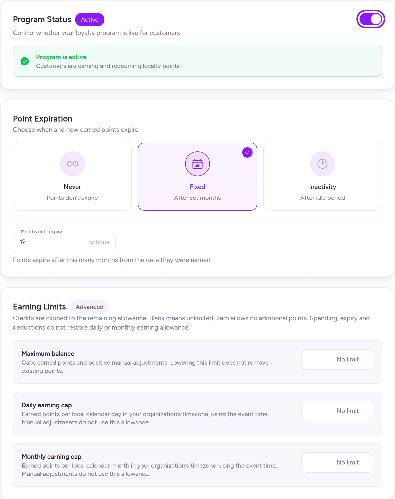
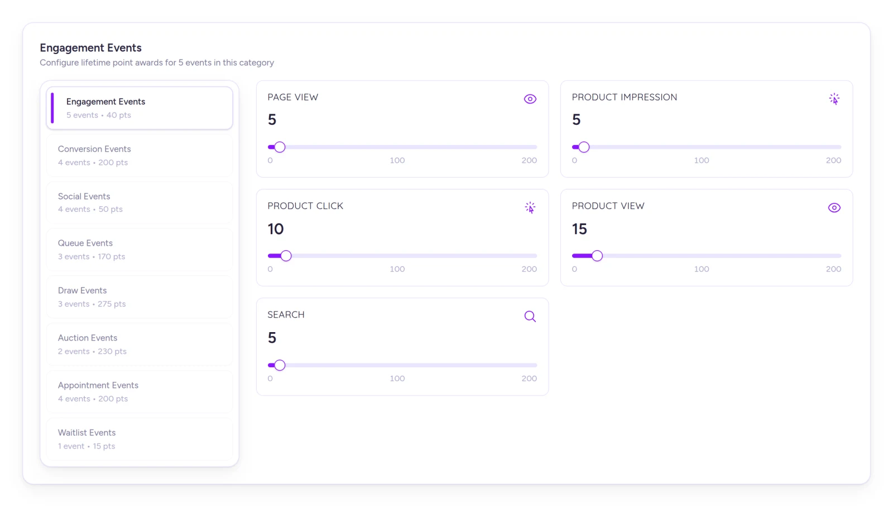

A loyalty programme gives each signed-in customer a points balance. Customers earn points when they buy and when they take part in your drops: joining a queue, entering a draw, bidding, booking an appointment or joining a waitlist. You decide how many points each of those is worth, whether points expire, and how many points a customer can collect. Points then feed two things: loyalty tiers, which are audiences built from points, and loyalty priority, which gives customers with more points better odds in a queue or a draw. The rules behind earning, expiry and priority are explained in [Loyalty and Fanfair](/concepts/loyalty).

<Info>Available on Pro and above.</Info>

On Starter and Growth, **Loyalty** is still in the sidebar, but its pages show an upgrade prompt and every control is disabled. If the programme was switched on before a downgrade, it keeps awarding points, and its switch is the only thing that still works.

Customers cannot spend or redeem points anywhere in Fanfare.

## Before you start

- Your organisation is on the Pro or Enterprise plan. See [Plans and what they unlock](/guide/start/plans).

Everything lives under **Loyalty** in the sidebar, which has two pages in its side menu: **Settings** for the programme switch, expiry and limits, and **Event Points** for what each action earns. The Loyalty pages and the loyalty parts of customer profiles are the same in the Fanfare app in Shopify.

## Switch the programme on

1. Open **Loyalty → Settings**.
2. On the **Program Status** card, turn the switch on. The badge changes to **Active** straight away, but nothing is saved yet.
3. Select **Save** in the bar at the bottom of the page. You see "Loyalty settings updated successfully".

<Frame caption="The programme switch, expiry and earning limits are all on the Settings page.">
  
</Frame>

Once you save (earning can take a few minutes to start):

- Signed-in customers earn points for what they do from then on.
- Customer profiles show the **Adjust points** action and the **Points Ledger**.
- The loyalty priority switch on queues and draws can be turned on. While the programme is off, the switch cannot be turned on and shows "Needs a loyalty program". A switch that is already on can still be turned off. See [Set up a queue](/guide/create/queue) and [Set up a draw](/guide/create/draw).

Only signed-in customers earn points. Guests never do. See [Customers and identity](/concepts/customers).

## Switch the programme off

Turn the same switch off and select **Save**. The badge reads **Inactive**.

<Warning>
  Switching the programme off freezes it; it does not reset it. Within a few minutes customers stop earning. Scheduled expiry stops, you can no longer adjust anyone's points, and the **Points Ledger** and **Adjust points** disappear from customer profiles. Every balance stays stored and still shows in the **Loyalty** column of the Customers list. On a plan below Pro, you cannot switch it back on without upgrading. See [Billing and usage](/guide/account/billing).

  Stored balances still count while the programme is off. Loyalty tiers still sort customers by them, and a queue or draw whose loyalty priority switch is already on still gives customers with more points better odds. To stop that, turn loyalty priority off on each of them.

  With **Inactivity** expiry, time while the programme is off still counts as inactivity: when you switch it back on, every customer whose last earned points are older than **Months of inactivity** loses their whole balance at the next hourly check.
</Warning>

## Choose when points expire

Under **Point Expiration**, pick one option and select **Save**.

- **Never**: points do not expire.
- **Fixed**: each day's points expire a set number of months after the day they were earned. Enter the number in **Months until expiry**.
- **Inactivity**: a customer's whole balance expires at once after a set number of months in which they earned nothing. Enter the number in **Months of inactivity**.

Days are counted in your organisation's time zone. Expired points are removed by a check that runs every hour, and also whenever the customer earns points or you adjust their balance. Each removal shows in the customer's ledger as an **Expired** row. How expiry dates are worked out is on [Loyalty and Fanfair](/concepts/loyalty).

Points earned under **Fixed** keep the expiry date they were given, whatever you change later. Switching to **Never** stops expiry, but expired points do not come back, and if you switch back to **Fixed**, any points whose date has passed expire at the next hourly check.

**Inactivity** is different: it applies to balances customers already hold. Switching to it, or lowering **Months of inactivity**, removes at the next hourly check the whole balance of every customer who has earned points before but not within the new period.

## Set earning limits

The **Earning Limits** card has three limits. Leave a field blank for no limit. Enter 0 to allow no more points.

- **Maximum balance**: the most points a customer can hold, whether they earned the points or you added them.
- **Daily earning cap**: the most points a customer can earn in one calendar day.
- **Monthly earning cap**: the most points a customer can earn in one calendar month.

When a credit would go over a limit, Fanfare credits only what is left of the allowance. Days and months follow your organisation's time zone. Expiry and deductions do not give back any daily or monthly allowance. Select **Save** when you are done.

### Settings reference

| Setting | What it does | Default | Can you change it once it is live? |
| --- | --- | --- | --- |
| **Program Status** switch | Turns earning, expiry and manual adjustments on or off for the whole organisation. | Off | Yes. Below Pro, you can only switch it off. |
| **Point Expiration** | **Never**, **Fixed** or **Inactivity**. | **Never** | Yes, on Pro and above. **Fixed** dates only points earned from then on. **Inactivity** applies to balances customers already hold. Expired points do not come back. |
| **Months until expiry** / **Months of inactivity** | How many months, 1 to 120, for **Fixed** or **Inactivity**. | None | Yes, on Pro and above. |
| **Maximum balance** | The most points a customer can hold. | No limit | Yes, on Pro and above. Lowering it removes no points. |
| **Daily earning cap** | The most points a customer can earn per calendar day. Manual adjustments do not count. | No limit | Yes, on Pro and above. |
| **Monthly earning cap** | The most points a customer can earn per calendar month. Manual adjustments do not count. | No limit | Yes, on Pro and above. |

## Choose what earns points

Open **Loyalty → Event Points**.

At the top, the **Loyalty Balance Distribution** chart shows how many customers hold how many points. It appears once your organisation has signed-in customers, even before anyone has earned points, and can take up to an hour to reflect recent changes.

Below it, select a category on the left to see its cards on the right. Each category shows how many cards it holds and their total points.

<Warning>
  Only **Purchase**, **Appointment Booked** and the cards under Queue Events, Draw Events, Auction Events and Waitlist Events award points. **Appointment Confirmed**, **Checked In** and **Appointment Completed** can be set, but they award nothing. The cards under Engagement Events (Page View, Product Impression, Product Click, Product View, Search) and Social Events (QR Scanned, Message Clicked, Message Opened, Message Read), and the other Conversion Events cards (Add to Cart, View Cart, Begin Checkout), can be set, but nothing awards those points.
</Warning>

Each card has a slider from 0 to 200 in steps of 5. Drag it to the value you want. About half a second after the slider stops moving, the change saves itself and the card's border shows whether it saved or failed. There is no **Save** button.

<Warning>
  A change applies to every award made after it, across your whole organisation, within a few minutes of saving. Points customers have already earned keep their value. There is no confirmation and no undo. To go back, drag the slider to the old value; the defaults are in the table below.
</Warning>

<Frame caption="Each card's slider sets the points for one action.">
  
</Frame>

The cards that award points, with their default values:

| Category | Card | Default points |
| --- | --- | --- |
| Conversion Events | Purchase | 100 |
| Queue Events | Queue Entered | 20 |
| Queue Events | Queue Granted | 50 |
| Queue Events | Queue Completed | 100 |
| Draw Events | Draw Entered | 25 |
| Draw Events | Draw Won | 200 |
| Draw Events | Draw Completed | 50 |
| Auction Events | Bid Placed | 30 |
| Auction Events | Bid Won | 200 |
| Appointment Events | Appointment Booked | 50 |
| Waitlist Events | Waitlist Entered | 15 |

The **Queue Entered** card currently shows a technical name instead of its label; it is the first card under Queue Events.

Some actions earn nothing whatever you set: entering a timed release, and a waitlist entry you add yourself rather than one the customer makes. Some actions that have no card can still award points by default; [Loyalty and Fanfair](/concepts/loyalty) lists them.

## Adjust one customer's points

Use this to correct a mistake or to give a customer a bonus. It needs the Pro plan or above and the programme switched on.

1. Open the customer's profile from **Customers**. See [Customer profiles](/guide/learn/customers).
2. On the **Value** card, select **Adjust points**.
3. Choose **Add** or **Deduct**.
4. Enter the number of **Points**. The top of the dialogue shows the **Current balance** and, beside it, the **Requested balance** when adding or the **New balance** when deducting.
5. Under **Reason**, pick a chip (**Correction**, **Promotional bonus**, **Goodwill gesture**, **Customer complaint** or **Refund adjustment**), type in "Additional details...", or both. The reason shows in the customer's ledger.
6. Select **Add N points** or **Deduct N points**, once.

{/* image: guide-learn-loyalty-adjust */}

What to expect:

- **Maximum balance** applies to points you add, so the **Requested balance** can be more than the customer ends up with. The confirmation then reads "Added N of M requested points due to the balance cap", followed by the new balance.
- The daily and monthly caps do not apply to adjustments.
- You cannot deduct more than the customer holds. The dialogue shows "Insufficient balance for this deduction" and the button stays disabled.
- Points you add also count towards the customer's lifetime points.
- Loyalty priority in a queue or a draw uses the balance a customer had when they last signed in, so points you add only improve their priority after they sign in again.
- If the dialogue is submitted twice in separate attempts, both adjustments apply.

<Note>
  An adjustment does not count as activity for **Inactivity** expiry. If a customer's last earned points are older than the inactivity period, points you add can expire at the next hourly check.
</Note>

## Read a customer's points history

The **Points Ledger** on the customer's profile has one row for each change to their balance. Each row shows:

- the type: **Earned** for points from an action, **Expired** for points removed by expiry, **Adjusted** for your own changes
- the number of points added or removed
- where the points came from, or the reason you gave
- when it happened and, for points that expire, when they expire

When a limit cut a credit down, the row adds a line such as "Requested 100 points; credited 40. Limited by: …" naming the limit. Select **Load more** to see older rows.

The "pts expiring soon" box above the rows lists every future expiry date the customer has, not only near ones.

<Frame caption="A credit cut down by a limit says which limit applied.">
  
</Frame>

## Tiers, priority and wallet passes

- Loyalty tiers are audiences. Create them from **Audiences → Create Audience → Create Loyalty Tiers**. See [Build audiences](/guide/create/audiences).
- Wallet passes that show a customer's points are designed in Design Studio, on Pro and above. See [Templates and widget designs](/guide/create/templates).
- To use tiers and priority for your next drop, see [Set up the next drop from this one](/guide/learn/next-drop).

## Troubleshooting

<AccordionGroup>
  <Accordion title="Adjust points is missing from a customer's profile">
    The programme is switched off. Switch it on in **Loyalty → Settings**, which needs Pro or above. If your plan is below Pro and the programme is still on, **Adjust points** is there, but the dialogue shows an upgrade prompt and you cannot enter points or submit. If the programme is on and the action is still missing, reload the page: the profile hides all loyalty parts when it cannot read the programme settings.
  </Accordion>
  <Accordion title="The Points Ledger says No loyalty transactions yet, but the customer has points">
    The ledger shows that message when it fails to load. Reload the page.
  </Accordion>
  <Accordion title="The balance chart is missing from Event Points">
    Your organisation has no signed-in customers yet. The chart appears once it does, though it can take up to an hour to show up.
  </Accordion>
  <Accordion title="Fewer points were added than I entered">
    **Maximum balance** stopped the credit at the cap. Raise **Maximum balance** in **Loyalty → Settings** if the customer should hold more.
  </Accordion>
</AccordionGroup>

## Related

<CardGroup>
  <Card title="Loyalty and Fanfair" href="/concepts/loyalty">
    How earning, expiry, limits and loyalty priority work.
  </Card>
  <Card title="Build audiences" href="/guide/create/audiences">
    Create loyalty tiers from customers' points.
  </Card>
  <Card title="Customer profiles" href="/guide/learn/customers">
    The rest of a customer's profile.
  </Card>
  <Card title="Plans and what they unlock" href="/guide/start/plans">
    Which plans include loyalty and wallet passes.
  </Card>
</CardGroup>
