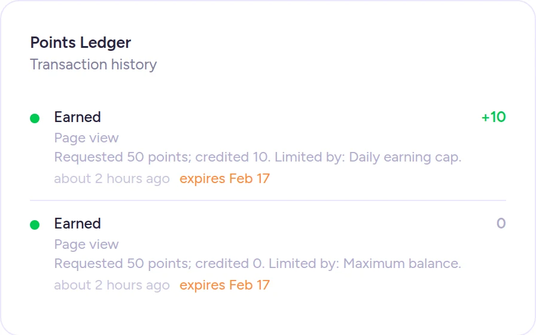

A loyalty program rewards signed-in customers with points when they buy from your drops or participate in queues, draws, auctions, appointments, and waitlists. Points power two things in Fanfare: **loyalty tiers** (audiences built from point thresholds) and **loyalty priority** (better odds in queues and draws for higher-point customers). Customers can't spend or redeem points directly in Fanfare. For the full earning and weighting model, see [Loyalty and Fanfair](/concepts/loyalty).

<Info>
  Available on **Pro** and **Enterprise** plans. On Starter and Growth, **Loyalty** stays visible in the sidebar with an upgrade prompt. If you already turned the program on before downgrading, it keeps awarding points—and the turn-off toggle is the only control that remains active. See [Plans and what they unlock](/guide/start/plans).
</Info>

Everything lives under **Loyalty** in the sidebar, split across two pages: **Settings** (program status, expiration, and earning limits) and **Event Points** (how many points each action earns).

## Turn the program on

<Steps>
  <Step title="Open Loyalty Settings">
    Go to **Loyalty → Settings** in the sidebar.
  </Step>
  <Step title="Enable the program">
    On the **Program Status** card, turn the toggle on so the badge switches to **Active**, then select **Save** at the bottom of the page.
  </Step>
</Steps>

<Frame caption="Control program status, point expiration, and earning limits from Loyalty → Settings.">
  
</Frame>

Within a few minutes of saving:

- Signed-in customers begin earning points on eligible actions (guests never earn points—see [Customers and identity](/concepts/customers)).
- Customer profiles gain the **Adjust points** action and **Points Ledger**.
- You can turn on **Bias toward loyal consumers** on queues and draws (while the program is off, that switch shows **"Needs a loyalty program"**). See [Set up a queue](/guide/create/queue) and [Set up a draw](/guide/create/draw).

## Turn the program off

Toggle **Program Status** off on **Loyalty → Settings** and select **Save**.

<Warning>
  Turning the program off freezes it rather than resetting it:
  - Within a few minutes, customers stop earning points, scheduled expiration pauses, and **Points Ledger** and **Adjust points** are hidden from customer profiles.
  - Existing point balances remain stored (and visible in the **Loyalty** column of **Customers**). Loyalty tiers continue sorting customers by those balances, and any queue or draw with loyalty priority already enabled still weights odds by them—turn loyalty priority off on each distribution if you want to stop it.
  - **One-way on Starter and Growth:** If you turn Loyalty off after downgrading below Pro, you can't turn it back on without upgrading again. See [Billing and usage](/guide/account/billing).
  - **Inactivity expiration keeps counting:** Time spent turned off still counts toward inactivity. When you turn the program back on, any customer whose last earned points are older than **Months of inactivity** loses their entire balance at the next hourly check.
</Warning>

## Choose when points expire

Under **Point Expiration**, select a policy and save:

- **Never** — Points don't expire.
- **Fixed** — Each day's points expire after **Months until expiry** (1 to 120 months). Points keep the expiration date assigned when earned, even if you later change the window. Switching to **Never** stops future expiration (previously expired points don't return), and switching back to **Fixed** expires any past-due points on the next hourly check.
- **Inactivity** — A customer's entire balance expires after **Months of inactivity** (1 to 120 months) without earning points. Unlike **Fixed**, **Inactivity** applies retroactively to existing balances—switching to it or shortening the window expires inactive balances at the next hourly check.

Days follow your organization's time zone. Expiration runs every hour—and whenever a customer earns points or receives a manual adjustment—and records an **Expired** row in their ledger. See [Loyalty and Fanfair](/concepts/loyalty) for how dates are calculated.

## Set earning limits

On the **Earning Limits** card, leave any field blank for no limit or enter `0` to stop further earning:

- **Maximum balance** — The highest balance a customer can hold (applies to both earned points and manual adjustments; lowering it doesn't remove existing points).
- **Daily earning cap** — Maximum points a customer can earn in a calendar day (manual adjustments don't count).
- **Monthly earning cap** — Maximum points a customer can earn in a calendar month (manual adjustments don't count).

If an award would exceed a cap, Fanfare credits only the remaining allowance. Calendar days and months follow your organization's time zone, and expired or deducted points don't restore daily or monthly caps. Select **Save** when you're done.

### Settings reference

| Setting | What it controls | Default | Editable while live? |
| --- | --- | --- | --- |
| **Program Status** | Turns earning, expiration, and manual adjustments on or off organization-wide. | Off | Yes (below Pro, you can only turn it off) |
| **Point Expiration** | **Never**, **Fixed**, or **Inactivity**. | **Never** | Yes (Pro and above); **Fixed** affects future points, **Inactivity** applies to existing balances |
| **Months until expiry** / **Months of inactivity** | Expiration window from 1 to 120 months. | None | Yes (Pro and above) |
| **Maximum balance** | Maximum points a customer can hold. | No limit | Yes (Pro and above); lowering it doesn't remove existing points |
| **Daily earning cap** | Maximum earned points per calendar day (excludes adjustments). | No limit | Yes (Pro and above) |
| **Monthly earning cap** | Maximum earned points per calendar month (excludes adjustments). | No limit | Yes (Pro and above) |

## Choose what earns points

Open **Loyalty → Event Points** to inspect point distribution and tune point values.

At the top, the **Loyalty Balance Distribution** chart shows how balances are spread across your signed-in customers (it appears once you have signed-in customers and can take up to an hour to reflect recent changes).

Below the chart, pick an event category on the left to adjust its sliders on the right (0 to 200 points in steps of 5). Changes auto-save about half a second after you stop dragging—there's no **Save** button.

<Warning>
  Only **Purchase**, **Appointment Booked**, and the events under **Queue Events**, **Draw Events**, **Auction Events**, and **Waitlist Events** currently award points. Other cards shown on this page—**Appointment Confirmed**, **Checked In**, **Appointment Completed**, **Engagement Events** (Page View, Product Impression, Product Click, Product View, Search), **Social Events** (QR Scanned, Message Clicked, Message Opened, Message Read), and other **Conversion Events** (Add to Cart, View Cart, Begin Checkout)—can be moved, but they don't award points.
</Warning>

<Warning>
  Slider changes apply organization-wide within a few minutes to future awards only (previously earned points keep their original value). Changes save immediately with no confirmation or undo—use the defaults table below if you want to revert a value.
</Warning>

<Frame caption="Adjust each action's point value on Event Points; sliders auto-save as soon as you release them.">
  
</Frame>

### Active events and default points

| Category | Event | Default points |
| --- | --- | --- |
| **Conversion Events** | Purchase | 100 |
| **Queue Events** | Queue Entered | 20 |
| **Queue Events** | Queue Granted | 50 |
| **Queue Events** | Queue Completed | 100 |
| **Draw Events** | Draw Entered | 25 |
| **Draw Events** | Draw Won | 200 |
| **Draw Events** | Draw Completed | 50 |
| **Auction Events** | Bid Placed | 30 |
| **Auction Events** | Bid Won | 200 |
| **Appointment Events** | Appointment Booked | 50 |
| **Waitlist Events** | Waitlist Entered | 15 |

<Note>
  **Queue Entered** currently appears under **Queue Events** with an internal event key instead of its display label—it's the first card in that category. Timed release entries and waitlist entries added manually by your team don't earn points. For unlisted actions that still carry default awards, see [Loyalty and Fanfair](/concepts/loyalty).
</Note>

## Adjust a customer's points

Add bonus points or deduct points—for example, after a refund or support resolution—directly from a customer's profile. (Requires Pro or above with the loyalty program turned on.)

<Steps>
  <Step title="Open the adjustment dialog">
    Open the customer's profile from **Customers** (see [Customer profiles](/guide/learn/customers)) and select **Adjust points** on the **Value** card.
  </Step>
  <Step title="Choose Add or Deduct and enter points">
    Select **Add** or **Deduct** and enter the **Points** amount. The top of the dialog previews **Current balance** alongside **Requested balance** (when adding) or **New balance** (when deducting).
  </Step>
  <Step title="Record a reason and submit">
    Under **Reason**, pick a chip (**Correction**, **Promotional bonus**, **Goodwill gesture**, **Customer complaint**, or **Refund adjustment**), type a free-text note, or both, then submit once with **Add N points** or **Deduct N points**.
  </Step>
</Steps>

{/* image: guide-learn-loyalty-adjust */}

Keep these rules in mind when adjusting balances:

- **Maximum balance applies:** Adding points stops at your **Maximum balance** cap (if capped, Fanfare credits up to the limit and confirms how many points were added). Daily and monthly earning caps don't apply to adjustments.
- **No negative balances:** You can't deduct more than the customer's current balance.
- **Lifetime points:** Points you add also increase the customer's lifetime points total.
- **Queue and draw priority:** Loyalty priority reads a customer's balance at their last sign-in, so newly added points improve priority the next time they sign in.
- **Separate submissions each apply:** Submitting the dialog twice in separate attempts applies both adjustments.

<Note>
  Manual adjustments don't count as earning activity for **Inactivity** expiration. If a customer's last earned points are already older than your inactivity window, manually added points can expire at the next hourly check.
</Note>

## Read a customer's Points Ledger

When Loyalty is turned on, each customer profile includes a **Points Ledger** listing every **Earned**, **Expired**, and **Adjusted** transaction with its point delta, source or reason, timestamp, and expiration date (when applicable). Credits reduced by a cap note which limit applied. Select **Load more** for older history.

The **"pts expiring soon"** summary above the ledger lists every upcoming expiration date on the customer's balance—not just imminent dates.

<Frame caption="When a limit caps an award, the Points Ledger notes how many points were requested and which limit applied.">
  
</Frame>

## Tiers, priority, and wallet passes

- **Loyalty tiers:** Build tier audiences from **Audiences → Create Audience → Create Loyalty Tiers**. See [Build audiences](/guide/create/audiences).
- **Wallet passes:** Design Apple Wallet and Google Wallet passes displaying a customer's points in **Design Studio** (Pro and above). See [Templates and widget designs](/guide/create/templates).
- **Next drop:** See [Set up the next drop from this one](/guide/learn/next-drop) to pair tiers and loyalty priority with your next release.

## On Shopify

**Loyalty → Settings**, **Loyalty → Event Points**, and the loyalty controls on customer profiles work identically in the Fanfare Shopify app.

## Troubleshooting

<AccordionGroup>
  <Accordion title="Adjust points isn't showing on a customer's profile">
    Make sure the loyalty program is turned on in **Loyalty → Settings** (requires Pro or above). If you downgraded below Pro while the program stayed on, **Adjust points** remains visible but displays an upgrade prompt. If the program is active and the controls are still missing, reload the page.
  </Accordion>
  <Accordion title="Fewer points were added than I entered">
    Your **Maximum balance** cap limited the credit. Increase **Maximum balance** in **Loyalty → Settings** if you want customers to hold more points.
  </Accordion>
  <Accordion title="The balance distribution chart isn't showing on Event Points">
    The chart appears once your organization has at least one signed-in customer, and it can take up to an hour to populate.
  </Accordion>
  <Accordion title="The Points Ledger says No loyalty transactions yet even though the customer has points">
    Reload the page—this message can appear if the ledger failed to load.
  </Accordion>
</AccordionGroup>

## Related

<CardGroup>
  <Card title="Loyalty and Fanfair" href="/concepts/loyalty">
    How earning, expiration, limits, and loyalty priority work under the hood.
  </Card>
  <Card title="Build audiences" href="/guide/create/audiences">
    Create loyalty tiers from customers' points.
  </Card>
  <Card title="Customer profiles" href="/guide/learn/customers">
    View spend, invites, and drop history alongside a customer's points.
  </Card>
  <Card title="Plans and what they unlock" href="/guide/start/plans">
    See which plans include loyalty programs and wallet passes.
  </Card>
</CardGroup>
