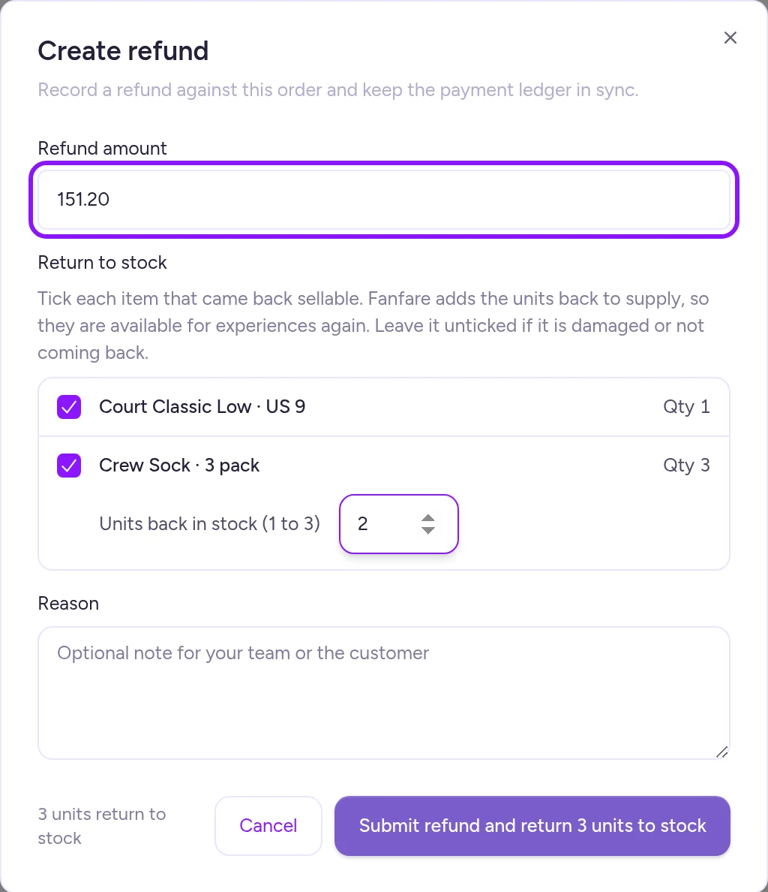

The **Orders** page brings together every order across your organization—both native orders paid through Fanfare checkout and orders synced from your external store. Use it to look up an order, trace its payment history, cancel an uncaptured order, issue a refund, and decide whether returned items go back into inventory.

Order management and refunds are available on every plan (your plan sets only the per-order take rate—see [Payments and fees](/guide/account/payments)). Refunds are processed through your connected Stripe account, and any team member in your organization can issue refunds and record stock decisions.

## Where to find orders

- **Orders** in the sidebar shows every order across your organization.
- **Orders** inside an experience's navigation filters the same view to that experience.
- **Customer profiles** include an **Orders for this experience** link on any drop where a customer purchased—it opens *all* orders for that experience, not just that customer's. See [Customer profiles](/guide/learn/customers).

<Frame caption="The Orders list with summary cards calculated across every order matching your current search and filters.">
  
</Frame>

## Summary cards

Four cards sit above the table: **Total orders**, **Gross revenue**, **Refunded**, and **Average order value**. They calculate totals across all orders matching your current search and filters—not just the current page—and automatically exclude test orders. If your filtered results span multiple currencies, Fanfare displays a separate row of cards per currency without combining them.

<Warning>
  **Gross revenue** and **Average order value** include unpaid orders (**Draft**, **Pending payment**, **Payment failed**, and **Cancelled**) and don't subtract refunds. To check collected payments here, filter **Order status** to **Paid**, then to **Partially refunded**, and read the cards for each—or check **Net revenue** on **Home** and the **Performance** tabs (see [Read your results](/guide/learn/performance)).
</Warning>

## Find an order

<Steps>
  <Step title="Open Orders">
    Select **Orders** in the sidebar (or inside a specific experience).
  </Step>
  <Step title="Search by customer, experience, or ID">
    Type in **Search orders, customers, or experiences...** to match a customer's name, email, or phone number, an experience name, your external store's order ID, or a full Fanfare order ID.
  </Step>
  <Step title="Filter and sort">
    Narrow results by **Order status**, **Payment status**, or **Source** (such as Shopify), and sort by **Placed** (**Asc** or **Desc**). Select any row to open the order page.
  </Step>
</Steps>

<Tip>
  Search doesn't match the 8-character short reference displayed in the table. To search by Fanfare ID, use **Copy order ID** on the row to copy the full ID. Your active search and filters stay in the page URL, so you can share a filtered view with a teammate.
</Tip>

**Clear filters** resets the dropdown filters while keeping your search query intact.

### Reading the list and order statuses

Each row shows the **Order** reference (with **Copy order ID** and a **Test** badge on test orders), **Customer**, **Items**, **Status** (plus payment status details or sync issues like `"Shopify sync: Failed"`), **Total** (with any refunded amount underneath), **Placed** date (hover for the exact timestamp), and a row action menu for **Refund**, **Cancel**, or **View source**.

| Status | What it means |
| --- | --- |
| **Draft** | The buyer is still inside their payment window and hasn't paid yet. See [Admission and the payment window](/concepts/admission-and-payment). |
| **Pending payment** | Payment hasn't been captured in full. Synced store orders may also show **Authorized**, **Partially paid**, or **Voided** underneath. |
| **Paid** | Payment was captured. Orders with a full refund still processing remain here until the refund completes. |
| **Partially refunded** | Part of the payment has been refunded. |
| **Refunded** | The entire payment has been refunded. |
| **Payment failed** | Payment didn't go through. |
| **Cancelled** | The order was canceled. |

<Note>
  Canceled native Fanfare orders display **Failed** as their payment status in the list (while showing **Cancelled** on their **Payment** card), so filtering **Payment status** to **Failed** includes canceled Fanfare orders as well.
</Note>

## The order page

Opening an order shows the 8-character reference, status, experience name, and an **Actions** menu in the header (test orders also display a banner confirming they're excluded from revenue, purchase limits, and customer metrics).

<Frame caption="Inspect payment details, items, timeline events, and issue refunds from the Actions menu on the order page.">
  
</Frame>

- **Payment** — **Order total**, **Refunded**, **Remaining refundable**, **Provider** (Stripe or Shopify), **Payment status**, **Amount**, **Fanfare fee**, and provider **Reference**. At the bottom, you'll see **Vendor** (`Native` for Fanfare checkout, or your external store name), **External order ID**, **Sync status**, **Last synced**, and **View source**.
- **Items** — Products, variants, quantities, line totals, unit prices, and post-refund stock status, plus **Tax**, **Shipping**, **Discount**, and **Duties** when nonzero. For external store orders, rely on the order total if synced line items don't add up to it.
- **Timeline** — Chronological log of order placement, payment capture or failure, cancellations, and every **Full** or **Partial** refund with its reason.
- **Customer & addresses** — **Name** (links to their customer profile), **Email**, **Phone**, **Shipping address**, and **Billing address**.

### Available actions by status

| Status | **Refund** | **View source** |
| --- | --- | --- |
| **Draft** | No | Synced orders only |
| **Pending payment** | No | Synced orders only |
| **Paid** | Native orders only | Synced orders only |
| **Partially refunded** | Native orders with remaining balance | Synced orders only |
| **Refunded**, **Payment failed**, **Cancelled** | No | Synced orders only |

- **Cancel** appears on native Fanfare orders whose payment hasn't been captured yet (such as **Pending payment**). Confirming the **Cancel order** dialog voids the payment before capture and marks the order **Cancelled**. Once payment is captured, refund the order instead. See [Checkout options](/concepts/checkout-options) and [Admission and the payment window](/concepts/admission-and-payment).
- **Refund** applies only to native Fanfare checkout orders. If a refund fails after a full refund was previously attempted, **Refund** may not reappear for the remaining balance—issue it from your Stripe Dashboard instead.
- **View source** opens the order in your external store when the store provides a link.

## Refund an order

<Steps>
  <Step title="Open the refund dialog">
    Open the order page and select **Actions → Refund** to open the **Create refund** dialog.
  </Step>
  <Step title="Verify the refund amount">
    Confirm **Refund amount** for a full refund, or enter a smaller amount for a partial refund (minimum one cent; commas work as decimal separators; the amount can't have more decimal places than the currency allows).

    <Warning>
      **Refund amount** pre-fills with the full remaining balance. Submitting sends the refund to Stripe immediately and can't be undone—double-check the amount before continuing.
    </Warning>
  </Step>
  <Step title="Choose which items return to stock">
    If Fanfare manages stock for items on the order, check each sellable item under **Return to stock**. For multi-unit items, enter the quantity in **Units back in stock (1 to N)**. Items you leave unchecked are recorded as kept out of stock (you can still return them later from the order page).
  </Step>
  <Step title="Add a reason and submit">
    Optionally enter a **Reason**, then select **Submit refund** (or **Submit refund and return N units to stock**).
  </Step>
</Steps>

<Frame caption="Refund amount pre-fills with the full remaining balance; check items under Return to stock to restore inventory at the same time.">
  
</Frame>

### What happens after you submit

- **Completed immediately:** Your refund and stock choices are recorded right away.
- **Pending in Stripe:** Pending refunds immediately count toward **Refunded** and **Remaining refundable** (if one later fails, the balance is restored). However, the stock choices you made in the dialog are discarded—make them again on the order page once the refund completes.
- **Failed:** No items are returned to stock.

You can issue multiple partial refunds until the remaining balance reaches zero.

<Note>
  You can also select **Refund** from an order's row menu in the Orders list. That shortcut skips the **Return to stock** section, leaving refunded items as **"No stock decision recorded"** until you decide on the order page.
</Note>

## Decide stock after a refund

When a refunded order has Fanfare-managed items awaiting a stock decision, a banner on the order page links directly to them via **Go to item**.

<Frame caption="Refunded items without a stock decision display Return to stock and Keep out of stock actions directly on the order page.">
  
</Frame>

For each eligible item, choose:

- **Return to stock** — Adds the units back to your product's **Supply**. It doesn't lower **Sold** or automatically add units back into a drop's allocation—to sell them again, allocate them to a drop (see [Allocate stock to a drop](/guide/create/stock-allocation)). Single units return immediately; multi-unit lines ask how many came back sellable. Fanfare prevents returning the same unit twice.
- **Keep out of stock** — Records that the item isn't returning to sellable inventory. You can still return it later if needed.

Only non-test orders with a completed refund and a non-deleted, Fanfare-managed product can be returned to stock. See [Manage stock](/guide/create/stock) for how returned units affect supply and where to find pending returns on the product page.

## External store orders

Orders synced from an external store show the store's name under **Vendor**, along with its **External order ID** and **Sync status**. Select **View source** to open the order in your store's admin.

<Warning>
  Orders synced from an external store (such as Shopify) can't be refunded in Fanfare. Process refunds directly in that store.
</Warning>

## Refunds, fees, and loyalty points

- **Fees:** Fanfare's per-order fee isn't returned when you refund an order. Check Stripe's documentation for how refunds affect Stripe processing fees, and see [Payments and fees](/guide/account/payments) and [Billing and usage](/guide/account/billing) for rate and billing details.
- **Stripe Dashboard refunds:** Any refund issued directly in your Stripe Dashboard syncs back to the Fanfare order automatically—don't submit it a second time in Fanfare.
- **Loyalty points:** Refunding an order doesn't automatically deduct the **Purchase** points the customer earned. To claw them back, deduct them manually on the customer's profile using the **Refund adjustment** reason (see [Run a loyalty program](/guide/learn/loyalty)).

## Test orders

Orders placed with a test payment method appear alongside live orders with a **Test** badge, hatched row background, and a **"Test order"** banner. They're excluded from revenue, purchase limits, and customer metrics, and their items can't be returned to stock. See [Add and gate sequences](/guide/create/sequences) for test orders and purchase limits.

## On Shopify

The **Orders** list and order detail page work the same inside the Fanfare Shopify app. Because Fanfare checkout isn't used in the Shopify app, orders completed through Shopify checkout show **Vendor** as **Shopify**, offer at most **View source**, and must be refunded in Shopify. Refunds issued in Shopify don't sync back to Fanfare, so the order continues showing **Paid** in Fanfare.

In the Shopify app, the order page also includes a panel to push a Fanfare order to Shopify or link it to an existing Shopify order. See [Orders with Shopify checkout](/guide/shopify/orders).

## Troubleshooting

<AccordionGroup>
  <Accordion title="Refund isn't available under Actions">
    Check whether one of the following applies:
    - The order was synced from an external store (refund it in that store instead).
    - Payment hasn't been captured yet—use **Cancel** if available.
    - The order is already fully refunded or has a full refund in progress.
    - The order is still in **Draft** while the buyer is in their payment window.
  </Accordion>
  <Accordion title="My refund amount isn't accepted">
    Make sure the amount is at least one cent, doesn't exceed the currency's decimal precision, and doesn't exceed **Remaining refundable** (which already accounts for pending refunds).
  </Accordion>
  <Accordion title="Search doesn't find an order by its short reference">
    The 8-character short reference isn't searchable. Use **Copy order ID** on the row to search by the full Fanfare ID, or search by customer details, experience name, or external store order ID.
  </Accordion>
  <Accordion title="Return to stock isn't available on a refunded item">
    Items can be returned to stock only after the refund completes in Stripe, on non-test orders, for non-deleted products whose stock is managed by Fanfare.
  </Accordion>
</AccordionGroup>

## Related

<CardGroup>
  <Card title="Payments and fees" href="/guide/account/payments">
    Connect Stripe and review your Fanfare take rate.
  </Card>
  <Card title="Manage stock" href="/guide/create/stock">
    Track product supply and see how returned units are handled.
  </Card>
  <Card title="Read your results" href="/guide/learn/performance">
    Compare paid orders and net revenue across your drops.
  </Card>
  <Card title="Customer profiles" href="/guide/learn/customers">
    View the customer behind any order.
  </Card>
  <Card title="Orders with Shopify checkout" href="/guide/shopify/orders">
    Push Fanfare orders to Shopify or link them to Shopify orders.
  </Card>
</CardGroup>
