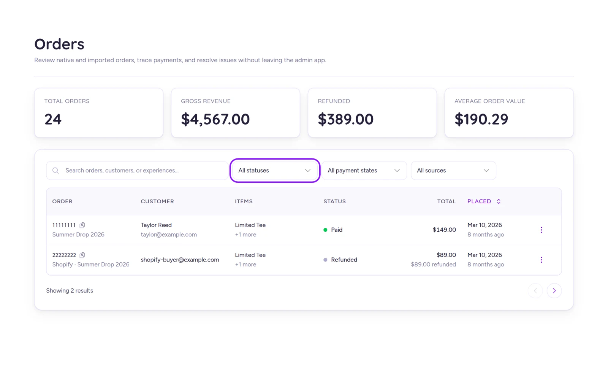
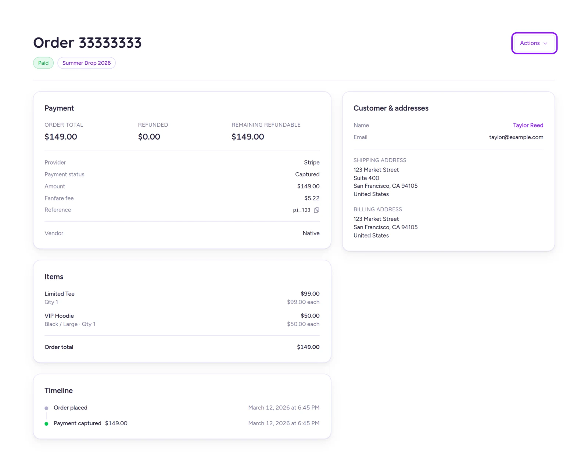
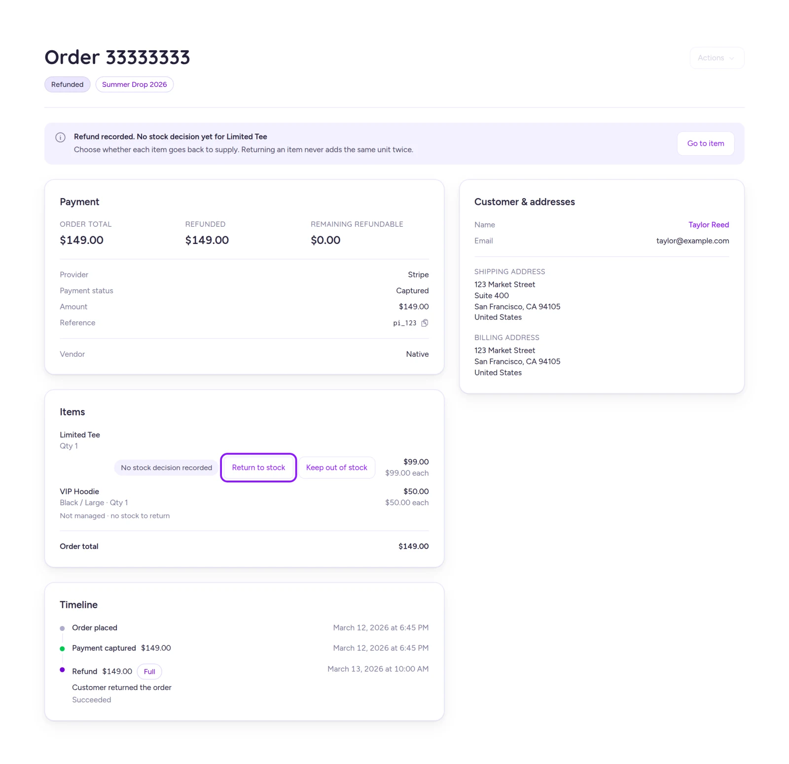

The **Orders** page lists every order in your organisation: native orders paid through Fanfare checkout, and orders synced from your store. Use it to find one order, check what happened to its payment, refund or cancel it, and decide whether refunded items go back into stock. Every plan can do all of this. The plan sets only the Fanfare fee on each order: see [Payments and fees](/guide/account/payments).

## Before you start

- Refunds go through your connected Stripe account. Connecting Stripe is covered in [Payments and fees](/guide/account/payments).
- Any member of your organisation can refund and record stock decisions, not only admins.

## Where to find orders

- **Orders** in the sidebar lists every order in the organisation.
- **Orders** in an experience's side nav shows the same list for that experience only. Opening an order from it takes you to the same order page.

The customer's name on an order opens their profile. On the profile, an experience the customer bought from has an **Orders for this experience** link to that experience's order list. See [Customer profiles](/guide/learn/customers).

<Frame caption="The Orders list, with summary cards computed over every order that matches the filters.">
  
</Frame>

## The summary cards

Four cards sit above the list: **Total orders**, **Gross revenue**, **Refunded** and **Average order value**. They count every order that matches the current search and filters, not only the page you are looking at. Test orders are left out, and the cards say "Test orders are excluded" when the filtered list contains one. If you have orders in more than one currency, you get one row of cards per currency, each headed by its currency code, with no combined total.

<Warning>
  **Gross revenue** and **Average order value** include orders that were never paid: Draft, Pending payment, Payment failed and Cancelled. Refunds are shown beside them in **Refunded**, not subtracted. To see money you actually took, set **Order status** to **Paid**, then to **Partially refunded**, and read the cards for each.
</Warning>

The Performance tabs and Home use a different measure, net revenue, which counts only paid orders and takes refunds off. See [Read your results](/guide/learn/performance).

## Find an order

1. Open **Orders** from the sidebar.
2. Type in **Search orders, customers, or experiences...**. Search matches a customer's name, email or phone, an experience name, the order ID from your store, or the full Fanfare order ID.
3. Narrow the list with **Order status**, **Payment status** or **Source** (the store an order was synced from, such as Shopify).
4. Select an order to open it.

The 8-character reference shown on each order does not match in search. To find an order by its Fanfare ID, use **Copy order ID** on its row, which copies the full ID, and search for that.

The list shows 10 orders per page, most recently recorded first, with Previous and Next. Only **Placed** can be sorted: select its header and choose **Asc** or **Desc**. **Clear filters** resets the three filters but leaves your search text in place. The page address keeps your search and filters, so you can share a link to a filtered list with a colleague.

## Read the list

| Column | What it shows |
| --- | --- |
| **Order** | The 8-character reference, which opens the order; a copy button (**Copy order ID**); a **Test** chip on test orders. Below: the store the order came from and the experience name. |
| **Customer** | The customer's name, or their email or phone when there is no name, with the next contact detail below. |
| **Items** | The first item and its SKU, then "+N more" or the item count. |
| **Status** | The order status (see below). Below it, the payment status when it adds something, or a sync problem such as "Shopify sync: Failed". |
| **Total** | The order total, with the amount refunded below it when there has been a refund. |
| **Placed** | The date, with how long ago below it. Hover for the exact time. |
| (menu) | **Refund**, **Cancel** and **View source**, where the order allows them. A greyed-out menu means none is allowed. |

Test orders appear among real orders on a hatched background.

### Order statuses

| Status | What it means |
| --- | --- |
| **Draft** | The buyer is still inside their payment window and has not paid. See [Admission and the payment window](/concepts/admission-and-payment). |
| **Pending payment** | Not yet paid in full. Read the payment status below it: for orders synced from your store this can be an authorised payment not yet taken (**Authorized**), a part payment (**Partially paid**) or a voided payment (**Voided**); a Fanfare order still waiting for its payment shows no second line. |
| **Paid** | The payment was taken. A full refund still in progress shows here, with the refunded amount under the total, until it completes. |
| **Partially refunded** | Some of the payment has been refunded. |
| **Refunded** | The whole payment has been refunded. |
| **Payment failed** | The payment did not go through. |
| **Cancelled** | The order was cancelled. |

A Fanfare order that was cancelled shows payment status **Failed** in the list (its **Payment** card reads Cancelled). Filtering **Payment status** to **Failed** therefore includes cancelled Fanfare orders as well as payments that failed.

## The order page

The header shows "Order" and the 8-character reference, the status, the experience name, and an **Actions** button. A test order carries a "Test order" banner: "Excluded from revenue, purchase limits, and customer metrics".

<Frame caption="The order page. Refund is under Actions.">
  
</Frame>

| Card | What it shows |
| --- | --- |
| **Payment** | **Order total**, **Refunded** and **Remaining refundable**. Then, when there is a payment record: **Provider** (Stripe or Shopify), **Payment status**, **Amount**, **Fanfare fee** (once payment was taken, unless the order is cancelled), and **Reference**, the payment provider's reference for the payment. At the foot of the card: **Vendor** ("Native" for orders made in Fanfare, otherwise the store's name), **External order ID**, **Sync status**, **Last synced** and a **View source** link. |
| **Items** | Each product with its variant, quantity, line total and price each, and its stock state after a refund. Below, **Tax**, **Shipping**, **Discount** and **Duties** appear only when they are not zero. For an order synced from your store, the order total is the figure to trust, even where the lines do not add up to it. |
| **Timeline** | Order placed, payment captured, failed or cancelled, and each refund (marked **Full** or **Partial**, with its reason) or cancellation. |
| **Customer & addresses** | **Name**, **Email**, **Phone**, **Shipping address** and **Billing address**. The name opens the customer's profile. |

## What you can do in each state

| Status | **Refund** | **View source** |
| --- | --- | --- |
| Draft | No | Synced orders only |
| Pending payment | No | Synced orders only |
| Paid | Yes | Synced orders only |
| Partially refunded | Usually, while a balance remains | Synced orders only |
| Refunded, Payment failed, Cancelled | No | Synced orders only |

Refund applies only to native orders paid through Fanfare checkout. **View source** appears when the order came from a store that provided a link to it. If **Actions** is greyed out, nothing is allowed on this order.

If a refund fails after the order was fully refunded, **Refund** may not be offered for the remaining balance. Refund it in your Stripe Dashboard.

**Cancel** is offered on a Fanfare order whose payment has not been taken yet, such as one in **Pending payment**. The **Cancel order** dialogue cancels the payment before it is taken and marks the order **Cancelled**. Once the payment has been taken, refund the order instead. To understand when payment is taken, see [Checkout options](/concepts/checkout-options) and [Admission and the payment window](/concepts/admission-and-payment).

## Refund an order

1. Open the order and select **Actions** > **Refund**. The **Create refund** dialogue opens.
2. Check **Refund amount**.

   <Warning>
     **Refund amount** is filled in with the full remaining balance. If you submit without changing it, you refund everything left on the order. The refund is sent to Stripe as soon as you submit, and a refund cannot be undone.
   </Warning>

   For a partial refund, type the amount. A comma works as the decimal point. The smallest refund is one cent, and an amount with more decimal places than the currency allows is refused.
3. If the order has items whose stock Fanfare manages, a **Return to stock** section lists them. Tick each item that came back sellable. For an item with more than one unit left, enter how many in **Units back in stock (1 to N)**. Items whose stock Fanfare does not manage carry a note that there is nothing to return.
4. Optionally add a **Reason**.
5. Select **Submit refund**, or **Submit refund and return N units to stock** when you ticked items.

<Frame caption="The refund amount starts at the full remaining balance.">
  
</Frame>

Items you leave unticked are recorded as kept out of stock. You can still return them later from the order page.

### After you submit

Without a **Return to stock** section, you see "Refund submitted". With one, what you see depends on Stripe:

- The refund completes. You see "Refund submitted" and your stock choices are recorded.
- The refund is still pending. You see "Refund is pending. Return to stock can be chosen once it completes." The stock choices you made in the dialogue are dropped. Once the refund completes, make them again on the order page.
- The refund fails. You see "The refund did not go through, so no items were returned to stock."

A pending refund already counts in **Refunded** and **Remaining refundable**. If it later fails, the balance comes back.

You can refund again while a balance remains. Each refund appears on the timeline marked **Full** or **Partial**.

### Refund from the list

The menu on a row also offers **Refund**. It opens the same dialogue without the **Return to stock** section. Refunded items are left as "No stock decision recorded" until you decide on the order page.

## Decide stock after a refund

When a refunded item has no stock decision yet, the order page shows "Refund recorded. No stock decision yet for …" with a **Go to item** button that takes you to it.

<Frame caption="Each refunded item waits for a stock decision.">
  
</Frame>

For each item, choose:

- **Return to stock** adds the units back to **Supply**. It does not lower **Sold** or add them to any drop's allocation: to sell them again, allocate them to a drop ([Allocate stock to a drop](/guide/create/stock-allocation)). For an item with one unit left, it happens at once. For several, a dialogue asks how many came back sellable.
- **Keep out of stock** records that the item is not going back. You can still return it later.

An item then shows "Returned to stock", "Kept out of stock", a count such as "2 of 3 returned to stock" while some units are back, or "Not managed · no stock to return" for a product whose stock Fanfare does not manage. Returning an item never adds the same unit twice.

Only items of products whose stock Fanfare manages, and that have not been deleted, on an order that is not a test order and has a completed refund, can be returned. What returned units do to your supply, and the product page's list of refunded items not yet returned, are covered in [Manage stock](/guide/create/stock).

## Orders from your store

An order synced from an external store shows the store's name as its **Vendor**, its **External order ID** and its **Sync status**. Use **View source** to open it in the store's admin.

<Warning>
  An order synced from an external store, such as Shopify, cannot be refunded in Fanfare. Its only action is **View source**, and only when the store provided a link. Make the refund in that store.
</Warning>

## Refunds and fees

The Fanfare fee on an order is not returned when you refund it, and Stripe charges its processing fees to your Stripe account; see Stripe's documentation for how refunds affect them. Fee rates are covered in [Payments and fees](/guide/account/payments), and fees on your bill in [Billing and usage](/guide/account/billing).

A refund you make in your Stripe Dashboard is recorded on the order as well. Do not repeat it in Fanfare.

A refund does not take back the **Purchase** points the order earned. To take them back, deduct them by hand with the "Refund adjustment" reason described in [Run a loyalty programme](/guide/learn/loyalty).

## Test orders

Test orders are placed through a test payment method. They are listed with real orders, with a **Test** chip, a hatched row and a "Test order" banner. They are excluded from revenue, purchase limits and customer metrics, and their items cannot be returned to stock. Where test orders come from, and order limits per customer, are covered in [Add and gate sequences](/guide/create/sequences).

## On Shopify

The lists and the order page are the same in the Fanfare app in Shopify. Taking payment with Fanfare checkout is not available there, so orders paid through Shopify checkout show **Vendor** "Shopify", offer at most **View source**, and are refunded in Shopify. A refund you make in Shopify is not passed back to Fanfare: the Fanfare order still shows **Paid**.

The order page in the Fanfare app in Shopify also has a panel to push a Fanfare order to Shopify or link it to a Shopify order. See [Orders with Shopify checkout](/guide/shopify/orders).

## Troubleshooting

<AccordionGroup>
  <Accordion title="Refund is missing from Actions">
    - The order was synced from your store. Refund it there.
    - The payment has not been taken yet. A Fanfare order in this state may offer **Cancel** instead.
    - The order is already fully refunded, or a full refund is still in progress.
    - The order is Draft: the buyer is still in their payment window.
  </Accordion>
  <Accordion title="The refund amount is refused">
    - It is more than the remaining balance. The balance already counts refunds still in progress.
    - It has more decimal places than the currency allows.
    - It is under one cent.
  </Accordion>
  <Accordion title="Search does not find the order">
    The 8-character reference does not match in search. Use **Copy order ID** on the order's row, or search by the customer, the experience or your store's order ID.
  </Accordion>
  <Accordion title="Return to stock is not offered">
    - The refund is still pending. Come back once it completes.
    - Fanfare does not manage stock for that product, or the product has been deleted.
    - It is a test order.
  </Accordion>
</AccordionGroup>

## Related

<CardGroup>
  <Card title="Payments and fees" href="/guide/account/payments">Connect Stripe and see the Fanfare checkout fee.</Card>
  <Card title="Manage stock" href="/guide/create/stock">What returned units do to supply.</Card>
  <Card title="Read your results" href="/guide/learn/performance">Paid orders and net revenue.</Card>
  <Card title="Customer profiles" href="/guide/learn/customers">The customer behind an order.</Card>
  <Card title="Orders with Shopify checkout" href="/guide/shopify/orders">Push and link orders to Shopify.</Card>
</CardGroup>
