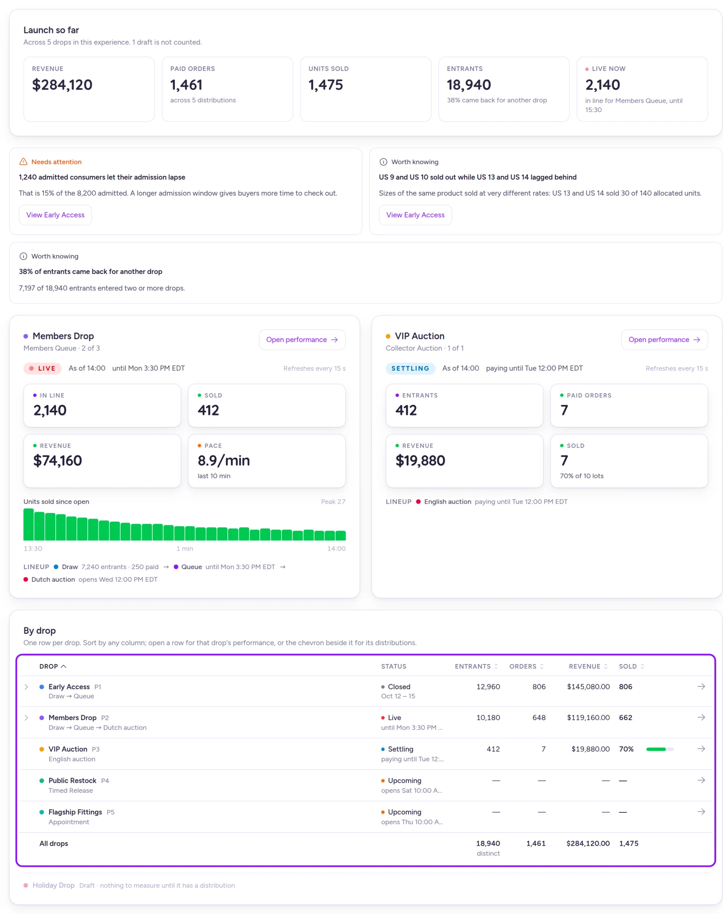
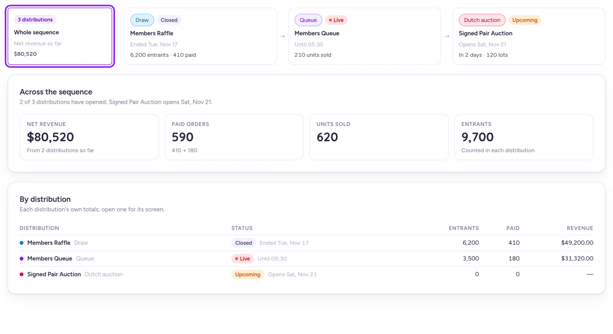

Once a drop wraps up—or while it's still running—you want to know how many people showed up, how many bought, and how much revenue it brought in. Fanfare reports those numbers in four places, each scoped slightly differently so you can zoom out across your whole store or drill into a single queue or draw.

<Note>
  A sequence is one way into an experience (see [Sequences and routing](/concepts/sequences)). On the **Performance** tabs, Fanfare refers to each sequence as a **drop** (as in **By drop** and **All drops**). Results appear once at least one sequence has a distribution.
</Note>

## Where to find your results

| View | How to open it | Scope |
| --- | --- | --- |
| **Home** metrics panel | **Home** in the sidebar (titled **Dashboard**) | All experiences over a rolling time window |
| Experience **Performance** tab | Open an experience → **Performance** | Every sequence in that experience, all time |
| Sequence **Performance** tab | Open a sequence → **Performance**, select **View performance** on a sequence card or Performance card, or follow "Orders and revenue are on the Performance tab" on a finished sequence in the experience **Overview** | One sequence—either combined or one distribution at a time |
| Sequence **Performance** card | Top of every tab on a sequence page | One sequence over the time window last selected on **Home** |

Every distribution on the **Performance** tabs shows a phase: **Upcoming**, **Live**, **Settling**, or **Closed** (sequences without a distribution show **Draft**). **Settling** means entry has closed, but final numbers can still move—a draw hasn't been picked yet, an auction hasn't closed, or admitted customers are still inside their payment window. These phases are separate from the status badges on your experiences list; see [Experiences](/concepts/experiences).

## Read the Home metrics panel

<Steps>
  <Step title="Pick a rolling time window">
    Open **Home** and select **Last 24 hours**, **7 days**, **30 days**, or **90 days**. Fanfare remembers your choice in this browser. Periods are rolling—**7 days** means the last 7 × 24 hours, not the current calendar week.
  </Step>
  <Step title="Review the five headline cards">
    Check **Views**, **Entries**, **Wins**, **Paid orders**, and **Net revenue**. Each card includes a breakdown underneath:
    - **Views** breaks down by customer segment (Champions, Loyal, At-Risk, New, Lost), showing up to five segments (so rows may not sum to the total).
    - **Entries** and **Wins** break down by distribution type.
    - **Paid orders** and **Net revenue** break down by your top four experiences plus **Other**. **Net revenue** also displays gross revenue underneath.
  </Step>
  <Step title="Explore the trend chart">
    Below the cards, switch the chart between **Views**, **Entries** (default), **Wins**, and **Paid orders** to spot spikes over time. (**Net revenue** doesn't have a chart.)
  </Step>
</Steps>

Metrics refresh automatically every 30 seconds while the tab is open. Toggle **Auto-refresh On** to pause automatic updates, or select **Refresh** to reload immediately. If there's no activity in your chosen window, the panel displays faded **Sample data**—switch to a longer period to see historical numbers.

{/* image: guide-learn-performance-home */}

<Warning>
  **Paid orders** includes fully refunded orders. Because refunds reduce **Net revenue** to zero for those orders without removing them from the order count, a refund lowers revenue while keeping **Paid orders** unchanged.

  The **Paid orders** card and the **Paid orders** chart can also disagree: the card groups orders by order date, while the chart plots payment capture time (or external store order time for synced orders) and doesn't reflect refunds or cancellations.
</Warning>

## Read an experience's Performance tab

What appears on an experience's **Performance** tab depends on its sequences:

- **No sequences:** Shows "No drops yet" until you add a drop.
- **One sequence:** Opens that sequence's own Performance view directly (see [Read a sequence's Performance tab](#read-a-sequences-performance-tab)).
- **Two or more sequences (all drafts):** Shows "Nothing to measure yet" with links to each draft until a distribution is added.
- **Two or more sequences (at least one with a distribution):** Opens the experience overview below. Any draft sequences appear below the table and aren't included in totals.

### Launch so far

The headline tiles summarize every sequence in the experience since launch:

| Tile | What it shows |
| --- | --- |
| **Revenue** | Net revenue (customer payments minus refunds). |
| **Paid orders** | Paid orders across the experience, along with how many distributions have opened. |
| **Units sold** | Units on paid orders. **"of N offered"** appears only when no opened distribution is a queue or timed release, since those don't have a fixed unit cap. |
| **Entrants** | Distinct customers who entered any sequence, along with the share who returned for another sequence. |
| **Next drop** | Countdown to the next scheduled distribution when nothing is currently live. |

While a distribution is active, **Live now** and live monitoring cards replace **Next drop**. See [Watch a live drop](/guide/drop/watch-live).

<Frame caption="The experience overview totals every drop in the experience; select any row in By drop to inspect that sequence.">
  
</Frame>

### Insights

Once sequences close, Fanfare surfaces automated findings labeled **Needs attention** or **Worth knowing** to help you spot friction or inventory imbalances:

| Insight | Trigger |
| --- | --- |
| **Admitted customers let their admission lapse** (**Needs attention**) | At least 10 people—and more than 10% of admitted shoppers—didn't pay before their window expired. |
| **Entrants missed out** (**Needs attention**) | At least 10 people—and more than 25% of entrants—were turned away after sellout or were still waiting when the queue closed. |
| **One size sold out while another lagged** (**Worth knowing**) | Every size has an allocation, and one size sold out while another size of the same product sold less than half its allocation. (On a single distribution's screen, this appears only when the sequence has one distribution.) |
| **Repeat entrants** (**Worth knowing**) | At least two sequences have closed and some customers entered more than one. |

Insights never appear while a distribution is **Settling**. You'll see them in two places:

- **Closed queue results** on the sequence **Performance** tab, with a **View drop** link to the sequence's **Overview**.
- **Experience overview** (up to four insights at a time) for sequences that have completely closed. If a sequence still has an upcoming distribution, it's excluded until all of its distributions finish.

To learn why admitted shoppers lapse during checkout, see [Admission and the payment window](/concepts/admission-and-payment).

### By drop

The **By drop** table lists one row per sequence. Select any row to open that sequence's **Performance** tab.

| Column | What it shows |
| --- | --- |
| **Drop** | Sequence name, routing priority (such as P1), and distribution flow in chronological order (for example, Queue → Draw). |
| **Status** | Current phase and opening or closing time. |
| **Entrants** | Distinct customers who entered that sequence. |
| **Orders** | Paid orders. |
| **Revenue** | Net revenue. |
| **Sold** | Share of offered units sold, units sold when there's no fixed cap, or "—" before opening. |

Rows sort by priority (creation order, which can't be changed in the admin; see [Sequences and routing](/concepts/sequences)). Select **Entrants**, **Orders**, **Revenue**, or **Sold** to sort highest first, or **Drop** to return to priority order; select a column header again to reverse it.

Sequences with multiple distributions expand via the chevron to link to each distribution's results. If any paid orders in a sequence can't be matched to a specific distribution, they still count in the sequence row and appear under **"Not linked to a distribution"** when you expand a multi-distribution sequence.

In the **All drops** footer, **Entrants** is deduplicated across sequences—each customer counts once, so the total is usually lower than the sum of individual rows.

## Read a sequence's Performance tab

When a sequence has a single distribution, its **Performance** tab opens directly to that distribution. With two or more distributions, a switcher at the top lets you toggle between **Whole sequence** and each individual distribution in time order (switching to a **Distribution** dropdown on narrow screens or with five or more distributions).

By default, the tab opens on the most recently opened **Live** distribution—falling back to **Settling**, then the next **Upcoming**, then the most recently **Closed**.

### Whole sequence

**Whole sequence** displays **Across the sequence** summary tiles (**Net revenue**, **Paid orders**, **Units sold**, **Entrants**) above a **By distribution** breakdown table.

<Note>
  **Entrants** in **Whole sequence** counts a customer once per distribution they entered ("Counted in each distribution"). Because the experience overview deduplicates across sequences, the same group of shoppers can produce a higher number here.
</Note>

<Frame caption="Whole sequence combines totals across every distribution in a single sequence.">
  
</Frame>

### Before a distribution opens

Before launch, the **Before opening** view shows an **Opens in** countdown along with a demand forecast:

- **Expected entrants** — The median entrant count from up to five of this experience's most recently closed distributions of the same type.
- **Range** — The lowest and highest entrant counts across those prior distributions.

Fanfare needs at least two closed distributions of the same type in the same experience to build a forecast. Until then, you'll see **"No forecast yet"**.

### Results when settling or closed

Once entry closes, the distribution view shows the sections below (omitting any section with no data):

- **Settling notice** — While **Settling**, a banner notes that admitted shoppers can still complete payment and numbers may continue to change.
- **Results** — **Entrants**, **Admitted**, **Paid orders**, **Units sold**, and **Net revenue** (with gross revenue underneath). If an earlier distribution of the same type in this experience closed before this one opened, **Entrants**, **Admitted**, and **Paid orders** compare against it—and **Units sold** does too on multi-distribution sequences (otherwise **Units sold** shows allocated units).
- **Insights** — Automated findings on closed queues (see [Insights](#insights)).
- **Entry to payment** — Funnel showing entered, admitted, and paid counts with step-to-step conversion rates.
- **Activity since open** — Time-series chart of entries, admissions, and paid orders.
- **Sizes** — Units sold per size and sellout times. When a sequence has a single distribution, **Allocated** is populated alongside a size sellout chart; multi-distribution sequences show "—" for **Allocated** because stock is allocated per sequence, not per distribution (see [Stock](/concepts/stock)).
- **How queue places ended** — Breakdown of queue outcomes: **Admission lapsed**, **Still waiting at close**, **Left the queue**, **Turned away, sold out**, and **Other**.
- **Changes after opening** — Any settings adjusted while the distribution was live.
- **Announcements** — Email and SMS delivery, open, and click counts.

<Warning>
  Draws, auctions, timed releases, and appointments currently share the queue results layout. While live, **"Waiting in queue"** reads 0, and appointments always show 0 **Admitted**. Their finished views omit **How queue places ended** and insights—focus on **Entrants**, **Paid orders**, **Units sold**, and **Net revenue** for these distribution types.
</Warning>

<Frame caption="Closed queue results pair headline metrics and comparisons with funnel conversion, size sellout timing, and queue outcomes.">
  
</Frame>

## The Performance card on a sequence page

Every tab inside a sequence includes a compact **Performance** card tracking **Entries**, **Denials**, distribution-specific wins (**Queue grants**, **Draw winners** with **Lapsed winners**, **Auction winners**), **Paid orders**, **Conversion**, and **Revenue**.

<Note>
  This card uses the time period you last selected on **Home** in the same browser—changing the period on **Home** updates every sequence's card. It doesn't auto-refresh; reload the page for the latest numbers. Orders that aren't attributed to a specific drop are excluded from its totals.
</Note>

## Metric definitions

<Warning>
  Three similar labels count different things:
  - **Entries** on **Home** counts every entry action across distributions—one customer entering three distributions counts three times.
  - **Entries** on a sequence's **Performance** card counts entry actions during the selected Home window.
  - **Entrants** on the **Performance** tabs counts distinct customers, except in **Whole sequence**, where a customer counts once per distribution entered.
</Warning>

<Frame caption="Three customers produce 4 Entries, 3 Entrants, and 2 Wins depending on whether actions, unique people, or admissions are counted.">
  
</Frame>

| Metric | Where it appears | What it counts | Watch out for |
| --- | --- | --- | --- |
| **Views** | Home | Visits to your experience pages by customer segment | Tracked in the customer's browser rather than Fanfare's server records |
| **Entries** (Home) | Home | Entries into queues, draws, auctions, and timed releases, plus appointment bookings | Counts every entry action, not unique customers |
| **Entries** (card) | Sequence **Performance** card | Entry actions within the selected Home window | Not deduplicated by customer |
| **Entrants** | Performance tabs | Distinct customers who entered | Summed per distribution in **Whole sequence**; deduplicated across sequences in **All drops** |
| **Admitted** | Sequence **Performance** tab | Distinct customers granted permission to buy (admitted from a queue, picked in a draw, won an auction, or entered a timed release) | Always 0 for appointments |
| **Wins** | Home | Customers admitted from a queue, picked in a draw, or winning an auction | Excludes timed releases and appointments; a queue win means permission to buy, not a completed purchase |
| **Paid orders** | Everywhere | Orders with captured payment, including partial or full refunds; excludes canceled and test orders | Still includes refunded orders; purchases made in your own checkout aren't tracked (see [Checkout options](/concepts/checkout-options)) |
| **Net revenue** / **Revenue** | Everywhere | Order totals minus refunds recorded in Fanfare (fully refunded orders add nothing) | **Revenue** on the experience overview is net; gross revenue appears beneath net revenue on Home and distribution results, and on the sequence **Performance** card when refunds make gross and net differ |
| **Units sold** | Performance tabs | Total units across paid orders | |
| **Units offered** ("of N offered") | Performance tabs | Draw: winner count. English auction: 1. Dutch auction: quantity. Appointment: places per slot × number of slots | Omitted for queues, timed releases, and appointments missing an open or close time; appointment slots depend on [location hours](/guide/create/locations) |
| **Allocated** | **Sizes** table on distribution results | Stock allocated to the sequence per size | Shown only when the sequence has one distribution |
| **Conversion** | Sequence **Performance** card | Paid orders divided by entries in the period | Includes orders placed in the period even if the buyer entered earlier |
| **Denials** | Sequence **Performance** card | Refused entry attempts in the period | In a draw, customers picked at any point aren't counted |
| **Lapsed winners** | Sequence **Performance** card | Draw winners whose payment window expired in the period | Draws only |
| **"Not linked to a distribution"** | **By drop**, **By distribution** | Sequence paid orders that can't be matched to a single distribution | Included in the sequence's totals |
| **"Not attributed"** | Home **Paid orders** and **Net revenue** breakdowns | Paid orders not tied to an experience | |

If you delete a distribution, its individual screen disappears, but its paid orders remain in the sequence totals under **"Not linked to a distribution"**.

<Tip>
  Looking for gross order volume including unpaid orders? Check [Orders and refunds](/guide/learn/orders). For Fanfare's per-order checkout fees, see [Billing and usage](/guide/account/billing).
</Tip>

## Data freshness, time zones, and currencies

- **Refresh intervals:** Settling results update roughly every 30 seconds; closed results refresh about every minute. Experience overview **Entrants** can lag up to 1 minute, overview **Insights** up to 5 minutes, and forecasts or prior-drop comparisons up to 1 hour. Updates pause while the browser tab is hidden.
- **Time zones and rounding:** Performance tabs use the experience's time zone, while the **Home** chart uses your browser's local time zone. Currency tiles round to whole units.
- **Multiple currencies:** Fanfare never converts or combines revenue across currencies. If an experience spans multiple currencies, **Revenue** / **Net revenue** displays "—" on the experience overview and **Whole sequence**, the **Net revenue** tile is hidden on distribution results, and **Home** displays the largest currency with **"+N more"**.

## On Shopify

**Home** and both **Performance** tabs work the same inside the Fanfare Shopify app. Until checkout protection is on and the product widget is on your theme, **Home** displays a **Finish setting up Fanfare** card above the metrics panel—see [Storefront setup](/guide/shopify/storefront-setup).

<Note>
  Refunds and cancellations processed in Shopify don't sync back to Fanfare, so **Paid orders** and **Net revenue** continue counting those orders in full. See [Orders with Shopify checkout](/guide/shopify/orders).
</Note>

## Troubleshooting

<AccordionGroup>
  <Accordion title="Home metrics stopped refreshing automatically">
    Auto-refresh turns itself off after a network or loading error. Select **Auto-refresh Off** to turn it back on, or select **Refresh** to reload immediately.
  </Accordion>
  <Accordion title="The experience Performance tab says 'Unable to load performance data for this experience.'">
    If you see "Unable to load performance data for this experience.", select **Try again** to reload the overview. If the error persists, refresh the page to check whether the experience was deleted.
  </Accordion>
</AccordionGroup>

## Related

<CardGroup>
  <Card title="Watch a live drop" href="/guide/drop/watch-live">
    Monitor queues, admissions, and sales in real time while a drop is running.
  </Card>
  <Card title="Orders and refunds" href="/guide/learn/orders">
    Search orders, issue refunds, and decide whether items return to stock.
  </Card>
  <Card title="Customer profiles" href="/guide/learn/customers">
    Inspect an individual customer's spend, invites, and drop history.
  </Card>
  <Card title="Set up the next drop from this one" href="/guide/learn/next-drop">
    Turn drop results into audiences, loyalty rewards, and settings for your next launch.
  </Card>
</CardGroup>
