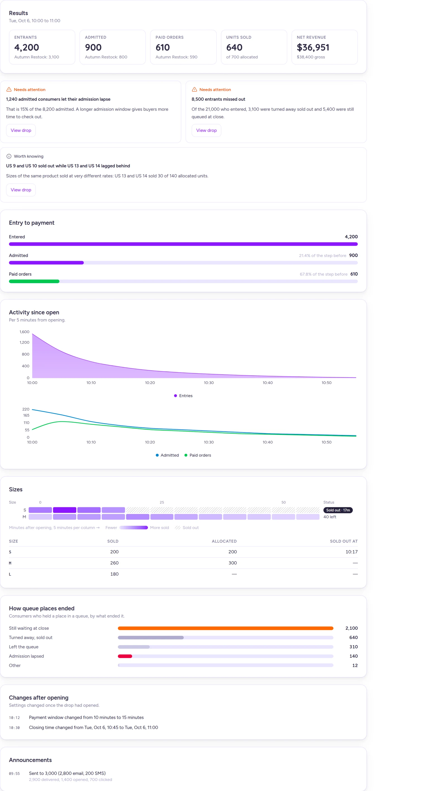
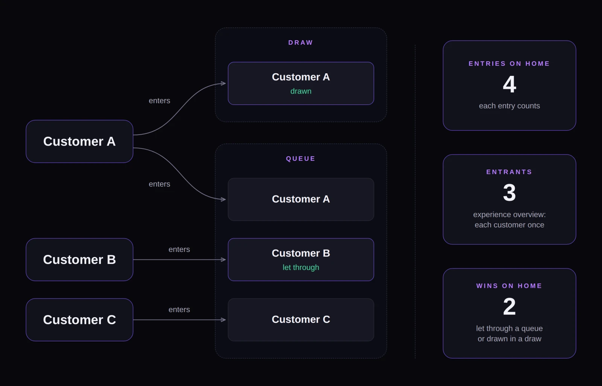

When a drop is over, you want to know how many people came, how many bought and what it earned. Fanfare reports this in four places, and each counts slightly differently.

## Before you start

- An experience has results once one of its sequences has a distribution. A sequence is one way in to an experience: see [Sequences and routing](/concepts/sequences).
- The Performance tabs call each sequence a "drop", as in **By drop** and **All drops**.

## Where your results are

| Place | How to get there | What it covers |
| --- | --- | --- |
| Home metrics panel | **Home** in the main menu (the page is titled Dashboard), at the top of the page | Activity across all your experiences in a recent period |
| Experience **Performance** tab | Open the experience, then **Performance** in its side menu | Every sequence of the experience, all time |
| Sequence **Performance** tab | **Performance** in the sequence's side menu; **View performance** on the sequence card's menu or on the sequence's **Performance** card; or, once a sequence has ended, the link "Orders and revenue are on the Performance tab" on its card in the experience's **Overview** | One sequence, one distribution at a time or the whole sequence |
| Sequence **Performance** card | At the top of every tab of a sequence page | One sequence over the period last chosen on Home |

On the Performance tabs each distribution carries a phase: **Upcoming**, **Live**, **Settling** or **Closed**, and a sequence with no distribution shows **Draft**. **Settling** means entry has ended but the distribution is not finished: a draw has not been drawn yet, an auction has not closed, or admitted customers can still pay. The figures may still change. These phases are not the status chips on your experiences list: see [Experiences](/concepts/experiences).

## Read the Home metrics panel

1. Open **Home**.
2. Choose a period: **Last 24 hours**, **7 days**, **30 days** or **90 days**. Fanfare remembers your choice in this browser.
3. Read the five cards: **Views**, **Entries**, **Wins**, **Paid orders** and **Net revenue**.
4. Under the cards, choose **Views**, **Entries**, **Wins** or **Paid orders** to chart that metric over the period. The chart starts on **Entries**. **Net revenue** has no chart.

Periods are rolling: "7 days" means the last 7 × 24 hours, not this calendar week.

Each card shows a total and a breakdown: **Views** by customer segment (Champions, Loyal, At-Risk, New, Lost), **Entries** and **Wins** by distribution type, and **Paid orders** and **Net revenue** by experience, with your top four experiences and the rest under "Other". **Views** lists at most five segments, so its rows may not add up to the total. **Net revenue** also shows the gross amount beneath it.

**Refresh** reloads the panel now. **Auto-refresh On** reloads it every 30 seconds; select it to switch to **Auto-refresh Off**.
{/* image: guide-learn-performance-home */}

<Warning>
  **Paid orders** counts fully refunded orders too. They add nothing to **Net revenue**, so a refund lowers revenue but not the order count. The **Paid orders** card and the **Paid orders** chart can also disagree: the card counts orders by order date, while the chart places each order when its payment was captured (or, for orders synced from your store, at the store's order time) and does not reflect refunds or cancellations.
</Warning>

If nothing happened in the chosen period, faded example figures under a **Sample data** card replace the panel, even for an established organisation. Choose a longer period.

## Read an experience's Performance tab

What the tab shows depends on how many sequences the experience has.

| Sequences | What you see |
| --- | --- |
| None | "No drops yet" |
| One | That sequence's own Performance view, described in [the next section](#read-a-sequences-performance-tab) |
| Two or more, all of them drafts | "Nothing to measure yet", with a link to each draft |
| Two or more | The experience overview, described below |

Adding a second sequence, even an empty draft, switches the tab to the overview. Drafts are listed below the table and not counted.

### Launch so far

The tiles at the top cover every sequence of the experience since the start.

| Tile | What it shows |
| --- | --- |
| **Revenue** | Net revenue: what customers paid minus refunds. |
| **Paid orders** | Paid orders, with the number of distributions that have opened. |
| **Units sold** | Units on paid orders. "of N offered" appears only when no distribution that has opened is a queue or a timed release, because those have no fixed number of units on offer. |
| **Entrants** | Distinct customers who entered any sequence, with the share who came back for another one. |
| **Next drop** | A countdown to the next distribution to open, with its name and time. It shows only when nothing is live. |

While a distribution is live, a **Live now** tile and live cards appear instead; see [Watch a live drop](/guide/drop/watch-live).

<Frame caption="The overview sums every drop of the experience; each row of By drop opens that drop's results.">
  
</Frame>

### Insights

Findings about finished sequences are marked **Needs attention** or **Worth knowing**.

| Finding | When it appears |
| --- | --- |
| Admitted customers let their admission lapse (**Needs attention**) | At least 10 people, and more than 10% of those admitted, did not pay in time. |
| Entrants missed out (**Needs attention**) | At least 10 people, and more than 25% of entrants, were either turned away when stock sold out or still waiting in the queue at close. |
| One size sold out while another lagged (**Worth knowing**) | Every size has an allocation, and a size of a product sold out while another size of the same product sold less than half of its allocation. On a distribution's own screen this appears only when the sequence has a single distribution. |
| Repeat entrants (**Worth knowing**) | At least two sequences have closed and some customers entered more than one. |

Insights never appear while **Settling**. They appear in two places, and a finding can show in one but not the other:

- On a closed queue's own screen in the sequence Performance tab. **View drop** opens the sequence's **Overview** tab.
- On the experience overview, at most four at a time, and only for sequences that have fully closed. One distribution still to open keeps the whole sequence out. **View** followed by the sequence name opens that sequence's Performance tab.

Why admitted customers lapse is explained in [Admission and the payment window](/concepts/admission-and-payment).

### By drop

The **By drop** table has one row per sequence. Select a row to open that sequence's Performance tab.

| Column | What it shows |
| --- | --- |
| **Drop** | The sequence name, its priority (such as P1) and the types of its distributions in time order, such as Queue → Draw |
| **Status** | Its phase and when it opens, closes or closed |
| **Entrants** | Distinct customers who entered it |
| **Orders** | Paid orders |
| **Revenue** | Net revenue |
| **Sold** | The share of units on offer that sold, or the units sold when there is no fixed number on offer, or "—" before it opens |

The table is sorted by priority, lowest number first. Priority is set by the order you created the sequences in and cannot be changed in the admin: see [Sequences and routing](/concepts/sequences). Select **Entrants**, **Orders**, **Revenue** or **Sold** to sort by that column, highest first, or **Drop** to return to priority order; select a header again to reverse it. **Status** does not sort. A sequence with two or more distributions has a chevron that lists them, each linking to its own results. When some of a sequence's paid orders cannot be matched to one of its distributions, they count in the sequence's row. They are listed separately as "Not linked to a distribution" only when you open the chevron of a sequence with two or more distributions.

In the **All drops** footer, **Entrants** is marked "distinct": each customer counts once, so it is usually lower than the column added up.

## Read a sequence's Performance tab

A sequence with no distribution shows "Nothing to report yet". A sequence with one distribution shows that distribution's screen. With two or more, a switcher sits above the screen: a **Whole sequence** step, then one step per distribution in time order. On a narrow screen, or from five distributions, the switcher becomes a **Distribution** drop-down with arrows for the earlier and later distribution.

The tab opens on the most recently opened live distribution, else the most recently opened settling one, else the next to open, else the last to close.
### Whole sequence

**Whole sequence** shows **Across the sequence** tiles (**Net revenue**, **Paid orders**, **Units sold**, **Entrants**) and a **By distribution** table of each distribution's own totals.

<Note>
  **Entrants** here is "Counted in each distribution": a customer who entered two distributions counts twice. The experience overview counts them once, so the same people can give a higher number here.
</Note>

<Frame caption="Whole sequence adds up the distributions of one sequence.">
  
</Frame>

### Before a distribution opens

**Before opening** shows **Opens in**, a countdown to the opening time. Fanfare also forecasts demand: **Expected entrants** is the middle value of the entrant counts of up to five of this experience's most recently closed distributions of the same type, and **Range** shows the fewest and most entrants they drew. It needs at least two such distributions; until then you see "No forecast yet".

### Results when settling or closed

Once entry ends, the screen shows these sections from top to bottom. A section with nothing to show is left out.

- While **Settling**, a line at the top says admitted customers can still pay, so the figures may change.
- **Results**: **Entrants**, **Admitted**, **Paid orders**, **Units sold** and **Net revenue**. Where an earlier distribution of the same type in this experience closed before this one opened, **Entrants**, **Admitted** and **Paid orders** compare against it, and so does **Units sold** when the sequence has more than one distribution. Otherwise **Units sold** shows the units allocated. **Net revenue** shows the gross amount instead. The comparison is labelled with the name of the earlier distribution's sequence, which may be this one.
- Insights, on a closed queue (see [Insights](#insights)).
- **Entry to payment**: entered, admitted and paid, each with its share of the step before.
- **Activity since open**: entries, admissions and paid orders over time.
- **Sizes**: units sold per size and when each sold out. When the sequence has exactly one distribution, the **Allocated** column is filled in and a chart shows each size selling out over time. Otherwise **Allocated** shows "—", because stock is allocated to a sequence, not to each distribution: see [Stock](/concepts/stock).
- **How queue places ended**: customers who held a place in a queue, by what ended it: **Admission lapsed**, **Still waiting at close**, **Left the queue**, **Turned away, sold out** or **Other**.
- **Changes after opening**: settings changed once the distribution had opened.
- **Announcements**: how many people were sent messages by email and SMS, and how many were delivered, opened and clicked.

<Warning>
  Only queues have a results screen of their own. Draws, auctions, timed releases and appointments use the queue's screens. While they are live, "Waiting in queue" reads 0. Appointments always show 0 admitted. Their results have no **How queue places ended** section and no insights. Use **Entrants**, **Paid orders**, **Units sold** and **Net revenue** for these types.
</Warning>

<Frame>
  
</Frame>

## The Performance card on a sequence page

Every tab of a sequence page has a **Performance** card with counts for a recent period: **Entries**, **Denials**, a wins row for each type the sequence uses (**Queue grants**, **Draw winners** with **Lapsed winners**, **Auction winners**), **Paid orders**, **Conversion** and **Revenue**.

<Note>
  The card has no period selector. It uses the period you last chose on Home in this browser, and changing it there changes every sequence's card. The card does not refresh on its own: reload the page for current figures.
</Note>

If the card says some of the experience's orders are not attributed to a drop, those orders are left out of its counts.

## What each number counts

<Warning>
  Three similar words count three different things. **Entries** on Home adds up entry actions across all distributions, so one customer who enters three distributions counts three times. **Entries** on a sequence's **Performance** card counts entries made in the chosen period. **Entrants** on the Performance tabs counts distinct customers, except in **Whole sequence**, which counts a customer once per distribution entered.
</Warning>

<Frame caption="The same three customers give 4 Entries, 3 Entrants and 2 Wins, because each number counts something different.">
  
</Frame>

| Metric | Where you see it | What it counts | Watch out for |
| --- | --- | --- | --- |
| **Views** | Home | Visits to your experience pages, by customer segment | Comes from the customer's browser, while the other cards come from Fanfare's own records |
| **Entries** (Home) | Home | Entries into queues, draws, auctions and timed releases, plus appointment bookings | Each entry counts, not each customer |
| **Entries** (card) | Sequence **Performance** card | Entries made in the period | Not a count of distinct customers |
| **Entrants** | Performance tabs | Distinct customers who entered | Summed per distribution in **Whole sequence**; distinct across sequences in **All drops** |
| **Admitted** | Sequence Performance tab | Distinct customers given the right to buy: let through a queue, drawn, winning an auction, or entering a timed release | Always 0 for appointments |
| **Wins** | Home | Customers let through a queue, drawn in a draw, or winning an auction | Timed releases and appointments never count. A queue win is permission to buy, not a purchase |
| **Paid orders** | Everywhere | Orders whose payment was taken, including those later refunded in part or in full; cancelled and test orders excluded | Refunded orders still count. Purchases made in your own checkout are never counted, because Fanfare does not see them ([Checkout options](/concepts/checkout-options)) |
| **Net revenue** / **Revenue** | Everywhere | Order totals minus refunds, as recorded in Fanfare; a fully refunded order adds nothing | "Revenue" on the experience overview is net. Gross is order totals before refunds. It shows under net revenue on Home and on a distribution's results, and on the sequence's **Performance** card when refunds make it differ |
| **Units sold** | Performance tabs | Units on paid orders | |
| Units offered ("of N offered") | Performance tabs | A draw: its number of winners. An English auction: 1. A Dutch auction: its quantity. An appointment: places per slot times the number of slots | None for queues and timed releases, or for an appointment without both an opening and a closing time. Appointment slots depend on [location hours](/guide/create/locations) |
| **Allocated** | **Sizes** on a distribution's results | Stock allocated to the sequence, per size | Shown only when the sequence has one distribution |
| **Conversion** | Sequence **Performance** card | Paid orders divided by entries in the period | Counts orders made in the period whether or not those buyers entered in it |
| **Denials** | Sequence **Performance** card | Entries refused in the period | In a draw, a customer who was drawn at any point is not counted |
| **Lapsed winners** | Sequence **Performance** card | Draw winners whose place lapsed in the period | Draws only |
| "Not linked to a distribution" | **By drop**, **By distribution** | Paid orders of the sequence that cannot be matched to one of its distributions | Counted in the sequence's totals |
| "Not attributed" | Home, **Paid orders** and **Net revenue** breakdowns | Paid orders with no experience | |

If you delete a distribution, its results screen and its step in the switcher go, but its paid orders stay in the sequence's totals under "Not linked to a distribution".

The Orders list keeps its own totals, and its gross figure includes unpaid orders: see [Orders and refunds](/guide/learn/orders). Fanfare's fees on paid orders are in [Billing and usage](/guide/account/billing).

## How current the figures are

- Closed results refresh about every minute, and settling ones about every 30 seconds.
- **Entrants** on the experience overview can be up to a minute behind.
- Insights on the experience overview can be up to five minutes behind.
- Forecasts and comparisons with an earlier distribution can be up to an hour old.
- Updates pause while the browser tab is hidden.

Times on the Performance tabs are in the experience's time zone. The Home chart uses your browser's time zone. Money tiles round to whole units of the currency.

## Things to know before you go live

- Revenue in more than one currency is never converted or added together. The experience overview shows "—" for **Revenue** in **Launch so far** and in **By drop**, **Whole sequence** shows "—" for **Net revenue**, the **Net revenue** tile disappears from a distribution's results, and Home shows only the currency with the largest total, with "+N more" for the others.

## On Shopify

The Home metrics panel and both Performance tabs are the same in the Fanfare app in Shopify. Until checkout protection is on and the product widget is on your theme, Home also shows a **Finish setting up Fanfare** card above the panel: see [Storefront setup](/guide/shopify/storefront-setup).

Refunds and cancellations made in Shopify do not reach Fanfare, so **Paid orders** and **Net revenue** still count those orders in full: see [Orders with Shopify checkout](/guide/shopify/orders).

## Troubleshooting

<AccordionGroup>
  <Accordion title="Home has stopped updating">
    Auto-refresh switches itself off after a loading error and stays off until you turn it back on or open the page again. Select **Auto-refresh Off** to turn it back on, or select **Refresh**.
  </Accordion>
  <Accordion title="The experience Performance tab says &quot;Unable to load performance data for this experience.&quot;">
    The overview could not be loaded. Select **Try again**. If someone deleted the experience while you had the tab open, reloading the page shows that it was deleted.
  </Accordion>
</AccordionGroup>

## Related

<CardGroup>
  <Card title="Watch a live drop" href="/guide/drop/watch-live">
    The live screens and what each number means while a drop runs.
  </Card>
  <Card title="Orders and refunds" href="/guide/learn/orders">
    Find, refund and cancel orders.
  </Card>
  <Card title="Customer profiles" href="/guide/learn/customers">
    One customer's history across your drops.
  </Card>
  <Card title="Set up the next drop from this one" href="/guide/learn/next-drop">
    Turn these results into audiences and settings for next time.
  </Card>
</CardGroup>
