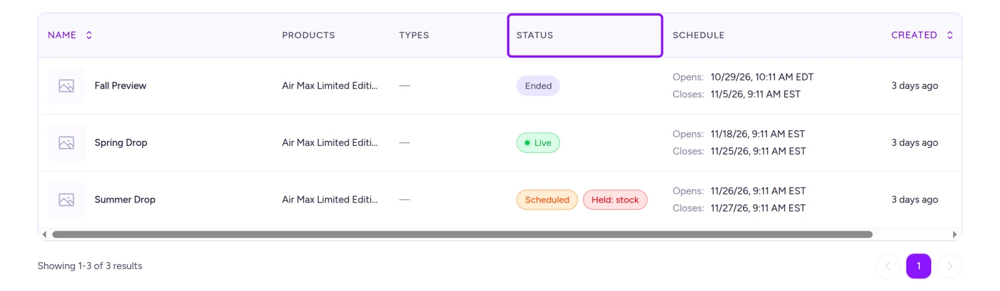

Fanfare calculates every status automatically—you never set a status manually, and there's no separate launch or publish step for an experience (see [Experiences](/concepts/experiences)). Use this page to look up any status badge you see in the admin.

## Experiences and sequences

A sequence is one entry path into an experience. Each experience and sequence displays a single status chip.

| Chip | What it means |
| --- | --- |
| **Live** | At least one distribution is open. On the experience **Overview** and sequence pages, a draw still selecting winners or waiting for winners to pay also counts as **Live** even after entry closes. The **Experiences** list goes by distribution windows alone. |
| **Scheduled** | Nothing is open yet, and at least one distribution is scheduled for the future. |
| **Ended early** | Nothing is open or upcoming, and at least one distribution was deactivated before its scheduled close. |
| **Ended** | Every distribution ran to its scheduled end. |
| **Draft** | No distribution has been added yet (doesn't mean unpublished). |

Status rolls up in the order above, so one **Live** sequence makes the entire experience **Live**. Customers never see these internal chips—see [What your customers see](/guide/drop/what-customers-see). On a published hosted page, deactivating any distribution or sequence marks the entire experience as ended for shoppers, even if the admin chip still reads **Live** (see [What locks, and when](/concepts/what-locks-when)).

<Frame caption="Every experience displays one status chip, calculated from its distributions.">
  
</Frame>

- **Deactivated** with a date in the header: Everything has stopped and at least one part was deactivated ([Stop a drop](/guide/drop/deactivate)).
- `"Sequences: 2 (1 Live | 1 Scheduled)"` in the header: Summarizes your sequences by status chip ([Experiences](/concepts/experiences)).
- `"… was deleted"` on a saved link: The experience or sequence has been deleted ([Stop a drop](/guide/drop/deactivate)).

## Distributions

| Status | Sequence card shows | What it means |
| --- | --- | --- |
| Scheduled | `"Opens"` with the time or date, or **Upcoming** | Its **Opens** time hasn't arrived yet. |
| Live | **Live** | Its window is open, or it's a draw still selecting winners or waiting for payment. |
| Ended | **Ended** | Its window closed (or for a draw, all selections finished), or you deactivated it after its window had already ended. |
| Ended early | **Ended early** | You deactivated it before its window ended. |

See [Distributions](/concepts/distributions/overview) for how windows work by type, and [What locks, and when](/concepts/what-locks-when) for what you can edit at each stage.

- **Waiting room:** A queue displays Scheduled during its 5-minute waiting room, even though shoppers can already join ([Queue](/concepts/distributions/queue)).
- **Paused queues:** **Paused** appears next to a paused queue's **Live** chip. Setting **Admit rate** to 0 doesn't show a **Paused** badge ([Change things mid-drop](/guide/drop/live-controls)).
- **Performance labels:** **Performance** labels each drop **Upcoming**, **Live**, **Settling**, **Closed**, or **Draft**. **Settling** means entry closed, but admitted customers can still pay ([Watch a live drop](/guide/drop/watch-live)).
- **Auction phases:** Auction views display a phase: **Upcoming**, **Bidding**, **Settling**, **Settled**, **Ended**, or **Ended early** ([Auction](/concepts/distributions/auction), [Watch a live drop](/guide/drop/watch-live)).
- **Draws settling:** A draw card stays **Live** while selecting winners or waiting for payment—even after entry closes—and switches to **Ended** once complete ([Distributions](/concepts/distributions/overview)).
- **Deactivated cards:** `"Deactivated"` with a date appears on any distribution you deactivated ([Stop a drop](/guide/drop/deactivate)).

## Orders

| Status | What it means |
| --- | --- |
| **Draft** | Not yet paid. With Fanfare checkout, an order only appears once a customer submits payment, so shoppers who never attempt checkout don't create an order. |
| **Pending payment** | Not yet paid in full. |
| **Paid** | Payment has been captured. |
| **Partially refunded** | Part of the payment has been refunded. |
| **Refunded** | The full payment has been refunded. |
| **Payment failed** | Payment didn't go through. |
| **Canceled** | The order was canceled. |

All order and payment statuses are covered in [Orders and refunds](/guide/learn/orders), including these details:

- On synced orders, **Pending payment** can show **Authorized**, **Partially paid**, or **Voided** underneath.
- A canceled Fanfare order shows payment status **Failed** in the list, so filtering by **Failed** includes it.
- **Test** flags test orders—they appear in **Orders**, but are excluded from revenue, purchase limits, and customer metrics.
- Refunded items display `"Returned to stock"`, `"Kept out of stock"`, `"2 of 3 returned to stock"`, `"No stock decision recorded"`, or `"Not managed · no stock to return"`.
- **Gross revenue** includes unpaid orders.

## Audiences

Creating or editing audiences requires Growth or above ([Plans and what they unlock](/guide/start/plans)). **Dynamic** audiences show their status in the **Status** column, while static and imported lists show it in the **Access** row on the audience page (and never display **Refreshing** or **Held**).

| Status | What it means | Who can enter |
| --- | --- | --- |
| **Not built yet**, **Queued**, **Building** | The first build hasn't finished yet. | Nobody. |
| **Build failed** | The first build failed. | Nobody, until a build succeeds. |
| **Live** | The latest build is active. | Current audience members. |
| **Refreshing** | A rebuild with the same rules is queued or running. | Members from the previous build. |
| **Updating** | You saved rule changes and the new build is still running. | Mostly members from before your change; anyone re-checked during the build is evaluated against the new rules. |
| **Update failed** | The build for your latest rule change failed. | Members from before your change. |
| **Held** | A drop gated by this audience is currently open, so full rebuilds wait until it closes. | Members from the last build, plus or minus anyone re-checked since. |

A new audience admits no one until its first build reaches **Live** ([Audiences and access codes](/concepts/audiences)).

## Other status labels

| Where | Labels | Explained in |
| --- | --- | --- |
| Sequence waitlist members | **Waitlisted**, **Converted**, **Left**, **Removed** (filters: **On the list**, **Left**, **All**) | [Waitlists](/concepts/waitlists) |
| Variants on a sequence's **Stock** card | **Not counting yet**, **Preparing**, **Ready**, **Selling**, **Opens sold out**, **Held: stock** or `"Over-allocated by N"`, **Paused**, **Ended**, **Released**, `"Sold out right now"`, `"Last N in checkout"`, and `"N at risk"` (units in checkout not covered by stock on hand) | [Stock](/concepts/stock) |
| Live **Sizes** tiles | **Selling**, **Last call**, **Gone** | [Watch a live drop](/guide/drop/watch-live) |
| Appointment attendees | **Confirmed**, **Checked In**, **Canceled**, **Completed** | [Set up appointments](/guide/create/appointment) |
| Plan badge on **Billing** | **Trial**, **Active**, **Past due**, **Ends** + date (or **Canceling**), **Canceled**, **Inactive**, **Pending**, **No subscription** | [Billing and usage](/guide/account/billing) |
| Stripe account | `"Setup not finished"`, `"Action needed"`, `"Active"` | [Payments and fees](/guide/account/payments) |
| Sending domains | **Waiting for DNS**, **Verified**, **Needs attention**, **Failed**, **Removing**, **Unknown** | [Sender identity and sending domain](/guide/create/email-sender) |
| Designs and templates | **Draft**, **Live** | [Templates and widget designs](/guide/create/templates) |
| Announcements agenda | **Needs attention**, **Up next**, **Recently sent**, **Won't send**, **Canceled** | [Announcements](/guide/create/announcements) |

## On Shopify

- **Order sync status:** Shopify checkout orders show **Sync status** Synced, and the list flags sync issues such as `"Shopify sync: Failed"` ([Orders with Shopify checkout](/guide/shopify/orders)).
- **Deleted Shopify products:** A product deleted in Shopify displays **Source missing** ([Products from Shopify](/guide/shopify/products)).
- **Inside Shopify admin:** The **Fanfare experiences** block on a Shopify product page labels experiences **Active**, **Upcoming**, or **Closed** ([Fanfare inside Shopify admin](/guide/shopify/in-shopify-admin)).
- **No appointments:** Appointments aren't available in the Shopify app, so attendee statuses don't apply.
- **Shopify-billed plans:** Manage plan changes from inside the Fanfare app in Shopify ([Billing and usage](/guide/account/billing), [Install and choose a plan](/guide/shopify/install-and-plans)).

## Related

<CardGroup>
  <Card title="Experiences" href="/concepts/experiences">
    How experiences roll up sequences, schedules, and statuses.
  </Card>
  <Card title="Distributions" href="/concepts/distributions/overview">
    Compare queues, draws, auctions, timed releases, and appointments.
  </Card>
  <Card title="Watch a live drop" href="/guide/drop/watch-live">
    Monitor live status, stock tiles, and settling windows in real time.
  </Card>
  <Card title="Stop a drop" href="/guide/drop/deactivate">
    Understand Deactivate, Ended early, and Delete timing.
  </Card>
</CardGroup>
