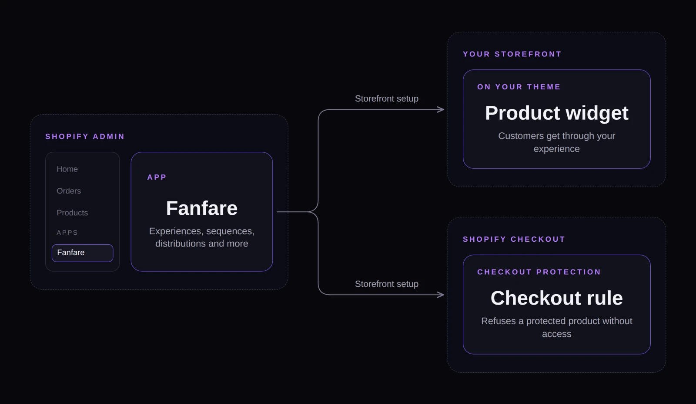

The Fanfare app runs directly inside Shopify admin, giving you the same experiences, sequences, distributions, audiences, customers, loyalty tools, Design Studio, and live analytics as the standalone admin at [admin.fanfare.io](https://admin.fanfare.io)—connected directly to your Shopify catalog, storefront theme, and checkout.

This guide covers both environments. Where Shopify behaves differently, individual pages call it out in an **On Shopify** section or note. Use this page as a quick reference for what's identical, what's Shopify-specific, and how staff permissions work.

<Frame caption="The Fanfare app runs inside Shopify admin and connects to your storefront through the product widget and checkout protection rule configured in Storefront setup.">
  
</Frame>

## What works the same

These areas work the same in the Shopify app as in the standalone admin (apart from any Shopify-specific notes on their individual pages):

- Experiences, sequences, access gates, and waitlists
- Audiences (note: Shopify customer lists can't be imported as audiences)
- Customers and loyalty
- Design Studio
- **Performance** analytics and live monitoring screens
- Locations

## Built specifically for Shopify

| Feature | What it does | Learn more |
| --- | --- | --- |
| **Settings → Storefront setup** | Tracks your checkout protection rule and product widget status. Complete both before launching a drop—checkout protection blocks ordinary checkouts as soon as a product joins an experience, even if the widget isn't on your theme yet. | [Storefront setup](/guide/shopify/storefront-setup) |
| Setup checklist & guided tour | The **Finish setting up Fanfare** checklist on **Home** and the **Setting up Fanfare on your store** tour walk you through storefront setup. | [Storefront setup](/guide/shopify/storefront-setup) |
| Checkout protection | Blocks normal checkouts for protected products unless the shopper earned access through your experience, for as long as any experience includes the product. Shows a `"Shopify gating could not be updated"` warning if a sync fails. | [Checkout protection](/guide/shopify/checkout-protection) |
| Shopify product picker & **Sync from Shopify** | Imports products straight from your Shopify catalog and refreshes details on demand. | [Products from Shopify](/guide/shopify/products) |
| Shopify checkout orders | Automatically syncs paid drop orders, supports manual import for missing orders, and links records via the **Shopify order** card. | [Orders with Shopify checkout](/guide/shopify/orders) |
| Shopify admin shortcuts | The **Fanfare experiences** block, **Create Fanfare experience**, and **Import order into Fanfare** let you view and launch Fanfare workflows directly from Shopify product and order pages. | [Fanfare inside Shopify admin](/guide/shopify/in-shopify-admin) |
| Shopify billing & plans | Handles plan approval on Shopify's plan page, **Confirming your plan**, comped stores, legacy subscriptions, unsupported-currency checks, and per-order fees billed as Shopify usage charges. | [Install and choose a plan](/guide/shopify/install-and-plans) |

## How the Shopify app compares

| Area | Standalone Fanfare admin | Fanfare app in Shopify | Details |
| --- | --- | --- | --- |
| Getting started | Sign in at admin.fanfare.io and create an organization. | Install from Shopify; Fanfare automatically creates your organization in your store's currency. No separate sign-up, sign-in, or sign-out. | [Install and choose a plan](/guide/shopify/install-and-plans) |
| Navigation | Fanfare sidebar, with **Billing** and **Usage** in the user menu. | Shopify's left navigation menu, with top-level **Billing** and **Usage**. **Billing** opens Shopify's plan page (comped stores see a notice instead). **Settings** adds **Storefront setup** and omits **Tours & Tips**. No **Send feedback**. | [A tour of the admin](/guide/start/tour-of-the-admin) |
| Home quick actions | **Create Product** | **Create Location** | [A tour of the admin](/guide/start/tour-of-the-admin) |
| Team & permissions | Admins and members, managed via invitations. | No roles—see [Who can use the app](#who-can-use-the-app). | [Team members](/guide/account/team) |
| Products | Created in Fanfare. | Imported from Shopify; name, description, URL, handle, and variants are read-only. **Sync from Shopify** replaces **Delete**. | [Products from Shopify](/guide/shopify/products) |
| Stock | Fanfare-managed or Not managed. | Products imported while your checkout processor is **External** stay Shopify-managed. For Fanfare-managed products, Fanfare and Shopify counts don't sync. | [Manage stock](/guide/create/stock), [Stock](/concepts/stock) |
| Distribution types | Five (Queue, Draw, Timed Release, Auction, Appointment). | Four—**Appointment** isn't available on any plan. **Auction** requires a plan that includes it plus Shopify Plus and checkout protection enabled. | [Distributions](/concepts/distributions/overview), [Checkout protection](/guide/shopify/checkout-protection) |
| Checkout & payment | Fanfare checkout via Stripe, with payment collection and card pre-authorization. | Shopify checkout. Your organization starts on **External** checkout—leave it there. While [Organization settings](/guide/account/organization) lets you switch to Fanfare checkout, connecting Stripe is "Coming soon" in the app. There's no payment collection or **Authorization amount**, and disconnecting a previously linked Stripe account can't be undone from the app. | [Checkout options](/concepts/checkout-options), [Payments and fees](/guide/account/payments) |
| Refunds & cancellations | Handled in Fanfare. | Handled in Shopify only; changes don't sync back to Fanfare's copy of the order. | [Orders with Shopify checkout](/guide/shopify/orders) |
| Plan & billing | Stripe subscription (shows a banner if inactive). | Every store—including **Starter**—must approve a plan on Shopify's plan page before opening the app, except comped stores and stores on an older Fanfare subscription. | [Install and choose a plan](/guide/shopify/install-and-plans), [Billing and usage](/guide/account/billing) |
| Test emails | Sent to your Fanfare sign-in email. | Sent to your Shopify staff email once Shopify verifies it. | [Announcements](/guide/create/announcements) |
| Integrations | Standard browser flow. | Meta and Discord OAuth opens in the full browser window and redirects back to Shopify admin. | [Integrations](/guide/account/integrations) |
| **Embedding** | Restricts which domains can frame your pages. | Also restricts headless storefront API calls once any entry is added. | [API keys and embedding](/guide/account/developer) |
| Hosted pages | Only organization admins can create, edit, save, publish (including overriding freeze), or archive pages. | Anyone who can open the app has full control. | [Build and publish the hosted page](/guide/create/hosted-page) |
| Locations | Used by appointments. | Same screens appear even though appointments aren't offered. Fanfare locations aren't connected to Shopify inventory locations. | [Locations and opening hours](/guide/create/locations) |

{/* image: guide-shopify-overview-nav */}

## Only in the standalone admin

These features aren't part of the Shopify app:

- Fanfare sign-up, sign-in, and sign-out
- Team invitations, members, and roles
- **Account** and **Profile** settings
- **Tours & Tips** settings and **Send feedback**
- In-app billing overview, plan-change dialog, and Stripe customer portal
- Creating products directly in Fanfare
- Appointments
- Connecting Stripe for Fanfare checkout

## Who can use the app

Opening Fanfare inside Shopify doesn't require a Fanfare account—Shopify's staff permissions control who can open the app.

There are no separate admin or member roles inside the Shopify app. Every staff member who can open Fanfare has full organization admin permissions, including:

- Rotating your API secret key
- Editing organization settings, including your checkout processor
- Changing email sender settings and **Embedding** rules
- Connecting and disconnecting marketing integrations
- Disconnecting an existing Stripe account (which can't be reconnected from the Shopify app)
- Creating, editing, publishing, and archiving hosted pages

Anywhere this guide says "ask an admin," that restriction doesn't apply inside the Shopify app.

<Warning>
  Every Shopify staff member with access to the Fanfare app has full admin control—including rotating API secret keys, changing your checkout processor or **Embedding** settings, and modifying integrations. Restrict app access in Shopify staff permissions accordingly.
</Warning>

Fanfare logs changes made through the app under your store rather than individual Shopify staff accounts. For details on stopping live drops, see [Stop a drop](/guide/drop/deactivate).

## Key things to know before launching

- **Finish storefront setup before testing or launching:** Fanfare usually enables checkout protection on install, but shoppers can only enter your drop once the product widget is placed on your theme. Without the widget, protected products can't be purchased at all. See [Storefront setup](/guide/shopify/storefront-setup).
- **Protection stays on after a drop ends:** A product remains protected for as long as any experience includes it—even after the drop closes or is deactivated. Remove the product or delete the experience when you're ready to sell normally again. See [Checkout protection](/guide/shopify/checkout-protection).
- **Billing opens Shopify's plan page:** Selecting **Billing** leaves the Fanfare app for Shopify's plan page (unless your store is comped). See [Install and choose a plan](/guide/shopify/install-and-plans).
- **Unsupported currencies block app access:** If your store uses a currency Fanfare doesn't support yet, the app displays a notice until you change your store currency. See [Install and choose a plan](/guide/shopify/install-and-plans).

## Example: setting up a queue from Shopify

When a merchant at Northbound Supply Co. follows [Set up a queue](/guide/create/queue) inside Shopify admin for the Phantom Stitch Anorak, almost every step works the same—with three Shopify-specific differences:

1. **Product selection:** Shopify's product picker opens so they can pull the anorak straight from their store catalog.
2. **Payment step:** The **Payment** step notes `"Customers pay in your own checkout, so Fanfare collects no payment for this queue."` There's no **Pre-authorize on joining** option.
3. **Storefront readiness:** Shoppers can join the queue once checkout protection is **On** and the product widget is placed on the theme—both tracked by the **Finish setting up Fanfare** checklist on **Home**.

Ready to launch? Follow the end-to-end walkthrough in [Your first drop on Shopify](/guide/start/your-first-drop-on-shopify), or compare tiers in [Plans and what they unlock](/guide/start/plans).

## Related

<CardGroup>
  <Card title="Your first drop on Shopify" href="/guide/start/your-first-drop-on-shopify">
    Install the app, set up your storefront, and launch your first drop.
  </Card>
  <Card title="Install and choose a plan" href="/guide/shopify/install-and-plans">
    Install Fanfare, approve a plan in Shopify, and understand usage billing.
  </Card>
  <Card title="Storefront setup" href="/guide/shopify/storefront-setup">
    Enable checkout protection and place the product widget on your theme.
  </Card>
  <Card title="Products from Shopify" href="/guide/shopify/products">
    Import products from Shopify and keep details and inventory synced.
  </Card>
  <Card title="Checkout protection" href="/guide/shopify/checkout-protection">
    See what the checkout rule blocks and how long protection stays active.
  </Card>
  <Card title="Orders with Shopify checkout" href="/guide/shopify/orders">
    Understand how drop orders sync, how refunds work, and how to import missing orders.
  </Card>
  <Card title="Fanfare inside Shopify admin" href="/guide/shopify/in-shopify-admin">
    Use the Fanfare experiences block and quick actions on Shopify product and order pages.
  </Card>
</CardGroup>
