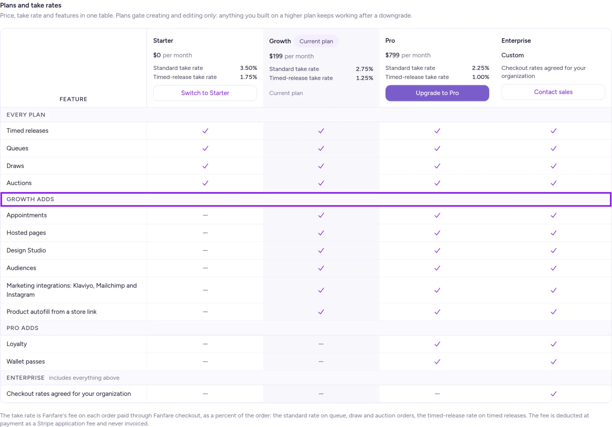

Your plan decides two things: which features you can create and edit, and the take rate, Fanfare's fee on each order paid through Fanfare checkout or Shopify checkout. It never decides whether something you already built keeps running. Anything you set up on a higher plan keeps serving customers after you move to a lower one. What you lose is the ability to create new ones, and to change most of the ones you have.

## The four plans

| Plan | Price per month | Standard take rate (queues, draws, auctions) | Timed-release take rate |
| --- | --- | --- | --- |
| **Starter** | $0 | 3.50% | 1.75% |
| **Growth** | $199 | 2.75% | 1.25% |
| **Pro** | $799 | 2.25% | 1.00% |
| **Enterprise** | Custom, by quote | Agreed for your organisation | Agreed for your organisation |

- The take is a percentage of each order paid through Fanfare checkout or Shopify checkout. Sales through your own store's checkout carry no per-order fee, because Fanfare never sees them. Appointments never take payment, so they carry no take on any plan.
- Enterprise is not self-serve. Use **Contact sales** in the plans table to talk to Fanfare. Until your agreed rates are recorded, an Enterprise organisation is charged Pro's rates.
- If Fanfare has set a custom checkout rate for your organisation, it replaces the published take on every plan and stays in place when you change plan, so upgrading does not lower it.

How the take is deducted from each payment, and where to see the rate you are paying, is on [Payments and fees](/guide/account/payments).

## What each plan unlocks

Each plan includes everything in the plan before it. You compare them on the **Billing** page, in the **Plans and take rates** table.

| Feature | Starter | Growth | Pro | Enterprise |
| --- | :-: | :-: | :-: | :-: |
| Timed releases, queues, draws and auctions | ✓ | ✓ | ✓ | ✓ |
| Appointments |  | ✓ | ✓ | ✓ |
| Hosted pages |  | ✓ | ✓ | ✓ |
| Design Studio |  | ✓ | ✓ | ✓ |
| Audiences |  | ✓ | ✓ | ✓ |
| Marketing integrations: Klaviyo, Mailchimp, Meta (Facebook and Instagram), Discord, Telegram and Twilio |  | ✓ | ✓ | ✓ |
| Product autofill from a store link |  | ✓ | ✓ | ✓ |
| Loyalty |  |  | ✓ | ✓ |
| Wallet passes |  |  | ✓ | ✓ |
| Checkout rates agreed for your organisation |  |  |  | ✓ |

No plan limits these. They work the same on Starter as on Enterprise:

- Announcements by email
- Products and locations
- Sequences, order limits and waitlists
- Orders and refunds
- Settings, including the Google Analytics connection
- **Deactivate**

<Frame caption="Each plan column shows its price and take rates; the rows show what each plan adds.">
  
</Frame>

## A plan gates creating and editing, never what already runs

Plan checks apply when you create or change something. They are never applied to customers entering an experience or to something already serving them. So after a move to a lower plan:

- Live hosted pages stay published.
- Audiences keep deciding who can enter the sequences they gate. A sequence is one way in to an experience.
- Loyalty and wallet passes keep working for customers who have them.
- Appointments you created keep running, and you can still edit them.

What you cannot do on the lower plan is create new audiences, hosted pages, organisation design templates, loyalty programmes or wallet passes, or edit the ones you have, until you choose a plan that includes them again.

A rule-based audience with a refresh schedule keeps rebuilding on that schedule after a move to a lower plan, so its members keep changing as customers start or stop matching its rules. **Refresh now** needs Growth or above.

You can always tidy up or wind down. On any plan you can:

- Delete audiences. An audience that still gates a sequence of an experience that has not ended cannot be deleted, whatever your plan: remove it from those sequences first, or wait for the experience to end.
- Take hosted pages down with **Archive page**. Only organisation admins see this action.
- Edit any live distribution, including pausing a queue, and **Deactivate** it.
- Disconnect integrations.
- Turn off Loyalty. This is one-way: turning it back on needs Pro. See [Run a loyalty programme](/guide/learn/loyalty).

Organisation design templates are the exception. On a plan without Design Studio they no longer open, so you cannot unpublish or delete them there. If you want them gone, unpublish or delete them before you move to Starter.

<Frame caption="After a move to a lower plan, what you built keeps serving customers, but you can't create new ones or edit the ones you have.">
  
</Frame>

### Which subscription states count as which plan

| Subscription state | Features and take rate you get |
| --- | --- |
| Active, including a trial | Your paid plan's |
| Past due | Your paid plan's, until the payment is fixed or the subscription ends |
| Cancelled | Starter's |
| Pending | Starter's |
| Inactive | Starter's |

A cancellation set for the end of the billing period keeps your plan until that date. Once a paid plan has ended, the **Billing** page names Starter as your current plan.

<Warning>
  Cancelling immediately, or any other end to your subscription (for example a trial that ends without a card), drops your whole organisation to Starter at once. Everything you built keeps serving customers, but from that moment nobody in the organisation can create Growth or Pro features, and most of them can no longer be edited. For example, audiences cannot be edited, and organisation design templates no longer open in the editor. Payments customers start from that moment carry Starter's take rate (3.50% standard, 1.75% timed release), unless Fanfare has set a custom checkout rate for your organisation. A payment already under way keeps the rate it started with. To create and edit them again, reactivate or choose a paid plan: see [Billing and usage](/guide/account/billing).
</Warning>

Changing, cancelling and reactivating a plan, the trial, and past-due payments are covered on [Billing and usage](/guide/account/billing).

## What you see when your plan does not include something

- **A badge and an upgrade link.** A locked feature shows a badge naming the plan it needs, such as "Available on Growth", next to a link such as "Upgrade to Growth". The link opens the plans table on the **Billing** page.
- **Locked cards in the experience wizard.** On Starter, the Appointment card is greyed out and placed after the open types. Hovering over it shows the upgrade link.
- **Disabled forms.** Rule-based and synced audience forms, Loyalty settings, and the connect dialogues for Twilio, Klaviyo, Mailchimp, Meta and Discord stay visible, but saving or connecting is disabled, with the upgrade link beside them. An enabled loyalty programme keeps its off switch, and existing connections can still be disconnected. Telegram's dialogue is the exception: it has no badge and lets you enter a channel, but refuses when you select **Get code**, with a message naming the plan you need.
- **Places with no explanation.** On Starter, opening Design Studio takes you to the Brand editor, which every plan can use. Opening an organisation template on a plan without Design Studio takes you straight to the plans table. Some items in the template menus are disabled with no reason shown.

The sidebar never shows padlocks. Locks appear only inside the pages. If Fanfare cannot check your subscription for a moment, pages may show Starter's locks; reload the page after a moment.

An Auction card marked "Needs a checkout that charges the winning bid" is not a plan lock. It has no upgrade link, and upgrading does not lift it. It depends on your checkout: see [Checkout options](/concepts/checkout-options).

## Starting out

A new organisation created in the Fanfare admin starts on Growth, in a 5-day trial that needs no card, not on Starter. What happens when the trial ends without a card is on [Billing and usage](/guide/account/billing).

## Worked example: cancelling immediately mid-drop

Northbound Supply Co. is on Growth. Its experience "Phantom Stitch Anorak Drop" has two sequences: "Inner Circle Early Access", a queue open only to the "Inner Circle" audience, and "Public Draw". While the queue is running, they cancel their subscription and choose to cancel immediately.

- The organisation is on Starter from that moment, and payments customers start in the queue from then on carry Starter's take rate. A payment already under way keeps Growth's rate.
- The queue keeps admitting customers. Routing and admission carry on unchanged, and the "Inner Circle" audience still decides who can enter "Inner Circle Early Access".
- Both distributions can still be edited, and either can be stopped with **Deactivate**.
- The "Inner Circle" audience can no longer be changed. Renaming it is refused with "This feature requires the Growth plan. Upgrade to continue."
- The audience cannot be deleted either while "Inner Circle Early Access" is still running. Fanfare refuses and names the experience. Once they remove the audience from the sequence, or the experience ends, they can delete it.
- To change the audience again, they choose a paid plan on the **Billing** page.

## On Shopify

The plans, the features each one unlocks, and the rule that a plan gates creating and editing are the same in the Fanfare app in Shopify. Billing differs, and so does what happens when a subscription ends:

- An organisation installed from Shopify is billed through Shopify. You choose and approve your plan on Shopify's plan page, which the Fanfare app opens for you, and the upgrade links lead there too.
- In the Fanfare app in Shopify, **Billing** opens Shopify's plan page. If you open Billing in the Fanfare admin, the plans table shows no prices and every plan reads **Manage in Shopify**.
- If your Shopify subscription ends, the Fanfare app in Shopify opens Shopify's plan page instead of the app until you choose a plan, Starter included. Your live experiences keep serving customers meanwhile.
- Appointment is never offered in the Fanfare app in Shopify, on any plan.
- When Fanfare has set a custom rate for your organisation, orders paid through Shopify checkout can carry their own rate, different from Fanfare checkout's.

See [Install and choose a plan](/guide/shopify/install-and-plans).

## Related

<CardGroup>
  <Card title="Billing and usage" href="/guide/account/billing">
    Change, cancel or reactivate your plan, and handle the trial and failed payments.
  </Card>
  <Card title="Payments and fees" href="/guide/account/payments">
    How the take is deducted from each payment, and the rate you pay today.
  </Card>
  <Card title="Checkout options" href="/concepts/checkout-options">
    Fanfare checkout, your own checkout, Shopify checkout, and why Auction can be locked.
  </Card>
  <Card title="Install and choose a plan" href="/guide/shopify/install-and-plans">
    Choosing and approving a plan in the Fanfare app in Shopify.
  </Card>
</CardGroup>
