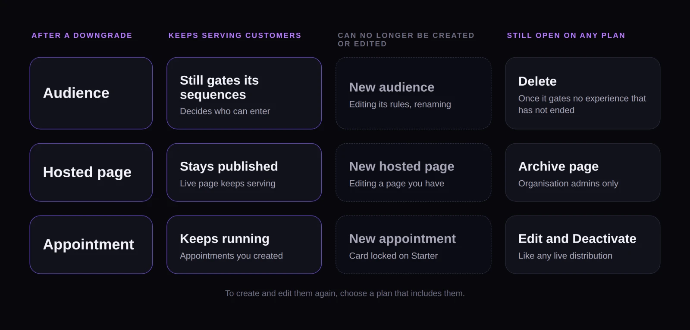

Your Fanfare plan controls two things: which features you can create and edit, and your **take rate**—Fanfare's per-order fee on orders paid through Fanfare checkout or Shopify checkout.

Your plan never interrupts a live drop. If you downgrade, everything you've already built keeps serving customers—you just won't be able to create new higher-tier features or edit most existing ones until you upgrade again.

## Plan pricing and take rates

| Plan | Monthly price | Standard take rate (queues, draws, auctions) | Timed-release take rate |
| --- | --- | --- | --- |
| **Starter** | $0 | 3.50% | 1.75% |
| **Growth** | $199 | 2.75% | 1.25% |
| **Pro** | $799 | 2.25% | 1.00% |
| **Enterprise** | Custom | Custom | Custom |

- **When take rates apply:** Fanfare charges a percentage fee on orders paid through Fanfare checkout or Shopify checkout. Orders completed on your own external store checkout carry no Fanfare per-order fee, and unpaid appointments carry no fee on any plan.
- **Enterprise plans:** Select **Contact sales** on the **Billing** page to discuss custom pricing and rates for your organization.
- **Custom checkout rates:** If you have a negotiated rate with Fanfare, it overrides the standard plan take rate across every plan.

For details on how fees are deducted and where to check your current rate, see [Payments and fees](/guide/account/payments).

## Features by plan

Each plan includes everything in the tier below it. You can compare plans anytime on the **Billing** page under **Plans and take rates**.

| Feature | Starter | Growth | Pro | Enterprise |
| --- | :-: | :-: | :-: | :-: |
| Timed releases, queues, draws, and auctions | ✓ | ✓ | ✓ | ✓ |
| Appointments |  | ✓ | ✓ | ✓ |
| Hosted pages |  | ✓ | ✓ | ✓ |
| Design Studio templates and widget designs |  | ✓ | ✓ | ✓ |
| Audiences |  | ✓ | ✓ | ✓ |
| Marketing integrations (Klaviyo, Mailchimp, Meta, Discord, Telegram, Twilio) |  | ✓ | ✓ | ✓ |
| Product autofill from a store link |  | ✓ | ✓ | ✓ |
| Loyalty program |  |  | ✓ | ✓ |
| Wallet passes |  |  | ✓ | ✓ |
| Custom checkout rates |  |  |  | ✓ |

Core drop tools work the same on every plan, including Starter:

- Email announcements
- Products and locations
- Sequences, order limits, and waitlists
- Orders and refunds
- Brand colors and fonts, plus Google Analytics
- Live controls and **Deactivate**

<Frame caption="Compare monthly pricing, take rates, and features on the Billing page.">
  
</Frame>

## What happens when you downgrade

Plan checks apply only when you create or edit features—never to customers entering a drop. After moving to a lower plan:

- **Live hosted pages** stay published and accessible.
- **Audiences** continue gating access to the sequences they're attached to, and rule-based audiences with a refresh schedule keep updating on schedule (manual **Refresh now** requires Growth or above).
- **Loyalty programs and wallet passes** keep working for customers who already have them.
- **Existing appointments** keep running and remain editable.

You won't be able to create new audiences, hosted pages, Design Studio templates, loyalty programs, or wallet passes—or edit existing ones—until you return to a plan that includes them.

You can always clean up or wind down on any plan:

- **Archive hosted pages** (organization admins only).
- **Delete audiences** once they're no longer gating an active or upcoming experience.
- **Edit, pause, or deactivate** live distributions.
- **Disconnect integrations** and **turn off Loyalty** (turning Loyalty back on requires Pro).

<Tip>
  If you plan to downgrade from Growth to Starter and want to unpublish or delete custom Design Studio templates, do that before downgrading—the template editor locks on Starter.
</Tip>

<Frame caption="After a downgrade, live experiences keep serving customers while creating and editing higher-tier features is locked.">
  
</Frame>

### How subscription status affects your plan

| Subscription status | Active features and take rate |
| --- | --- |
| **Active** (including free trial) | Your paid plan |
| **Past due** | Your paid plan, until payment is resolved or the subscription ends |
| **Canceled**, **Pending**, or **Inactive** | **Starter** |

If you schedule cancellation for the end of your billing period, you keep your paid plan until that date.

<Warning>
  Canceling immediately—or letting a free trial end without a payment method—moves your entire organization to **Starter** right away. Live drops keep serving customers, but creating and editing Growth or Pro features locks immediately, and new customer checkouts use Starter's take rate (payments already in progress keep the rate they started with). See [Billing and usage](/guide/account/billing) to reactivate or change plans.
</Warning>

## How plan limits appear in the admin

- **Upgrade prompts:** Features outside your plan display an **"Available on [Plan]"** badge with a direct link to the **Billing** page.
- **Experience wizard:** Higher-tier drop types appear disabled in the wizard with an upgrade link when hovered.
- **Disabled forms:** On Starter, forms for higher-tier features like audiences, Loyalty, and marketing integrations remain visible for reference, with saving disabled until you upgrade.

<Note>
  If **Auction** shows **"Needs a checkout that charges the winning bid"**, that restriction comes from your checkout configuration rather than your plan—upgrading won't unlock it. See [Checkout options](/concepts/checkout-options).
</Note>

## Free trial

New organizations created at [admin.fanfare.io](https://admin.fanfare.io) automatically start with a **5-day free trial of Growth**—no credit card required. See [Billing and usage](/guide/account/billing) for what happens when your trial ends.

## Example: canceling mid-drop

Suppose Northbound Supply Co. is on **Growth** and running an experience with two sequences: an early-access queue gated to their "Inner Circle" audience, followed by a public draw. Mid-way through the queue, they cancel their subscription immediately:

- **Customer traffic continues uninterrupted:** The queue keeps admitting shoppers, and the "Inner Circle" audience still controls who can enter.
- **Take rates update for new checkouts:** Customers starting checkout from that point forward are charged Starter's take rate, while checkouts already underway keep Growth's rate.
- **Live controls still work:** The team can still edit either distribution or stop them with **Deactivate**.
- **Audience edits lock:** Editing the "Inner Circle" audience requires upgrading back to Growth, and it can't be deleted until it's removed from the active sequence or the drop ends.

## On Shopify

Plan features and downgrade rules work the same in the Shopify app, with a few billing differences:

- **Billed through Shopify:** You choose and manage your plan on Shopify's plan page (which **Billing** opens directly), and take-rate fees appear as Shopify usage charges.
- **Subscription lapses:** If your Shopify subscription ends, the app prompts you to select a plan—including Starter—before reopening, while your live drops continue serving customers in the background.
- **Appointments:** Not available in the Shopify app on any plan.
- **Custom rates:** If your organization has custom pricing, Shopify checkout orders can carry their own agreed rate separate from Fanfare checkout.

See [Install and choose a plan](/guide/shopify/install-and-plans) for full Shopify billing details.

## Related

<CardGroup>
  <Card title="Billing and usage" href="/guide/account/billing">
    Change or cancel your plan, manage your trial, and resolve failed payments.
  </Card>
  <Card title="Payments and fees" href="/guide/account/payments">
    How take rates are deducted and where to view your current rate.
  </Card>
  <Card title="Checkout options" href="/concepts/checkout-options">
    Compare Fanfare checkout, external checkout, and Shopify checkout.
  </Card>
  <Card title="Install and choose a plan" href="/guide/shopify/install-and-plans">
    Manage your Fanfare plan and usage billing through Shopify.
  </Card>
</CardGroup>
