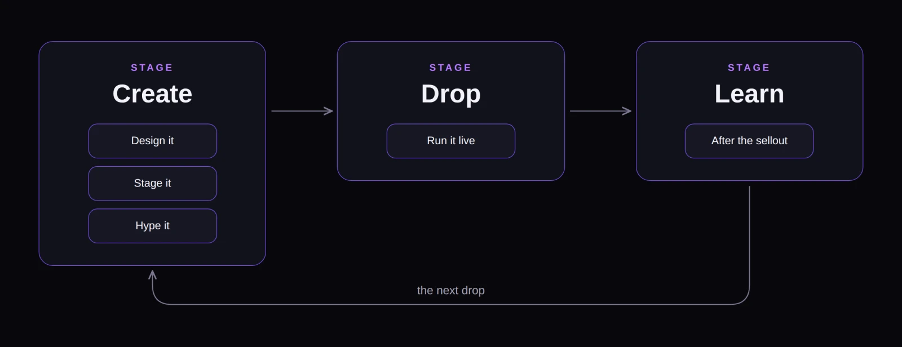

Fanfare runs the release of a limited product. You decide who can buy it, when, and how: through a queue, a draw, an auction, a timed release, or bookable appointments. These are the five [distribution types](/concepts/distributions/overview). Customers enter on a page Fanfare hosts for you, on a page of your own website, or on your Shopify store's product page. Fanfare lets them in and gives each one a payment window, a limited time to pay; an appointment books a time slot instead and takes no payment. It keeps a profile of every customer who signs in, and records the orders paid through Fanfare checkout, or through Shopify checkout for products a Fanfare experience protects, so your next drop can start from what this one taught you. See [Checkout options](/concepts/checkout-options).

## The pieces you set up

An experience holds everything for one drop: its sequences, and the distributions each sequence runs. A sequence is one way in to an experience. See [The model in one page](/concepts/overview).

## Where customers take part

- A page Fanfare hosts, on Growth and above. See [Build and publish the hosted page](/guide/create/hosted-page).
- A page of your own website, where your developer adds the Fanfare widget. See [Run it on your own site](/guide/create/your-own-site).
- Your Shopify store, on the product page, once the Fanfare app's storefront setup is done. See [Storefront setup](/guide/shopify/storefront-setup).

## How this guide is organised

The guide follows a drop from start to finish, and then into the next one.

<Frame caption="The guide follows a drop through Create, Drop and Learn, and back to Create for the next drop.">
  
</Frame>

| Stage | What it covers | Start with |
| --- | --- | --- |
| Create | Design it: products, stock, the experience and its sequences. Stage it: your brand, templates, and the hosted page or your own site. Hype it: announcements, invites and the waitlist. | [Add products](/guide/create/products) |
| Drop | Run it live: what must be true before doors open, watching the drop, changes you can make mid-drop, stopping a drop, and what your customers see. | [Before doors open](/guide/drop/preflight) |
| Learn | Your results, orders, customer profiles, loyalty, and setting up the next drop from this one. | [Read your results](/guide/learn/performance) |

## Which docs are for you

| You use | Start here |
| --- | --- |
| The Fanfare admin at admin.fanfare.io. You get in with **Sign in**, or **Create an account** if you are new. If sign-up is closed, **Create an account** shows "Join the Fanfare waitlist" instead, and Fanfare emails you when your invitation is ready. | [Your first drop](/guide/start/your-first-drop), then [A tour of the admin](/guide/start/tour-of-the-admin) |
| The Fanfare app in Shopify. You install it from Shopify and choose a plan on Shopify's plan page before the app opens. There is no separate Fanfare sign-up. The drop usually runs on your Shopify product page, once storefront setup is done, and customers pay in Shopify checkout. | [Your first drop on Shopify](/guide/start/your-first-drop-on-shopify) and [Fanfare in Shopify](/guide/shopify/overview) |
| A developer putting Fanfare on your own website. | [API keys and embedding](/guide/account/developer) for the keys, then the [SDK docs](https://docs.fanfare.io/sdk/components/react) |

This guide serves both the Fanfare admin and the Fanfare app in Shopify. Where the Fanfare app in Shopify works differently, the page says so in an **On Shopify** section.

Your plan decides what you can create and edit, and Starter is free. See [Plans and what they unlock](/guide/start/plans).

## Related

<CardGroup>
  <Card title="The model in one page" href="/concepts/overview">
    Experiences, sequences and distributions, and how a customer moves through them.
  </Card>
  <Card title="Distributions" href="/concepts/distributions/overview">
    The five types compared.
  </Card>
  <Card title="Your first drop" href="/guide/start/your-first-drop">
    Sign up and run a drop from start to finish.
  </Card>
  <Card title="Plans and what they unlock" href="/guide/start/plans">
    What each plan lets you create and edit.
  </Card>
</CardGroup>
