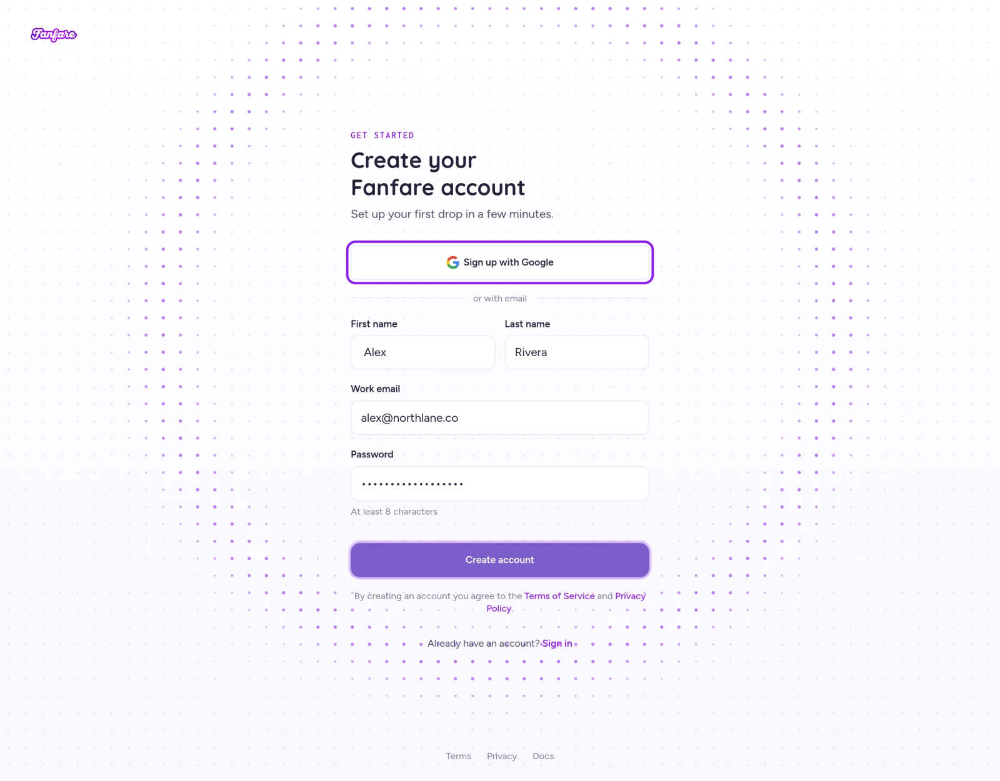
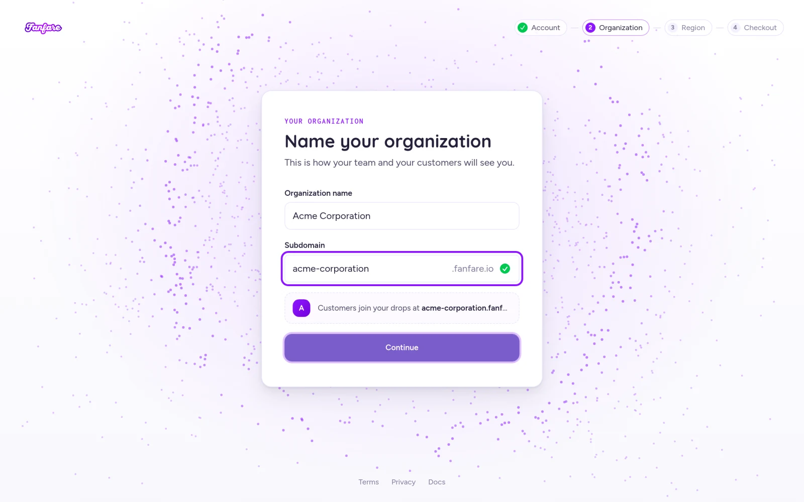
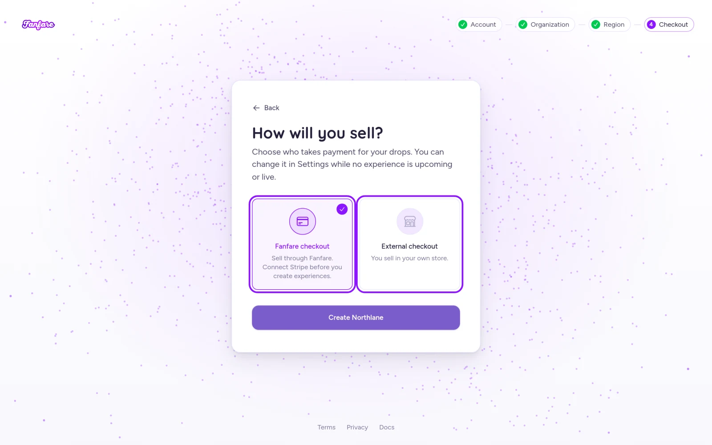

This walkthrough takes you from creating your Fanfare account to launching a drop your customers can enter. Account and organization setup are covered in full here, and each launch step links to its detailed guide.

<Note>
  **Using Shopify?** You don't need to sign up here—installing the Fanfare app from Shopify creates your organization automatically. Follow [Your first drop on Shopify](/guide/start/your-first-drop-on-shopify) instead.
</Note>

## Before you start

- Have a work email address or Google account ready.
- Make sure you're creating a new organization. If a teammate already invited you to theirs, open the link in your invitation email instead—each Fanfare account belongs to one organization. See [Team members](/guide/account/team).

## Step 1: Create your account

1. Go to [admin.fanfare.io](https://admin.fanfare.io) and select **Create an account**.
2. Sign up with either option:
   - **Google:** Select **Sign up with Google** and approve access to go straight to organization setup.
   - **Email:** Enter your **First name**, **Last name**, **Work email**, and a **Password** (at least 8 characters), then select **Create account**.
3. If you signed up with email, enter the 6-digit verification code sent to your inbox. Once verified, you'll be signed in and taken to organization setup.

<Frame caption="Sign up with Google or with your work email and a password.">
  
</Frame>

<Note>
  If self-serve sign-up is temporarily closed, you'll see **Join the Fanfare waitlist** instead. Enter your work email and Fanfare will email you as soon as your invite is ready.
</Note>

## Step 2: Set up your organization

Your organization is your workspace in Fanfare—it holds your team, products, brand, and drops. Setup takes three quick steps:

### Name your organization

1. Enter your **Organization name**.
2. Review your **Subdomain** and edit it to whatever fits your brand best. The line below previews your customer-facing addresses. The subdomain fills in from your organization name the first time only, so recheck it if you rename your organization.
3. Wait for the green checkmark confirming your subdomain is available—or pick one of the suggestions if it's already taken—then select **Continue**.

For full subdomain guidelines and how to update it later, see [Organization settings](/guide/account/organization).

<Frame caption="Wait for the green checkmark beside your subdomain before continuing.">
  
</Frame>

### Confirm your region

Fanfare prefills your **Country**, **Currency**, and **Time Zone** from your browser. These set your default currency and the starting time zone for new experiences. Select **Change** on any row to adjust it, then select **Continue**.

### Choose how you'll sell

Select who handles checkout and payments for your drops:

- **Fanfare checkout:** Customers pay directly through Fanfare using your connected Stripe account. Available for US organizations selling in USD.
- **External checkout:** Customers complete payment in your own store's checkout.

Compare both options in [Checkout options](/concepts/checkout-options).

<Warning>
  Your country and currency lock once you connect a Stripe account, and you can only switch checkout options when no experience is scheduled or live. If you choose **Fanfare checkout**, connect Stripe before creating your first experience. See [Organization settings](/guide/account/organization) and [Payments and fees](/guide/account/payments).
</Warning>

<Frame caption="Choose Fanfare checkout to sell via Stripe, or External checkout to use your own store's checkout.">
  
</Frame>

### Finish setup

Select **Create [your organization name]** to create your workspace and open **Home**.

<Frame>
  
</Frame>

### What you start with

- **A 5-day free trial of Growth** (no credit card required). If you don't add a card before the trial ends, your organization automatically moves to the free Starter plan. See [Billing and usage](/guide/account/billing).
- **Admin permissions** for your organization.
- **Quick Actions on Home** and an optional walkthrough tour to help you get oriented. See [A tour of the admin](/guide/start/tour-of-the-admin).

## Step 3: Build and launch your first drop

With your organization ready, work through these steps in order to take your first drop live:

<Steps>
  <Step title="Connect Stripe (Fanfare checkout only)">
    If you chose **Fanfare checkout**, go to **Settings → Payments** and connect your Stripe account before creating an experience. See [Payments and fees](/guide/account/payments).
  </Step>
  <Step title="Add your email sender address">
    Go to **Settings → Email Sender** and save a business postal address. Fanfare requires a postal address before you can schedule email announcements or send audience invites. See [Sender identity and sending domain](/guide/create/email-sender).
  </Step>
  <Step title="Add a product">
    Open **Products** and select **Create Product** (or use **Create Product** in Quick Actions on **Home**). Before saving, choose your **Stock management** option carefully—it can't be changed after a product is created. See [Manage stock](/guide/create/stock) and [Add products](/guide/create/products).
  </Step>
  <Step title="Create your experience">
    Open **Experiences** and select **Create Experience**. Pick a drop type—a [queue](/guide/create/queue) is the simplest place to start—then select your product, enter an **Experience Name**, and set your **Time Zone**, **Opens At**, and **Closes At** times. **Auction** requires a checkout that can charge the winning bid, and **Appointment** requires Growth or above.

    <Note>
      **Opens At** defaults to the next minute, and there is no separate publish step—queues, draws, auctions, and timed releases open automatically at their scheduled time. Set **Opens At** before finishing so your drop doesn't go live immediately. Appointments accept bookings as soon as your page is live, regardless of **First bookable slot**.
    </Note>

    Work through the remaining wizard steps and select **Create experience**. See [Create an experience](/guide/create/experiences) for details on every type, including [draws](/guide/create/draw), [auctions](/guide/create/auction), [timed releases](/guide/create/timed-release), and [appointments](/guide/create/appointment).
  </Step>
  <Step title="Stage your drop">
    Customize your brand colors and fonts in **Design Studio** ([Set your brand](/guide/create/brand)), then decide where customers will enter:

    - **Hosted page (Growth and above, included in your trial):** Build and publish a page directly in Fanfare, then share the URL from **Live at**. Hosted pages work with Fanfare checkout—if you use **External checkout**, embed the widget on your own site instead so customers can complete checkout. See [Build and publish the hosted page](/guide/create/hosted-page).
    - **Your own site:** Share your embed credentials with your developer to add the Fanfare widget. See [Run it on your own site](/guide/create/your-own-site).

    <Warning>
      If your sequence targets a specific audience, Fanfare turns **Send this invite** on by default and sends it to the whole audience—2 days before opening, or right after you publish if the sequence opens within about 2 days and your postal address is set. Review the **Invite email** card on the sequence's **Access** tab—or turn off **Send this invite**—before you publish. See [Invites, waitlist and access-code sends](/guide/create/invites-and-waitlist).
    </Warning>

    Make sure your drop page is published before any announcement linking to it goes out.
  </Step>
  <Step title="Build hype">
    - **Waitlists:** Every sequence (except appointment-only ones) automatically includes a waitlist where customers can sign up before the drop opens. See [Waitlists](/concepts/waitlists).
    - **Announcements:** Schedule email or social announcements to let customers know when doors open. See [Announcements](/guide/create/announcements).
    - **Audience invites:** If you gated a sequence to a specific audience, Fanfare invites eligible members automatically (on by default). See [Invites, waitlist and access-code sends](/guide/create/invites-and-waitlist).
  </Step>
  <Step title="Run a pre-launch check">
    Preview the customer flow in [What your customers see](/guide/drop/what-customers-see) and walk through the final checklist in [Before doors open](/guide/drop/preflight).
  </Step>
  <Step title="Monitor and manage the live drop">
    Once doors open, follow traffic and sales in real time with [Watch a live drop](/guide/drop/watch-live). If you need to pause a queue or adjust settings mid-drop, see [Change things mid-drop](/guide/drop/live-controls). To end a drop early, see [Stop a drop](/guide/drop/deactivate) (note that **Deactivate** cannot be undone).
  </Step>
  <Step title="Review results and orders">
    After sellout, analyze drop performance in [Read your results](/guide/learn/performance) and manage orders or refunds in [Orders and refunds](/guide/learn/orders).
  </Step>
</Steps>

## On Shopify

If you use Shopify, skip account setup here and follow [Your first drop on Shopify](/guide/start/your-first-drop-on-shopify)—installing the Fanfare app creates your organization automatically.

## Troubleshooting

<AccordionGroup>
  <Accordion title="Selecting Create shows 'Internal server error'">
    Your organization may still have been created. Because each account can create only one organization, avoid retrying from scratch—contact Fanfare support at [support@fanfare.io](mailto:support@fanfare.io) for help getting in.
  </Accordion>
  <Accordion title="Fanfare checkout is disabled during setup">
    Fanfare checkout currently supports US organizations selling in US dollars. Go back to **Region** to check your country and currency, or select **External checkout** to sell through your own store. See [Checkout options](/concepts/checkout-options).
  </Accordion>
  <Accordion title="My preferred subdomain isn't available">
    Another organization may already be using it, or it may be reserved by Fanfare. Pick one of the suggested alternatives or try another name that fits your brand. If a subdomain-taken error appears on the final step, use the back arrow twice to return to Step 1 and pick another subdomain.
  </Accordion>
  <Accordion title="I see 'Join the Fanfare waitlist' instead of the sign-up form">
    Self-serve sign-up is currently paused. Enter your work email to join the waitlist, and Fanfare will email you when your invitation is ready.
  </Accordion>
</AccordionGroup>

## Related

<CardGroup>
  <Card title="A tour of the admin" href="/guide/start/tour-of-the-admin">
    Find your way around Home, the sidebar, and settings.
  </Card>
  <Card title="The model in one page" href="/concepts/overview">
    How experiences, sequences, and distributions fit together.
  </Card>
  <Card title="Create an experience" href="/guide/create/experiences">
    A full walkthrough of the Create Experience wizard.
  </Card>
  <Card title="Plans and what they unlock" href="/guide/start/plans">
    Compare features, monthly pricing, and per-order fees.
  </Card>
</CardGroup>
