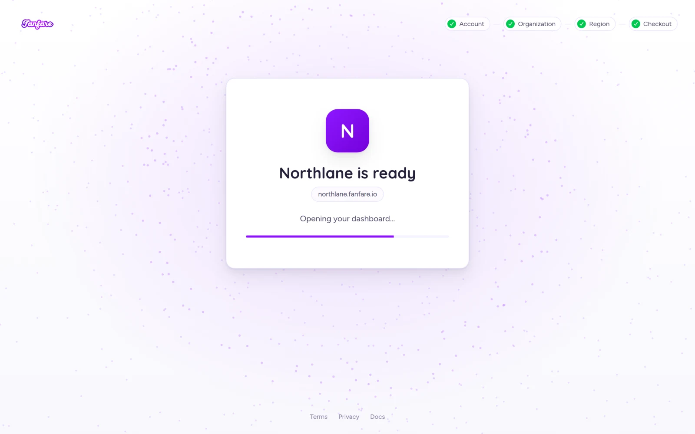

This page takes you from signing up to a drop your customers can enter, in the order the steps depend on each other. Signing up and setting up your organisation are covered in full here. Each later stage gets a few steps and a link to the page with the detail.

## Before you start

- You have a work email address or a Google account.
- You are starting a new organisation. If someone invited you to theirs, open the link in the invitation email instead: you cannot create a second organisation later. See [Team members](/guide/account/team).

## Step 1: Create your account

1. On **Sign in to Fanfare**, under "New to Fanfare?", select **Create an account**. The screen is headed "Create your Fanfare account".
2. Sign up with Google or with your email address:
   - With Google: select **Sign up with Google** and approve on Google's screen. You come back to Fanfare and go straight to organisation setup. Google is not offered when you sign up from an invitation.
   - With email: enter **First name**, **Last name**, **Work email** and a **Password** of at least 8 characters, then select **Create account**.
3. If you signed up with email, Fanfare shows "Verify your email". Type the 6-digit code from the email. It submits on its own when you type the sixth digit, or you can select **Verify and continue**. A wrong code is cleared so you can type it again. After 30 seconds, **Resend code** sends another. The back arrow returns you to the form with what you typed.

Once your email is verified you are signed in and taken to organisation setup.

<Frame caption="Sign up with Google, or with your work email and a password.">
  
</Frame>

<Note>
  If sign-up is closed, the same address shows "Join the Fanfare waitlist" instead of the form. Enter your **Work email** and select **Join the waitlist**. Fanfare emails you when your invitation is ready.
</Note>

## Step 2: Set up your organisation

Your organisation is your company in Fanfare: your team, your products and your drops all belong to it. Setup has three steps: **Organization**, **Region** and **Checkout**. A progress rail shows where you are, starting with **Account**, which is already done.

### Organization

The screen is headed "Name your organization".

1. Enter your **Organization name**.
2. Check the **Subdomain**. The first time you leave the name field, the subdomain fills itself in from the name if it is still empty. It does not change if you edit the name afterwards, so check it again.
3. Wait for the status beside the subdomain. A green tick means you can use it. **Taken**, **Invalid**, **Invalid format**, **Reserved value**, **Too short**, **Too long** or **Required** mean you cannot. When it is taken, pick one of the **Suggestions** below it or try another.
4. Select **Continue** once the subdomain shows a green tick. **Continue** is disabled while the subdomain is taken, reserved or badly formed. For any other problem, selecting it shows what is wrong and keeps you on this step.

The line under the subdomain previews the addresses it gives your organisation: one on fanfare.io and, for your hosted pages, one on fanfaredrops.com. Choose something your customers will recognise. The full subdomain rules, and how to change it later, are in [Organisation settings](/guide/account/organization).

<Frame caption="Wait for the green check beside the subdomain before you continue.">
  
</Frame>

### Region

The screen is headed "Confirm your region". **Country**, **Currency** and **Time Zone** are filled in from your browser. Select **Change** on a row to edit it. Currency follows the country until you pick a currency yourself. These set your default currency and the time zone new experiences start in. Select **Continue**.

### Checkout

The screen is headed "How will you sell?". Choose who takes payment for your drops:

- **Fanfare checkout**: "Sell through Fanfare. Connect Stripe before you create experiences." Customers pay in Fanfare's checkout.
- **External checkout**: "You sell in your own store." Customers pay in your own store's checkout.

Fanfare checkout is selected for you when it is available. It is available only to organisations in the US selling in US dollars. Otherwise its card is disabled with "Fanfare checkout supports US stores selling in USD for now." and External checkout is selected for you. Changing the currency away from USD on the Region step has the same effect. What each choice means for your customers is in [Checkout options](/concepts/checkout-options).

<Warning>
  Country and currency can no longer change once your organisation has a Stripe account, and the checkout choice can change later only while no experience has a window still to open or still running. If you choose Fanfare checkout, connect Stripe before you create an experience. The exact conditions are in [Organisation settings](/guide/account/organization), and connecting Stripe is in [Payments and fees](/guide/account/payments).
</Warning>

<Frame caption="Fanfare checkout is preselected; choose External checkout if you sell in your own store.">
  
</Frame>

### Create the organisation

Select **Create** followed by your organisation's name. Fanfare shows that your organisation is ready, with your subdomain, then "Opening your dashboard…", and opens **Home**.

If the create fails, an error message appears. A problem the form can tie to the name or subdomain field takes you back to the first step. Otherwise you stay on the Checkout step. If the message says the subdomain is already taken, use the back arrow twice to return to the first step and pick another subdomain. If you leave the page part way through, your browser warns you before it discards what you entered.

<Frame>
  
</Frame>

## What you start with

- Your organisation starts on a 5-day trial of Growth, with no card needed. If no card is on file when the trial ends, your organisation moves to Starter: see [Billing and usage](/guide/account/billing).
- You are your organisation's admin.
- The first time you sign in on a browser, Fanfare offers the "Getting started with Fanfare" tour, and while you have no experiences, **Home** shows **Quick Actions** to get you going. See [A tour of the admin](/guide/start/tour-of-the-admin).

## Step 3: Connect Stripe

Only if you chose Fanfare checkout. Open **Settings → Payments** and connect Stripe before you create your experience. See [Payments and fees](/guide/account/payments).

## Step 4: Set your sender details

Open **Settings → Email Sender** and save a postal address. Fanfare will not schedule an email announcement or send an invite without one. See [Sender identity and sending domain](/guide/create/email-sender).

## Step 5: Add a product

Open **Products** and select **Create Product**, or use the **Create Product** quick action on **Home**. The **Stock management** choice you make here can never be changed, so read [Manage stock](/guide/create/stock) first. The full steps are in [Add products](/guide/create/products).

## Step 6: Create the experience

An experience is your drop: the products on offer, when it opens, and how customers get in.

1. Open **Experiences** and select **Create Experience**.
2. Pick a type: [Queue](/guide/create/queue), [Draw](/guide/create/draw), [Auction](/guide/create/auction), [Timed Release](/guide/create/timed-release) or [Appointment](/guide/create/appointment). Auction needs a checkout that charges the winning bid, such as Fanfare checkout, and Appointment needs Growth or above. For a first drop, start with a queue.
3. Pick your product and enter an **Experience Name**.
4. Set **Time Zone**, then **Opens At** and **Closes At**. For Appointment the first field is **First bookable slot**: customers can book as soon as the page is live, not from that time. See [Set up appointments](/guide/create/appointment).
5. Work through the remaining steps and select **Create experience**.

<Note>
  **Opens At** starts at the next minute. Set it before you finish, or the drop opens almost at once. See [Create an experience](/guide/create/experiences).
</Note>

There is no separate publish step: a queue, draw, auction or timed release opens at its opening time. An appointment takes bookings as soon as the page is live. See [Experiences](/concepts/experiences).

## Step 7: Stage it

1. Set your brand in **Design Studio**. See [Set your brand](/guide/create/brand).
2. Choose where customers enter:
   - A hosted page: build and publish the experience's page, then copy its address from **Live at**. See [Build and publish the hosted page](/guide/create/hosted-page). A hosted page cannot hand customers to your own store's checkout: on External checkout, customers let in there see no checkout button, so use your own site.

     <Info>Available on Growth and above.</Info>

     During your trial you are on Growth.
   - Your own site: hand your developer the widget. See [Run it on your own site](/guide/create/your-own-site).

<Warning>
  If a sequence has an audience, publishing the page can send its invite: Fanfare turns the invite email on for you, and it waits only for a published page and your postal address. If the sequence opens within about 2 days, it can reach the whole audience minutes after you publish. Check the **Invite email** card on the sequence's **Access** tab first, or turn off **Send this invite**. See [Invites, waitlist and access-code sends](/guide/create/invites-and-waitlist).
</Warning>

Publish the page before any announcement that links to it goes out.

## Step 8: Tell customers

- A sequence is one way in to an experience, and every sequence has a waitlist, except one that runs only appointments. It takes sign-ups while a window is still to come, and not while a window is open. See [Waitlists](/concepts/waitlists).
- Schedule an announcement. See [Announcements](/guide/create/announcements).
- If a sequence has an audience, Fanfare invites its members on its own: see the warning in Step 7, and [Invites, waitlist and access-code sends](/guide/create/invites-and-waitlist).

## Step 9: Before doors open

Check what your customers will see at each stage in [What your customers see](/guide/drop/what-customers-see), then run through [Before doors open](/guide/drop/preflight).

## Step 10: Watch it

- Follow the drop as it happens: [Watch a live drop](/guide/drop/watch-live).
- To change things mid-drop, see [Change things mid-drop](/guide/drop/live-controls).
- To stop a drop, see [Stop a drop](/guide/drop/deactivate). **Deactivate** cannot be undone.

## Step 11: After the drop

Read how it went in [Read your results](/guide/learn/performance), and handle orders and refunds in [Orders and refunds](/guide/learn/orders).

## On Shopify

None of the sign-up or organisation setup on this page applies. You install the Fanfare app from Shopify, Fanfare creates your organisation for you, and you approve a plan on Shopify's plan page. Follow [Your first drop on Shopify](/guide/start/your-first-drop-on-shopify).

## Troubleshooting

<AccordionGroup>
  <Accordion title="Selecting Create shows Internal server error">
    Your organisation may have been created anyway. Do not try to set it up again, because each person can create only one organisation. Contact Fanfare support at support@fanfare.io.
  </Accordion>
  <Accordion title="The Fanfare checkout card is greyed out">
    Fanfare checkout is available only to organisations in the US selling in US dollars. Go back and check **Region**, or continue with External checkout. See [Checkout options](/concepts/checkout-options).
  </Accordion>
  <Accordion title="The subdomain shows Taken or Reserved value">
    Another organisation uses it, or it is a word Fanfare keeps for itself. If it is taken, pick one of the **Suggestions** shown below it. If it is reserved, try another name.
  </Accordion>
  <Accordion title="I see Join the Fanfare waitlist instead of the sign-up form">
    Sign-up is closed for now. Enter your **Work email** and select **Join the waitlist**. Fanfare emails you when your invitation is ready.
  </Accordion>
</AccordionGroup>

## Related

<CardGroup>
  <Card title="A tour of the admin" href="/guide/start/tour-of-the-admin">Home, the sidebar and where things live.</Card>
  <Card title="How Fanfare works" href="/concepts/overview">Experiences, sequences and distributions in one page.</Card>
  <Card title="Create an experience" href="/guide/create/experiences">The wizard step by step.</Card>
  <Card title="Plans and what they unlock" href="/guide/start/plans">What each plan lets you create.</Card>
</CardGroup>
